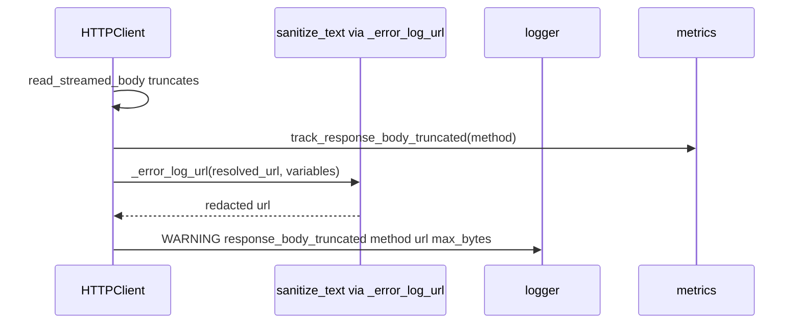

# PYPOST-1122: Architecture — redact URLs in response_body_truncated WARNING logs

## Research

- PYPOST-741 added `HTTPClient._error_log_url(url, variables)` which wraps
  `sanitize_text(url, env_vars=...)` and is used on all four ERROR failure paths.
- Truncation path in `send_request` still logs the raw resolved `url` at WARNING:

  ```text
  response_body_truncated method=%s url=%s max_bytes=%d
  ```

- Existing unit coverage: `TestHTTPClientResponseBodyCap` exercises truncation + metric;
  `TestHTTPClientErrorLogging` asserts ERROR redaction patterns (`token=***`, secret absent).
- `doc/dev/logging.md` catalogs `response_body_truncated` with fields `method`, `url`,
  `max_bytes`. GitLab/GitHub MCP collection docs list PYPOST-1122 as an open follow-up for
  this exact log site.
- No new dependency: reuse `_error_log_url` so WARNING and ERROR share one sanitizer path.

## Implementation Plan

1. Add a failing unit test on `TestHTTPClientResponseBodyCap` that forces body truncation with
   a URL containing an environment-resolved query secret and asserts the WARNING log redacts
   the secret (same assertions style as ERROR logging tests).
2. Change the truncation WARNING to pass `self._error_log_url(url, variables)` instead of raw
   `url`.
3. Keep event name, field set (`method`, `url`, `max_bytes`), and metric
   `track_response_body_truncated` unchanged.
4. Update `doc/dev/logging.md` (and MCP collection follow-up notes) to state WARNING URLs are
   sanitized like ERROR URLs.

**Failing Repro (Step 3):**

| Item | Detail |
| --- | --- |
| Test | `tests/test_http_client.py::TestHTTPClientResponseBodyCap::test_truncation_warning_logs_redacted_resolved_url` |
| Assert | WARNING contains `response_body_truncated`, host retained, secret value absent, `token=***` |
| Force | Mock session returns oversized chunks; `max_response_bytes=10`; variables with `token` |
| Deps | No live network — mocked `session.request` |
| Sequencing | Write red test → confirm fail on secret presence → fix → green |

## Architecture



| Component | Change |
| --- | --- |
| `HTTPClient.send_request` truncation branch | Log `_error_log_url(url, variables)` |
| `TestHTTPClientResponseBodyCap` | New redaction assertion test |
| Docs | Note WARNING URL sanitization; mark PYPOST-1122 resolved in collection follow-ups |

### Non-goals

- No `hidden_keys` threading into `HTTPClient`.
- No changes to `sse_stream_detected` / retry URL logs (PYPOST-1333).
- No metric or message-prefix renames.

## Q&A

- **Q:** Rename `_error_log_url` since WARNING will use it?
  **A:** Out of scope for 1 SP. Helper name stays; behavior is "log-safe URL". Rename can be
  separate debt if desired.
