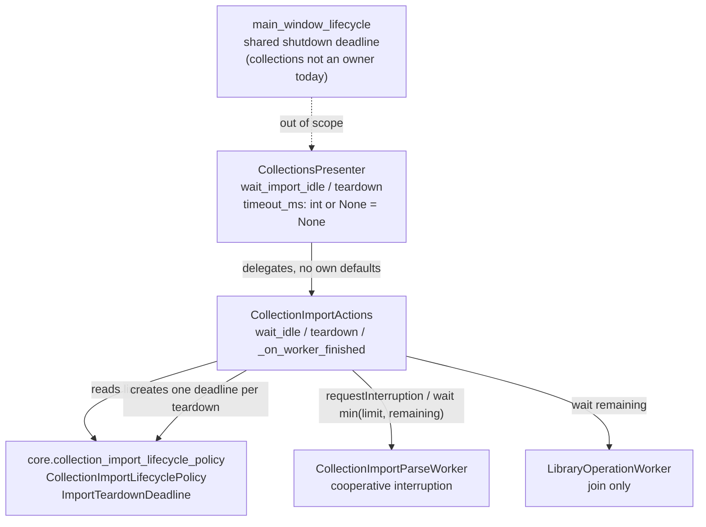

# PYPOST-1264: Consolidate collection import teardown policy

## Research

### Current code facts (verified)

- `pypost/ui/presenters/collection_import_actions.py`
  - `:70` `_WORKER_FINISH_WAIT_MS = 100`: join after `QThread.finished` (PYPOST-829 H3), used in
    `_on_worker_finished` (`:537`). The value is named but local to the module and has no link
    to the teardown values.
  - `:120` `wait_idle(timeout_ms: int = 5000)`: pumps `processEvents()` until `is_busy()` is
    false. It checks `QElapsedTimer` between iterations. With no `QApplication`, it falls back
    to `self._worker.wait(10)` (`:139`), which is another bare literal.
  - `:148` `teardown(timeout_ms: int = 5000)`: three phases run one after another, and each
    gets its own budget:
    1. `wait_idle(timeout_ms)` (`:161`) can use the **full** budget.
    2. A final file-worker join after disconnection, `worker.wait(100)` (`:188`), is a bare
       literal that runs even when the budget is exhausted.
    3. A library-worker join, `library_worker.wait(timeout_ms)` (`:200`), gets the **full**
       budget again.
    - Worst case ≈ `2 × timeout_ms + 100 ms`. This breaks the caller budget (DoD 3).
  - Both workers can be alive at the same time: `_start_library_operation` (`:335-343`) and
    `_start_parse` (`:479-487`) set separate fields (`_worker` and `_library_worker`).
  - Library import sets `PREPARING` (`:265`), so `is_busy()`, and with it phase 1, also covers
    library work. `LibraryOperationWorker` has no cooperative interruption hook, so teardown can
    only wait for it.
- `pypost/ui/presenters/collections_presenter.py:382/386`: `wait_import_idle` and `teardown`
  repeat the 5000 ms default and delegate to the import actions.
- `pypost/ui/main_window_lifecycle.py:111-125`: gives each owner `min(allocated, remaining)`
  of one shared monotonic deadline. **Observation:** `CollectionsPresenter` is not in that
  owner list (`:67-76`). Its `teardown()` is called today only from tests and fixtures. Adding
  it to application shutdown is out of scope (requirements: application-wide allocation is out
  of scope). It is recorded below as a risk and follow-up candidate.
- Repository precedents:
  - The `pypost/core/*_policy.py` modules (for example `websocket_session_policy.py` with
    frozen `HeartbeatConfig` / `ReconnectConfig` dataclasses) set the pattern of a Qt-free,
    immutable, named policy object.
  - `EnvironmentStorageGateway.teardown` (`pypost/core/qt/environment_storage_gateway.py:203`)
    sets the pattern `timeout_ms: int | None = None → budget`, one `deadline = started +
    budget`, and child waits get `max(0, deadline - now)`.

### External research

- Qt 6 `QThread::wait(unsigned long ms)` / `wait(QDeadlineTimer)` returns `false` when the
  deadline passes while the thread is still running. It returns `true` if the thread has
  finished or never started. A timed-out wait does not stop the thread. Interruption stays
  cooperative (`requestInterruption()`), which matches the "no forcible termination" NFR.
  Sources: [QThread Class (Qt 6)](https://doc.qt.io/qt-6/qthread.html),
  [PySide6 QThread](https://doc.qt.io/qtforpython-6.8/PySide6/QtCore/QThread.html),
  [QDeadlineTimer (Qt 6)](https://doc.qt.io/qt-6/qdeadlinetimer.html).
- `wait(0)` returns at once. This means a "remaining = 0" join is a non-blocking liveness
  probe, which is how an exhausted budget gives a prompt unclean result (DoD 3).
- `QDeadlineTimer` would work as the deadline carrier. **Rejected** in favour of a Qt-free
  monotonic helper with an injectable clock: the helper can be unit-tested deterministically
  without a Qt event loop, and it follows the gateway's `time.monotonic()` precedent.

## Implementation Plan

1. **Policy module (new, Qt-free)**: `pypost/core/collection_import_lifecycle_policy.py`
   holds `CollectionImportLifecyclePolicy`, a frozen dataclass, the
   `DEFAULT_COLLECTION_IMPORT_LIFECYCLE_POLICY` instance, and the `ImportTeardownDeadline`
   helper.
2. **Wire actions**: `CollectionImportActions` takes two optional keyword-only constructor
   arguments: `lifecycle_policy` (default: the module instance) and `clock` (default:
   `time.monotonic`; the test seam, see below). Every bare literal and the
   `_WORKER_FINISH_WAIT_MS` constant are replaced by policy fields. `teardown()` and
   `wait_idle()` create their deadline with `ImportTeardownDeadline.start(budget,
   clock=self._clock)`, and the `wait_idle` loop checks `deadline.expired` instead of a
   private `QElapsedTimer`, so the injected clock governs every budget decision.
3. **Wire presenter**: the `CollectionsPresenter.wait_import_idle` / `teardown` defaults
   become `None` and delegate to the actions, so there is one source of defaults. The presenter
   does not duplicate any value.
4. **Latency measurement**: add a measurement test module for the DoD 5 scenarios, marked
   `pytest.mark.slow` (excluded from `make test`), and run it explicitly through
   `make test-slow PYTEST_ARGS=...` (see "Latency measurement approach"). Record the results
   and the configurability decision in `doc/dev/collection_import.md`.
5. **Tests**: add deterministic unit tests for policy and deadline arithmetic, fake-clock
   teardown tests for the DoD 3 wait arithmetic, Qt integration tests for the DoD 7
   behaviours, and keep the existing teardown and caplog tests green.

**Test seam for DoD 3 (clock injection)**: today only `ImportTeardownDeadline` would take a
clock, and the actions could not reach it. The seam is the keyword-only constructor argument
`CollectionImportActions(..., clock: Callable[[], float] | None = None)`, which defaults to
`time.monotonic` and is passed to every `ImportTeardownDeadline.start(...)` the actions create.
It is a constructor keyword, not a policy field, because the policy is a frozen,
comparable configuration value, while a clock is infrastructure that only tests replace.
It is internal (not user-visible), like `lifecycle_policy`.

**Mandatory — Failing Repro (next Step 3):**

`make test` runs the suite through `scripts/run_parallel_tests.py` with
`WORKERS = min(cpu + 2, 16)`, so it is deliberately oversubscribed. PYPOST-1263 just fixed a
test that flaked on a fixed wall-clock threshold under that load. The primary DoD 3 proof is
therefore **deterministic**: it asserts the wait arguments, not wall time.

- **Location**: `tests/test_collection_import_teardown_budget_repro.py`, with
  `pytestmark = pytest.mark.timeout(30)`, using the existing `qapp` fixture.
- **Spy workers (no real threads)**: test-local stand-ins assigned to the private
  `_worker` / `_library_worker` fields, with the state left `IDLE` so P1 is skipped and the
  test exercises P2 and P3 directly. Each spy:
  - reports `isRunning() -> True` and records `requestInterruption()` / `deleteLater()`;
  - exposes signal attributes whose `disconnect(...)` is a no-op (teardown already tolerates
    `RuntimeError` / `TypeError`);
  - records every `wait(ms)` argument, simulates a join that times out, and returns its
    configured result (`False` here, with `isRunning()` staying `True`). How the spy lets
    time pass depends on the test: in test A it **really sleeps** `ms / 1000` s
    (`time.sleep`, bounded because every budget is ≤ 300 ms); in test B it advances the fake
    clock by `ms` and records the fake time at the call.
- **Fake clock (test B only)**: a test-local `FakeClock` with `__call__() -> float` (seconds)
  and `advance(ms)`. It moves only when a spy waits, so all expected values are exact.
- **Primary red test A (behavioural red by assertion; real-sleep spies)**: actions built
  **without** the new keywords (so after Step 4 they use the default `time.monotonic` clock),
  with spies whose `wait(ms)` really blocks for `ms` (see above). For `B in (300, 50, 0)`,
  assert:
  - the sum of all **requested** wait arguments is `<= B`;
  - the P2 (file worker) wait argument is `<= final_join_ms` (literal `100` in Step 3);
  - for `B = 0`: every recorded wait argument is `0` and `clean is False`.
  - **Red today, by assertion (not by error)**: current P2 is a fixed `wait(100)` and P3 is
    the full `wait(timeout_ms)`, independent of elapsed time. `B=300` → 100 + 300 = 400 > 300;
    `B=50` → 100 + 50 = 150 > 50; `B=0` → `wait(100)` (non-zero, and 100 > 0). The actions
    are built with today's constructor signature, so no `TypeError` can occur.
  - **Green after Step 4**: P2 = `min(100, remaining)`; the spy then really sleeps that long,
    so at P3 `remaining <= B - P2` (real elapsed time ≥ the requested sleep, and the deadline
    reads the same monotonic clock). Hence P2 + P3 `<= B`: `B=300` → 100 + ≤ 200;
    `B=50` → ≤ 50 + 0; `B=0` → `wait(0)` + `wait(0)`, unclean. With the real clock some
    time passes before P2, so truncation typically gives P2 = 49 at `B=50` (and P3 ≤ 199
    at `B=300`); test A therefore asserts only `<=`. The exact values (`50 + 0`,
    `100 + 200`) hold only in test B, where the fake clock moves solely inside spy waits.
    This requires
    `remaining_ms()` to truncate (never round up), which the deadline contract states.
  - **Load-safe**: the test asserts no upper wall-time bound, only requested-wait
    arithmetic. Extra scheduler delay under the oversubscribed `make test` runner only
    increases real elapsed time, which makes `remaining` (and therefore P3) smaller, so load
    can only make the inequality safer. Worst-case runtime is about 0.4 + 0.15 + 0.1 s of
    sleeps on current code, well inside the module's `pytest.mark.timeout(30)`.
  - **Rejected alternative**: non-sleeping spies with load-proof asserts only (P2 ≤ 100,
    each P3 ≤ B). Rejected because P2 ≤ 100 and P3 ≤ B both already pass on current code,
    so the red would remain only at `B = 0`; the sum ≤ B assert needs real elapsed time to be
    true after the fix.
- **Primary red test B (seam / exact-arithmetic test, fake clock)**: actions built with
  `clock=fake_clock`; spies advance the fake clock. For `B in (300, 50, 0)`, assert:
  - P2 wait arg `== min(final_join_ms, remaining)` where `remaining = B - elapsed` at the
    call (`300 → 100`, `50 → 50`, `0 → 0`);
  - P3 wait arg `== remaining` at its call (`300 → 200`, `50 → 0`, `0 → 0`);
  - sum of waits `<= B`;
  - exhausted budget (`B = 0`, and P3 of `B = 50`) issues `wait(0)` calls and `clean is False`.
  - Seam / exact-arithmetic test: its `TypeError` red (missing `clock=` keyword) is accepted
    because the behavioural red is carried by test A by assertion; the Step 3 reviewer must
    confirm test A fails on assertions, not errors. Test B turns green in Step 4 once the seam
    and shared deadline exist.
- **Loose real-thread regression guard (one test, not the primary proof)**:
  - Fake `read_import_file` blocks on a test-owned `threading.Event` without honouring
    cancellation (a reader stuck in I/O); a library `op` blocks on a second `Event`. Both
    workers start through the private `_start_parse(path)` and
    `_start_library_operation(op, on_completed)` (the suite already calls `_start_parse`).
  - `B = 300`: assert `clean is False` and `elapsed_ms < 2 * B` (`< 600 ms`). Old code takes
    ≈ `2B + 100` = 700 ms and fails; new code takes ≈ `B`, which leaves a ~300 ms margin for
    an oversubscribed runner.
  - `B = 0`: assert `clean is False` and a loose `elapsed_ms < 100` (old code: ≥ 100 ms from
    the unconditional `wait(100)`). No 50 ms bound.
  - **Cleanup**: in `finally`, set both events and join each worker with a bounded
    `wait(2000)` so no thread leaks.
- In Step 3, `final_join_ms` is the local test constant `100`. Step 4 switches it to the
  policy field. `budget_tolerance_ms` is **not** used by any Step 3 assertion.
- **Sequencing**: research (this step) → red repro (Step 3, no production change) → policy
  and shared deadline (Step 4) until green → measurement and decision record (Step 4 / 8).

## Architecture

### Module diagram



Dependency direction: `ui.presenters` → `core` (Qt-free policy). The policy imports nothing
from Qt or UI.

### Policy module: `pypost/core/collection_import_lifecycle_policy.py`

Shape (high level, final names may change in Step 4):

```python
@dataclass(frozen=True)
class CollectionImportLifecyclePolicy:
    teardown_budget_ms: int = 5000      # overall default caller budget
    final_join_ms: int = 100            # join after signal disconnection in teardown
    worker_finish_join_ms: int = 100    # join after normal QThread.finished (GUI thread)
    idle_poll_ms: int = 10              # no-QApplication wait_idle poll slice
    budget_tolerance_ms: int = 50       # documented overrun bound for teardown (contract)

    def resolve_budget_ms(self, timeout_ms: int | None) -> int: ...  # None→default, <0→0

DEFAULT_COLLECTION_IMPORT_LIFECYCLE_POLICY = CollectionImportLifecyclePolicy()

class ImportTeardownDeadline:
    """One monotonic deadline that the sequential teardown phases share."""
    @classmethod
    def start(cls, budget_ms: int, clock: Callable[[], float] = time.monotonic) -> ...
    def remaining_ms(self) -> int: ...          # max(0, …), truncated, never negative
    def bounded(self, limit_ms: int) -> int: ... # min(limit_ms, remaining_ms())
    def elapsed_ms(self) -> int: ...
    @property
    def expired(self) -> bool: ...
```

Construction validates the fields: all must be non-negative integers, and the joins must not
exceed the budget. An invalid value raises `ValueError`.

### Named budgets and rationale

| Field | Value | Purpose | Rationale |
| --- | --- | --- | --- |
| `teardown_budget_ms` | 5000 | Default overall budget for `wait_idle` / `teardown` when the caller passes none | Inherited value. It matches the main-window shutdown default (`main_window_lifecycle.py:166`) and the gateway default. It is long enough for a cooperative parse cancel and short enough that shutdown stays bounded. Kept unless measurement says otherwise. |
| `final_join_ms` | 100 | Upper bound for the file-worker join after its signals are disconnected | Gives native `QThread` exit a short grace period after interruption. It is now **capped by the remaining budget**, so it can never extend the budget. |
| `worker_finish_join_ms` | 100 | Join after normal `finished` (PYPOST-829 H3) | Runs on the GUI thread, so it must stay small. Outside teardown no caller budget exists. It is **not** capped by the teardown deadline even when the slot runs nested inside teardown P1's `processEvents()`: the slot is queued from `QThread.finished`, which is emitted at the very end of `run()`, so the join normally returns at once. See Risk 3. |
| `idle_poll_ms` | 10 | Poll slice for `wait_idle` with no `QApplication` | Already present as a bare literal. Named so DoD 1 holds. Capped by the remaining budget. |
| `budget_tolerance_ms` | **50** | **Documented DoD 3 contract value**: the allowed overrun of total teardown wall time beyond the caller budget on an unloaded machine | It is not a wait and **not a CI timing gate**. It covers work done outside the waits: one in-flight `processEvents()` iteration that started just before the deadline, the closing `processEvents()`, signal disconnects, `deleteLater`, logging, and ms rounding of `QThread.wait`. 50 ms is far below the 100 ms final join and the 2× budget overrun it replaces. It is evidenced by the slow latency measurement, not asserted in `make test`. |

**DoD 3 pass/fail threshold** (two layers):

1. **Deterministic, asserted in `make test`**: for any `timeout_ms = B ≥ 0`, the sum of all
   wait arguments issued by teardown is `<= B`; the P2 join is `min(final_join_ms,
   remaining)`; the P3 join is `remaining`; an exhausted budget issues only `wait(0)` probes
   and returns unclean. This is proved with the injected fake clock and spy workers, so it
   does not depend on machine load.
2. **Documented contract, measured not gated**: the wall time of `teardown(B)` is at most
   `B + budget_tolerance_ms` (`B + 50 ms`) on an unloaded machine. The slow latency module
   records it as evidence. The only real-thread wall-time assert in the fast suite is the
   loose guard `elapsed < 2B` (and `< 100 ms` for `B = 0`), which still fails the old
   ≈ `2B + 100 ms` behaviour.

### Shared-deadline teardown (sequential phases)

```text
teardown(timeout_ms=None):
  budget   = policy.resolve_budget_ms(timeout_ms)
  deadline = ImportTeardownDeadline.start(budget, clock=self._clock)
  log collection_import_teardown_started timeout_ms=<budget>
  P0  if busy and file worker running: requestInterruption()           (no wait)
  P1  if busy: clean = _wait_idle_until(deadline)                       (≤ remaining)
  P2  file worker: disconnect signals; if still running:
        requestInterruption(); ok = worker.wait(deadline.bounded(policy.final_join_ms))
        not ok → clean = False (existing interrupt_timeout log); deleteLater; clear field
  P3  library worker: if running: ok = wait(deadline.remaining_ms())   (0 → probe)
        not ok → clean = False (existing timeout log); disconnect; deleteLater; clear field
  P4  set IDLE; one processEvents(); log collection_import_teardown_completed clean=<clean>
```

- Public `wait_idle(timeout_ms=None)` resolves the budget, starts its own deadline, and calls
  the same private `_wait_idle_until(deadline)`. Its logs (`_started`, `_timeout
  elapsed_ms`, `_completed elapsed_ms`) do not change.
- Inside the loop the elapsed check uses `deadline.expired`. The no-app fallback waits
  `deadline.bounded(policy.idle_poll_ms)`.
- **Ordering is kept**: interrupt → wait-idle → disconnect/join/reap the file worker →
  join/disconnect/reap the library worker. Only the amounts change.
- **Wait share**: the phases run one after another against one deadline, so the sum of all
  waits is at most the budget by construction. P2's join is the smaller of its policy limit
  and what is left. P3 gets whatever is left. P1 does not reserve time for later phases: a
  worker that is still alive after P1 has already used up the caller's budget, so the correct
  outcome is unclean.

### Interfaces and call sites affected

| Call site | Change |
| --- | --- |
| `CollectionImportActions.__init__` | New keyword-only `lifecycle_policy: CollectionImportLifecyclePolicy \| None = None` (internal dependency injection for tests and future configuration; not user-visible) and keyword-only `clock: Callable[[], float] \| None = None` (default `time.monotonic`; DoD 3 test seam passed to every `ImportTeardownDeadline.start`) |
| `CollectionImportActions.wait_idle(timeout_ms: int \| None = None) -> bool` | Default resolved from the policy; uses the deadline helper |
| `CollectionImportActions.teardown(timeout_ms: int \| None = None) -> bool` | One shared deadline; literals removed |
| `CollectionImportActions._on_worker_finished` | `policy.worker_finish_join_ms` replaces `_WORKER_FINISH_WAIT_MS` (constant removed; no test references it) |
| `CollectionsPresenter.wait_import_idle / teardown(timeout_ms: int \| None = None)` | No local 5000; delegates `None`. Presenter log `collections_presenter_teardown_started timeout_ms=%d` logs the **resolved** budget, read from the actions' policy |
| `doc/dev/collection_import.md` | Signatures, a policy table, the tolerance, measurements, and the decision record |

The return type stays `bool`. Moving to `TeardownResult` is out of scope. Existing callers that
pass an explicit `timeout_ms` keep working unchanged.

### Preservation of existing behaviour (DoD 4)

- **Clean or unclean result**: same semantics: clean only when every live worker stopped within
  the budget. Idle teardown skips P0 to P3 (nothing is busy and both workers are `None`), so it
  does no waiting.
- **Cooperative only**: teardown keeps using only `requestInterruption()` and `wait()`, and
  never calls `terminate()`. The library worker can only be waited for, as today.
- **No UI delivery after teardown**: signals are still disconnected before `deleteLater`, and
  the state is forced to IDLE. The policy changes how long the waits last, not the order of
  disconnection.
- **Logs**: all existing event names and fields are kept (`collection_import_teardown_started
  timeout_ms=`, `_wait_idle_timeout`, `_worker_interrupting`, `_worker_interrupt_timeout`,
  `_worker_interrupted`, `_worker_reaped`, `collection_library_import_worker_timeout`,
  `_teardown_completed clean=`, `_worker_finish_wait_timeout wait_ms=`). Step 6 may append
  fields such as `elapsed_ms` / `budget_ms` but does not rename any. No collection content
  is logged.
- **Idempotency**: a second `teardown()` finds no busy state and no worker fields, so it is
  clean and immediate, as today.

### Latency measurement approach (DoD 5)

- **Module**: `tests/test_collection_import_teardown_latency.py`, with
  `pytestmark = [pytest.mark.slow, pytest.mark.timeout(120)]`. The default `make test`
  selection `-m "not slow"` excludes it, so its timings never run under the oversubscribed
  parallel runner.
- **How evidence is produced**: run it explicitly with the existing Makefile target
  `make test-slow PYTEST_ARGS="tests/test_collection_import_teardown_latency.py -m slow -s"`.
  `test-slow` calls `python -m pytest` directly (no `scripts/run_parallel_tests.py`), so the
  run is effectively `WORKERS=1`. The recorded run notes the worker count (1) and the machine
  load (`os.getloadavg()` printed by the module before and after the run). Do not run the
  measurement through `make test`.
- **Scenarios**: N = 20 repetitions each, timed with `time.perf_counter()` around
  `teardown()` with the default policy budget.
  1. **Idle**: no import is running.
  2. **Active file import cancelled**: a cancellation-aware fake reader loops over checkpoints
     (as a real reader does, PYPOST-1266) until interrupted.
  3. **Active library operation**: an operation that sleeps a fixed short time (200 ms) and
     returns; teardown must join it within budget.
  - A fourth reference run shows the bounded unclean path for a library operation that blocks
    longer than a reduced budget.
- **Recorded data**: per scenario, n, min, median, p95, max (ms), and the clean result.
  Environment: OS and kernel, CPU architecture, Python, PySide6/Qt versions,
  `QT_QPA_PLATFORM=offscreen`, worker count (1 via `test-slow`), and load average. The test
  emits one summary log line per scenario (`collection_import_teardown_latency scenario=…
  n=… p50_ms=… p95_ms=… max_ms=…`).
- **What may fail**: only structural asserts: each of scenarios 1 to 3 has `n == 20` and
  every run is `clean is True`; the reference scenario 4 is `clean is False`. The p95,
  max, and `budget + tolerance` figures are **recorded decision inputs, not assertions**.
- **Decision rule (fixed before measuring)**:
  - Keep the limits as **fixed policy values** if all of these hold: idle p95 ≤ 5 ms;
    file-cancel p95 ≤ 25 % of `teardown_budget_ms`; every run of scenarios 1 to 3 is clean
    and within `budget + tolerance`.
  - Make a specific limit **configurable** only if a measured scenario breaks these rules in a
    way a different value would fix, or if a production caller needs a different default.
    Even then, configuration goes through the injected policy. A user-visible setting is
    added only if the decision says so explicitly.
- **Where the decision is recorded**: a "Teardown lifecycle policy" section in
  `doc/dev/collection_import.md` (Step 8 owns its final wording, Step 4 adds the data). It
  contains the measurements table, the environment, the outcome (fixed or configurable), and
  the reasons. The roadmap Step 4 sub-items point to it.

### Test strategy (DoD 7)

- **Deterministic unit tests (Qt-free)**: `tests/test_collection_import_lifecycle_policy.py`
  checks:
  - the default values are 5000/100/100/10/50;
  - `resolve_budget_ms` handles None, negative, and 0;
  - frozen behaviour and `ValueError` validation;
  - `ImportTeardownDeadline` with a fake clock: `remaining_ms` is never negative, `bounded`
    returns the smaller value, and `expired` is correct.
  - These tests do no real waiting.
- **Deterministic teardown arithmetic (primary DoD 3 proof)**: the Step 3 spy-worker tests
  (test A: real-sleep spies, requested-wait arithmetic; test B: fake clock, exact values; P2 = `min(final_join_ms, remaining)`, P3 = `remaining`, sum ≤ budget,
  exhausted → `wait(0)` and unclean). Step 4 adds one fake-clock case with `PARSING` state
  where the fake clock passes the deadline during P1, asserting P1 returns unclean and P2/P3
  receive `wait(0)`.
- **Qt integration tests** (`qapp`, `timeout(30)`, events with bounded `wait`):
  - clean idle teardown: asserts `clean is True` and that no worker wait is issued; **no**
    wall-time assert against `budget_tolerance_ms`;
  - clean teardown of an interruptible active parse;
  - unclean teardown with a reader that blocks on an event and a short budget (for example
    100 ms);
  - one loose real-thread caller-budget guard (the Step 3 guard, file and library workers
    both blocked): `elapsed < 2B` for `B = 300`, and `clean is False` with `elapsed < 100 ms`
    for `B = 0`;
  - presenter delegation: a presenter with no argument uses the policy default (asserted
    through the resolved-budget log, without waiting 5 s);
  - idempotent second teardown;
  - no UI callbacks after teardown, using a spy on the status, refresh, and dialog hooks.
- **Thread hygiene**: every test releases its blocking events in `finally` and joins with a
  bounded wait. The structural assertions depend on events, not sleeps. `budget_tolerance_ms`
  is a documented contract value and is never used as a wall-time gate in `make test`; the
  only wall-time asserts are the loose `< 2B` / `< 100 ms` guard, with budgets of 300 ms or
  less so the suite stays fast.
- **Regression**: the existing `tests/test_collection_import_teardown_repro.py`,
  `tests/test_collection_import_cancellation_repro.py`,
  `tests/test_collections_import_ui_repro.py`, and the async-gaps tests stay green, because the
  log substrings are unchanged.

### Patterns and justification

- **Policy object (immutable value object)**: one named place for the limits, matching the
  `*_policy.py` precedent. Frozen, so no one can change it at runtime by accident.
- **Dependency injection** (constructor keyword): tests and future configuration can supply a
  different policy without monkeypatching module constants.
- **Shared deadline (single monotonic budget)**: the same model the gateway and main-window
  lifecycle already use, so budgets compose across layers.

### Risks

1. **Tighter final join may report unclean where it was clean before**: when P1 uses almost
   all of a small budget, the worker's native exit can take longer than what is left.
   Mitigation: this is the correct DoD 3 outcome. Cleanup (`deleteLater`, disconnect) still
   happens, and Step 4 tests cover it.
2. **Timing flakiness on loaded CI** (`make test` is oversubscribed; see PYPOST-1263):
   mitigated by making the primary DoD 3 proof deterministic (fake clock, spy workers), keeping
   one real-thread guard with a wide margin (`< 2B` against old ≈ `2B + 100`), moving the
   latency measurement to `pytest.mark.slow` with no timing asserts, and `pytest-timeout`.
   The tolerance is documented as not hard real-time (requirements constraint).
3. **A GUI-thread slot in `processEvents()` can overrun the deadline**: wait checks run only
   between iterations, so a long queued slot such as an apply could exceed the tolerance.
   Today teardown only reaches this during PREPARING or PARSING, and APPLYING is not rolled
   back. Recorded, with no change to the pump model.
   - **Nested `_on_worker_finished` join**: the slot can run inside P1's `processEvents()` and
     calls `wait(worker_finish_join_ms)` uncapped by the teardown deadline. **Decision: keep
     it uncapped and accept it within tolerance.** The slot is delivered from
     `QThread.finished`, which is emitted after `run()` returns, so native exit is already
     in progress and the join normally returns in well under 1 ms. Capping it with the
     teardown deadline would turn that join into `wait(0)` probes once the budget is spent,
     and the slot then clears `_worker` and calls `deleteLater()` on a thread that may still
     be exiting, which risks "QThread destroyed while running" for no real budget gain.
     The pathological case (native exit stalls) is bounded by `worker_finish_join_ms`
     (100 ms) and stays visible through the existing
     `collection_import_worker_finish_wait_timeout wait_ms=` warning.
4. **The library worker cannot be interrupted**: a stuck library operation always uses the rest
   of the budget and returns unclean. Behaviour is unchanged, and adding interruption support
   to `LibraryOperationWorker` is out of scope (follow-up debt candidate).
5. **`CollectionsPresenter` is not a main-window teardown owner**: the budget fix protects any
   caller, but application shutdown does not currently call collections teardown. This is out
   of scope; record it as follow-up debt in Step 7.
6. **Signature default change (`int` → `int | None`)**: callers that pass ints are
   unaffected. mypy baseline: covered by `make typecheck` in Step 5.

## Q&A

- **What is the concrete DoD 3 tolerance?** 50 ms (`budget_tolerance_ms`), a documented
  contract value: total teardown wall time ≤ `timeout_ms + 50 ms` on an unloaded machine, and
  with `timeout_ms = 0` and live work the result is unclean promptly. It is evidenced by the
  slow measurement, not used as a CI timing gate; CI proves the wait arithmetic
  deterministically with a fake clock.
- **Why is the clock a constructor keyword and not a policy field?** The policy is frozen
  configuration; a clock is infrastructure that only tests replace. Keeping it out of the
  policy keeps the policy a plain, comparable value object.
- **Why not reserve part of the budget for the final join?** If a worker is still alive when
  the shared budget runs out, it has already gone over the caller's limit. Reserving time
  would shorten the cooperative-cancel window for no benefit. The final join is a grace period
  capped by what is left, never an extension.
- **Why keep `worker_finish_join_ms` separate from `final_join_ms` when both are 100?** They
  serve different purposes (normal completion on the GUI thread versus a post-disconnect
  teardown join) and may be tuned on their own. DoD 2 asks for a stated purpose for each.
- **Why put the policy in `pypost/core` rather than next to the actions?** It is Qt-free, can
  be unit-tested without an event loop, and follows the `*_policy.py` convention.
- **Is a user-facing setting planned?** No. That depends on the recorded decision rule after
  measurement (DoD 6).
