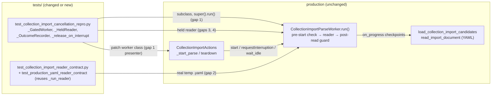

# PYPOST-1265: Expand collection import cancellation coverage

## Research

### Production code under test (verified at HEAD `2703575a`, not changed by this task)

- `pypost/core/qt/collection_import_parse_worker.py`, `CollectionImportParseWorker.run()`:
  1. It logs `collection_import_parse_worker_started` at DEBUG.
  2. **Pre-start branch**: `if self.isInterruptionRequested(): raise CollectionImportCancelled()`.
     This check runs *before* the reader is called.
  3. `_emit_progress(done, total)`: `(0, 0)` is a preparation or decoding checkpoint. It checks
     for interruption but emits nothing. Any other value emits `parse_progress` first and then
     checks for interruption.
  4. A post-read check runs before `parse_completed` (the final publication guard).
  5. `CollectionImportCancelled` leads to one `parse_cancelled` emission and an INFO log
     `collection_import_parse_worker_cancelled`. Only the unexpected-exception branch logs with
     `exc_info=True`.
- `load_collection_import_candidates()` (`pypost/core/collection_import.py:144`) calls
  `_read_records()`. That calls `read_import_document()` with `(0, 0)` checkpoints, and a
  `.yaml`/`.yml` suffix selects `_yaml_decode`. It then calls `on_progress(index, total)` once
  per record. So for a real reader, a request made *before* the reader is called would also be
  caught at the first `(0, 0)` decode checkpoint. **The pre-start branch can only be told apart
  from that checkpoint by showing that the reader was never called.**
- `CollectionImportActions` (`pypost/ui/presenters/collection_import_actions.py`):
  - `_start_parse()` constructs `CollectionImportParseWorker` by its module-global name,
    connects the presenter slots (AutoConnection, so they are queued from the worker thread),
    calls `worker.start()` and enters `PARSING`.
  - `teardown()` calls `worker.requestInterruption()` (a Python attribute lookup) when the import
    is busy and the worker is running. It then calls `_wait_idle_until()`, which pumps
    `processEvents()`, then disconnects, joins and reaps the worker.
  - `requestInterruption()` is called only from `teardown()`. There is no other cancel entry
    point.

### Open question: does QThread clear a pending `requestInterruption()` at `start()`?

**Answer:** In practice, yes, but it is the wrong question. A `requestInterruption()` made
before `start()` is **never recorded at all**, because Qt ignores it while the thread is not
running. So no pre-start request can reach `run()`, whatever `start()` does.

Evidence:

1. Qt 6 documentation for
   [`QThread::requestInterruption()`](https://doc.qt.io/qt-6/qthread.html#requestInterruption):
   *"This function has no effect on the main thread, and does nothing if the thread is not
   currently running."* The `start()` documentation says nothing about interruption.
2. A throwaway probe was run once via
   `make test WORKERS=1 PYTEST_ARGS='<scratchpad>/test_qthread_interrupt_probe.py -s'` with
   Qt 6.11.1 / PySide6 6.11.1, and then deleted. The repository tree is unchanged. Results:

   | Case | Observed |
   | ---- | -------- |
   | A. `requestInterruption()` before `start()` | `isInterruptionRequested()` is `False` right away and `False` inside `run()` |
   | B. Request after the thread finished, then `start()` again | `False`, and not seen on restart |
   | C. Request while `run()` is blocked in a pre-run hook | `True` inside `run()` |
   | D. Synchronous `run()` on the main thread after a not-running request | `False` |
   | E. Request immediately after `start()` returns, with `run()` held by a hook | `isRunning()` is `True` and the request is seen in `run()` |

3. Existing code agrees: `teardown()` checks `worker.isRunning()` before it requests
   interruption. The production pre-start branch is only reachable in the window between
   `start()` setting the thread running and `run()` reaching its first check (case E). That
   is the `_start_parse()` → immediate teardown race. A test can only hit that window by
   chance unless it holds `run()` at the window's end.

**Consequences for the design:**

- Rejected: "request before `start()`". Case A shows it never reaches the branch.
- Rejected: "call `run()` synchronously on the worker object". Case D shows that the predicate
  is `False` off-thread. Hitting the branch would mean patching `isInterruptionRequested`, so
  the test would mock the very check it claims to cover. That is not legitimate coverage.
- Rejected: "barrier injected in the reader". The reader is called *after* the branch, so the
  request would be caught at a checkpoint instead.
- **Chosen: pre-run gate subclass** (case C/E). A test-only subclass overrides `run()` to
  signal `entered`, waits on a bounded `release` event, and then calls the **unmodified**
  `super().run()`. The test requests interruption while the real QThread is running and held at
  the start of `run()`, then releases it. This is **legitimate coverage of the production
  branch**. The production `run()` body executes unchanged on a real running `QThread` with
  real Qt interruption state. The gate only fixes an interleaving that production reaches by
  scheduling chance (case E). It does not fake the predicate or skip any production line.
- Rejected alternative: a blocking DEBUG log handler on `collection_import_parse_worker_started`.
  It would work too, but it ties the test to log text and logger levels and conflicts with
  live-logging handlers (PYPOST-1326).

### Prior flakiness lessons applied

- PYPOST-1263 and PYPOST-1264 removed wall-clock thresholds that failed under oversubscribed
  `make test` (`WORKERS=min(cpu+2,16)`). Today `test_worker_stops_promptly_when_interrupted_mid_parse`
  asserts `worker.wait(300)`. That is a 300 ms latency threshold of the same kind, and a
  runner-speed dependency. The teardown tests rely on `_slow_reader` (40 × 50 ms sleep ≈ 2 s)
  outlasting a 1000 ms budget. This is the margin from PYPOST-1264 debt shortcut 2.
- PYPOST-1320: the `process_until` watchdog `threading.Timer` start deadlocks with a worker
  that logs `exc_info`. The new and changed tests drive only cancellation and success paths,
  which log at INFO or DEBUG with no `exc_info`. They also replace `process_until` with
  `threading.Event.wait(timeout=...)` wherever no Qt event delivery is needed. So PYPOST-1320 is
  not triggered. No new `process_until` call is added.

## Implementation Plan

Test-only. No production file changes. Order: Step 3 writes the new and changed tests and proves
them by mutation (see below). Step 4 fixes only test issues the review finds. If a test exposes a
real production defect, it is recorded as a finding and is not fixed in scope.

1. **Shared test doubles** (module-local in `tests/test_collection_import_cancellation_repro.py`,
   not in `tests/helpers/`, because nothing else reuses them):
   - `_GatedWorker(CollectionImportParseWorker)`: pre-run gate as described above. It exposes
     `entered: threading.Event`, `release: threading.Event` and `gate_timed_out: bool`. It
     waits `release.wait(timeout=_GATE_S)` with `_GATE_S = 5.0`. On timeout it records
     `gate_timed_out = True` and still calls `super().run()`, so the thread always ends.
   - `_HeldReader` (cancellation-aware, keyword `on_progress` per the PYPOST-1266 contract)
     with `total = 40`. It records `processed: list[int]` and `observed: list[str]`. After
     `on_progress(hold_at, total)` returns, it sets `holding` and waits
     `release.wait(timeout=_GATE_S)` (it records `hold_timed_out` on timeout). It then
     continues. Every `on_progress` call is wrapped in `try/except BaseException as exc:
     observed.append(type(exc).__name__); raise`. The reader **cannot finish naturally while
     held**, so the proof does not depend on how fast the reader or the runner is.
   - `_OutcomeRecorder`: connects `parse_cancelled`, `parse_completed` and `parse_failed`
     with `Qt.ConnectionType.DirectConnection` to list appends. This counts *emissions* on the
     worker thread, whether or not queued delivery happens later. It mirrors
     `tests/test_collection_import_reader_contract.py::_run_reader`.
   - `_release_on_interrupt(worker, release)`: replaces `worker.requestInterruption` on the
     instance with a wrapper. The wrapper calls the real method first and then
     `release.set()`. The precedent is `actions._wait_idle_until` instance patching in
     `test_default_teardown_requests_interruption_before_wait_and_discards_result`. Because
     the real request is made before the release, the worker always sees the flag when it
     resumes.
2. **Gap 1, pre-start interruption** (two new tests in the same module):
   - `test_worker_pre_start_interruption_skips_reader`: worker level. `_GatedWorker(path,
     recording_reader)`, then `start()`, then `assert entered.wait(5)`, then
     `requestInterruption()`, then `release.set()`, then `assert wait(5000)`. Assertions:
     `reader_calls == []`, `progress == []`, `cancelled == [True]`, `completed == []`,
     `failed == []`, `not gate_timed_out`. Also, with `caplog.at_level(INFO, logger=
     "pypost.core.qt.collection_import_parse_worker")`, exactly one
     `collection_import_parse_worker_cancelled` record (do-testing C1/C5).
   - `test_teardown_pre_start_interruption_applies_nothing`: presenter level. Patch
     `pypost.ui.presenters.collection_import_actions.CollectionImportParseWorker` with
     `_GatedWorker` and call `actions._start_parse(path)`. Wait on `entered` (bounded).
     Attach `_OutcomeRecorder` and `_release_on_interrupt`, then call
     `actions.teardown(timeout_ms=_TEARDOWN_WAIT_IDLE_MS)`. Assertions: reader never called,
     one cancellation emission with no completion or failure, `refresh_tree`,
     `restore_tree_state` and `emit_collections_changed` not called, the result dialog
     (patched `show_collection_import_result`) not called, `FakeRequestManager.collections
     == []`, `worker.finished` observed, `actions._worker is None`, `not actions.is_busy()`.
     This is the real "user closes right after starting" path.
3. **Gap 2, real YAML record checkpoint** (new test in
   `tests/test_collection_import_reader_contract.py`, reusing `_run_reader` unchanged):
   `test_production_yaml_reader_contract[cancel_at=None|1|2]`. Write `collections.yaml` under
   `tmp_path` with the same three records as the JSON test (`c1/First`, the invalid record
   with no name, `c3/Third`), as a block sequence. Expected:
   - `None`: progress `[(1,3),(2,3),(3,3)]`, one completion with `[("c1","First"),
     ("c3","Third")]` and one error mentioning `name`, no cancellation, no failure.
   - `1` or `2`: progress `[(d,3) for d in 1..cancel_at]`, so no later record is reported,
     `cancelled == [True]`, `completed == []`, `failed == []`.

   A `(k,3)` progress entry exists only after decoding has produced the record list, so this
   shows the cancellation happened at a record checkpoint after decoding. `(0,0)` checkpoints
   are never emitted.
4. **Gaps 3 and 4, changed PYPOST-1229 regressions** in
   `tests/test_collection_import_cancellation_repro.py`:
   - `test_worker_stops_promptly_when_interrupted_mid_parse`: use `_HeldReader(hold_at=1)`.
     `assert holding.wait(5)`, then `requestInterruption()`, then `release.set()`, then
     `assert worker.wait(5000)`. Replace the 300 ms latency threshold with a structural
     promptness proof: `processed == [1, 2]` (stopped at the very next checkpoint) and
     `observed == ["CollectionImportCancelled"]`. Exact counts: `cancelled == [True]`,
     `completed == []`, `failed == []`. The existing failure messages are kept, adapted to the
     list assertions.
   - `test_teardown_worker_stops_after_interruption` (explicit 1000 ms) and
     `test_default_teardown_requests_interruption_before_wait_and_discards_result` (default
     5000 ms): switch to `_HeldReader(hold_at=1)` and wait `holding.wait(5)` instead of
     `process_until(first_progress)`. Attach `_OutcomeRecorder` and
     `_release_on_interrupt(worker, reader.release)` before `teardown()`. New assertions:
     exactly one cancellation, zero completions, zero failures; `processed == [1, 2] < total`;
     `observed == ["CollectionImportCancelled"]`; `not hold_timed_out`. All existing
     assertions are kept: interrupted, `from_state=parsing` and no-timeout log lines;
     `wait_observations == [(5000, True)]`; no tree refresh or dialog. The explicit-budget test
     also asserts that the presenter log `collection_import_parse_cancelled` appears exactly
     once.
   - `_slow_reader`, `_RECORD_DELAY_S` and `_WAIT_AFTER_INTERRUPT_MS` become unused and are
     removed. `_TEARDOWN_WAIT_IDLE_MS = 1000` stays. It now only has to cover one checkpoint
     plus thread exit after release, not "the reader is still running".
5. **Timeouts and cleanup**: both modules keep `pytestmark = pytest.mark.timeout(30)`. Every
   test's `finally` sets all release events first, then `requestInterruption()` and
   `wait(5000)` if the worker is still running, using the existing defensive `RuntimeError`
   pattern. All event waits pass `timeout`.

**Mandatory: Failing Repro (Step 3).** There is no runtime behavioral change, so a natural red
does not apply: the production code already behaves as required, and the new tests are
expected to pass on HEAD. The td-25 "red" for this test-only task is a **mutation red**. Each new
or strengthened assertion must fail when the production behavior it guards is broken. Show this
in a **throwaway git worktree under the scratchpad** (`git worktree add --detach
<scratchpad>/mut HEAD`, copying in the new test files), never in `/home/src`. Run tests only via
`make -C <worktree> test WORKERS=1 PYTEST_ARGS='<test ids>'`. Step 3 must first check that the
worktree's `pypost` is the one imported, for example with a test-local assertion on
`pypost.__file__` or by checking that a known mutation turns a test red, because the editable
install points at `/home/src`. Then remove the worktree (`git worktree remove --force`).

| Gap | Mutation in scratch worktree (one at a time) | New test that must go red | Old assertions that stay green (shows the gap) |
| --- | ------------------------------------------- | ------------------------- | ---------------------------------------------- |
| 1 | Delete the pre-start `isInterruptionRequested()` check in `run()` | both pre-start tests (`reader_calls == [1]`; the cancellation then comes from the `(0,0)`/first checkpoint) | none exist today |
| 2 | In `_emit_progress`, drop the interruption check after `parse_progress.emit` for `done > 0` | YAML `cancel_at=1/2` (progress continues to `(3,3)`; the post-read guard still cancels, so `progress` is what fails) | JSON test also goes red (fine) |
| 3 | Emit `parse_cancelled` twice, or also emit `parse_failed` on cancellation | all three PYPOST-1229 tests (`cancelled == [True]` / `failed == []`) | old flag and log checks in tests 2 and 3 pass |
| 4 | Make `_emit_progress` ignore interruption for `done > 0` (the post-read guard keeps cancelling) | both teardown tests and the worker test (`processed == [1..40]`, `observed == []`) | old default-budget test passes: the reader finishes in about 2 s, which is under 5000 ms, and the post-read guard still cancels |

If a mutation does not turn its target red, the test design is wrong and must be fixed in
Step 3. Record each mutation and result as a STEP 3 roadmap sub-item. Do not use
`xfail`/`skip`.

## Architecture

### Components and responsibilities

| Component | Responsibility | Interface |
| --------- | -------------- | --------- |
| `_GatedWorker` | Holds a real running QThread at the start of `run()`, before the production pre-start check | `entered`, `release` (`threading.Event`), `gate_timed_out`; constructor same as the worker |
| `_HeldReader` | Real `ReadImportFile` shape that cannot finish while held and records what it processed and observed | `__call__(path, *, on_progress)`; `processed`, `observed`, `holding`, `release`, `hold_timed_out`, `total` |
| `_OutcomeRecorder` | Exact counts of outcome emissions, taken on the worker thread | `cancelled`, `completed`, `failed` lists; `attach(worker)` |
| `_release_on_interrupt` | Ties the gate release causally to the production `requestInterruption()` call inside `teardown()` | `(worker, release) -> None` |
| `_run_reader` (existing) | Runs the worker on a real reader with interruption at checkpoint `k` | unchanged |

### Synchronization (deterministic, no sleeps used for synchronization)

- **Order for gap 1:** the worker sets `entered`. The main thread returns from
  `entered.wait(5)` and calls `requestInterruption()`, directly or from `teardown()`. Only then
  is `release` set. The worker runs the production check, which sees `True`.
- **Order for gaps 3 and 4:** the reader sets `holding` after checkpoint 1. The main thread
  requests interruption, and the release follows the real request. The reader calls
  `on_progress(2, 40)`, the production check raises, and the reader records the exception.
- All waits are bounded: events wait 5 s, `worker.wait(5000)`, and teardown has its own
  deadline. A missing release can never hang a test: the gate times out, the `*_timed_out`
  flag fails the test, and the 30 s module timeout is the last resort.

### Patterns and justification

- **Test-double subclass and injected reader at existing seams** (constructor injection of
  `read_import_file` and the module-global worker class). These need no production hooks.
- **Causal gating instead of timing margins.** Each test's pass condition holds only if
  interruption, not completion or runner speed, ended the work. A faster reader cannot finish
  while held. A slower runner only delays the reader, and the bounded waits are far above
  normal latency.

## Q&A

- **Does QThread clear a pending `requestInterruption()` at `start()`?** The request is not
  even kept: Qt 6 documents it as a no-op while the thread is not running (probe cases A and
  B). The branch is reachable only between `start()` and the first check in `run()`, which the
  `_GatedWorker` holds open. See Research.
- **Is the `_GatedWorker` test legitimate coverage of the production branch?** Yes. The
  production `run()` runs unchanged on a real running thread, and only the interleaving is
  fixed. Calling `run()` synchronously with a patched predicate was rejected as not
  legitimate.
- **Why remove the 300 ms "promptly" assertion?** It is a wall-clock threshold, the class of
  flake fixed in PYPOST-1263 and PYPOST-1264. "Stopped at the very next checkpoint"
  (`processed == [1, 2]`) is stronger and does not depend on the runner.
- **Flakiness under parallel `make test`?** Low. No wall-clock assertion remains. The only
  time-bounded condition left is the existing 1000 ms explicit teardown budget, which now only
  has to cover one checkpoint plus thread exit after release. Under very heavy
  oversubscription this could still time out, with clean `False` and an `interrupt_timeout`
  log. This risk exists today and is not widened. Budget values are out of scope (PYPOST-1264).
- **PYPOST-1320?** Not triggered. No `exc_info` path is exercised, and no new `process_until`
  call is added. The changed tests drop their existing `process_until` waits in favor of
  `Event.wait`.
- **Do new tests log at ERROR?** No. Cancellation logs at INFO, so the do-testing caplog
  contract is satisfied with C1/C5 where logs are asserted.
