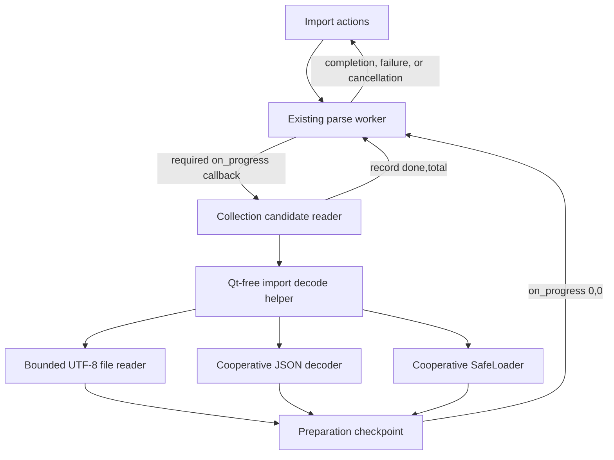

# PYPOST-1267: Cancellation checkpoints during import decoding

## Research

The accepted [requirements](10-requirements.md) cover real JSON/YAML files of at least 16 MiB,
including a large scalar, with a one-second request-to-worker-stop regression limit.

Repository inspection found:

- `collection_import._read_records()` calls `Path.read_text()`, then `json.loads()` or
  `yaml.safe_load()` before record validation can call the cancellation callback.
- JSON failures fall back to YAML for non-YAML filenames. That fallback currently catches every
  `Exception`; introducing checkpoints requires narrowing this catch to preserve cancellation.
- PYPOST-1266's `ReadImportFile` requires the existing `on_progress(done, total)` callback.
  The worker checks interruption through that callback and before result publication.
- The worker already distinguishes cancellation from failure and prevents cancelled candidates
  from reaching application. The presenter and apply workflow need no new states.
- Dependencies already include PyYAML 6.0.3; no additional parser dependency is required.

Primary-source research confirms relevant compatibility and extension boundaries:

- Python's [JSON documentation](https://docs.python.org/3/library/json.html) specifies default
  number conversion, non-finite constants, and interpreter integer-length limits.
- CPython's [decoder source][json-decoder] and [scanner source][json-scanner] expose Python
  parsing routines. Merely selecting the Python scanner is insufficient: object keys use the
  module's string scanner, and string/number/whitespace matching can still scan a whole scalar.
- PyYAML's [reader source][yaml-reader] and [scanner source][yaml-scanner] show long scalar
  lookahead repeatedly calling `peek(length)` before advancing. Checking only `forward()` or
  stream reads therefore misses the expensive scanning phase. `forward(length)` itself also
  loops over characters and needs bounded batches.

[json-decoder]: https://github.com/python/cpython/blob/3.11/Lib/json/decoder.py
[json-scanner]: https://github.com/python/cpython/blob/3.11/Lib/json/scanner.py
[yaml-reader]: https://github.com/yaml/pyyaml/blob/6.0.3/lib/yaml/reader.py
[yaml-scanner]: https://github.com/yaml/pyyaml/blob/6.0.3/lib/yaml/scanner.py

## Implementation Plan

1. Add the real-file red regressions below and record their behavioral failure before modifying
   production code. Review Step 3 independently.
2. Introduce a Qt-free decoding helper, `pypost/core/collection_import_decode.py`, containing
   bounded UTF-8 file reading, cooperative JSON decoding, and a cooperative safe YAML loader.
3. Integrate the helper into `_read_records()` while preserving format selection, fallback,
   root validation, record ordering, and current file-versus-record error boundaries.
4. Forward preparatory checkpoints through the existing reader callback and suppress them from
   GUI progress in the worker. Keep ordinary record progress and reader call compatibility.
5. Make the red tests green, add focused decoder compatibility coverage, and run the relevant
   existing import tests. Record actual latency and fixture conditions, then complete the normal
   Make quality gates and developer documentation in their assigned later steps.

### Step 3: Deterministic Failing Repro

Create `tests/test_collection_import_decode_cancellation.py` with an explicit module timeout
and finite event/thread waits. Generate fixtures before timing. Use the actual production reader
and `CollectionImportParseWorker`; do not replace decoding with a sleep or a fake reader result.

- Parameterize JSON, YAML with its normal extension, and YAML reached through JSON fallback.
  Fixtures include at least 16 MiB of actual UTF-8 content: a bundle of small records and a single
  collection containing a text value of at least 16 MiB. Use a retained collection text field,
  and include long plain and quoted YAML scalar variants in focused coverage.
- For loading, wrap the selected file's real text stream only to count returned characters and
  observe close. Delegate real reads unchanged. A forwarded reader callback recognizes a
  before-read preparatory checkpoint after some content has been read but before EOF. Choose
  the checkpoint immediately preceding the next actual chunk read, not the preceding after-read
  checkpoint. The forwarding callback first invokes the real worker callback, allowing its
  current interruption check to complete normally, and only then holds the synchronization gate.
- For decoding, use the same real-file wrapper to establish that reading has completed and
  test-only spies to identify the active lexical scanning routine. Count preparatory callbacks
  only while that routine is active, and gate after its 256th real worker callback has returned.
  Choose a checkpoint immediately before a bounded scan batch, with actual scanning work before
  the next checkpoint. For the large-scalar fixture,
  require a string/scalar scan to be active with no validated record yet. Printable-input checks,
  decoder entry checks, and file joins cannot satisfy this gate. The baseline lacks these
  callbacks and must fail the same missing-checkpoint assertion. Spies only observe and delegate;
  they never supply checkpoints. Decoder-specific spy wiring may follow the selected helpers in
  Step 4 while preserving all behavioral assertions. Do not add a public diagnostics interface.
- At each gate, the test controller records monotonic time, requests worker interruption, and
  immediately releases the forwarding callback. That callback returns without another
  interruption check. Production must perform the next read or scan batch before its next
  genuine checkpoint detects cancellation. Assert that the byte/character count or lexical scan
  position advanced after gate release and before cancellation, proving that timing includes
  actual work between checkpoints as well as unwinding. Assert worker completion within one
  second, one cancellation signal, and no completion or failure signal. A test that detects
  interruption inside the gated callback itself does not satisfy this regression.
- Assert the loading case stopped before EOF and the decoding case stopped before collection
  validation. Count cancellation outcomes with direct signal connections; retain the worker
  through bounded cleanup. Existing presenter cancellation tests cover no applied collections.
- The current implementation reaches neither preparatory gate: it reads and decodes the entire
  input before its first record callback. Its red failure must be the missing active-phase
  checkpoint assertion, not a missing import, unavailable helper, or an arbitrary sleep timeout.
  Bound the gate wait and cleanup separately; allow sufficiently long cleanup for baseline YAML
  decoding while retaining an explicit overall test timeout. Always release gates in `finally`.

Run through `make test PYTEST_ARGS='tests/test_collection_import_decode_cancellation.py'
WORKERS=1 WORKER_TIMEOUT=180`. Select the module timeout and bounded baseline cleanup budget to
fit inside that worker timeout. Timing measures cancellation, not fixture creation or worker
startup. Record fixture byte sizes, shape, format, and measured milliseconds in test properties.

## Architecture

### Responsibilities and Interfaces

- `collection_import_decode.py` owns source loading and format decoding, and imports no Qt or
  collection models. Its public module helper is
  `read_import_document(path: Path, checkpoint: Callable[[], None] | None = None) -> Any`.
  It preserves the existing extension-based selection and JSON-to-YAML fallback. Internal
  helpers separate file loading, JSON decoding, and YAML decoding for focused tests.
  Without a checkpoint, existing direct synchronous callers may retain the standard decoders.
- `collection_import.py` remains responsible for user-facing error translation, accepted root
  shapes, candidate validation, labels, and collection results. `_read_records()` receives an
  optional checkpoint and delegates document decoding. Normalization of a large root list also
  checks periodically rather than introducing another whole-list cancellation gap.
- The reader creates a zero-argument checkpoint that calls `on_progress(0, 0)` when a callback
  exists. `(0, 0)` means preparation with an unknown record total; actual record events retain
  their existing positive counts. Document this extension for direct callback consumers.
- `ReadImportFile` keeps its existing required keyword and callable shape. The worker callback
  checks interruption before handling `(0, 0)`, returns without emitting GUI progress for that
  sentinel, and preserves existing emit-then-check behavior for real record progress. This keeps
  PYPOST-1266's injected-reader contract and direct progress-triggered cancellation tests valid.
- Distinguish callback failures by their origin, not their exception type. Wrap exceptions raised
  by the callback itself in a private `_CheckpointRaised` carrier holding the original exception
  and traceback. Only the narrow callback invocation creates this carrier; decoder and file I/O
  exceptions remain unwrapped. Use the protected callback for reading, decoding, and root checks.
- At every broad decoder/fallback exception boundary, re-raise `_CheckpointRaised` before
  handling ordinary exceptions. Outside all decoding and file-error translation scopes,
  `_read_records()` unwraps it and re-raises the original exception with its original traceback.
  This preserves callback exception identity, including `CollectionImportCancelled`, `OSError`,
  `ValueError`, and `yaml.YAMLError`; none may become fallback or a file error. Callback exceptions
  outside the `Exception` hierarchy already bypass those catches and propagate normally.
- Preserve the existing decoder exception boundaries: direct YAML syntax errors are mapped as
  before, while a direct YAML constructor `ValueError` remains that error. After a JSON syntax
  failure, fallback YAML continues to catch ordinary `Exception`, including constructor errors
  such as an invalid timestamp, and report the original JSON parse failure. A fallback scalar
  root also retains that original JSON error. Do not narrow fallback handling to `YAMLError`.
  Close file handles and dispose YAML loaders in `finally`/context-manager paths, including when
  the private checkpoint carrier passes through them.

This is a local adapter around existing parsing behavior. It does not add a process, thread,
global decoder mutation, service, format, or dependency injection framework.

### Bounded File Reading

Read UTF-8 text in chunks of at most 64 Ki characters, checking immediately before and after
each read. Use the text stream's incremental Unicode and newline handling so multibyte input
and CRLF match `Path.read_text()`. Keep chunks and join once, with checkpoints around the join.
Retain the full decoded text for existing JSON/YAML error positions and fallback behavior.
Streaming the resulting object graph is not required; avoiding quadratic concatenation is.

### Cooperative JSON Decoding

Keep a small local decoder implementation with the standard library as the behavioral oracle.
Use an instance-local explicit container stack for arrays and objects, with the standard
library's grammar as the oracle. Reusing its recursive Python array routine adds Python frames
per container and rejects nesting accepted by the C decoder (the Step 4 differential repro
demonstrated this at 600 levels). The iterative stack preserves accepted depths without changing
the process recursion limit, and checks at both descent and unwinding boundaries. Locally adapt
the scanner dispatch, string scanner, and container grammar needed to replace hidden whole-token
work; do not copy the entire JSON package. Any adapted
CPython code must retain the relevant attribution/license notice. Keep these routines private to
the import helper; no monkeypatching of `json` globals or tracing hooks is permitted.

- Scan ordinary string spans using a regular-expression search with an explicit end position
  no more than 4096 characters ahead. When a window has no terminator, append it and checkpoint
  before advancing. Handle escapes and surrogate pairs with the standard decoder's rules,
  including escapes that straddle a window boundary. Join string pieces once at completion.
- Use this same bounded string routine for object keys and values. A custom value scanner alone
  would leave the standard object parser's global key scanner uninterruptible.
- Scan whitespace and numeric lexemes in bounded windows/loops with a checkpoint at least every
  4096 input characters. Preserve JSON number grammar, then use normal `int`/`float` conversion,
  including the interpreter's integer-digit restriction and non-finite constants.
- Check container traversal at each value/member boundary. Preserve duplicate-key last-value
  behavior, insertion order, null/boolean types, control-character rejection, and trailing-data
  rejection. Produce `JSONDecodeError` for syntax errors with the original input position so
  existing fallback and error formatting continue to work.
- Keep all parsing state instance-local. One cancelled import must not alter another decoder.

The main compatibility risk is maintaining these small parsing adaptations across Python
versions. Isolate them and use differential tests against `json.loads()`, including object keys,
not merely collection fixtures. Do not substitute YAML for successful JSON decoding.

### Cooperative YAML Decoding

Subclass `yaml.SafeLoader`, retaining its safe constructors, resolver, aliases, merge semantics,
and single-document behavior. Initialize it with the already loaded text rather than a stream;
this avoids growing-buffer costs during long scalar lookahead.

- Initialize the checkpoint/counter before the superclass constructor. Override printable-input
  validation to operate on bounded slices while preserving original error offsets.
- Count calls to `peek()` and checkpoint every 4096 calls. This observes plain, quoted, and block
  scalar scanning even when the scanner has not called `forward()` yet.
- Split `forward(length)` into batches no larger than 4096 characters, with checkpoints between
  batches; preserve reader index, line, column, BOM, and newline semantics through superclass
  behavior. Also check prefix access at its boundary.
- Check at composition and construction boundaries, including `construct_object()` and the
  collection/merge traversals needed to avoid a long object-building phase after scanning.
  Implement merge flattening with PyYAML's original precedence and node mutations, but check
  each source mapping and each reversed merge-sequence member; extend assembly lists in batches
  of at most 4096 entries. Checking only source traversal misses the later assembly loop.
  Preserve alias identity and recursive-node handling; do not flatten or serialize the result
  through a different format.
- Keep the checkpoint lightweight and counter-based. Avoid a GUI signal per character.
  Always call loader disposal, including when cancellation interrupts construction.

### Largest Uninterrupted Work and Limits

Application-controlled scanning is bounded by 4096 characters or lookahead calls; file reads are
bounded by 64 Ki characters. Neither waiting for the end of a collection nor prechecking before
an unrestricted decoder call satisfies this design.

Native allocations, final string/list assembly, scalar conversions, and retained safe YAML
constructor/resolver operations are not preemptible. Check immediately around such operations
and explicitly exercise their surrounding large-scalar scenarios. These residual operations
are subject to the accepted one-second measured bound on the normal test environment, not a
hard real-time claim for arbitrary document size. If measurements identify an operation that
breaks that bound, split that operation before accepting implementation; do not enlarge the
latency target or omit the failing fixture. File-system stalls and scheduling exclusions remain
those stated in the accepted requirements.

### Compatibility and Validation

- Differential JSON fixtures: nested arrays/objects; duplicate keys; Unicode and surrogate pairs;
  lone surrogates; escapes at chunk boundaries; long keys/values/whitespace; integer limits;
  exponents, negative zero, NaN/Infinity; malformed strings/numbers and trailing content.
- Differential YAML fixtures: plain/single/double/block scalars; escapes; CRLF; Unicode; anchors,
  aliases and merge keys; safe scalar tags; duplicate keys; invalid syntax, unsafe tags, and
  multiple documents. Compare to `yaml.safe_load()`, accounting for identity/NaN where needed.
- Cover invalid timestamp and malformed explicitly tagged safe scalar values both in direct
  YAML files and non-YAML files that invoke fallback. Assert the current direct-YAML exception
  type and fallback's original JSON error precedence, including constructor `ValueError` rather
  than only `YAMLError`. Include valid timestamp/tagged values to protect successful conversion.
- Preserve JSON-first fallback for non-YAML suffixes, including JSON-invalid but YAML-valid
  inputs. Test cancellation during the YAML fallback directly so broad error catches cannot
  mask it. Keep unsupported root/list-entry errors and record validation errors unchanged.
- At reading, JSON scanning, YAML scanning, and YAML fallback checkpoints, inject callback
  exceptions of types `ValueError`, `OSError`, and `yaml.YAMLError`, as well as the worker's
  cancellation exception. Assert original exception identity survives the private carrier,
  cleanup occurs, and no fallback retry or file-error replacement is triggered by the callback.
- Existing callback tests that inspect the pure reader may filter documented `(0, 0)` preparation
  events while retaining exact record progress assertions. Worker-facing progress assertions
  remain unchanged. Cover simultaneous decoder instances and checkpoint exception propagation.
- Run focused new and existing collection import, progress, reader-contract, responsiveness,
  cancellation, and presenter tests through `make test`; use `make lint`, `make typecheck`, and
  `make verify-ai-tasks` at later gates. No new Make target is needed.

## Q&A

- **Why retain the existing callback shape?** It preserves the accepted required-reader contract
  and avoids changing every injected reader for a second cancellation interface. Preparation
  events have a documented sentinel and never become misleading GUI record progress.
- **Why not keep `json.loads()` after chunked reads?** It would leave the decoding gap intact.
  The checkpoints must occur during the scan of a long value and object key.
- **Why not use a process?** Cancellation, result transfer, exception fidelity, startup, and
  cooperative child cleanup would add a second lifecycle without removing the need for safe
  interruption inside the decoder. This design stays inside the existing worker lifecycle.
- **Who accepts Step 2?** The autonomous orchestrator after independent architecture review;
  the executing agent leaves Step 2 `[/]`.
