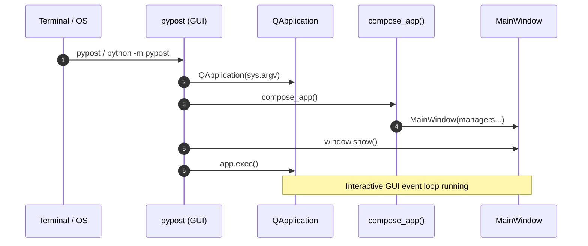
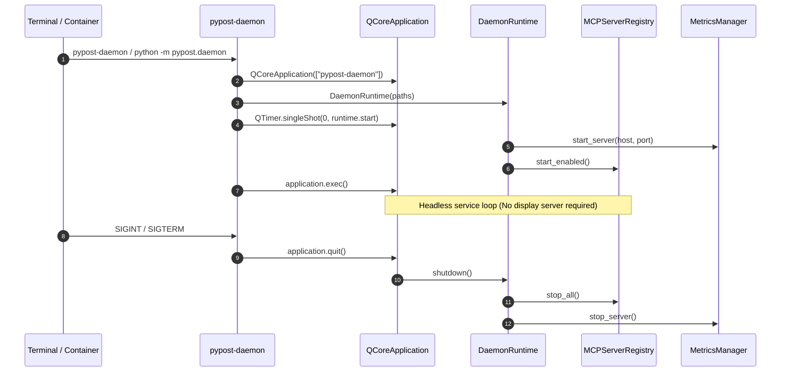

# PYPOST-1269: Support dual runtime distribution modes: GUI desktop and headless daemon

## Research

### 1. Existing Entry Points and Package Configuration
- **`pyproject.toml`**:
  - The `[project.scripts]` section currently configures:
    - `pypost-agent-ui-mcp = "pypost.agent.ui_actions_mcp:main"`
    - `pypost-daemon = "pypost.daemon:main"`
  - **Gap**: There is no standard `pypost` console script configured for the GUI application (`pypost = "pypost.main:main"`). Users installing via standard Python distribution packages (`pip install pypost`) cannot launch the primary interactive application via `pypost`.
  - **Module Execution (`python -m`)**:
    - `python -m pypost.daemon` executes `pypost/daemon.py` directly (`if __name__ == "__main__": raise SystemExit(main())`).
    - `python -m pypost` currently fails with `No module named pypost.__main__` because `pypost/__main__.py` does not exist.
    - `python pypost/main.py` is currently the only module-style launch script used by Makefile (`make run`).

### 2. Dependency Decoupling & Import Boundaries
- **Runtime Mode 1 — GUI Desktop**:
  - Implemented in `pypost/main.py` and `pypost/ui/`.
  - Instantiates `PySide6.QtWidgets.QApplication`.
  - Builds and displays `MainWindow` and subsidiary dialogs, editors, tree views, and tabs.
  - Initializes `AgentUiAttachHost` IPC server on local sockets for agent UI automation.
- **Runtime Mode 2 — Headless Daemon**:
  - Implemented in `pypost/daemon.py` and `pypost/core/qt/daemon_runtime.py`.
  - Instantiates `PySide6.QtCore.QCoreApplication` (or reuses an active instance).
  - Operates Prometheus HTTP metrics server and local/remote MCP server processes via `MCPServerRegistry`.
  - Binds Unix signal handlers (`SIGINT`, `SIGTERM`) with a 500 ms `QTimer` tick to ensure responsive Python signal delivery within the Qt event loop.
  - Enforces strict configuration parsing (`load_config_strict`) and scoped storage snapshots (`load_collections_snapshot_strict`, `load_environments_snapshot_strict`).
- **Core Domain Services (`pypost/core/` and `pypost/models/`)**:
  - Auditing `pypost/core/` and `pypost/models/` for GUI library imports identified a single leakage in `pypost/core/qt/environment_storage_gateway.py`:
    - Line 73 imports `from PySide6.QtWidgets import QApplication` to invoke `app.processEvents()` inside `wait_idle()`.
    - Because `QApplication` derives from `QGuiApplication` which derives from `QCoreApplication`, calling `QCoreApplication.instance().processEvents()` is fully polymorphic and standard across Qt.
    - Replacing `QApplication` with `QCoreApplication` in `environment_storage_gateway.py` completely eliminates `PySide6.QtWidgets` from `pypost/core/`.
  - Aside from this single site, `pypost/core` and `pypost/models` are cleanly decoupled from `pypost/ui` and `PySide6.QtWidgets`.

### 3. Packaging Validation & Build Verification
- **Wheel Member Validation (`scripts/check_package_data.py`)**:
  - Executed via `make check-package-data` and `make test-slow`.
  - Currently verifies that bundled example collections, environments, and package `__init__.py` files are present and match repository canonical sources.
  - Does not currently inspect the wheel's `entry_points.txt` metadata to confirm console scripts are generated.
  - Enhancing `scripts/check_package_data.py` (or complementing it with dedicated distribution test assertions) ensures that both `pypost` and `pypost-daemon` console script entry points are strictly enforced upon package compilation.
- **Makefile Targets**:
  - `make run`: Currently executes `PYTHONPATH=. $(BIN)/python pypost/main.py`.
  - `make run-daemon`: Currently executes `PYTHONPATH=. $(BIN)/python -m pypost.daemon`.
  - Adding `pypost/__main__.py` ensures both `python -m pypost` and `python -m pypost.daemon` are symmetrically supported.
- **Dependency Locks**:
  - `make lock` / `make check-lock` manages `requirements.txt` generated from `requirements.in`.

### 4. Existing Test Harnesses
- `tests/test_daemon_cli.py`:
  - Contains `test_daemon_import_does_not_add_widget_modules`, which checks that `pypost.ui.main_window` is not in `sys.modules`.
  - Contains `test_packaging_declares_daemon_console_script`, checking for `pypost-daemon` in `pyproject.toml`.
  - Does not check for `pypost` GUI entry point or strict isolation from `PySide6.QtWidgets` across all daemon runtime paths.
- `tests/test_daemon_runtime.py`, `tests/test_daemon_config.py`, `tests/test_daemon_storage.py`, `tests/test_daemon_settings.py`:
  - Comprehensive coverage for daemon-specific behavior (strict configs, directory precedence, snapshot isolation, startup deadline watchdog, port collision handling, clean signal shutdown).

---

## Implementation Plan

### High-Level Execution Steps

1. **Step 3 (Failing Repro Tests)**:
   - Implement automated red tests covering missing GUI entry points, entry point metadata resolution, `pypost/__main__.py` invocation, and headless import isolation without `PySide6.QtWidgets`.
2. **Step 4 (Development)**:
   - **Entry Point Configuration**:
     - Register `pypost = "pypost.main:main"` in `[project.scripts]` in `pyproject.toml`.
     - Add `pypost/__main__.py` pointing to `pypost.main.main` to enable `python -m pypost`.
   - **Core Decoupling**:
     - Update `pypost/core/qt/environment_storage_gateway.py` to use `from PySide6.QtCore import QCoreApplication` instead of `PySide6.QtWidgets.QApplication`.
   - **Packaging Validation**:
     - Extend `scripts/check_package_data.py` or package verification tests to validate `entry_points.txt` within generated wheels.
   - **Makefile & Lock Alignment**:
     - Verify and update `make run` and `make run-daemon` documentation and targets.
     - Regenerate / sync lock files via `make lock` if required.
   - **Documentation**:
     - Update `doc/user/getting-started.md`, `doc/user/README.md`, and `doc/dev/daemon.md` to document the dual runtime modes (`pypost` and `pypost-daemon`) and their launch options.

### Mandatory — Failing Repro (next Step 3)

The failing repro test suite will reside in `tests/test_runtime_distribution_modes.py` (or extend `tests/test_daemon_cli.py`) and assert the following behaviors before any implementation changes:

1. **GUI Console Script Declaration Test**:
   - Reads `pyproject.toml` and parses `[project.scripts]`.
   - Asserts `'pypost = "pypost.main:main"'` is declared.
   - *Failure state*: Fails initially because only `pypost-daemon` and `pypost-agent-ui-mcp` are declared.
2. **Module Execution Package Test (`python -m pypost`)**:
   - Asserts that `pypost/__main__.py` exists, is importable, and exports or invokes `main()`.
   - Executes `python -m pypost --help` or verifies module entry without raising `No module named pypost.__main__`.
   - *Failure state*: Fails initially because `pypost/__main__.py` does not exist.
3. **Headless Import Isolation (`PySide6.QtWidgets` Absence)**:
   - Spawns a clean Python subprocess with `DISPLAY=""` and `WAYLAND_DISPLAY=""`.
   - Executes:
     ```python
     import sys
     import pypost.daemon
     from pypost.core.qt.environment_storage_gateway import EnvironmentStorageGateway
     assert "PySide6.QtWidgets" not in sys.modules, "QtWidgets leaked into headless imports"
     assert "pypost.ui" not in sys.modules, "pypost.ui leaked into headless imports"
     ```
   - *Failure state*: Fails initially because `environment_storage_gateway.py` references `PySide6.QtWidgets`.
4. **Wheel Entry Points Metadata Inspection**:
   - Inspects the wheel produced by `pip wheel --no-deps .` to verify that `pypost-<version>.dist-info/entry_points.txt` contains both `[console_scripts]` entries:
     - `pypost = pypost.main:main`
     - `pypost-daemon = pypost.daemon:main`
   - *Failure state*: Fails initially because `pypost` entry point is omitted.

---

## Architecture

### System Module Breakdown

```
┌────────────────────────────────────────────────────────────────────────┐
│                        Execution Entry Points                          │
│                                                                        │
│   CLI: pypost                CLI: pypost-daemon     CLI: pypost-agent  │
│   Module: python -m pypost   Module: python -m ...  UI sidecar         │
└──────────────────┬───────────────────────┬─────────────────────────────┘
                   │                       │
                   ▼                       ▼
┌──────────────────────────────┐ ┌───────────────────────────────────────┐
│     GUI Desktop Runtime      │ │       Headless Daemon Runtime         │
│     (pypost.main:main)       │ │       (pypost.daemon:main)            │
│                              │ │                                       │
│  - PySide6.QtWidgets.QApp    │ │  - PySide6.QtCore.QCoreApplication    │
│  - MainWindow & Widgets      │ │  - DaemonRuntime lifecycle            │
│  - AgentUiAttachHost (IPC)   │ │  - SIGINT/SIGTERM handlers + heartbeat│
│  - ComposedApp Wiring        │ │  - Scoped strict data loaders         │
└──────────────┬───────────────┘ └───────────────────┬───────────────────┘
               │                                     │
               └──────────────────┬──────────────────┘
                                  │
                                  ▼
┌────────────────────────────────────────────────────────────────────────┐
│                      Shared Core Domain Services                       │
│                      (pypost.core.*, pypost.models.*)                  │
│                                                                        │
│  - StorageManager & DaemonStorage (JSON collections / environments)    │
│  - ConfigManager & Settings (Strict / Defaults)                        │
│  - MCPServerRegistry & MCPServerManager (Uvicorn / Stdio tools)        │
│  - MetricsManager (Prometheus exporter)                                │
│  - TemplateService & Variable Resolution (Jinja2)                      │
│  - RequestManager & Request Execution Engine                           │
│                                                                        │
│  * Strict Constraint: Pure Python + PySide6.QtCore ONLY                │
│    Zero dependencies on PySide6.QtWidgets or pypost.ui                │
└────────────────────────────────────────────────────────────────────────┘
```

### Architectural Boundaries & Dependency Invariants

1. **GUI Presentation Layer (`pypost.ui.*`, `pypost.main`)**:
   - Depends on `PySide6.QtWidgets`, `PySide6.QtGui`, and `PySide6.QtCore`.
   - Depends on `pypost.core.*` and `pypost.models.*`.
   - Never depended upon by headless daemon or core services.
2. **Headless Daemon Layer (`pypost.daemon`, `pypost.core.qt.daemon_runtime`)**:
   - Depends on `PySide6.QtCore` only.
   - Depends on `pypost.core.*` and `pypost.models.*`.
   - Strictly decoupled from `PySide6.QtWidgets` and `pypost.ui.*`.
3. **Core Domain Layer (`pypost.core.*`, `pypost.models.*`)**:
   - Depends on standard library, `pydantic`, `requests`, `mcp`, `prometheus_client`, and `PySide6.QtCore`.
   - **Invariant**: No module in `pypost.core` or `pypost.models` may import `PySide6.QtWidgets`, `PySide6.QtGui`, or any module within `pypost.ui`.

### Runtime Lifecycle Sequences





### Interface Contracts

1. **Console Script Entry Points**:
   - `pypost`: Target `pypost.main:main`. Launches GUI desktop application.
   - `pypost-daemon`: Target `pypost.daemon:main`. Launches headless service runtime.
2. **Package Execution Contracts**:
   - `python -m pypost`: Invokes `pypost/__main__.py`, delegating to `pypost.main.main()`.
   - `python -m pypost.daemon`: Invokes `pypost/daemon.py:main()`.
3. **Headless Execution Contract**:
   - When executing `pypost-daemon` in an environment where `DISPLAY` and `WAYLAND_DISPLAY` are unset, startup proceeds without warning, error, or GUI platform plugin initialization.

---

## Q&A

**Q: Why configure `pypost` as the console script instead of `pypost-gui`?**  
**A:** `pypost` is the canonical brand and package name. Developers installing PyPost on their workstations naturally expect the package command (`pypost`) to open the application. Complementing it with `pypost-daemon` makes the distinction immediately intuitive.

**Q: Why create `pypost/__main__.py` in addition to the console script?**  
**A:** `python -m pypost` is standard Python idiom for running a package directly without needing it installed on the system `PATH`. Symmetrically supporting `python -m pypost` and `python -m pypost.daemon` provides consistent ergonomics for developers and scripts.

**Q: Why was `EnvironmentStorageGateway.wait_idle()` importing `QApplication`?**  
**A:** In desktop UI workflows, `wait_idle()` was written to pump pending Qt events while waiting for async storage threads to finish. Replacing `from PySide6.QtWidgets import QApplication` with `from PySide6.QtCore import QCoreApplication` preserves identical event processing (`app.processEvents()`) without coupling core storage orchestration to desktop UI libraries.

**Q: How does `QCoreApplication` ensure headless operation without X11/Wayland?**  
**A:** `QCoreApplication` does not load Qt GUI platform plugins (QPA such as `xcb`, `wayland`, or `cocoa`) and does not establish socket connections to X11 or Wayland servers. It operates entirely as an event dispatcher for timers, sockets, and thread signals, which is ideal for server and container deployments.
