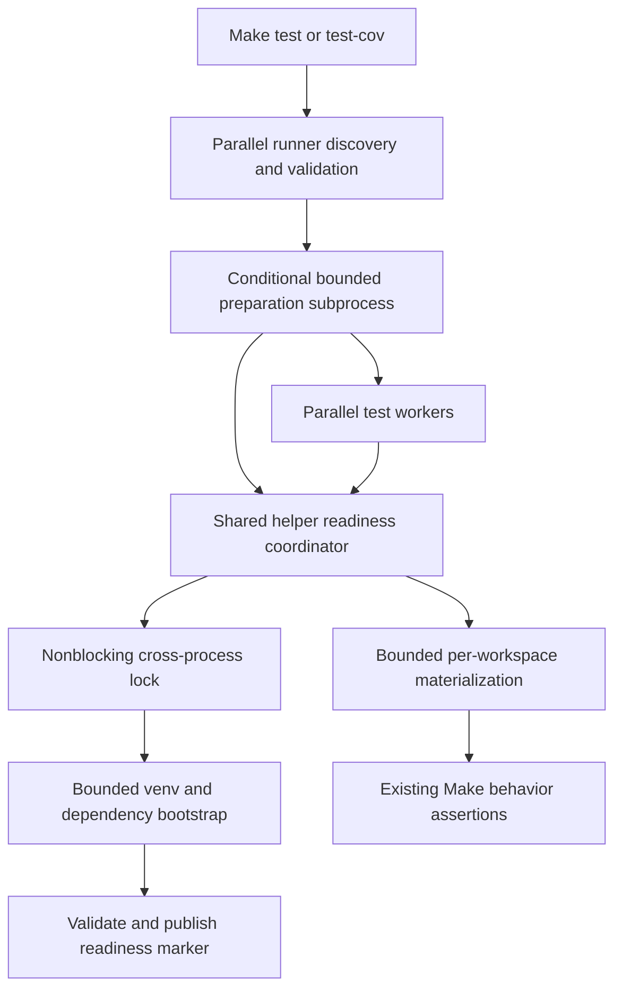

# PYPOST-1298: Bounded shared Make fixture readiness

## Research

### Repository evidence

`tests/makefile_test_helpers.py::_get_shared_base_venv` shares a temporary environment
between worker processes. It acquires a blocking exclusive `flock` and runs both environment
creation and dependency installation without subprocess deadlines. A caller can therefore
spend its entire test deadline waiting for another worker's cold preparation. The in-process
cache also accepts an existing directory without checking the initialization marker.

`make_workspace` materializes that environment into separate class workspaces. `_run_make`
also materializes missing environments. Current materialization uses unbounded `cp -al`.
The Make recipes and tests intentionally retain actual pip installation and import assertions.
Changing dependency visibility or substituting fake installations would change that coverage.

`scripts/run_parallel_tests.py` discovers file dispatch units before creating its executor
and worker pool. That boundary can prepare the shared prerequisite once before any test or
worker deadline starts. `tests/conftest.py` enforces explicit test timeouts and requires no
change. The Makefile already routes `test` and `test-cov` through the same runner.

### Official references

- Python documents nonblocking lock acquisition using `LOCK_NB`, with `EACCES` and `EAGAIN`
  indicating contention. Poll only those conditions; propagate other lock failures.
  [Python 3.11 fcntl](https://docs.python.org/3.11/library/fcntl.html).
- A monotonic clock supports a cumulative deadline independent of wall-clock changes.
  [Python 3.11 time](https://docs.python.org/3.11/library/time.html#time.monotonic).
- Subprocess timeouts terminate and reap the direct child. Process-group management is needed
  when prerequisite commands launch descendants; process creation itself may add OS overhead.
  [Python 3.11 subprocess](https://docs.python.org/3.11/library/subprocess.html).

### Decision and assumptions

Keep the existing isolated venv and pytest/flake8 bootstrap. Prepare it before dispatch rather
than requiring network installation to fit a 20-second fixture deadline. A normal installed
repository already has pytest through Make prerequisites, so importing the helper in a fresh
Python subprocess is supported. Importing that module does not load pytest conftest or Qt.

Reject offline distribution copying and system-site-packages inheritance: they would change
dependency isolation and overlap PYPOST-1363, which separately owns flake8 reporter discovery.
Reject higher test limits, fewer workers, suite exclusions, and serialized test execution.
Only prerequisite initialization is serialized; every test file remains independently dispatched.

## Implementation Plan

1. Add a narrow pre-dispatch preparation hook to the parallel runner after successful discovery
   and existing coverage validation, before creating/submitting workers. Call the helper through
   a bounded fresh subprocess using `config.python_bin`, repository cwd, and explicit import
   path. Do not run pytest collection or import conftest to perform preparation.
2. Trigger the hook only when the repository helper exists and selected units include the
   Make integration family (`tests/test_makefile_*.py`). This deliberately permits harmless
   preparation for contract-only files and covers the actual `make_workspace` consumers.
   Copied runners in minimal workspaces without the helper continue normally. Unrelated-only
   selections do not prepare anything. Document this selection rule when future consumers arise.
3. Give the helper an optional preparation-budget keyword. Preserve its zero-argument use.
   Replace blocking lock acquisition with nonblocking attempts against one monotonic deadline.
   Recheck readiness after acquisition, so competing requests build only once.
4. Bound each prerequisite subprocess with the remaining cumulative preparation budget.
   Validate the expected interpreter and successful pytest/flake8 imports before publishing
   the existing initialization marker. Set the process cache only after readiness succeeds;
   require marker and interpreter presence when reusing that cache.
5. Clear incomplete artifacts only while holding the shared lock. Never publish a marker on
   failure. Release the lock in all paths; a subsequent invocation can clean and retry.
   Keep prepared environments immutable and preserve workspace-specific Make stamp semantics.
6. Bound workspace materialization. Retain separate workspace directories and current hardlink
   behavior; remove a failed partial destination before a later retry. Do not change Make
   recipes, dependency versions, assertions, parallel inclusion, or existing test timeouts.

### Budgets and diagnostics

- Pre-dispatch cold preparation: 90 seconds cumulatively, including lock wait, venv creation,
  installation, and readiness validation. This allows existing network bootstrap more time
  than an individual fixture test while remaining finite. Reserve a further 5 seconds for
  process termination and cleanup; the runner watchdog is 95 seconds.
- Ordinary helper calls: 20 seconds cumulatively across wait and preparation, plus at most
  5 seconds reserved cleanup. Normal Make runs reach these calls with a prepared base.
- Workspace `cp`: 21 seconds total (20 seconds for the command and one for termination).
  Step 4 Make trials showed that the original five-second bound failed even a serial hardlink
  copy of the normal 28 MB environment on the workspace filesystem. A recursive hardlink
  variant without metadata preservation also failed, so retain `cp -al`. A 14-second command
  trial completed fixture setup and the clean/rematerialize tests without changing test limits.
  However, normal full-suite load still exceeded 14 seconds without a competing baseline
  installation. The command now receives 20 seconds, retaining nine seconds of the shortest
  existing 30-second test deadline for Make recipe assertions. No test deadline is changed.
- Lock polling: at most 50 milliseconds per sleep, clipped to the remaining budget. Tests
  inject a clock and sleepers rather than measuring tiny real elapsed-time differences.

These are explicit engineering bounds, not a claim that every network service responds in
90 seconds. An unavailable prerequisite fails before tests launch with its stage, shared path,
budget, and captured diagnostic output. The runner reports preparation failure through its
existing nonzero summary/report mechanism and submits no workers. Do not relabel it as a
passing/skipped test or weaken coverage configuration. Reap subprocesses and any descendants
before releasing ownership; keep cleanup inside the reserved budget. Bounds assume a responsive
OS and local temporary filesystem; Python cannot guarantee interruption of process creation.

### Mandatory failing repro for Step 3

Write `tests/test_makefile_shared_readiness.py` before implementation with an explicit
30-second module timeout and bounded event waits, joins, subprocess calls, and cleanup.
Use a private temporary shared root and reset the process cache, never the real global cache.
Do not require a package service. Fake prerequisite commands create a usable local executable
or delegate only local interpreter checks; record their invocation and supplied timeout.

1. Force lock contention with a real separate lock owner and an IPC readiness event. For
   deterministic expiry, stub the helper's `flock` to raise `BlockingIOError` on successive
   attempts and advance a fake monotonic clock to the deadline. Assert a stage-specific
   bounded preparation exception, no blocking `LOCK_EX`, and no published marker. On the
   current helper, have the stub reject its blocking operation immediately; the test fails
   its desired exception assertion without waiting for the outer test timeout.
2. Hold the first builder at a bounded event while launching multiple independent consumers.
   Assert no consumer returns before release, exactly one successful preparation occurs,
   all returned paths contain the marker/interpreter, and separate workspaces remain distinct.
   Release events and terminate/reap children in `finally`, including failed assertions.
3. Make the fake venv/install command raise `TimeoutExpired` and separately a nonzero result.
   Assert a positive remaining timeout was supplied, readiness was not published, ownership
   was released, and a later successful call repairs incomplete state. Simulate cumulative
   clock advancement so the second stage receives less budget rather than a fresh timeout.
4. Seed an incomplete directory into `_SHARED_BASE_VENV`; assert it is rebuilt or rejected
   instead of returned as ready. Simulate materialization failure and verify bounded retry
   without accepting the partial workspace as usable.
5. Add runner integration regressions in `tests/test_run_parallel_tests.py` using fake discovery,
   prerequisite subprocesses, and executor results. Assert preparation precedes every dispatch;
   preparation failure yields nonzero summary and zero dispatched units; unrelated selections
   and helper-free copied workspaces omit preparation. Preserve both normal and coverage paths.

At least the lock/deadline and stale-cache assertions must fail against the unmodified helper
for the intended behavioral reason. Step 3 may test current call signatures and patched
dependencies to avoid failures caused only by missing new APIs. Capture focused red results
through `make test PYTEST_ARGS=...`, obtain review, then implement until the same assertions
pass. Validate affected Make suites, runner tests, full `make test`, and full `make check` with
normal worker settings. Record unrelated baseline failures separately under sprint triage.

## Architecture

### Components and interfaces

| Component | Responsibility and interface |
| --- | --- |
| Runner preparation hook | Receives discovered units/config; prepares or raises before dispatch. |
| `_get_shared_base_venv` | Returns ready `Path`; optional budget; raises actionable stage failure. |
| Lock/deadline helpers | Carry one monotonic deadline; own exclusive preparation/recovery rights. |
| Bootstrap command helper | Runs a stage with remaining time; terminates/reaps on failure. |
| Initialization marker | Readiness commit point, published after all required stages succeed. |
| `_materialize_prewarmed_venv` | Receives workspace `Path`; copies ready base with bounded failure. |
| Existing fixtures/tests | Keep independent workspaces, imports, stamps, and Make assertions. |

Use single-writer initialization with double-checked readiness, plus explicit dependency
preparation before parallel fan-out. The lock remains filesystem-based because worker processes
do not share Python memory. The module cache is an optimization, never the source of readiness.
No new application module or dependency is needed. `tests/conftest.py` and Make recipes stay
unchanged; developer testing documentation records the new preparation boundary and deadlines.

## Q&A

- **Why does bounded locking alone not solve the issue?** It still leaves cold network work
  inside individual test deadlines. Pre-dispatch preparation removes that contention pressure.
- **Can consumers observe partial state?** They return only a validated published environment;
  failed attempts retain no success marker and recovery occurs under exclusive ownership.
- **Does this cover flake8 plugin contamination?** No. PYPOST-1363 owns that separate problem.
- **Who accepts this design?** The autonomous orchestrator after independent architecture review.
