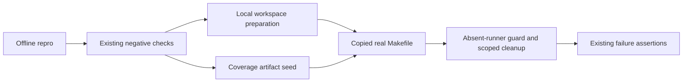

# PYPOST-1299: Offline preparation for missing-runner checks

## Research

The accepted requirements concern two negative checks in `tests/test_pytest_exit_policy.py`.
At task base `be43fa63`, their shared `_prepare_missing_runner_workspace` copies the real
Makefile, writes a small project, and executes `make install` with a 60-second timeout.
Installation creates a virtual environment, upgrades pip, and installs editable dev/OTel
extras. None of those packages is needed to exercise the absent-runner guard.

The supplied `/tmp/pypost-1298-step4-baseline-precise.log` records the ordinary check failing
after 60.05 seconds inside that installation subprocess, before the target recipe runs.
Both `test` and `test-cov` already reject a missing `scripts/run_parallel_tests.py`, delete
root `.coverage.*` files, emit `parallel runner unavailable` on stderr, and exit unsuccessfully.
The guard follows environment prerequisites, but a prepared fixture satisfies those locally.
There is no evidence requiring a Makefile change for this ticket.

`tests/test_parallel_runner_followups_repro.py::_seed_make_workspace` demonstrates the
repository's existing offline recipe-testing pattern: a link to the current interpreter and
three versioned preparation stamps. The broader `tests/makefile_test_helpers.py` preparation
can download dependencies and is unsuitable for this negative scenario.

GNU Make rebuilds a target when its normal prerequisites are newer; fixture stamps must be
created after the project metadata and environment marker. See the
[GNU Make manual](https://www.gnu.org/software/make/manual/make.html).
Python's standard library supports local interpreter links through
[Path.symlink_to](https://docs.python.org/3/library/pathlib.html#pathlib.Path.symlink_to).
Bounded calls retain the standard
[subprocess timeout contract](https://docs.python.org/3.11/library/subprocess.html).

`tests/test_makefile_parallel_budget.py` requires the ordinary check's timeout marker to be
at least 60 seconds and its target subprocess timeout to be at least 50 seconds. Retain the
existing 75-second markers and 60-second target subprocess limits; eliminate wasted work
rather than changing established suite budgets.

## Implementation Plan

1. Create and independently review the deterministic failing repro below before fixing the
   preparation helper. Confirm the failure identifies forbidden preparation, not network lag.
2. Replace only missing-runner workspace preparation with local files: copy the real
   Makefile, write project metadata, create `.venv/bin/python` linked to `sys.executable`,
   and create current-version initialized, dev, and OTel stamps in dependency order.
   Keep the runner absent. Remove obsolete package-seeding code only if this makes it unused.
3. Preserve the real `make test` and `make test-cov` calls and their existing failure/cleanup
   assertion helper. Set `WORKERS=1` for these isolated negative calls if needed to avoid
   evaluating the absent runner's worker-count import during Make expansion.
4. Run focused checks and the timeout-budget contract through `make test`, then the required
   repository quality gate through `make check`. Record durations to establish comfortable
   completion within the existing deadlines. Triage unrelated baseline failures separately.

### Mandatory Failing Repro for Step 3

Add `tests/test_pytest_exit_policy_offline_repro.py`, parameterized over both affected checks.
Import the existing test module and invoke each original check with its isolated temporary
directory. Wrap that module's `subprocess.run`, saving the real function before patching it.
The wrapper permits only the actual `make ... test` or `make ... test-cov` invocation for the
selected case and delegates it to the real subprocess implementation. Any preparation
subprocess, especially `make install`, raises an immediate assertion describing the offline
preparation contract. This deterministically fails the unchanged helper without downloading
packages or waiting for the historical timeout.

After the fix, require exactly one delegated target invocation per case, bounded completion,
an absent runner file, and no pip-install output. Calling the original check also retains
its real nonzero-exit, stderr diagnostic, root-fragment deletion, and base/nested preservation
assertions. The wrapper must never synthesize a successful or failing Make result. Declare
an explicit test/module timeout and use `make test PYTEST_ARGS=...` for execution.
Sequence: research -> reviewed red test -> helper correction -> green focused and full checks.

## Architecture

Use the existing isolated integration-test pattern with dependency substitution only at the
preparation boundary. The actual failure branch and filesystem cleanup remain observable.
The fixture's stamp files represent readiness for this early-rejection scenario; they are
not a reusable environment for successful package execution.

- `tests/test_pytest_exit_policy.py` owns preparation, target execution, coverage seeding,
  and the existing assertion helper. All affected behavior remains local to this module.
- `_prepare_missing_runner_workspace(tmp_path: Path) -> None` retains its interface. Its
  output is a ready isolated workspace without a runner and without installation side effects.
- `_seed_missing_runner_coverage_files` retains its three-path return contract: disposable
  root fragment, persistent root base file, and unrelated nested fragment.
- Make target calls return `subprocess.CompletedProcess[str]`; the assertion helper consumes
  that result and the three paths. Nonzero status alone never establishes the contract.
- `tests/test_pytest_exit_policy_offline_repro.py` independently enforces offline preparation
  while executing both real negative scenarios. It changes no application interface.
- `Makefile` and `scripts/run_parallel_tests.py` retain their current behavior. Existing
  successful-run and empty-test-policy checks remain validation of adjacent contracts.

## Q&A

- Is a test-fixture correction sufficient? Inspection supports that narrow design: the guard
  already supplies every required failure and cleanup outcome once prerequisites are ready.
- Why avoid the shared environment helper? Its package bootstrap is unnecessary for this guard
  and can reintroduce external downloads and preparation timeouts.
- Why preserve current timeouts? Existing budget checks intentionally constrain them; local
  preparation should make both negative checks fast without loosening those limits.
- Does a rejected install count as the expected Make failure? No. It is the deterministic red
  repro condition; green requires real target execution and all existing contract assertions.
