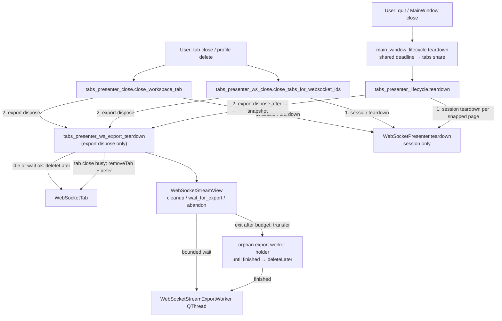

# PYPOST-1301: Guard WebSocket stream export teardown on tab removal and app exit

## Research

### Current production gap (verified)

- **`WebSocketStreamView` already has the PYPOST-1286 contract**
  (`pypost/ui/widgets/websocket/stream_view.py`):
  - `is_export_busy()`, `wait_for_export(timeout_ms)`, `cleanup()` →
    `wait_for_export(_WORKER_FINISH_WAIT_MS)` with `_WORKER_FINISH_WAIT_MS = 100`.
  - `closeEvent` refuses close when `cleanup()` returns `False` (WARNING
    `websocket_stream_export_worker_finish_wait_timeout … action=close_refused`).
  - Ownership lives in `self._export_worker` until `_finalize_export_worker`
    clears it and schedules `deleteLater()` after a successful nonblocking join.
- **No production caller invokes that contract.** Documented in
  `doc/dev/websocket_message_stream.md` and PYPOST-1286 TD-1
  (`ai-tasks/PYPOST-1286/60-tech-debt.md`): `QTabWidget.removeTab` never
  `close()`s the stream view, and nothing calls `cleanup()`.
- **Tab close paths today** (all end in `removeTab` only; page not deleted):
  - Generic workspace close: `tabs_presenter_close.close_workspace_tab`
    (`:52-60`) — RequestTab gets `teardown_tab`; then duck-typed
    `tab.presenter.teardown()` (WebSocket session close); then
    `removeTab`. No `stream_view.cleanup()`, no `deleteLater`.
  - Deleted-profile WS close: `tabs_presenter_ws_close.close_tabs_for_websocket_ids`
    (`:79-80`) — `removeTab` only; does **not** call session `teardown()` or
    stream cleanup.
  - Request / MCP bulk-close helpers likewise only `removeTab` (out of scope
    except that the **shared** workspace close path must gain disposal for
    WebSocket pages the same way).
- **`WebSocketTab.stream_view`** already exposes the embedded view
  (`websocket_tab.py:146-148`) — no new navigation API required to reach
  export ownership from the presenter.
- **Application exit** (`main_window_lifecycle.teardown`, PYPOST-1321 owner
  list): `tabs → history_panel → history_manager → collections → env` with a
  shared remaining-deadline grant. `TabsPresenter.teardown`
  (`tabs_presenter_lifecycle.py:85-172`) fences request workers and calls
  `McpClientTab.presenter.teardown()`, but **never walks WebSocket tabs for
  stream export ownership**, nor any pages already removed from the strip but
  still alive. Destroying a parentless running
  `WebSocketStreamExportWorker` at process teardown is the hard-abort risk
  (`QThread: Destroyed while thread is still running`).

### Qt / lifecycle external research

- **`QTabWidget.removeTab` does not delete the page** — callers must
  `deleteLater()` (or equivalent) themselves
  ([QTabWidget::removeTab](https://doc.qt.io/qt-6/qtabwidget.html#removeTab);
  common PyQt/PySide pattern: capture widget → `removeTab` → `deleteLater`).
- **Never destroy a running `QThread`** — wait for `finished` / `wait(deadline)`
  before deletion; `terminate()` is discouraged
  ([QThread](https://doc.qt.io/qt-6/qthread.html),
  [Qt Wiki QThreads usage](https://wiki.qt.io/QThreads_general_usage)).
- **Bounded close-while-worker**: request stop / wait with timeout / proceed
  without hanging — matches existing main-window budgets and PYPOST-1286
  `cleanup()` shape. Export write is not interruptible mid-write (out of
  scope); exit therefore needs an **ownership-release / orphan** path after
  the budget, not `terminate()`.
- **Orphaning a parentless `QThread`**: clearing `view._export_worker` without
  retaining another strong reference lets Python/Qt destroy the `QObject` while
  the native thread still runs (same abort). Abandon must **transfer** the
  reference to a process-lifetime holder until `finished`, then `deleteLater`.

### Related architecture to reuse (not reinvent)

| Precedent | Reuse for PYPOST-1301 |
| --- | --- |
| PYPOST-1286 stream_view `cleanup` / `wait_for_export` | Bounded wait attempt on both tab close and exit |
| PYPOST-1321 / `main_window_lifecycle` shared deadline | Exit wait is the tabs owner's allocated `timeout_ms` share (or remaining wall clock inside tabs teardown)—no new main-window owner |
| `tabs_presenter_lifecycle` helper module | Prefer extracting WS page disposal helpers beside close modules rather than growing `TabsPresenter` |
| Request `teardown_tab` before close | Analog: export-safe attempt before considering a WS page disposed |
| Qt `removeTab` does not delete pages; index shifts on mutate | Snapshot page refs before multi-page dispose; resolve index via `indexOf(page)` ([QTabWidget::removeTab](https://doc.qt.io/qt-6/qtabwidget.html#removeTab)) |

### Rejected alternatives (brief)

- **Rely on `closeEvent` alone** — `removeTab` never delivers it; TD-1 root cause.
- **Defer disposal on app exit the same as tab close** — process is ending;
  indefinite defer hangs shutdown (NFR / requirements).
- **`QThread.terminate()` on exit** — unsafe; out of scope vs abandon policy.
- **New main-window shutdown owner for stream export** — ownership is under
  tabs/pages; extend `TabsPresenter.teardown` instead (PYPOST-1321 pattern:
  extend the participant that already owns the widgets).
- **Export helper also owns session teardown** — rejected; session close stays on
  close modules / lifecycle (same duck-typed `presenter.teardown()` as today).
  The helper only owns stream-export wait / strip / deleteLater / abandon.
- **Extract shared worker-hold test helpers** — PYPOST-1304; may duplicate
  `_PendingJoinWorker` patterns locally for this task's red tests.
- **Iterate live strip indices while disposing multiple WS pages** — rejected;
  `removeTab` shifts indices and can re-enter via `currentChanged`; snapshot first.

## Implementation Plan

1. **Introduce a small WS page disposal helper** (new module preferred, e.g.
   `pypost/ui/presenters/tabs_presenter_ws_export_teardown.py`, or a tightly
   scoped addition next to `tabs_presenter_close.py`) that:
   - Resolves `WebSocketTab` → `stream_view`.
   - Runs `stream_view.cleanup()` (existing 100 ms budget) **or**
     `wait_for_export(timeout_ms)` when the caller supplies a larger exit share.
   - Does **not** call `WebSocketPresenter.teardown` — callers own session close
     before invoking the helper (see ownership below).
   - On success: `removeTab` if `indexOf(page) >= 0`, then `page.deleteLater()`.
   - On tab-close budget miss: `removeTab` so the strip updates promptly; keep
     the page alive; register deferred disposal until `export_finished` (then
     `deleteLater`). Do not force-destroy while busy.
   - On exit budget miss: call a new stream-view **abandon / release ownership**
     API (below), then dispose the page; do not hang.
2. **Wire both production close entry points** that remove WebSocket pages
   (**session teardown first, then export helper**):
   - `close_workspace_tab`: keep today's RequestTab / duck-typed session
     `presenter.teardown()`; replace bare `removeTab` with the export-safe
     helper for `WebSocketTab` pages (DoD “shared generic path”).
   - `close_tabs_for_websocket_ids`: invoke the same duck-typed session
     `presenter.teardown()` per closing tab (align with generic close), then
     the same export-safe disposal helper instead of bare `removeTab`.
3. **Extend `TabsPresenter.teardown` / lifecycle helper** for app exit with a
   **snapshot-then-dispose** WS phase under the same monotonic deadline as
   request/MCP fencing (details in Architecture):
   - After the existing request-fence / MCP `presenter.teardown()` work, compute
     remaining budget from the shared deadline.
   - Snapshot WS targets once (strip `WebSocketTab` widget refs + deferred set)
     **before** any WS `removeTab` / dispose mutates the strip.
   - For each snapped page: lifecycle calls session `presenter.teardown()`, then
     the export helper with `mode="app_exit"` and that page's remaining-ms grant.
   - Idle views cost effectively nothing; exhausted budget → `timeout_ms=0` →
     immediate abandon path for remaining pages.
4. **Add `WebSocketStreamView` abandon seam** (name TBD in Step 4, e.g.
   `abandon_export_for_shutdown()` / `release_export_ownership()`):
   - Transfers the running worker reference to a module-level (or app-scoped)
     orphan set keyed by the worker object.
   - Clears view busy state (`_export_worker = None`, re-enable export UI
     signals as today on finalize) so the view can be destroyed safely.
   - Connects orphan `finished` → finalize join / `deleteLater` / drop from set
     so the process does not abort on worker destruction.
   - Logs a WARNING with `action=export_abandoned` (no transcript payload/path
     content beyond existing conventions if path logging is already avoided).
   - Does **not** add user-facing cancel UX or change the write algorithm.
5. **Preserve open-tab export UX** — start/finish/fail, public busy/wait helpers,
   and `closeEvent` refuse-while-busy behavior for direct `close()` remain;
   only tab-removal and exit wiring change (plus the abandon API for exit).
6. **Observability** — structured events for deferred dispose scheduled /
   completed and exit abandon; reuse existing finish-wait timeout naming with
   distinct `action=` values (`dispose_deferred`, `export_abandoned`) so
   queries stay filterable. No payload content in logs.

**Mandatory — Failing Repro (next Step 3):**

- **Location**: `tests/test_pypost_1301_failing_repro.py` with module
  `pytestmark = pytest.mark.timeout(30)`, using `qapp`.
- **What it asserts (desired behaviour)**:
  1. **Busy tab removal (production path)**: open a real `WebSocketTab` in a
     `TabsPresenter` / tab widget harness; hold export ownership with the
     existing Event-blocked worker pattern (from `tests/test_pypost_1286_*`,
     inline duplicate OK — PYPOST-1304 out of scope); invoke
     `TabsPresenter.close_tab` / `close_workspace_tab` (not
     `stream_view.closeEvent` alone). Assert: tab leaves the strip; within the
     close wait budget the page is either deleted after ownership ends, or
     disposal is deferred while `is_export_busy()` remains true (page not
     force-destroyed); after release, deferred page is deleted.
  2. **Idle tab removal**: close with no busy export → page disposed
     (`deleteLater` / gone from live widgets) without meaningful wait.
  3. **Busy app exit (production path)**: with an owned export (and optionally
     a deferred hidden page), call `TabsPresenter.teardown(timeout_ms=…)` or
     the main-window lifecycle seam that invokes tabs teardown. Assert:
     teardown attempts export wait within the budget; if still busy after the
     budget, ownership is released (abandon) and teardown returns without
     hanging; destroying/tearing down the view does not leave a still-owned
     running worker solely on the view.
  4. **Idle exit**: teardown with no busy WS export adds no export wait
     failure / no abandon.
- **How to force failure without live external deps**: Qt test `qapp` + tab
  presenter harness + Event-held fake/`WebSocketStreamExportWorker` subclass;
  no real WebSocket server, no real disk export required beyond a temp path if
  the worker constructor needs one.
- **Red today**: close only `removeTab`s; page stays leaked; tabs teardown
  ignores stream export — asserts on cleanup invocation, deferred dispose, and
  exit abandon fail.
- **Sequencing**: research (this step) → red repro (Step 3, no production
  change) → wire helpers + abandon API (Step 4) until green → keep PYPOST-1286
  suite green.

## Architecture

### Module diagram

### Who calls `WebSocketPresenter.teardown` (session)

| Caller | Owns session teardown? | Owns export dispose? |
| --- | --- | --- |
| `tabs_presenter_close.close_workspace_tab` | **Yes** — existing duck-typed `tab.presenter.teardown()` before dispose | Yes — invokes helper after session teardown |
| `tabs_presenter_ws_close.close_tabs_for_websocket_ids` | **Yes** — add the same duck-typed call (align with generic close) | Yes — invokes helper after session teardown |
| `tabs_presenter_lifecycle.teardown` | **Yes** — for each snapped WS page at exit, call session teardown before the helper | Yes — invokes helper with `mode="app_exit"` |
| `tabs_presenter_ws_export_teardown` (helper) | **No** — never calls session teardown | **Yes** — sole owner of cleanup/wait/abandon + strip/`deleteLater`/defer |

Order on every WS close/exit path: **session teardown → export helper**. Session and export concerns stay separable; the Mermaid edges match the plan (no `HELPER → WSP`).

### Module responsibilities

| Module | Responsibility after this task |
| --- | --- |
| `tabs_presenter_close` | After draft prompts and RequestTab teardown, run WS session `presenter.teardown()`, then dispose via the export-safe helper (not bare `removeTab`). |
| `tabs_presenter_ws_close` | Same session-then-helper sequence for deleted-profile closes (session teardown newly aligned with generic close). |
| `tabs_presenter_ws_export_teardown` (new) | Single place for: bounded export cleanup attempt, strip removal via `indexOf`, immediate vs deferred `deleteLater`, exit abandon orchestration, tracking deferred pages for later exit. **Not** session teardown. |
| `tabs_presenter_lifecycle` | On app teardown: existing request/MCP fencing first; then snapshot WS pages + deferred set; session teardown + export dispose under remaining monotonic budget; report busy export counts in `TeardownResult` when useful. |
| `WebSocketStreamView` | Keep PYPOST-1286 wait/cleanup/closeEvent; add abandon/release API for exit-after-budget; public busy/wait helpers unchanged for open tabs. |
| `websocket_stream_export_worker` | Unchanged write algorithm; remains parentless; may be held by orphan set after abandon. |
| `main_window_lifecycle` | **No owner-list change** — tabs already participates; stream export is tabs-owned work. |

### App-exit WS phase (`TabsPresenter.teardown`)

Uses one monotonic deadline for the whole tabs owner share:

`deadline = started + budget_ms / 1000` (same shape as today's request wait loop).

1. **Request / MCP phase (existing)** — fence request workers, MCP
   `presenter.teardown()`, wait workers with `remaining_ms = max(0, deadline - now)`
   per wait. This phase **consumes** wall clock from the shared budget.
2. **Snapshot WS targets (no strip mutation yet)** — build a stable list of
   distinct `WebSocketTab` page widgets:
   - one pass over `range(tabs.count())` collecting `isinstance(..., WebSocketTab)`;
   - union with a copy of the deferred-disposal set.
   Do **not** call `removeTab` / helper dispose while building this list.
3. **Dispose from the snapshot** — for each page in the list (order fixed;
   document Step 4 pick: strip order then deferred-only pages, or deferred
   first — either is fine if deterministic):
   - `remaining_ms = max(0, int((deadline - monotonic()) * 1000))`
   - lifecycle: duck-typed session `presenter.teardown()` (idempotent / safe if
     already torn down);
   - helper: `dispose_websocket_tab_page(..., mode="app_exit",
     timeout_ms=remaining_ms)`.
4. **Per-page budget rule** — each page's export wait grant is **only the
   remaining wall clock at the start of that page's helper call**. Idle pages
   return immediately and leave almost all remaining budget for later pages.
   When `remaining_ms == 0`, the helper skips meaningful wait and takes the
   abandon path immediately so teardown never hangs.
5. **Strip mutation safety** — helper always resolves the tab index with
   `tabs.indexOf(page)` (or equivalent) at dispose time; if already off-strip
   (deferred page), skip `removeTab`. Never iterate live indices with
   `removeTab(i)` while disposing multiple pages. Snapshot + `indexOf` avoids
   index-shift / recursive `currentChanged` ambiguity during exit.

### Post-budget policy (lifecycle fork)

| Path | After bounded wait if still owned |
| --- | --- |
| Tab removal (process lives) | Defer page `deleteLater` until `export_finished`; tab already off strip. |
| App exit (process quitting) | Abandon: transfer worker to orphan holder, clear view ownership, dispose page; exit proceeds. Incomplete transcript accepted. |

Both paths **share** the initial bounded-wait attempt (`cleanup` / `wait_for_export`).

### Interfaces / APIs

| Surface | Contract |
| --- | --- |
| `WebSocketStreamView.cleanup() -> bool` | Unchanged: wait `_WORKER_FINISH_WAIT_MS`. |
| `WebSocketStreamView.wait_for_export(timeout_ms) -> bool` | Unchanged; exit path may pass remaining tabs budget. |
| `WebSocketStreamView.abandon_export_for_shutdown() -> None` (new) | Idempotent if idle; if busy, move worker to orphan holder, clear ownership/busy UI, log abandon; safe for subsequent view destruction. |
| `dispose_websocket_tab_page(presenter, tab, *, mode, timeout_ms)` (helper) | `mode="tab_close"` \| `"app_exit"`; export wait + strip removal via `indexOf` + dispose/defer/abandon. **Does not** call `WebSocketPresenter.teardown`. |
| `TabsPresenter` deferred set | Presenter-private collection of pages awaiting export finish (for exit snapshot + deferred delete). |
| `TabsPresenter.teardown(timeout_ms) -> TeardownResult` | Extended: after request/MCP, snapshot WS pages then session+export dispose under remaining monotonic budget; may report `incomplete` if abandon was required or wait exhausted (exact outcome mapping fixed in Step 4; must not hang). |

### Patterns and justification

- **Presenter helper extraction** — mirrors `tabs_presenter_close` /
  `tabs_presenter_lifecycle` / PYPOST-1321 collections lifecycle split; keeps
  LOC baselines and one disposal policy.
- **Composition-root unchanged** — stream export is not a sibling of `tabs`;
  it is page-owned work drained inside the tabs share (fair deadline already
  exists).
- **Ownership transfer for abandon** — satisfies Qt “do not destroy running
  QThread” without mid-write cancel UX or indefinite exit wait.
- **Session vs export ownership split** — duck-typed session teardown stays on
  close modules / lifecycle; export helper is additive after it, never a
  replacement for session slot release.
- **Snapshot-then-dispose** — matches Qt guidance that `removeTab` does not
  delete pages and mutates indices; exit must not walk a mutating strip.

### Risks

1. **Orphan holder must outlive the view** until `finished`; otherwise the same
   abort returns. Mitigation: module/app-scoped set + `finished` →
   `deleteLater`.
2. **Deferred pages + restore / new tab of same profile** — deferred page is
   hidden and removed from the strip; treat as disposed UI. Exit must still
   find it via the deferred set (included in the snapshot).
3. **Nested `QEventLoop` in `wait_for_export` during close/teardown** —
   accepted in PYPOST-1286 (TD-9); keep waits short / budget-capped.
4. **`close_tabs_for_websocket_ids` missing session teardown today** — fixing
   it alongside export disposal is in scope for consistent close semantics;
   do not expand into unrelated MCP/request bulk-close redesign.
5. **Test harness weight** — production-path tests need a real enough tab
   strip; keep doubles only where they still call the same close/teardown
   functions.
6. **Shared deadline starved by request/MCP phase** — WS export may see
   `remaining_ms=0` and abandon immediately; accepted under PYPOST-1321 fair
   share (no new main-window owner / budget). Idle WS still free.

## Q&A

- **Why not only fix `closeEvent`?** Tab removal never calls `close()` on the
  stream view; the guard would remain unreachable (PYPOST-1286 TD-1).
- **Why abandon instead of refuse exit?** Refusing main-window close while an
  export runs conflicts with NFR “exit must not hang”; requirements accept an
  incomplete file after the budget.
- **Why a helper instead of inlining in two close modules?** Generic strip
  close and deleted-profile close must share policy; exit reuses the same
  dispose/abandon core with a different `mode`.
- **Who calls `WebSocketPresenter.teardown`?** Close modules and
  `tabs_presenter_lifecycle.teardown` — never the export helper. Order is
  always session teardown, then export dispose.
- **How is exit budget split across WS pages?** One monotonic deadline for the
  whole `TabsPresenter.teardown` share. Request/MCP run first and consume time;
  each subsequent WS page gets only `remaining_ms` at helper entry (0 →
  immediate abandon). Snapshot pages before any WS strip mutation.
- **Does this change `_WORKER_FINISH_WAIT_MS`?** Not required for tab close
  (reuse 100 ms via `cleanup()`). Exit may use the larger remaining tabs share
  through `wait_for_export(remaining_ms)` so a nearly finished export can
  complete within the process budget.
- **Who accepts this architecture?** Autonomous sprint orchestrator after
  independent review PASS; Step 2 stays `[/]` until that gate marks `[x]`.
