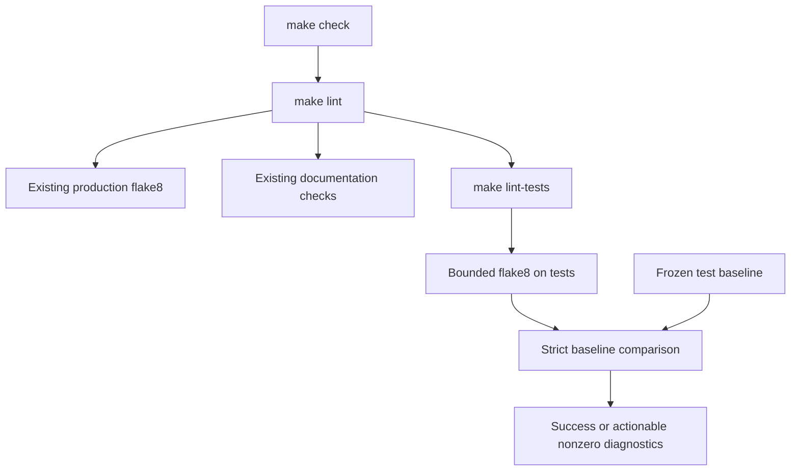

# PYPOST-1303: Test-source lint with a transparent legacy baseline

## Research

### Repository evidence and measurement

`Makefile::lint` runs flake8 on `pypost/` and retains the documentation checks. `check`
depends on `lint`, `test`, and artifact verification. `.flake8` sets a 100-character limit
and selects T201. The existing mypy gate demonstrates a reviewed multiset baseline rather
than a broad ignored category (`scripts/check_mypy_baseline.py`).

Measured test findings through a temporary analysis Makefile outside the repository:

```bash
make -f /tmp/pypost-1303-analysis.mk analyze-tests
make -f /tmp/pypost-1303-analysis.mk lint-tool-version
```

The first target runs the installed flake8 with `--jobs=1 --statistics --count tests/`;
Make exits 2 because findings exist. Evidence is `/tmp/pypost-1303-lint-inventory.txt`.
The tool-version target confirms flake8 7.4.1 and flake8-print 5.0.0 are installed.

| Code | Findings | Code | Findings |
| --- | ---: | --- | ---: |
| E127 | 2 | E128 | 1 |
| E203 | 5 | E302 | 163 |
| E303 | 3 | E304 | 48 |
| E305 | 25 | E501 | 47 |
| E741 | 3 | F401 | 45 |
| F541 | 1 | F811 | 46 |
| F841 | 3 | W293 | 5 |
| W391 | 12 | T201 | 0 |

Total: 409 legacy findings. Expanding the raw production command to `tests/` would require
broad edits to unrelated behavioral tests or leave the normal gate permanently red. Select
a test-only frozen baseline, preserving all selected categories for fresh findings. Do not
raise line limits, suppress F401/E501/T201 globally, or rewrite hundreds of legacy test lines.

The isolated Make fixtures copy the Makefile and a minimal test tree, but currently do not
copy a lint checker or baseline. Their minimal dev dependency set also lacks flake8-print.
Explicitly seed the new lint assets, shared configuration, and an empty baseline for their
clean miniature test tree. Otherwise a missing checker could invalidate existing lint tests
or tempt a silent bypass. Keep the real lint path active in those workspaces.

### Official references

Flake8 supports a machine-readable custom output format, explicit plugin requirements,
and per-file ignores; per-file ignores suppress a category for an entire file, which is too
broad for this adoption policy. See the
[official options reference](https://flake8.pycqa.org/en/latest/user/options.html).
Code-specific inline allowances are possible, but mass annotations across legacy files are
larger and less auditable than a separate frozen inventory; see the
[official violation policy](https://flake8.pycqa.org/en/latest/user/violations.html).

## Implementation Plan

1. Add `scripts/check_test_lint_baseline.py` and `test-lint-baseline.json`. Capture the current
   selected findings once during implementation, with their narrow identities and documented
   legacy-adoption reasons. Re-measure after adding new clean tests; do not baseline new defects.
2. Add `lint-tests`, using the existing environment/dev prerequisites. Have `lint` invoke that
   target while retaining its production flake8 command and documentation checks. `check`
   continues to include test lint through `lint`. Retain the existing single-job flake8 setting.
3. The checker runs flake8 on `tests/` using the repository configuration, a parseable format,
   `--require-plugins=flake8-print`, and a finite 60-second subprocess timeout. A clean minimal
   workspace may have an empty baseline; an absent baseline is an error, never an implicit pass.
4. Parse diagnostics strictly and compare their multiset to the validated baseline. New
   findings fail with current source locations. Fixed baseline entries also fail with a clear
   instruction to prune, preventing a removed defect from returning under a stale allowance.
5. Provide `make lint-tests-prune` to remove only fixed entries. It must refuse to write if
   current findings contain anything outside the baseline or validation/tool execution fails.
   Normal lint never modifies the baseline. There is no automatic acceptance/update mode.
6. Seed the checker, `.flake8`, and an explicitly empty valid baseline into the isolated Make
   test workspace helpers. Include the already-supported flake8-print dev dependency in the
   minimal fixture project. Preserve fixture isolation, real lint execution, and existing tests.
7. Document the gate, baseline identity, adoption reason, pruning command, and plugin failure
   diagnostics in developer testing documentation. Validate focused regressions, existing Make
   lint suites, then full `make test` and `make check` with normal settings and failure triage.

### Mandatory failing repro for Step 3

Add `tests/test_makefile_test_lint_gate.py` before implementation with a 60-second module
timeout and bounded subprocess calls through `_run_make`. Use a private miniature Make
workspace and the installed repository interpreter running actual flake8. Copy the Makefile,
configuration, and available gate assets; seed a valid empty baseline and clean source tree.
Locally satisfy the interpreter marker/dev stamp prerequisites after writing the project
inputs, so these gate regressions never install packages. Use an interpreter wrapper or link
inside the private `.venv/bin/` to preserve the real Make recipe. Original integration suites
retain their existing real installation coverage. Inject defects only into private source files.

- A clean isolated test file makes `make lint` succeed.
- An unused import in a new test file makes `make lint` fail and mention that file and F401.
  This is the primary meaningful red: current Make lint ignores test sources and returns zero.
- A long line and an unapproved print in test sources similarly fail with E501 and T201.
- An unused production import still fails with F401. Clean production/test sources pass.
- Confirm no pip command ran in these dedicated gate regressions. Avoid changing assertions,
  collection rules, or existing deadlines in original fixtures. Verify through focused `make test`.

During Step 4 add pure checker regressions in `tests/test_test_lint_baseline.py` with a
30-second module timeout. Cover clean and existing legacy matches, duplicate-count growth,
changed/new findings in the same file, fixed-entry ratcheting and prune-only writes, missing
or malformed schema, invalid paths/counts, unknown tool output, nonzero tool errors, timeouts,
plugin absence, and source lookup failures. Inject tool results for those error paths rather
than accessing external services. This sequencing preserves a behavioral red on the current
Make target before introducing the checker implementation.

## Architecture



### Components and interfaces

| Component | Responsibility and interface |
| --- | --- |
| `lint` | Preserve production/docs checks; execute the test lint target. |
| `lint-tests` | Run the checker with environment/dev prerequisites. |
| Checker CLI | Resolve repository root, validate baseline, run tool, report outcome. |
| Diagnostic parser | Convert every tool diagnostic to a finding; reject unknown output. |
| Multiset comparator | Detect new occurrences and fixed allowances without writing files. |
| Frozen JSON baseline | Versioned finding identities, positive counts, and justification. |
| `lint-tests-prune` | Remove only resolved allowances after a successful validated scan. |
| Make workspace seeding | Copy real lint assets and seed a valid empty baseline. |

The checker is a small standalone developer-tool module. Its repository root defaults to
its script's parent repository; optional explicit root/baseline inputs allow isolated unit
verification. It does not import application modules or pytest. Flake8 remains the source
of diagnostic truth; the checker owns only adoption policy and failure reporting.

### Baseline identity and validation

Identify a finding by repository-relative path, diagnostic code, normalized diagnostic text,
and the stripped physical source line at its reported row. Count duplicate identities rather
than using a set. Do not include current row/column in identity, so unrelated preceding edits
do not invalidate every allowance. Only normalize known volatile F811 `from line N` references;
do not erase arbitrary numbers or substantive diagnostic content.

Including source text makes a changed/new violating statement in an existing legacy file
fail even if its category and diagnostic text match an old finding. This is an occurrence
inventory, not a file-level suppression. An identical replacement at the same source identity
is intrinsically indistinguishable; stale-entry pruning closes the normal remove/reintroduce
case, while code review remains responsible for deliberate edits to the baseline itself.

The JSON schema carries a version and an ordered list of entries with identity fields,
positive integer count, and a nonempty reason. Reject unknown versions, malformed data,
duplicate identity entries, traversal/absolute/non-test paths, and invalid counts. Reasons
state that the exact existing occurrence is deferred to avoid unrelated behavioral-test
rewrites during gate adoption; no reason authorizes future defects or an entire category.

### Failure and output contract

- Flake8 exit 0 means no findings; exit 1 must contain valid parsed findings. Other exits,
  missing plugin, malformed/unrecognized output, timeout, or contradictory output fail closed.
- Require finite source rows and readable files inside the selected test tree. Missing source
  or invalid output paths fail instead of losing an unparseable finding.
- Print new findings with their live file, row, column, code, and message. Print fixed baseline
  identities with the prune command. Report accepted legacy counts transparently on success.
- Checker validation/tool failures return nonzero with a clear reason; Make propagates failure.
- Pruning is atomic and deterministic, preserves unresolved counts/reasons, and refuses any
  baseline growth. Normal lint and check remain read-only for source and baseline files.
- Do not pass `--exit-zero`, introduce test-tree ignores, or bypass checking when assets are
  missing. Explicit miniature-workspace seeding supplies the same real gate with empty debt.

## Q&A

- **Why baseline rather than fix all 409 findings?** The issue explicitly permits transparent
  legacy adoption; hundreds of unrelated test edits would broaden scope and review risk.
- **Will fresh F401, E501, or T201 findings pass in a baselined file?** No. Identity and count
  comparison detect new source statements and extra duplicate occurrences.
- **Does this weaken production lint?** No. Its existing command and configuration remain;
  the baseline comparator applies exclusively to test findings.
- **How do copied Make fixtures remain meaningful?** They receive the real checker/config,
  its required plugin dependency, and a valid empty baseline for their clean test tree.
- **Who accepts this design?** The autonomous sprint orchestrator after independent review.
