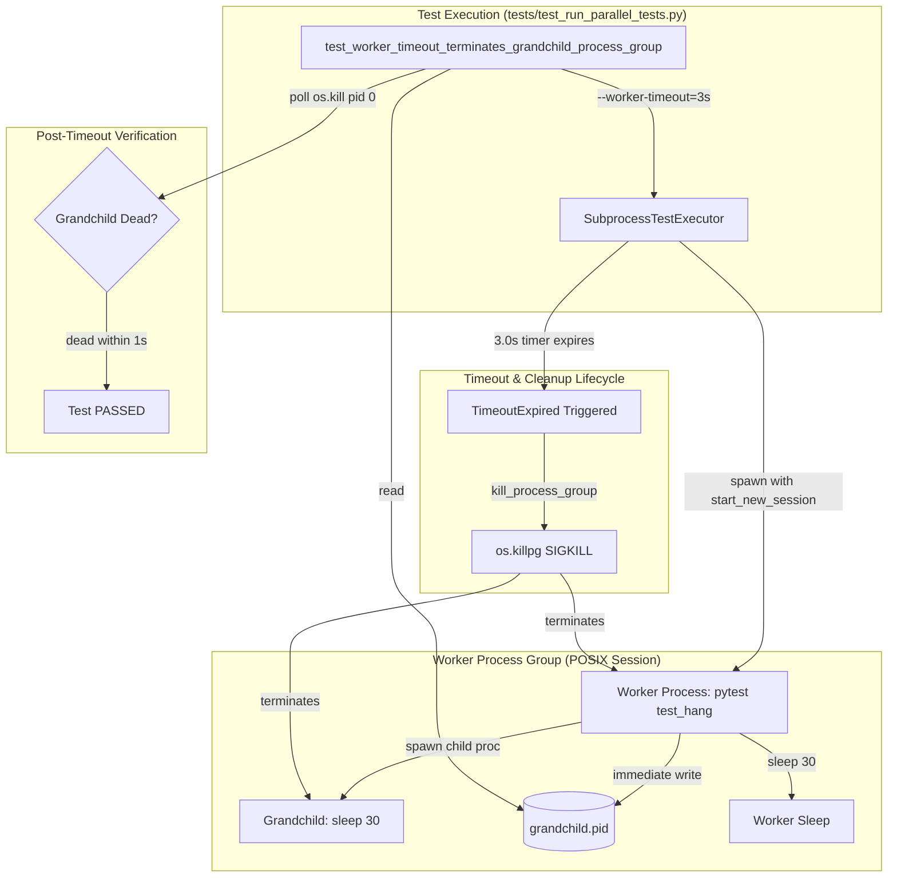

# PYPOST-1306: Deterministic process-group timeout verification under parallel load

## Research

### Problem analysis and triage findings

During sprint triage (PYPOST-1286, sprint 2021), the test suite experienced intermittent test
failures: `test_worker_timeout_terminates_grandchild_process_group` in
`tests/test_run_parallel_tests.py` failed with:
`AssertionError: Grandchild PID file was not created; stdout= stderr=worker timeout after 1.0s`.

Under parallel test execution (`scripts/run_parallel_tests.py` running with multiple worker
processes or under CI runner CPU contention), worker subprocess dispatch entails:
1. Spawning Python interpreter via `subprocess.Popen([sys.executable, "-c", ...])`.
2. Initializing pytest runtime, loading core plugins, and importing configured extensions.
3. Performing test discovery and collection on the generated test file.
4. Invoking the test function (`test_hang()`), which spawns a grandchild process and writes
   its PID to disk.

On an unloaded machine, steps 1-3 take approximately 0.2s to 0.4s. However, under parallel load
or CPU saturation, interpreter startup and pytest collection latency rises to between 0.8s and
1.2s.

Because the test configured `--worker-timeout=1`, `SubprocessTestExecutor.run_dispatch_unit`
enforced a hard 1.0s deadline on `proc.communicate(timeout=1.0)`. When startup latency met or
exceeded 1.0s, `subprocess.TimeoutExpired` was raised before `test_hang()` could execute or
write `grandchild.pid`. The runner then invoked `kill_process_group` and returned `timed_out`,
causing the post-dispatch assertion `assert pid_file.exists()` to fail deterministically on
startup latency rather than testing process termination.

### Execution timing budget analysis

The test is decorated with `@pytest.mark.timeout(15)`, providing a 15-second overall timeout
budget for the outer test execution.
- Pytest worker startup latency under heavy CPU load: 0.8s - 1.2s.
- Grandchild spawn and PID write duration: <0.05s.
- Grandchild and worker sleep duration: 30.0s (`time.sleep(30)`).
- Worker timeout budget: Expanding `--worker-timeout` from 1.0s to 3.0s (or 4.0s) provides
  300% to 400% headroom over startup latency under load.
- Dispatch unit duration: With a 3.0s or 4.0s worker timeout, the worker will reliably execute
  `test_hang()`, record the grandchild PID, and sleep until `SubprocessTestExecutor` times out
  at 3.0s or 4.0s.
- Post-timeout verification loop: Bounded polling loop checking `os.kill(grandchild_pid, 0)` with
  a 1.0s deadline (`time.perf_counter() + 1.0`), which completes in <0.1s once killed.
- Total test duration: Approximately 3.2s to 4.2s, which comfortably and safely sits well within
  the 15-second `@pytest.mark.timeout(15)` ceiling.

### Synchronization and filesystem persistence

In the generated `test_hang_with_grandchild.py`:
- `subprocess.Popen` creates the grandchild process.
- `pid_file.write_text(str(proc.pid), encoding="utf-8")` records the grandchild PID.
- To prevent filesystem caching delays or delayed directory visibility across processes, the PID
  write should be immediate and flushed.
- Both the grandchild process (`python -c "import time; time.sleep(30)"`) and the worker
  (`time.sleep(30)`) maintain long sleeps, ensuring neither exits naturally before the worker
  timeout fires.

### Production code verification

The production implementation in `scripts/run_parallel_tests.py` is robust and correct:
- `SubprocessTestExecutor` creates isolated process groups on POSIX using `start_new_session=True`.
- On timeout, `kill_process_group(proc.pid)` sends `signal.SIGKILL` to the process group via
  `os.killpg(pgid, signal.SIGKILL)`, correctly terminating the worker and all descendants.
- The flakiness is entirely confined to the test configuration in
  `tests/test_run_parallel_tests.py`, where an unrealistically tight worker timeout (1.0s) raced
  against interpreter startup.
- No changes to production code (`pypost/` or `scripts/run_parallel_tests.py`) are required.

## Implementation Plan

1. Step 3 (Failing Repro):
   - Create an automated red repro test `tests/test_pypost_1306_failing_repro.py`.
   - The test asserts the failure mechanism: when worker timeout is starved (e.g. 0.2s timeout
     or when startup latency exceeds worker timeout), `run_dispatch_unit` times out before
     the test payload executes, reproducing `AssertionError: Grandchild PID file was not created`.
   - The test asserts the passing contract: when configured with adequate headroom (3.0s or 4.0s),
     the worker reliably spawns the grandchild, writes the PID file, times out at the worker
     timeout boundary, and terminates the grandchild process group.
2. Step 4 (Development):
   - Update `test_worker_timeout_terminates_grandchild_process_group` in
     `tests/test_run_parallel_tests.py`:
     - Increase `--worker-timeout=1` to `--worker-timeout=3` (or 4s).
     - Ensure `test_hang_with_grandchild.py` writes and flushes `pid_file` immediately.
     - Keep outer timeout `@pytest.mark.timeout(15)`.
     - Preserve teardown safety in `finally` with `os.kill(grandchild_pid, signal.SIGKILL)`.
3. Step 5 (Code Cleanup):
   - Run code cleanup verification (`make lint`, `make typecheck`).
   - Create `ai-tasks/PYPOST-1306/40-code-cleanup.md`.
4. Step 6 (Observability):
   - Verify logging contracts and create `ai-tasks/PYPOST-1306/50-observability.md`.
5. Step 7 (Technical Debt Analysis):
   - Document any observed technical debt in `ai-tasks/PYPOST-1306/60-tech-debt.md`.
6. Step 8 (Dev Docs):
   - Update documentation as needed in `doc/dev/`.

**Mandatory — Failing Repro (next Step 3):**
- **What it asserts:** The desired behavior is that a worker timeout terminates grandchild
  processes in its process group without failing due to startup latency. The repro test asserts
  both sides of the race:
  1. Starving the startup budget (e.g., `--worker-timeout=0.2`) forces the failure observed in
     triage (`AssertionError: Grandchild PID file was not created; stdout= stderr=...`)
     without relying on live external dependencies or uncontrollable host CPU load.
  2. Providing sufficient budget (3.0s or 4.0s) ensures deterministic creation of `grandchild.pid`
     and verified grandchild process termination.
- **Where it lives:** `tests/test_pypost_1306_failing_repro.py`.
- **How to force the failure without live external deps:** By passing an intentionally short
  `--worker-timeout=0.2` to `SubprocessTestExecutor`, Python and pytest startup (which naturally
  takes >0.2s) will reliably exceed the timeout, reproducing the premature timeout error.
- **Sequencing:** Research & Architecture (Step 2) → Failing Repro (Step 3) → Implementation Fix
  in `tests/test_run_parallel_tests.py` (Step 4) until all quality gates pass green.

## Architecture

### Module definitions and responsibilities

- **`tests/test_run_parallel_tests.py`**:
  Contains `test_worker_timeout_terminates_grandchild_process_group`. Sets up temporary
  workspace, configures runner CLI flags, dispatches unit, and verifies grandchild termination.
- **`scripts/run_parallel_tests.py`**:
  Implements parallel test runner CLI parsing, unit discovery, dispatch execution,
  timeout monitoring, and POSIX process-group signaling.
- **`SubprocessTestExecutor`**:
  Spawns worker processes with isolated sessions (`start_new_session=True`), monitors timeout
  via `communicate(timeout=...)`, and dispatches cleanup on timeout.
- **`Worker Subprocess`**:
  Isolated Python process running pytest. Discovers and runs `test_hang_with_grandchild.py`,
  spawns grandchild process, records PID, and sleeps.
- **`Grandchild Process`**:
  Subprocess spawned by the worker (`python -c "import time; time.sleep(30)"`). Shares the
  worker's process group.
- **`grandchild.pid`**:
  Filesystem synchronization artifact recording the grandchild process ID so the parent test
  can inspect its lifecycle.

### Module interaction scheme

1. **Setup**: The test creates a temporary directory with `tests/test_hang_with_grandchild.py`
   and determines the path for `grandchild.pid`.
2. **Configuration**: `CLIParser.parse_args` configures `--workers=1`, `--worker-timeout=3`
   (or 4s), and target test file.
3. **Dispatch**: `SubprocessTestExecutor.run_dispatch_unit` launches the worker process using
   `python -c "import sys, os, pytest; ..."` with `start_new_session=True`.
4. **Execution**:
   - The worker initializes Python and pytest (~0.8s - 1.2s under load).
   - Pytest executes `test_hang()`.
   - `test_hang()` spawns grandchild process sleeping 30s.
   - `test_hang()` immediately writes grandchild PID to `grandchild.pid`.
   - `test_hang()` sleeps 30s.
5. **Timeout expiration**:
   - At 3.0s (or 4.0s), `proc.communicate(timeout=...)` raises `TimeoutExpired`.
   - `SubprocessTestExecutor` catches `TimeoutExpired` and calls `kill_process_group(proc.pid)`.
   - `kill_process_group` executes `os.killpg(pgid, signal.SIGKILL)`, killing both the worker
     and the grandchild process.
   - `run_dispatch_unit` returns `RunResult(status="timed_out")`.
6. **Verification**:
   - The test asserts `result.status == "timed_out"`.
   - The test asserts `pid_file.exists()`, which succeeds deterministically because the worker
     had ample headroom to execute `test_hang()` and write the PID file.
   - The test reads `grandchild_pid` and polls `os.kill(grandchild_pid, 0)` with a 1.0s deadline.
   - Once `os.kill` raises `ProcessLookupError`, the test asserts the grandchild is dead and passes.
7. **Teardown**: A `finally` block ensures any lingering grandchild process is terminated via
   `os.kill(grandchild_pid, signal.SIGKILL)`.

### Selected architectural patterns and justification

1. **Process Group Isolation Pattern (`start_new_session=True` / `os.killpg`)**:
   Standard POSIX pattern where the worker creates a new session and process group. When a worker
   times out, sending `SIGKILL` to the process group (`-pgid`) guarantees all descendant processes
   (including grandchildren) are cleanly terminated without leaving orphaned background processes.
2. **Watchdog Timer with Headroom Pattern**:
   A watchdog timeout must account for worst-case initialization variance. In concurrent test
   execution, interpreter startup can fluctuate significantly under CPU load. Allocating 3.0s or
   4.0s (3x to 4x baseline startup) guarantees that normal initialization does not prematurely trip
   the watchdog.
3. **Durable Filesystem Barrier Pattern**:
   Immediate and flushed writing of `grandchild.pid` ensures that once the child process spawns,
   its identifier is immediately visible to parent assertions.

### Main interfaces and APIs

- `CLIParser.parse_args(args: Sequence[str], repo_root: Path) -> RunnerConfig`:
  Parses command line arguments, extracting `--workers`, `--worker-timeout`, and pytest options.
- `SubprocessTestExecutor.run_dispatch_unit(...) -> RunResult`:
  Executes a single test unit in a child process group, returning execution outcome including
  `status` (`passed`, `failed`, `skipped`, or `timed_out`), `stdout`, and `stderr`.
- `kill_process_group(pid: int, run_id: str = "-") -> None`:
  Sends `signal.SIGKILL` (POSIX) or `signal.SIGTERM` (Windows) to the process group associated
  with `pid`.

## Q&A

- **Why increase worker timeout to 3s-4s instead of keeping 1s?**
  Under parallel load or slower CI hardware, Python interpreter startup and pytest collection
  alone can take ~0.8s to 1.2s. A 1.0s timeout leaves zero margin for error, causing premature
  timeouts before the test payload even executes. 3s to 4s provides reliable headroom while keeping
  test duration fast.
- **Does increasing worker timeout slow down the test suite significantly?**
  No. This is a single test verifying process-group termination on timeout. Increasing timeout from
  1s to 3s adds only ~2 seconds to this single test, while eliminating intermittent test failures
  that cost developer hours in retries and investigation.
- **Does this stay within the outer test timeout budget?**
  Yes. The test is decorated with `@pytest.mark.timeout(15)`. Total execution duration with a 3s-4s
  worker timeout is ~3.2s-4.2s, leaving over 10 seconds of safety margin under the 15-second limit.
- **Why are no production runner changes made?**
  The runner's `SubprocessTestExecutor` and `kill_process_group` correctly isolate and terminate
  process groups. The failure was caused exclusively by an aggressive test timeout parameter racing
  with subprocess initialization latency.
- **How will Step 3 repro prove the failure without relying on heavy host load?**
  By running with an artificially starved worker timeout (e.g. `--worker-timeout=0.2`), the repro
  test reliably forces startup latency to exceed the timeout budget, deterministically producing
  the exact `AssertionError: Grandchild PID file was not created` failure observed in triage.
- **Who accepts this architecture design?**
  The autonomous sprint orchestrator after independent review.
