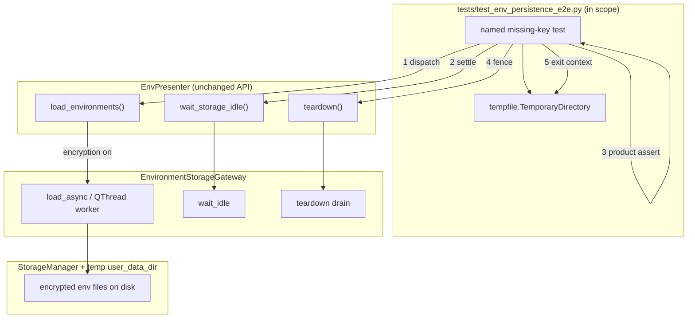

# PYPOST-1311: Env persistence e2e temp-dir cleanup under load

## Research

### Defect shape (code + ticket evidence)

- **In-scope test**:
  `tests/test_env_persistence_e2e.py` ::
  `test_presenter_load_shows_no_env_when_key_missing_for_encrypted_data`
  (module `pytestmark = pytest.mark.timeout(120)`).
- **Symptom**: after product asserts, `tempfile.TemporaryDirectory.__exit__` →
  `rmtree` raises `OSError: [Errno 39] Directory not empty` (temp path under
  `/tmp/...`). Observed under full-suite `make check`; focused file runs often
  pass (PYPOST-1297 discovery; Jira PYPOST-1311).
- **Log adjacency**: failure followed
  `environment_storage_async_load_dispatched` — the encrypted load path, not the
  sync `StorageManager.load_environments()` branch.
- **Why only this scenario races**: with encryption enabled,
  `EnvPresenter.load_environments()` dispatches
  `EnvironmentStorageGateway.load_async()` and **returns without applying UI
  state** (`env_presenter.py`). The worker is a `QThread`
  (`EnvironmentStorageWorker`) that reads the patched `user_data_dir` temp
  workspace. Sibling tests in the same file use sync load (encryption off) or
  no presenter async load, so they do not leave a worker on the temp tree.
- **Test gap today**: the named test never calls
  `presenter.wait_storage_idle(...)` or `presenter.teardown(...)` before leaving
  the `TemporaryDirectory` context. Product asserts run immediately after
  dispatch. Initial presenter state (`environment_count() == 1`, index `0` =
  “No Environment”) matches the desired missing-key end state, so asserts can
  pass **before** the async load finishes — leaving cleanup racing the worker
  under load.

### Existing product lifecycle surfaces (reuse, do not reinvent)

- `EnvPresenter.wait_storage_idle(timeout_ms)` — bounded pump /
  `processEvents` until gateway idle
  (`EnvironmentStorageGateway.wait_idle`).
- `EnvPresenter.teardown(timeout_ms)` / `begin_teardown()` — uniform presenter
  teardown: fence admission, drain gateway (`env_presenter_lifecycle`).
- `EnvironmentStorageGateway` — owns one load/save worker plus pending
  coalescing; exposes `wait_idle` / `teardown`.
- Late-delivery fencing —
  `on_storage_load_failed` / `on_storage_load_completed` ignore UI updates
  after teardown (`env_presenter_lifecycle`).

Documented contract: `doc/dev/presenter_teardown.md` — `wait_idle` is
synchronization, not a substitute for `teardown()`’s result; both are already
used in suite tests (e.g. `tests/test_mcp_builtin_paired_env.py`,
`tests/test_presenter_teardown_contract_repro.py`).

### External research (cleanup races)

- **Python `TemporaryDirectory`**: cleanup calls `rmtree`; concurrent writers or
  unfinished threads commonly yield `OSError` / “directory not empty”
  ([tempfile docs](https://docs.python.org/3/library/tempfile.html);
  [bpo-29982](https://bugs.python.org/issue29982);
  [slivka FS race report](https://github.com/bartongroup/slivka/issues/155)).
- **`ignore_cleanup_errors=True`**: best-effort silence of cleanup failures
  ([PR #24793](https://github.com/python/cpython/pull/24793)). Suitable as a
  last-resort FS quirk shield, **not** as the primary fix when the process still
  owns a live worker on that tree.
- **Qt test practice**: stop/join `QThread` work before test-end FS cleanup
  (pytest-qt `waitSignal`; see Q&A Qt teardown link).

### Selected approach vs alternatives

- **Selected — test-only fence**: after `load_environments()`, bounded
  `wait_storage_idle`, then product asserts, then `teardown()` **inside** the
  temp-dir context (`try`/`finally`). Matches ticket candidate, reuses public
  APIs, preserves coverage.
- **Selected companion**: assert product state only after idle / failed-load
  settlement — makes US3 honest under the async path.
- **Rejected as primary**: `TemporaryDirectory(ignore_cleanup_errors=True)`
  alone — masks race; worker may still touch removed paths.
- **Rejected**: skip / quarantine / drop timeout markers — DoD forbids.
- **Rejected**: broad env-storage redesign — out of scope.
- **Out of scope**: product behavior change for missing-key decrypt unless
  Step 3+ proves a real product bug; contracted check stays.

### Defect hypothesis (for Step 3 to pin)

Working hypothesis (requirements + code): unfinished encrypted async load still
uses the temp workspace when `TemporaryDirectory` cleans up. Step 3 must force
that race deterministically (gate/slow worker) rather than relying on full-suite
luck. If evidence shows a different root cause, refine the same test-harness
boundaries without expanding into a storage redesign.

## Implementation Plan

1. **Keep production APIs as-is** unless a genuine product bug is proven. Prefer
   fixing the e2e harness lifecycle around existing
   `wait_storage_idle` / `teardown`.
2. **Harden the named e2e scenario** in
   `tests/test_env_persistence_e2e.py`:
   - Retain encryption on → save with key → load with empty key flow.
   - After `presenter.load_environments()`, call bounded
     `wait_storage_idle(timeout_ms=...)` (assert True; stay within module
     timeout).
   - **Then** assert no environment shown (`environment_count() == 1`,
     `current_environment_index() == 0`, or equivalent clear “No Environment”
     meaning).
   - Call `presenter.teardown(timeout_ms=...)` before leaving the
     `TemporaryDirectory` context (`try`/`finally` so cleanup always fences).
   - Keep module/class timeout markers; no skips.
3. **Optional sibling helpers**: only if needed for clarity — small local
   `finally` helper in the e2e module; do not invent a new gateway API.
4. **Validation (Make-only)**: focused
   `make test … PYTEST_ARGS='tests/test_env_persistence_e2e.py …'`; then bounded
   full-suite / parallel evidence akin to `make check` (DoD US5 / DoD items 5–7).

**Mandatory — Failing Repro (next Step 3):**

- **Not** `N/A` — runtime test behavior must change (lifecycle fence + honest
  async settlement before temp-dir exit).
- **Location**: prefer a dedicated durable contract module, e.g.
  `tests/test_env_persistence_tempdir_cleanup_repro.py` (name final in Step 3),
  with per-test or module `@pytest.mark.timeout(...)` per do-testing rules.
  Keep the named e2e as the product coverage home; the repro forces the race.
- **Desired behavior asserted**:
  1. Encrypted missing-key presenter load against a temp workspace.
  2. Async load forced in-flight (storage double / gate / hold, same pattern as
     `tests/test_presenter_teardown_contract_repro.py` env gateway holds) so
     cleanup would race without a fence.
  3. After the scenario’s product checks (no env shown when key missing),
     leaving the temp-dir context **must not** raise
     `OSError` / “Directory not empty” (or equivalent cleanup error).
- **How to force failure without live external deps**: in-process gate on
  storage load (threading.Event), `qapp` only; no network. On current code
  (no wait/teardown before `__exit__`), the repro goes **red** by observing
  cleanup `OSError`. After Step 4 fence (`wait_storage_idle` + `teardown`
  before exit — applied to repro and named e2e), it goes **green**.
- **Sequencing**: research (done) → red repro (Step 3) → fix harness until green
  (Step 4) → focused + bounded full-suite Make evidence.

## Architecture

### Module diagram



### Module responsibilities

- `tests/test_env_persistence_e2e.py` — product e2e: missing-key → no env;
  **add** idle wait + teardown before temp-dir exit.
- Step 3 repro test module — deterministic red→green contract for cleanup
  without `Directory not empty` under held async load.
- `EnvPresenter` — existing load / wait / teardown façade; **no redesign**.
- `env_presenter_lifecycle` — existing teardown + late-load fencing.
- `EnvironmentStorageGateway` — existing async worker + `wait_idle` /
  `teardown`.
- `StorageManager` / encryption adapters — persist/load encrypted envs;
  unchanged unless a proven product defect appears.
- Make / pytest harness — only validation channel
  (`make test` / `make check`).

### Interaction scheme (target test sequence)

1. Enter `TemporaryDirectory`; patch `user_data_dir` / config dir to it.
2. Save encrypted environments with a valid key (existing setup).
3. Build `EnvPresenter` with encryption enabled and **empty** key.
4. `load_environments()` → async dispatch (log:
   `environment_storage_async_load_dispatched`).
5. `assert presenter.wait_storage_idle(timeout_ms=…)` — settle worker; pump Qt
   events so load-failed → empty environments apply.
6. Product asserts: no environment shown (preserve current meaning).
7. `presenter.teardown(timeout_ms=…)` in `finally` — fence + drain.
8. Exit `TemporaryDirectory` — `rmtree` must succeed without “Directory not
   empty”.

### Patterns

- **Test harness lifecycle fence** — join/drain async ownership before FS
  fixture teardown (Qt/tempfile race literature + repo presenter contract).
- **Reuse uniform teardown contract** — do not add a parallel shutdown API.
- **Honest async assertion** — observe UI after idle, not only at dispatch.
- **Make-only validation** — focused then load-comparable suite evidence.

### Interfaces (no new production API required)

- `EnvPresenter.load_environments() -> None` — dispatches async when
  encryption enabled.
- `EnvPresenter.wait_storage_idle(timeout_ms: int = 30000) -> bool` — True
  when gateway has no worker/pending work within budget.
- `EnvPresenter.teardown(timeout_ms: int | None = None) -> TeardownResult` —
  idempotent bounded drain; default 5000 ms.
- `EnvironmentStorageGateway.wait_idle` / `teardown` — underlying idle + drain
  (via presenter).
- Pytest module timeout — retain `pytestmark` / per-test timeouts; do not
  disable.

### Dependencies

```
named e2e / cleanup repro
  → EnvPresenter (wait_storage_idle, teardown, load_environments)
    → EnvironmentStorageGateway (QThread worker)
      → StorageInterface / StorageManager (temp user_data_dir)
  → tempfile.TemporaryDirectory (exit only after gateway idle + teardown)
```

No new package dependencies. No Makefile target changes expected unless Step 4
discovers a documentation-only Make example worth adding (out of scope unless
needed for DoD evidence commands in dev docs later).

### Scope boundary

- **In**: test lifecycle ordering for the named scenario (+ durable cleanup
  repro); bounded Make evidence.
- **Out**: encryption product redesign; skipping tests; silencing
  `TemporaryDirectory` errors as the sole fix; unrelated full-suite failures.

## Q&A

- **Q: Is this a production bug or a test harness bug?**
  **A:** Evidence points to harness lifecycle vs async encrypted load. Production
  already exposes `wait_storage_idle` / `teardown`. Fix is test-first; product
  code changes only if Step 3+ proves otherwise.

- **Q: Why wait before assert, not only before temp-dir exit?**
  **A:** Immediate asserts can pass on initial empty UI while the worker still
  runs. Waiting first preserves US3 (honest missing-key coverage) and removes
  the cleanup race.

- **Q: Why not `ignore_cleanup_errors=True`?**
  **A:** It hides `Directory not empty` without ensuring the worker released the
  tree; conflicts with an honest quality signal (requirements NFR).

- **Q: Does the ticket mandate `wait_storage_idle` + `teardown`?**
  **A:** No — candidate only. Architecture selects that pair because it already
  matches the uniform presenter contract and suite precedents. Step 3 may refine
  ordering/budgets with evidence.

- **Q: Links**
  - Issue: [PYPOST-1311](https://pypost.atlassian.net/browse/PYPOST-1311)
  - Discovery: [PYPOST-1297](https://pypost.atlassian.net/browse/PYPOST-1297)
  - Contract: `doc/dev/presenter_teardown.md`
  - tempfile: https://docs.python.org/3/library/tempfile.html
  - bpo-29982: https://bugs.python.org/issue29982
  - Qt teardown:
    https://czaki.github.io/blog/2024/09/16/preventing-segfaults-in-test-suite-that-has-qt-tests/
