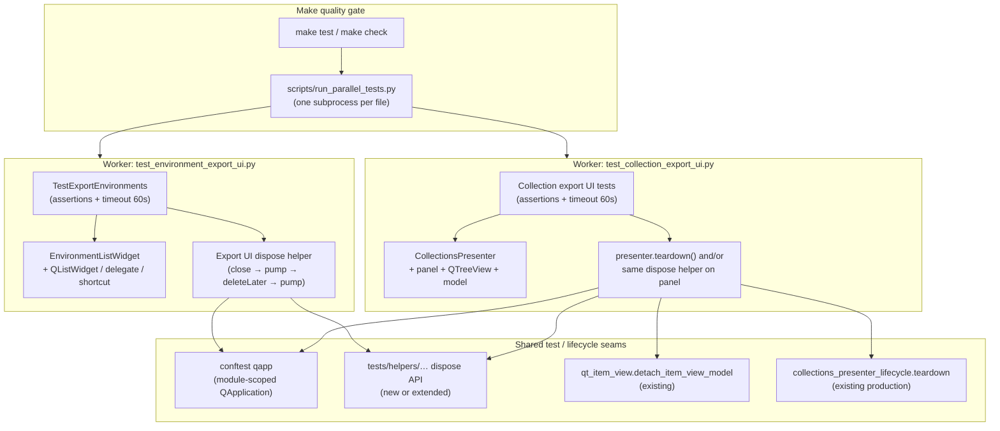

# PYPOST-1315: Flaky environment export UI worker segfaults after all tests pass

## Research

### Symptom and evidence (repository + Jira)

- **Primary failure** ([PYPOST-1315](https://pypost.atlassian.net/browse/PYPOST-1315), discovered in
  PYPOST-1266): `make check WORKER_TIMEOUT=120` ran
  `tests/test_environment_export_ui.py` to eight `PASSED` lines, then the native worker died with
  `exit_code=-11` (SIGSEGV), no Python traceback
  (`ERROR test_file_failed … file=tests/test_environment_export_ui.py exit_code=-11`).
- **Focused contrast**: two unchanged-tree reruns of
  `make test PYTEST_ARGS=tests/test_environment_export_ui.py WORKERS=1 WORKER_TIMEOUT=120`
  exited 0 (~1.6s). Observed rate ≈ 1 failure / 3 attempts under differing parallel load — flaky
  by unchanged-tree evidence, not a deterministic single-run baseline.
- **Related twin** (issue comment from PYPOST-1334 work):
  `tests/test_collection_export_ui.py` workers crashed with `exit_code=-11` (once `-7` / SIGBUS)
  under disk pressure on `/home/src`; the same file passed 3/3 from a worktree on another disk.
  Root cause not investigated there; classified as likely the same Qt teardown class.

### Process model in this repo

- `make test` / `make check` use `scripts/run_parallel_tests.py`: **one OS subprocess per test
  file**, offscreen QPA, per-file worker timeout ([parallel test runner](../../doc/dev/parallel_test_runner.md)).
- `tests/conftest.py` provides a **module-scoped** `qapp` fixture
  (`QApplication.instance() or QApplication([])`) — no session-end widget purge, no
  `pytest-qt` / `qtbot` dependency.
- A worker death after the last `PASSED` is therefore a **post-assertion process crash** inside
  that file’s subprocess: Python assertions already succeeded; interpreter / Qt finalization (or
  late deferred deletes) then SIGSEGV. The orchestrator correctly records `exit_code=-11` as a
  file failure — a false quality signal relative to product assertions.

### Distinct prior crash classes (do not conflate)

| Class | Ticket / doc | Crash site / shape | Relation to PYPOST-1315 |
| --- | --- | --- | --- |
| Large-batch `apply_theme` | PYPOST-1212 / [gui_batch_segfault.md](../../doc/dev/gui_batch_segfault.md) | Mid-batch in `StyleManager.apply_theme` / `QStyleFactory.create` after many GUI modules in one process | Different trigger and site; reuse **subprocess isolation + signal decoding** patterns only |
| SettingsDialog / `QWidgetItem` | PYPOST-1040 / PYPOST-1115 (cited in 1212 docs) | Session-end GC / Shiboken destructor | Different object graph; same *family* (ownership at teardown) |
| Presenter lifecycle contract | PYPOST-1256 / [presenter_teardown.md](../../doc/dev/presenter_teardown.md) | Bounded `teardown()` for async owners | Collections has a production `teardown()` the export UI tests do **not** call |
| Item-view model detach | PYPOST-940 / `tests/helpers/qt_item_view.py` | Detach model before destroying views | Collections production code already parents `QStandardItemModel` to the view; export UI tests still only `panel.close()` |

### In-scope test surfaces (current teardown)

**Environment export** (`tests/test_environment_export_ui.py`):

- Builds unparented `EnvironmentListWidget` (includes `QListWidget`, `EnvironmentNameDelegate`,
  `QShortcut`).
- Module list `_created_widgets` + autouse `_cleanup_widgets`: after each test,
  `close()` → `deleteLater()` → single `qapp.processEvents()`.
- Each test `finally` also calls `widget.close()` only — **double-close**, then deferred delete
  once the fixture runs.
- Assertions and `pytestmark = pytest.mark.timeout(60)` must be retained unchanged.

**Collection export** (`tests/test_collection_export_ui.py`):

- Builds `CollectionsPresenter` → unparented panel (`build_collections_panel` → `QWidget()`),
  tree + model (model parented to view — see comment in
  `collections_presenter.py` about unparented-model teardown risk).
- Every test `finally`: `presenter.panel.close()` only — **no** `deleteLater`, **no**
  `processEvents`, **no** `presenter.teardown()`.
- Same timeout marker class; include in fix/validation when the same lifetime defect applies.

**Contrast helpers that already drain deferred deletes safely**:

- `tests/helpers/qt_activation.py`: `close()` → `processEvents()` → `deleteLater()` →
  `processEvents()`.
- `tests/helpers/qt_item_view.py`: detach model → `close()` → `processEvents()`.

### External research (Qt / pytest-qt teardown)

- [Preventing segfaults in test suites with Qt tests](https://czaki.github.io/blog/2024/09/16/preventing-segfaults-in-test-suite-that-has-qt-tests/)
  (Bokota / napari practice): Python GC does not track Qt C++ refs; pending events against a
  collected wrapper → SIGSEGV, often **after** the responsible test. Mitigations: schedule
  top-level widgets with `deleteLater`, stop timers/threads, prefer `qtbot.add_widget` (or
  equivalent), drain the event loop while `QApplication` is alive.
- [pytest-qt #498 — leaking top-level widgets](https://github.com/pytest-dev/pytest-qt/issues/498):
  widgets surviving until interpreter shutdown crash during finalize; `deleteLater` alone is
  insufficient if DeferredDelete is never pumped.
- [PySide6 `QObject.deleteLater`](https://doc.qt.io/qtforpython-6.10/PySide6/QtCore/QObject.html):
  deferred deletion runs when control returns to the event loop that posted it;
  `processEvents` must actually process DeferredDelete; objects deleted after the main loop
  has stopped may never be deleted cleanly.
- Industry parallels (random CI SIGSEGV after green tests): control destruction order while
  the interpreter is healthy (Shotgun `tearDown` None-before-super pattern);
  subprocess-assert-clean-exit for GUI teardown (qiskit-metal MetalGUI);
  last-resort `os._exit` after session summary to skip C++ static dtors — **out of scope** as a
  primary fix here (would mask lifetime bugs and is a global harness change forbidden by
  requirements).

### Working defect hypothesis (to be confirmed in Steps 3–4)

Primary hypothesis: **unsafe Qt object lifetime relative to worker process end** for export UI
fixtures — top-level widgets / presenter-owned trees closed but not deterministically destroyed
(or destroyed in the wrong order / without enough event-loop drains) so that module or
interpreter teardown touches half-dead C++ objects under load or memory pressure.

Likely contributing shapes in this codebase:

1. Collection export: `panel.close()` without `deleteLater` + event drain → survivors until
   process exit (classic post-PASS SIGSEGV / SIGBUS under pressure).
2. Environment export: incomplete or racy drain (`close` in `finally` + later
   `close`/`deleteLater`/`processEvents` once) may leave DeferredDelete or shortcut/delegate
   edges until `qapp` / process finalization.
3. Parallel orchestrator load and disk pressure change GC and destructor timing → flake rate,
   not a separate product-logic bug.

This is an investigative hypothesis, not a mandate to change export product behavior beyond
what is required for safe lifetime/teardown.

## Implementation Plan

1. **Step 3 — Failing repro (mandatory design below):** land automated red evidence before any
   production or test-harness “fix” that is meant to make the gate green.
2. **Step 4 — Lifetime fix:** implement the disposal contract from Architecture (shared helper
   and/or thin presenter/widget dispose seams); wire both export UI modules; keep every listed
   assertion and timeout marker; do not skip tests.
3. **Step 4 validation:** focused Make runs for environment (and collection when same defect)
   export UI; parallel / `make check`-class runs with normal `WORKER_TIMEOUT` — workers must
   exit 0 after PASS, no post-PASS `-11`.
4. **Steps 5–8:** cleanup; observability only if new durable diagnostics are added (likely thin
   or N/A for test-harness-only); tech-debt for any distinct collection-only remainder; short
   dev-doc note linking export UI test disposal to existing Qt teardown helpers.

**Mandatory — Failing Repro (next Step 3):**

Not N/A — this task is a runtime stability / teardown behavior change; Step 3 must produce a
red automated signal before the fix.

### Goals of the red phase

1. **Bounded native-crash evidence** for the environment export UI worker (historically
   `exit_code=-11` / SIGSEGV after eight PASSes), without an unbounded flake hunt.
2. A **deterministic contract assertion** that fails under today’s incomplete disposal and turns
   green only when disposal is correct — so Step 4 is not solely dependent on flaky SIGSEGV.

### Where it lives

- New focused module, preferred name:
  `tests/test_environment_export_ui_teardown_repro.py`
  (optional sibling or shared parametrization for collection:
  `tests/test_collection_export_ui_teardown_repro.py` **or** one module covering both once
  shared-defect evidence is confirmed).
- Module `pytestmark` with an explicit `@pytest.mark.timeout(...)` (or module mark) per
  do-testing / lsr-python — keep timeouts honest; do not disable them.
- Reuse patterns from `tests/test_gui_batch_segfault_repro.py`: subprocess isolation,
  `PYTHONFAULTHANDLER=1`, `QT_QPA_PLATFORM=offscreen`, `signal`/`returncode` decoding
  (`-11` → SIGSEGV, `-7` → SIGBUS), bounded stdout/stderr tails.

### What it asserts (desired end-state behavior)

**A. Deterministic lifetime contract (primary red → green driver):**

- After constructing the same objects the export UI suites use
  (`EnvironmentListWidget` / `CollectionsPresenter` panel+tree), run the **current incomplete
  cleanup** path as a control (or call a temporary helper that mirrors it).
- Assert the **target contract** that Step 4 will satisfy, for example:
  - every created top-level widget is invalid after disposal
    (`shiboken6.isValid(widget) is False`), and
  - `QApplication.topLevelWidgets()` contains no leftover export UI roots of those types, and
  - DeferredDelete has been pumped (follow `qt_activation`: close → processEvents →
    deleteLater → processEvents, possibly twice).
- Today this fails (widgets remain valid / still listed as top-level after `close()`-only or
  after the current env fixture’s single `processEvents`). That is the stable red.

**B. Bounded native-crash evidence (subprocess stress, isolated from the parent runner):**

- Spawn a child: `python -m pytest tests/test_environment_export_ui.py` (exact file) under
  offscreen QPA with faulthandler, optionally amplified by a small stress harness that
  constructs/disposes widgets with the **broken** cleanup N times then exits (or re-runs the
  file in-process in a tight loop inside the child).
- **Bound:** fixed attempt budget (e.g. ≤ 5–10 child runs or a single stress child with a
  wall-clock timeout ≤ worker timeout class, e.g. 60–120s). Record return codes.
- Acceptance for evidence: at least one historically matching native death
  (`returncode in (-11, -7)` or `139`) **or**, if the local host cannot reproduce SIGSEGV
  within the bound, archive the attempt matrix and keep contract test **A** as the mandatory
  red gate — document the host result in the Step 3 roadmap notes (requirements allow bounded
  evidence, not 100% reproduction).
- Parent pytest must **never** be killed by the child’s SIGSEGV (same containment rule as
  PYPOST-1212).

**C. Green after fix (Step 4):**

- Contract **A** passes.
- Stress / focused child for environment export UI exits `0` within the same bound.
- When collection shares the defect: same for `tests/test_collection_export_ui.py`.
- Existing eight environment export UI tests remain unmodified in assertions/timeouts and
  still pass under Make.

### How to force failure without live external deps

- No network, no real dialogs: keep existing `unittest.mock.patch` seams for file/scope/secret
  prompts (or construct widgets without invoking dialogs for pure disposal stress).
- Use tmp_path only if exercising write paths; disposal stress can skip I/O entirely.
- Prefer in-process construction + wrong teardown for **A**; subprocess only for **B**.

### Sequencing

1. Research (this document) → accepted.
2. Step 3: add repro module(s); prove red on contract **A**; capture bounded **B** evidence.
3. Step 4: implement Architecture disposal contract until **A** and focused Make runs are green;
   then parallel validation.
4. Do not “fix” by skipping, weakening assertions, removing timeouts, or global
   `os._exit` session hacks.

## Architecture

### Module diagram



### Modules and responsibilities

| Module / component | Responsibility in this task |
| --- | --- |
| `tests/test_environment_export_ui.py` | Keep product assertions; replace ad-hoc `_created_widgets` / partial cleanup with the shared dispose contract; retain timeouts. |
| `tests/test_collection_export_ui.py` | When same defect: stop `panel.close()`-only teardown; dispose panel/tree (and call `presenter.teardown()` when that is the correct production fence) via the same contract. |
| New shared helper (preferred: extend `tests/helpers/qt_item_view.py` or add `tests/helpers/qt_widget_dispose.py`) | Single dispose sequence for top-level Qt roots used in export UI tests: hide/close, optional model detach, `deleteLater`, pump DeferredDelete (`processEvents` at least twice, matching `qt_activation`). Idempotent and safe if C++ object already gone. |
| `CollectionsPresenter.teardown` / lifecycle helper | Prefer calling existing production teardown for admission fence + panel close when tests own a full presenter; still ensure `deleteLater`+pump if close alone leaves top-level widgets. |
| `EnvironmentListWidget` / export actions (production) | **No product export behavior change** unless investigation proves a production ownership bug (e.g. unparented shortcut). Default fix locus is test disposal (+ reuse of existing presenter teardown). |
| Step 3 repro module(s) | Contract + bounded subprocess evidence only; not a permanent skip/quarantine of the eight tests. |
| Parallel orchestrator / `conftest` qapp | Out of scope for redesign; may be noted as tech debt if a session-level topLevelWidgets purge is desirable later. |

### Interaction scheme

1. Test body creates export UI root(s) and exercises export flows (dialogs mocked).
2. Teardown path **must** run while `qapp` is alive:
   - Environment: dispose widget root (children follow Qt parent ownership).
   - Collection: detach tree model if needed → fence via `teardown()` when appropriate →
     dispose panel (and any other top-level roots) with the shared helper.
3. After dispose, Python references are dropped; `shiboken6.isValid` is false; no export UI
   roots remain in `topLevelWidgets()`.
4. Worker process exits normally after the last PASS; orchestrator records success.

### Selected patterns and justification

| Pattern | Why |
| --- | --- |
| **Explicit dispose contract** (close → processEvents → deleteLater → processEvents) | Matches proven in-repo `qt_activation` helper and Qt DeferredDelete rules; addresses post-PASS crashes better than `close()` alone. |
| **Shared test helper** | Avoids duplicating fragile sequences across env/collection export UI; keeps product modules free of test-only APIs unless a production dispose seam is truly needed. |
| **Reuse presenter `teardown()` for collections** | Aligns with PYPOST-1256 lifecycle; fences import admission even when idle; better than inventing a second collections shutdown path. |
| **Subprocess isolation for crash evidence** | Native SIGSEGV cannot be caught in-process; PYPOST-1212 already established the harness style. |
| **Deterministic contract red test** | Requirements demand bounded evidence *and* a fix; flaky SIGSEGV alone is a poor sole red gate. |
| **Reject global `os._exit` / skip / timeout removal** | Masks defects; violates DoD (assertions, timeouts, no skips, honest gate). |

### Main interfaces / APIs

Proposed test-facing API (names illustrative; Step 4 may adjust):

```text
dispose_qt_root(widget: QWidget, qapp: QApplication) -> None
  # Idempotent: close/hide, deleteLater if still valid, pump DeferredDelete.

dispose_collections_export_fixture(presenter: CollectionsPresenter, qapp: QApplication) -> None
  # Optional thin wrapper: presenter.teardown(timeout_ms=…) then dispose_qt_root(panel)
  # and detach tree model if still attached.
```

Invariants after dispose (asserted by Step 3 contract tests, maintained by Step 4):

- `not shiboken6.isValid(root)` for disposed roots.
- No disposed export UI root types left among `qapp.topLevelWidgets()`.
- Existing export UI test assertions unchanged; module/class timeout markers remain.

Production interfaces: **unchanged** for `export_environments` / `CollectionExportActions`
unless Step 3 evidence proves a production ownership defect (then a minimal dispose/parenting
fix only — still no export behavior rewrite).

### Scope boundary vs twin flake

- **In scope:** environment export UI lifetime fix + validation; collection export UI when
  evidence shows the same dispose-class defect.
- **Out of scope / debt:** distinct disk-only infrastructure failures with a different root
  cause; global harness redesign; unrelated suite failures.

## Q&A

- **Q: Why not only stress until SIGSEGV and skip a contract test?**
  **A:** Crash is intermittent. A deterministic validity/`topLevelWidgets` contract gives a
  reliable red→green loop; bounded subprocess stress still satisfies DoD evidence without
  hanging the sprint on flake hunting.

- **Q: Why not adopt pytest-qt `qtbot.add_widget` globally?**
  **A:** The repo does not depend on pytest-qt today; requirements forbid broad harness
  redesign. A small shared dispose helper matches existing `qt_activation` /
  `qt_item_view` style with less churn.

- **Q: Is `os._exit` in `pytest_sessionfinish` an acceptable fix?**
  **A:** No for this ticket. It can hide lifetime bugs and is a global policy change outside
  the export UI defect scope.

- **Q: Must collection export UI be fixed in the same PR?**
  **A:** Yes if Step 3/4 evidence shows the same lifetime/teardown class; otherwise document
  the distinct remainder as tech debt (requirements US5 / DoD §8).

- **Q: Links**
  - Issue: [PYPOST-1315](https://pypost.atlassian.net/browse/PYPOST-1315)
  - Related: [PYPOST-1266](https://pypost.atlassian.net/browse/PYPOST-1266),
    [PYPOST-1334](https://pypost.atlassian.net/browse/PYPOST-1334) (comment evidence)
  - Qt deleteLater:
    <https://doc.qt.io/qtforpython-6.10/PySide6/QtCore/QObject.html>
  - Bokota segfault guide:
    <https://czaki.github.io/blog/2024/09/16/preventing-segfaults-in-test-suite-that-has-qt-tests/>
  - pytest-qt widget leak discussion:
    <https://github.com/pytest-dev/pytest-qt/issues/498>
  - In-repo parallels: [gui_batch_segfault.md](../../doc/dev/gui_batch_segfault.md),
    [presenter_teardown.md](../../doc/dev/presenter_teardown.md),
    `tests/helpers/qt_activation.py`, `tests/test_gui_batch_segfault_repro.py`
