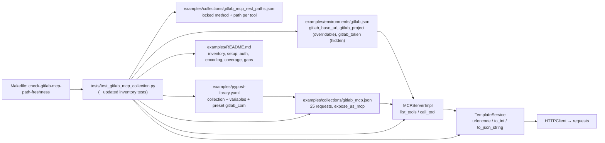

# PYPOST-1316: Create a GitLab collection for MCP in PyPost

## Research

### Sources (GitLab, checked 2026-10-09)

- REST API authentication — <https://docs.gitlab.com/api/rest/authentication/>: personal, project
  and group access tokens are accepted in `PRIVATE-TOKEN: <token>` (GitLab labels it
  "recommended") **and** in the OAuth-compliant `Authorization: Bearer <token>` header. A missing or
  invalid token returns `401`.
- Token overview — <https://docs.gitlab.com/security/tokens/>: personal access tokens use the
  `glpat-` prefix. Other prefixes include `gloas-`, `gldt-`, `glrt-`, `glcbt-`, `glptt-`, `glft-`
  and `glimt-`.
- Repository files API — <https://docs.gitlab.com/api/repository_files/>:
  `GET /projects/:id/repository/files/:file_path/raw`. Here `file_path` is URL-encoded (for example
  `lib%2Fclass%2Erb`), `ref` is optional (default: project HEAD) and the response is the raw
  bytes. The non-raw endpoint returns Base64 content and needs `ref`.
- In REST v4, `:id` is either the numeric project ID or the URL-encoded full path
  (`group%2Fsub%2Fproject`). Issue and MR routes take the project-scoped **IID**. Pipeline and job
  routes take global numeric IDs. Branches and commits take `:branch` and `:sha` path segments.

### PyPost runtime facts (from reading the code; no new runtime features are needed)

| Fact | Source | Consequence for the design |
| ---- | ------ | -------------------------- |
| `urlencode(v)` = `urllib.parse.quote(str(v), safe="")` | `pypost/core/function_registry.py` | `/`, space, `#`, `?`, `%`, `+` are percent-encoded, so one path segment is guaranteed. `str()` lets a native int `42` render as `42`. |
| `to_int(v)` accepts a native int or an ASCII decimal string and raises `IntegerConversionError` for anything else; it is a *strict conversion* function | `function_registry.py`, `template_service.py` (`render_string_strict_conversion`) | A non-decimal IID, pipeline ID or job ID fails **before** any HTTP send ("Could not render integer template expression", `http_client.py`). |
| `{{ … }}` may contain only a safe dotted path or an allow-listed **single-argument** function call (nesting allowed). No `or`, filters or operators. | `function_expression_resolver.py` | Any defaulting or branching must use `` statements (as `jira-create-issue` already does), never `{{ a or b }}`. |
| If a render fails for a reason other than `to_int`, the **raw template string is returned** (fallback) | `template_service.py`, `template_service_render.py` | Tests must assert that no `{{`/`{%` survives in a rendered URL, param or body. |
| Query params whose rendered value is `""` are dropped. Params go to `requests` as `params=`, which form-encodes them. | `http_client.py::_prepare_request_kwargs` | Query values must be raw `{{ mcp.request.x }}`. Wrapping them in `urlencode` would double-encode. Optional string filters disappear when omitted. |
| A JSON body is `json.loads`-ed and sent as `json=`. Invalid JSON falls back to `data=` | `http_client.py` | Rendered bodies must be valid JSON for every sample. Tests must `json.loads` them. |
| `requests` re-quotes the URL but keeps existing `%XX` escapes for reserved characters (`%2F` survives) | `requests.utils.requote_uri` | An encoded project or file segment reaches GitLab intact. The loopback stub sees the raw `self.path`. |
| Omitted optional args are absent from `mcp.request`. `mcp_params[*].default` fills them before render. Explicit `null` stays as `None` | `mcp_server_impl.py::_build_execution_variables` | An optional `to_int` pagination arg **must** have a `default` (Jira pattern), or omitting it breaks the call. Body conditionals test `is defined and is not none`. |
| The tool name is `normalize_mcp_tool_name(request.name)` (lower-cased, non-alphanumerics → `_`) | `mcp_tool_contract.py` | Request `name` "GitLab Get Current User" → tool `gitlab_get_current_user`. |
| Env vars referenced by a request are left out of the agent schema. An overridable, non-hidden env var that the request references is added as an optional string property, and the override is applied only if the key exists in the environment | `mcp_secrets_policy.py`, `mcp_server_impl.py::_generate_schema` | The default project is an env var in `mcp_overridable_keys`, the same as `jira_project_key`. The token is hidden and never published. |
| `meta.find_undeclared_variables` ignores `env.globals` (`urlencode`, `to_int`, `to_json_string`, `namespace`, …) | `jinja2/meta.py` | The companion-env coverage check (referenced env names ⊆ env variables) works as it does for Jira. |
| Jinja `a.b` tries `getattr` before item lookup | Jinja semantics | MCP argument names must not shadow `dict` attributes (`items`, `keys`, `values`, `get`, `update`, `pop`, `copy`, `clear`, `setdefault`). This is enforced by a test. |
| The sanitizer redacts header **names** such as `authorization` and the regex `Bearer <token>`. `private-token` is not in `_SENSITIVE_HEADER_NAMES` | `pypost/core/sensitive_text_sanitizer.py` | Drives the auth-header decision (Q2). |
| `make lint-docs` (`scripts/lint_user_docs.py`) checks formatting of `doc/user/*.md` and `doc/README.md` only. `make check-docs-links` **does** check relative links in `examples/README.md` | `scripts/lint_user_docs.py`, `scripts/check_user_docs_links.py` | No linter checks README inventory, tool counts or parity, so these must be test-enforced. Links are covered. |

## Implementation Plan

1. **Step 3 (red):** add `tests/test_gitlab_mcp_collection.py` (design below). It fails because
   the artifacts are missing. Deliberately update the inventory assertions in the existing tests
   (listed below) so they also go red for the same reason.
2. **Step 4 (green):** add `examples/collections/gitlab_mcp.json`,
   `examples/environments/gitlab.json` and `examples/collections/gitlab_mcp_rest_paths.json`.
   Update `examples/pypost-library.yaml` and `examples/README.md`. Add the Makefile target
   `check-gitlab-mcp-path-freshness`. Iterate with `make test PYTEST_ARGS=...`, then
   `make check`.
3. **Steps 5–8:** cleanup, then observability (expected N/A: fixture-only, no runtime code), then
   tech debt. Step 8 adds `doc/dev/gitlab_mcp_collection.md`, which mirrors
   `jira_mcp_path_freshness.md` and covers the catalog refresh procedure.

**Mandatory — Failing Repro (next Step 3):**

- **Location:** new module `tests/test_gitlab_mcp_collection.py`, with
  `pytestmark = pytest.mark.timeout(30)`. Offline only, with no network beyond a loopback stub.
- **Imports:** only existing, stable modules (`pypost.core.collection_import`,
  `pypost.core.environment_import`/`load_import_candidates`, `pypost.core.library_manifest`,
  `pypost.core.template_service`, `pypost.core.mcp_tool_contract`,
  `pypost.core.mcp_secrets_policy`). Missing files are detected with path checks and assertions at
  test time, **never** at import or collection time. Module-level constants are just `Path`
  objects. This keeps the failure a test assertion and not a collection error.
- **Red cases (each fails today for the intended reason):**
  1. `test_gitlab_mcp_collection_imports_via_native_loader`: asserts
     `GITLAB_COLLECTION_PATH.is_file()` with the message "examples/collections/gitlab_mcp.json
     missing (PYPOST-1316)". Then it calls `load_collection_import_candidates` and expects
     `parse_errors == []` and id `gitlab-mcp`.
  2. `test_gitlab_environment_imports_with_placeholders`: `environments/gitlab.json` is
     missing.
  3. `test_gitlab_mcp_published_tools_match_documented_set`: the exact tool-name set equals
     `EXPECTED_GITLAB_TOOLS` (the 25 names below), and each tool's input schema matches exactly.
  4. `test_gitlab_mcp_http_contracts_match_locked_catalog`: method and path template per tool.
     The catalog is missing.
  5. Encoding substitution cases (the parametrized table below).
  6. `test_gitlab_library_manifest_lists_collection_variables_and_preset` and
     `test_gitlab_library_manifest_project_default_matches_environment_placeholder`.
  7. `test_gitlab_readme_documents_inventory_and_tool_parity`.
  8. `test_gitlab_fixtures_contain_no_real_tokens` and its mutation twin
     `..._rejects_glpat_like_value`. The scan helper works on an in-memory string, so the twin
     passes today (the helper is test code). The scan over the tracked files fails because those
     files are missing.
  9. Deliberate inventory updates (see "Existing tests to update"). These are red until Step 4.
- **Must not be red:** guard tests for the pure test helpers (mutation twins that run the
  checker on synthetic `RequestData`), so that the checkers are proven able to fail. These are
  green in Step 3 and are allowed.
- **Verification:** `make test PYTEST_ARGS="tests/test_gitlab_mcp_collection.py
  tests/test_examples_modernization.py tests/test_predefined_library_pypost_1281_repro.py"`.
  Every failure must be an `AssertionError` naming a missing GitLab artifact or entry. There must
  be no `ImportError`, `fixture not found` or collection error. No `xfail` or `skip`.
- **Sequencing:** research (this doc) → red tests (Step 3, reviewed) → fixtures, manifest, README
  and make target until green (Step 4).

## Architecture

### Module diagram

### Components and responsibilities

| Component | Responsibility | Status |
| --------- | -------------- | ------ |
| `examples/collections/gitlab_mcp.json` | Collection `id: gitlab-mcp`, `name: GitLab MCP`, `version: 1.0.0`, with `variables[]` (same shape as Jira) and 25 requests. Each request has `expose_as_mcp: true`, a non-empty `mcp_description`, explicit `mcp_params` for every `mcp.request.*` reference, `body_type: json` and `retry_policy: null`. | new |
| `examples/environments/gitlab.json` | A list with one environment: `id: gitlab-mcp-environment`, `name: GitLab MCP`, placeholders, `hidden_keys: [gitlab_token]`, `mcp_overridable_keys: [gitlab_project]`, `enable_mcp: true` (same as Jira, a legacy migration input). | new |
| `examples/collections/gitlab_mcp_rest_paths.json` | Locked offline catalog: `version`, `description`, `reviewed_on`, `doc_refs[]`, `tools[]` of `{id, tool, capability, method, path}`, where `path` is the canonical template after `{{ gitlab_base_url }}`. Not importable and not listed in the manifest (same as the Jira catalog). | new |
| `examples/pypost-library.yaml` | Appends the collection, 3 variables and a `gitlab_com` preset. Jira entries stay unchanged. | edit |
| `examples/README.md` | GitLab sections (see "Docs"). | edit |
| `Makefile` | `check-gitlab-mcp-path-freshness` target (`.PHONY`, `##` help). | edit |
| `tests/test_gitlab_mcp_collection.py` | All offline contracts. | new |
| Core runtime (`pypost/`) | **No change.** Existing `urlencode`, `to_int`, `to_json_string`, `integer_or_string`, hidden and overridable keys are sufficient. | none |

### Resolved Step 1 open questions

**Q1 — Environment file name:** `examples/environments/gitlab.json`. Jira needs `jira_cloud.json`
because Cloud and Data Center differ in auth and API. GitLab.com and self-managed GitLab expose the
same `/api/v4` and the same token headers, so one environment covers both (AC3.1) and only
`gitlab_base_url` changes. The default value `https://gitlab.com` targets GitLab.com. Self-managed
users change only that variable (and may use a sub-path, e.g. `https://git.example.com/gitlab`,
with no trailing slash).

**Q2 — Auth header:** every request sends `"Authorization": "Bearer {{ gitlab_token }}"` together
with `"Accept": "application/json"` (and `"Content-Type": "application/json"` on POST and PUT).
Justification:

- GitLab documents Bearer as valid for personal, project and group access tokens, so it is a
  supported header (AC3.4). GitLab's "recommended" label for `PRIVATE-TOKEN` is a preference, not a
  capability difference.
- **Defense in depth inside PyPost:** `sensitive_text_sanitizer` redacts the `authorization` header
  name and any `Bearer <token>` text in logs, MCP results and the UI. It does **not** treat
  `PRIVATE-TOKEN` as sensitive, so with that header the only protection would be masking by the
  hidden-key value. The Jira pair also uses `Authorization` (`Basic {{ base64(jira_credentials) }}`),
  so both examples follow one convention: one `Authorization` header built from one hidden secret
  variable.
- It is the same OAuth-compliant form other clients use. Users who prefer `PRIVATE-TOKEN` can edit
  their imported copy. The README notes this alternative.
- Offline check: every request's headers equal the fixed auth header exactly. No request has
  `PRIVATE-TOKEN`, a `private_token` query param or any other token location. A mutation twin
  proves that the checker rejects an altered header.

**Q3 — Behaviour when the default project is unset:**

- `gitlab_project` is an env var. It is visible (not hidden), listed in `mcp_overridable_keys`,
  and its placeholder default is `your-group/your-project`. It is a soft default, not a security
  boundary, the same as `jira_project_key`.
- Every project-scoped URL uses `{{ urlencode(gitlab_project) }}`. Because the variable is
  overridable, `list_tools` publishes an optional `gitlab_project` string property on each of
  these tools, so the agent may target any other project by ID or by path.
- Tools stay **declarative**: no `` fallback in URLs. When the variable is blank and no
  override is passed, the URL becomes `.../projects//...` and GitLab returns `404` (an upstream
  error the agent can see). PyPost has no runtime way to require an env var before sending, and
  adding one is out of scope.
- Mitigations: (a) the shipped env and preset keep a non-empty placeholder, which is test-enforced;
  (b) every project-scoped `mcp_description` says "Uses the endpoint's gitlab_project (numeric ID
  or full path, e.g. group/subgroup/project); pass gitlab_project to target another project; if no
  default is configured you must pass it"; (c) the README states that a blank default is not
  supported for project-scoped tools. `gitlab_get_project` is the one tool where a blank value
  would hit `/api/v4/projects/`. That is documented as a risk (R2). A follow-up "required env var /
  fail-closed empty segment" runtime feature is recorded for Step 7, not built here.
- The manifest variable `gitlab_project` has the non-empty placeholder default
  `your-group/your-project`, the same value as the environment file and the `gitlab_com` preset.
  This follows the Jira style: `examples/pypost-library.yaml` gives `jira_project_key` the
  placeholder default `"PROJ"` (preset `jira_cloud` sets `"DEMO"`), not `""`. A blank manifest
  default would break mitigation (a), because a library attach without the preset would yield a
  blank project. Test strategy item 8 enforces it.

**Q4 — Concrete tool list (25 tools, prefix `gitlab_`):**

Notation:

- `P` = `{{ gitlab_base_url }}/api/v4/projects/{{ urlencode(gitlab_project) }}`.
- `pg` = optional `page` (default `1`) plus optional `per_page` (default `20`), both
  `integer_or_string`, rendered as query `page={{ to_int(mcp.request.page) }}` and
  `per_page={{ to_int(mcp.request.per_page) }}`.
- `(s)` = optional string query param rendered raw as `{{ mcp.request.<n> }}`, so it is dropped
  when omitted.
- IID, pipeline and job IDs are required `integer_or_string`, rendered as
  `{{ to_int(mcp.request.<n>) }}`. Their descriptions say "decimal string or integer" and "project
  IID" or "global ID".
- Body fields: `R` = required, `o` = optional (emitted only when defined and not null). Values go
  through `to_json_string`.

| # | Tool (request `name` → normalized) | Method | Path | Path args | Query args | JSON body | Capability |
| - | ---------------------------------- | ------ | ---- | --------- | ---------- | --------- | ---------- |
| 1 | `gitlab_get_current_user` | GET | `{{ gitlab_base_url }}/api/v4/user` | — | — | — | Identity |
| 2 | `gitlab_list_projects` | GET | `{{ gitlab_base_url }}/api/v4/projects` | — | `search`(s), `membership`(s, "true"/"false"), pg | — | Projects: search/list |
| 3 | `gitlab_get_project` | GET | `P` | (gitlab_project) | — | — | Projects: get by ID/path |
| 4 | `gitlab_list_branches` | GET | `P/repository/branches` | — | `search`(s), pg | — | Branches: list |
| 5 | `gitlab_get_branch` | GET | `P/repository/branches/{{ urlencode(mcp.request.branch) }}` | `branch` R string | — | — | Branches: get |
| 6 | `gitlab_get_file` | GET | `P/repository/files/{{ urlencode(mcp.request.file_path) }}/raw` | `file_path` R string | `ref`(s) | — | Files: read at ref |
| 7 | `gitlab_list_repository_tree` | GET | `P/repository/tree` | — | `path`(s), `ref`(s), `recursive`(s, "true"/"false"), pg | — | Files: tree at ref |
| 8 | `gitlab_list_commits` | GET | `P/repository/commits` | — | `ref_name`(s), `path`(s), `since`(s), `until`(s), pg | — | Commits: list (ref/path filter) |
| 9 | `gitlab_get_commit` | GET | `P/repository/commits/{{ urlencode(mcp.request.sha) }}` | `sha` R string (SHA, branch or tag) | — | — | Commits: get |
| 10 | `gitlab_list_issues` | GET | `P/issues` | — | `state`(s), `labels`(s), `search`(s), pg | — | Issues: list |
| 11 | `gitlab_get_issue` | GET | `P/issues/{{ to_int(mcp.request.issue_iid) }}` | `issue_iid` R | — | — | Issues: get |
| 12 | `gitlab_create_issue` | POST | `P/issues` | — | — | `title` R, `description` o, `labels` o | Issues: create |
| 13 | `gitlab_update_issue` | PUT | `P/issues/{{ to_int(mcp.request.issue_iid) }}` | `issue_iid` R | — | `title` o, `description` o, `labels` o, `state_event` o (`close`/`reopen`) | Issues: update/close/reopen |
| 14 | `gitlab_list_merge_requests` | GET | `P/merge_requests` | — | `state`(s), `source_branch`(s), `target_branch`(s), `search`(s), pg | — | MRs: list |
| 15 | `gitlab_get_merge_request` | GET | `P/merge_requests/{{ to_int(mcp.request.merge_request_iid) }}` | `merge_request_iid` R | — | — | MRs: get |
| 16 | `gitlab_create_merge_request` | POST | `P/merge_requests` | — | — | `source_branch` R, `target_branch` R, `title` R, `description` o, `labels` o | MRs: create |
| 17 | `gitlab_update_merge_request` | PUT | `P/merge_requests/{{ to_int(mcp.request.merge_request_iid) }}` | `merge_request_iid` R | — | `title` o, `description` o, `labels` o, `target_branch` o, `state_event` o (`close`/`reopen`) | MRs: update/close/reopen |
| 18 | `gitlab_list_issue_notes` | GET | `P/issues/{{ to_int(mcp.request.issue_iid) }}/notes` | `issue_iid` R | `sort`(s), pg | — | Comments: list on issue |
| 19 | `gitlab_create_issue_note` | POST | `P/issues/{{ to_int(mcp.request.issue_iid) }}/notes` | `issue_iid` R | — | `body` ← `note_body` R | Comments: add on issue |
| 20 | `gitlab_list_merge_request_notes` | GET | `P/merge_requests/{{ to_int(mcp.request.merge_request_iid) }}/notes` | `merge_request_iid` R | `sort`(s), pg | — | Comments: list on MR |
| 21 | `gitlab_create_merge_request_note` | POST | `P/merge_requests/{{ to_int(mcp.request.merge_request_iid) }}/notes` | `merge_request_iid` R | — | `body` ← `note_body` R | Comments: add on MR |
| 22 | `gitlab_list_pipelines` | GET | `P/pipelines` | — | `ref`(s), `status`(s), pg | — | CI: list pipelines |
| 23 | `gitlab_get_pipeline` | GET | `P/pipelines/{{ to_int(mcp.request.pipeline_id) }}` | `pipeline_id` R | — | — | CI: get pipeline |
| 24 | `gitlab_list_pipeline_jobs` | GET | `P/pipelines/{{ to_int(mcp.request.pipeline_id) }}/jobs` | `pipeline_id` R | pg | — | CI: list jobs of pipeline |
| 25 | `gitlab_get_job` | GET | `P/jobs/{{ to_int(mcp.request.job_id) }}` | `job_id` R | — | — | CI: get job |

Design rules behind the table:

- **Read = GET with an empty body, create = POST, update = PUT.** There are no DELETE tools (AC2
  gaps). There are no payload-string escape hatches: every GitLab body field is a typed, documented
  argument, so the body-field contract test is exact.
- **Body template shape.** Bodies use ``. Each field is wrapped in
  `{{ ns.sep }}"X": {{ to_json_string(mcp.request.X) }}`.
  This yields valid JSON whichever optional subset is passed, and it also renders from the GUI
  (no `mcp`) as `{}`. Required fields are still guarded the same way, because MCP
  required-argument validation runs first. For notes, the argument `note_body` maps to GitLab
  field `body`. The name `note_body` avoids confusion with the request body.
- `labels` is a comma-separated string (GitLab's documented form). `state_event` values and the
  string booleans (`membership`, `recursive`) are given in the descriptions as literal
  `close`/`reopen` and `true`/`false`. The MCP `boolean` type is avoided because Jinja renders it
  as `True`/`False`.
- Every argument name is checked against `dict` attribute names (see Research).
- Tool count is **25**. Every requirement capability maps to at least one tool, and the mapping is
  test-locked through the catalog's `capability` field.

**Q5 — Locked path catalog and make target:**

- **Catalog: yes**, as `examples/collections/gitlab_mcp_rest_paths.json`. It covers **all 25**
  tools (unlike the Jira catalog, which covers 5 critical markers) with an exact `method` and an
  exact `path` template (the URL with the `{{ gitlab_base_url }}` prefix removed). It is the
  single offline source of truth for the documented tool set. Tests compare the collection to the
  catalog exactly (set equality of ids and tools, method, path), and compare the README tool list
  to the catalog. `reviewed_on` and `doc_refs` record the GitLab docs review, as in PYPOST-1030.
- **Make target: yes**, `check-gitlab-mcp-path-freshness`. It runs only
  `tests/test_gitlab_mcp_collection.py::test_gitlab_mcp_http_contracts_match_locked_catalog` and
  `::test_gitlab_mcp_catalog_check_rejects_path_drift` through `$(BIN)/python -m pytest -q`, with
  the same recipe shape as `check-jira-mcp-path-freshness`. It gives contributors a fast,
  credential-free command after they refresh against GitLab docs. The same tests also run in
  `make test` and `make check`, so the target adds no extra gate. If a Makefile contract test
  enumerates targets, update it consciously in Step 4.

### Templating and encoding contract

| Input | Template | Sample | Rendered |
| ----- | -------- | ------ | -------- |
| Project path (nested) | `{{ urlencode(gitlab_project) }}` | `group/subgroup/my-project` | `group%2Fsubgroup%2Fmy-project` |
| Project numeric ID (string override; the published property is `type: string`) | same | `"42"` | `42` |
| File path | `{{ urlencode(mcp.request.file_path) }}` | `src/app/main.py` | `src%2Fapp%2Fmain.py` |
| File path, reserved characters | same | `docs/a b#c?d%e+f.md` | `docs%2Fa%20b%23c%3Fd%25e%2Bf.md` |
| Branch in path | `{{ urlencode(mcp.request.branch) }}` | `feature/x` | `feature%2Fx` |
| SHA or ref in path | `{{ urlencode(mcp.request.sha) }}` | `a1b2c3d` | `a1b2c3d` |
| IID, pipeline or job ID | `{{ to_int(mcp.request.issue_iid) }}` | `7` / `"7"` | `7`; `"7a"` → `IntegerConversionError` before any HTTP |
| Query ref, path or search | raw `{{ mcp.request.ref }}` in `params` | `feature/x&y=1#z`, `a b&c` | rendered verbatim at the template layer; on the wire `requests` emits `ref=feature%2Fx%26y%3D1%23z` and `search=a+b%26c` (one key each). AC3.3 is proven at the wire layer (test strategy items 7a and 7b), not by the verbatim render. |
| Base URL with sub-path | `{{ gitlab_base_url }}/api/v4/...` | `https://git.example.com/gitlab` | `https://git.example.com/gitlab/api/v4/...` |

Tests cover two layers:

- **Template layer:** `TemplateService().render_string_strict_conversion` on each request's URL,
  params and body, with `{**env, "mcp": {"request": args}}` built the same way as
  `mcp_server_impl._merge_execution_variables`.
- **Wire layer:** through the real MCP stack against a loopback stub that records the raw
  `self.path` and the query. This catches double-encoding and confirms that `%2F` survives
  `requests`. Query-string integrity for reserved characters (AC3.3) is asserted only here
  (items 7a and 7b), because the template layer renders query values verbatim.

**Known limitation — dot segments.** `urlencode` uses `quote(..., safe="")`, which leaves `.`
unencoded. A `file_path`, `branch` or `sha` of exactly `.` or `..` renders as a dot segment that
`requests` or a proxy may normalise away. This is documented (here and in the README "GitLab
default project and identifiers" section) rather than tested or fixed, because no valid input
reaches it: Git forbids `.` and `..` as ref names, a repository file cannot be named `.` or `..`,
and a SHA is hex. Encoding dots would need a core `urlencode` change, which is out of scope.
Segments such as `a.md` or `../x` (rendered `..%2Fx`) are unaffected.

The test also asserts that no `urlencode(` appears in any `params` value (no double-encoding),
and that every project-scoped URL starts with the exact `P` prefix.

### Library manifest and README integration

- `pypost-library.yaml`:
  - `collections` gains `"collections/gitlab_mcp.json"` (inserted after `jira_mcp.json`, before
    `mcp.json`).
  - `variables` gains `gitlab_base_url` (default `https://gitlab.com`, `secret: false`),
    `gitlab_project` (default `your-group/your-project`, the environment placeholder,
    `secret: false`, description "Default GitLab project: numeric ID or full path") and `gitlab_token` (default `""`, `secret: true`).
  - `presets.gitlab_com` = `{gitlab_base_url: https://gitlab.com, gitlab_project:
    your-group/your-project}`. The token is never in a preset.
  - `description` mentions GitLab. `version` stays `2.0.0`, because existing tests pin it.
- `examples/README.md`:
  - "Git Collection Library" bundled list and presets.
  - Standalone Inventory entries for the collection ("**End users.** … (25 REST tools)"), the
    catalog ("**Contributors.** … `make check-gitlab-mcp-path-freshness` … Not an importable
    collection.") and the environment.
  - A new "Recommended import order (GitLab pair)": the environment, then placeholders, then the
    collection, then select the environment, then create and start the MCP endpoint, then point
    the agent at `/mcp`.
  - "GitLab authentication": PAT, project or group token. Scopes are `read_api` for read-only and
    `api` for read/write. Enter the token in the hidden key `gitlab_token`. Mention the
    `Authorization: Bearer` convention and the `PRIVATE-TOKEN` alternative.
  - "GitLab.com vs self-managed": base URL form, sub-path, no trailing slash, and that TLS and
    network access are the user's concern.
  - "GitLab default project and identifiers": soft default, not a security boundary, override per
    call, blank default not supported; ID vs path; IID vs global ID; encoding rules; the
    dot-segment limitation (`.` or `..` as a whole file path, branch or SHA is not supported).
  - "GitLab coverage vs gaps": a table of the 25 tool names by area, plus the explicit gaps from
    AC2.
  - The "Secret handling" bullet is extended with the GitLab placeholder `your-gitlab-access-token`
    and never `glpat-…`.
- No linter checks inventory or counts in `examples/README.md` (`lint-docs` formats only
  `doc/user` and `doc/README.md`; `check-docs-links` checks only its relative links). Parity is
  therefore enforced by tests:
  - The README contains each of the 25 tool names. The set of `gitlab_[a-z_]+` tokens in the GitLab
    coverage section equals the catalog set.
  - The inventory line states "25", which equals `len(catalog.tools)` and equals the collection
    request count. The collection `description` also says 25.
  - The README mentions `gitlab.json`, `gitlab_token`, `hidden`, `read_api`, `api`, `self-managed`,
    `not a security boundary` and `IID`.

### Secret handling

- Collection variable `gitlab_token`: `secret: true`, `required: true`, default `""`.
- Manifest variable `gitlab_token`: `secret: true`.
- Environment: `gitlab_token` is in `hidden_keys` and **not** in `mcp_overridable_keys`. Its value
  is the placeholder `your-gitlab-access-token`. `hidden_keys == {"gitlab_token"}` exactly, so
  `gitlab_project` stays visible.
- The agent schema never contains `gitlab_token` or `gitlab_base_url`. This is asserted on the
  published schemas.
- Offline hygiene check: scan the tracked `gitlab_mcp.json`, `gitlab.json`,
  `gitlab_mcp_rest_paths.json`, `pypost-library.yaml` and `examples/README.md` with the regex
  `\bgl(?:pat|oas|dt|rt|cbt|ptt|ft|imt|agent|soat)-[A-Za-z0-9_\-]{8,}`. Any match fails. A mutation
  twin proves that the scanner flags `glpat-` plus 20 characters in a synthetic string.

### Test strategy (offline only, via `make test` / `make check`)

All tests live in `tests/test_gitlab_mcp_collection.py` with
`pytestmark = pytest.mark.timeout(30)` (pure file and template work), except the loopback e2e
case, which has `@pytest.mark.timeout(60)`. No test contacts any non-loopback host or needs
credentials.

1. **Format and load:** `load_collection_import_candidates` → 1 collection, no parse errors, id
   and name, 25 requests, all `expose_as_mcp`, non-empty descriptions. The environment loads via
   `load_import_candidates` with a `StorageManager` in `tmp_path` (the Jira helper pattern) and
   gives the expected id, name, placeholders, hidden and overridable keys.
2. **Tool publication and schema exact match:** register the requests in `MCPServerImpl` with
   suppliers for env vars, `hidden_keys={"gitlab_token"}` and
   `overridable_keys={"gitlab_project"}`. Assert the `tools_map` keys equal the
   `EXPECTED_GITLAB_TOOLS` set (25). For each tool, `_generate_schema(req)` equals an expected
   schema built from a test-local spec table: property names, `type`/`anyOf` for
   `integer_or_string`, `required` list and defaults (`page=1`, `per_page=20`). The table also
   asserts that the `gitlab_project` override property is present exactly on project-scoped
   tools, and that `gitlab_token` and `gitlab_base_url` are absent everywhere. Names are unique,
   ≤ 64 characters, and match `^gitlab_[a-z_]+$`.
3. **HTTP contracts:** method and path equal the catalog. Body: read tools have `body == ""`.
   For write tools, the rendered body (all fields supplied) `json.loads` to exactly the documented
   key set. A minimal-arguments render gives only the required keys. Query keys equal the
   documented set per tool.
4. **Auth convention:** the header equals the exact Bearer string on all 25 tools. There is no
   `PRIVATE-TOKEN` and no token query param. Mutation twin.
5. **Placeholder integrity:** every `mcp.request.X` is declared in `mcp_params`, and every
   declared param is referenced (no dead arguments). Env names referenced ⊆ environment variables
   (Jira `assert_..._companion_env_coverage` pattern). No argument name shadows a `dict`
   attribute. Rendering every URL, param and body with full sample arguments leaves no `{{`/`{%`.
6. **Encoding (template layer):** parametrized over the encoding table. Includes nested group
   path, numeric ID (string override only, matching the published `type: string` property), file path with slashes and with ` #?%+`, branch with `/`, sub-path base
   URL. Invalid IID, pipeline or job values (`"7a"`, `"1.5"`, `""`) raise `IntegerConversionError`
   from `render_string_strict_conversion`. Every listed numeric path arg has type
   `integer_or_string` with "decimal", "string" and "integer" in its description (Jira PYPOST-1038
   pattern).
7. **Wire-level e2e (loopback):** a new `tests/helpers/gitlab_mcp_collection_http.py` stub
   (`ThreadingHTTPServer` on `127.0.0.1:0`, the same pattern as `mcp_collection_http.py`, bounded
   join timeout). It drives `live_mcp_server` through `gitlab_get_current_user`, `gitlab_get_file`
   (nested project path plus slashed file path plus `ref="feature/x&y=1#z"`),
   `gitlab_list_projects` (`search="a b&c"`) and `gitlab_create_issue_note`. Test name:
   `test_gitlab_mcp_loopback_e2e_wire_contract` in `tests/test_gitlab_mcp_collection.py`.
   It asserts the raw paths (`/api/v4/projects/group%2Fsub%2Fproj/repository/files/src%2Fapp%2Fmain.py/raw`),
   the JSON body `{"body": "..."}` and the `Authorization` header received.
   - **7a (wire, loopback):** the stub's raw query string is parsed with
     `urllib.parse.parse_qs(..., keep_blank_values=True)`. For `gitlab_get_file` the result equals
     exactly `{"ref": ["feature/x&y=1#z"]}`. For `gitlab_list_projects` it equals exactly
     `{"search": ["a b&c"], "page": ["1"], "per_page": ["20"]}`. There are no extra keys such as
     `y`, and no fragment is cut off.
   - **7b (prepared request, no socket):**
     `test_gitlab_query_reserved_characters_stay_single_key_on_wire` in the same module, with the
     30 s module timeout. For each `(tool, arg, value)` in `[(gitlab_get_file, ref,
     "feature/x&y=1#z"), (gitlab_list_projects, search, "a b&c"), (gitlab_list_branches, search,
     "a b&c")]`, it builds variables as `{**env, "mcp": {"request": args}}`, calls
     `HTTPClient()._prepare_request_kwargs(request_data, variables)` (the real pypost params dict;
     precedent in `tests/test_http_client.py`), then
     `requests.Request(kwargs["method"], kwargs["url"], params=kwargs["params"]).prepare()`. It
     parses `urlsplit(prepared.url).query` and asserts each param key appears exactly once with the
     exact original value, that `urlsplit(prepared.url).fragment == ""`, and that the path is
     unchanged. A mutation twin builds the URL with the value pre-joined
     (`url + "?ref=feature/x&y=1#z"`) and proves the checker fails.
8. **Library and README parity:** manifest lists the collection and the 3 variables (token
   `secret: true`) and has the `gitlab_com` preset. Jira entries are unchanged.
   `test_gitlab_library_manifest_project_default_matches_environment_placeholder` asserts that the
   manifest `gitlab_project` default is non-empty (after `strip()`), equals the
   `gitlab_project` value in `examples/environments/gitlab.json` (`your-group/your-project`), and
   equals `presets.gitlab_com.gitlab_project`.
   `validate_manifest_collections` reports nothing missing. README parity checks as described
   above.
9. **Secret hygiene:** the scan and its mutation twin, plus the environment placeholder and
   `hidden_keys` assertions.

**Existing tests to update deliberately (not weaken):**

- `tests/test_examples_modernization.py::test_examples_manifest_discovery_and_structure`: add
  `"collections/gitlab_mcp.json" in manifest.collections`, the GitLab variable names, token
  `secret is True`, and `"gitlab_com" in manifest.presets`.
- `tests/test_examples_modernization.py::test_examples_collections_load_as_collections`: add the
  GitLab collection load with `name == "GitLab MCP"` and `len(requests) == 25`.
- `tests/test_predefined_library_pypost_1281_repro.py::test_predefined_library_lists_valid_manifest_collections`:
  the exact list becomes `[jira_mcp.json, gitlab_mcp.json, mcp.json]`.
- Makefile contract tests, only if any enumerates `.PHONY` or help targets (check in Step 4).
- Not affected (verified): Jira-specific tests in `test_example_fixtures.py`, `test_mcp_collection_e2e.py`,
  `test_mcp_server_integration.py`. They load the Jira files by path, and nothing globs
  `examples/collections/*.json` as collections. The Jira catalog already lives there.

### Interfaces (between modules)

- **Collection ↔ environment:** the env var names `gitlab_base_url`, `gitlab_project` and
  `gitlab_token` are the whole contract.
- **Collection ↔ MCP:** `name` gives the tool name, `mcp_description` the description, and
  `mcp_params` plus the overridable env refs give the input schema.
- **Collection ↔ catalog:** request `id` maps to `{tool, capability, method, path}`.
- **Catalog ↔ README:** the tool name set and the count.
- **Manifest ↔ collection:** relative path plus variable schema (names and `secret` match the
  collection `variables[]`).

### Risks

- **R1 — Bearer vs GitLab's "recommended" `PRIVATE-TOKEN`.** Both are documented. Some proxies
  strip `Authorization`, and DPoP-enabled accounts need an extra header. Mitigation: the README
  documents the alternative and DPoP is out of scope. If needed, switching the header later is a
  one-line change per request plus a test constant.
- **R2 — Blank `gitlab_project`.** This gives `//` URLs (404). For `gitlab_get_project` it gives
  `/projects/`, which GitLab may treat as list projects. Mitigation: a test-enforced non-empty
  placeholder in the environment, the preset **and** the manifest variable default (so a library
  attach without the preset is not blank), descriptions and README. A runtime follow-up goes to Step 7.
- **R3 — Render fallback hides template errors** (the raw template is sent). Mitigation: the
  "no surviving `{{`/`{%`" assertions on every field.
- **R4 — Body template complexity** (`namespace` separator) could produce invalid JSON for some
  subset. Mitigation: render all-args, minimal and each-single-optional subsets and `json.loads`
  every one.
- **R5 — GitLab API drift** (new versions or deprecations). Mitigation: the locked catalog with
  `reviewed_on` and the freshness target. A live smoke test is out of scope.
- **R6 — String booleans and enums** (`membership`, `recursive`, `state_event`) are not
  schema-validated, so a bad value gets an upstream 400. This is accepted and documented in the
  descriptions.
- **R7 — Inventory churn:** pinned counts and lists in 2–3 existing tests must change. They are
  listed above so the change is deliberate.
- **R8 — Raw file response size and binary content.** Agents get raw bytes as text, and large
  blobs are rate-limited by GitLab. This is documented. No artifact or log download tools are
  included (gaps).

## Q&A

- **Q: Why not a `project` MCP argument with a `` fallback?** A: The requirement asks to
  follow the Jira convention unless there is a justified reason. Overridable env keys already give
  a published optional `gitlab_project` argument, reject-before-execute validation and
  Hidden-wins semantics, with no template branching in URLs.
- **Q: Why the raw file endpoint?** A: Agents need text. The JSON endpoint returns Base64 and
  requires `ref`, while `/raw` makes `ref` optional (defaults to HEAD). The `/raw` suffix also
  avoids format-suffix ambiguity for paths that end in an extension.
- **Q: Why typed body args instead of a `*_payload` JSON string (Jira style)?** A: They make the
  body contract exact and testable, give agents a schema instead of free-form JSON, and use
  `to_json_string` against injection (PYPOST-1283).
- **Q: New runtime features needed?** A: No. Everything uses existing `urlencode`, `to_int`,
  `to_json_string`, Jinja `namespace`, `integer_or_string`, hidden and overridable keys.
- **Q: Observability (Step 6)?** A: Expected N/A, since no runtime code changes. Existing MCP and
  template metrics apply.
- References: GitLab REST API authentication
  (<https://docs.gitlab.com/api/rest/authentication/>), Repository files API
  (<https://docs.gitlab.com/api/repository_files/>), token overview
  (<https://docs.gitlab.com/security/tokens/>), `ai-tasks/PYPOST-1030/20-architecture.md` (Jira
  catalog precedent).
