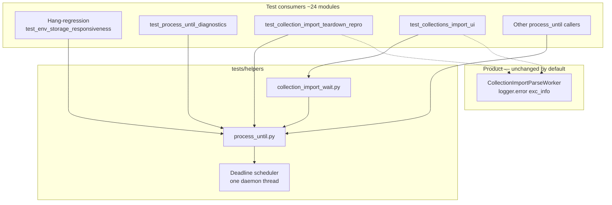

# PYPOST-1320: Eliminate process_until watchdog Timer.start deadlock with QThread exc_info logging

## Research

### Problem (from requirements + observed stacks)

Intermittent hang until the parallel-runner worker timeout (~120 s). pytest’s per-test
timeout never fires because the main thread never returns to Python bytecode.

Observed triad (faulthandler under Make; PYPOST-1264 triage; Jira PYPOST-1320):

| Thread | Stuck in |
| --- | --- |
| Main (GUI) | `threading.Thread.start` → `self._started.wait()` while arming the watchdog at `tests/helpers/process_until.py:136` |
| `CollectionImportParseWorker` (QThread) | `logger.error(..., exc_info=True)` at `collection_import_parse_worker.py:93` (`current_thread()` / traceback formatting) |
| Watchdog path | `threading.Timer.run` (or a sibling Timer) making no progress |

Affected nodes include at least:

- `tests/test_collection_import_teardown_repro.py::test_unexpected_reader_exception_requires_teardown_and_reaps_worker`
- `tests/test_collections_import_ui.py::test_zero_candidates_treated_as_invalid_file`

Rates (documented): ~1/7 targeted parallel; ~2/12 stress; pre-existing at `c3f8e183`.

### Current helper contract (must keep)

`tests/helpers/process_until.py` (PYPOST-823 → PYPOST-827 shared extract; diagnostics
PYPOST-828):

1. Nested `QEventLoop.exec()` so queued `QThread` signals deliver.
2. Optional 10 ms Qt poll timer (`use_poll_timer=True`, default) checking predicate +
   wall-clock deadline.
3. Cross-thread posted quit: after a delay equal to remaining wall-clock time, call
   `QTimer.singleShot(0, loop, loop.quit)` with **GUI-thread context** `loop` so a silent
   poll timer cannot leave `exec()` stuck.
4. `use_poll_timer=False`: hang-regression mode — no poll timer; **only** the posted-quit
   path may break `exec()`. Proven by
   `tests/test_env_storage_responsiveness.py::test_process_until_exits_via_posted_quit_without_poll_timer`.
5. Public API: `process_until(predicate, *, timeout_ms=5000, use_poll_timer=True,
   timeout_detail=None)` plus diagnostic helpers.

Today step 3 is implemented as **per-wait** `threading.Timer(remaining_s, post_quit)` +
`watchdog.start()` (line 134–136). That `start()` is the hang site.

Consumers: **24** Python modules under `tests/` import the helper or
`collection_import_wait` (which wraps it). Requirements’ “~21 test files” is the same
shared-contract surface; all must keep hang-resistant, deadline-bounded waits.

### Why this deadlocks (working model)

1. **QThread is an alien thread** to `threading`: it is not registered in
   `threading._active`. Logging that needs a thread name / `current_thread()` (default
   when `logging.logThreads` is on, and during `exc_info` record construction) can create a
   `_DummyThread`, which takes `threading._active_limbo_lock` to insert into `_active`
   ([threading docs / DummyThread](https://docs.python.org/3/library/threading.html#thread-objects);
   [SO: Dummy in current_thread](https://stackoverflow.com/questions/55778365/what-is-dummy-in-threading-current-thread)).
2. **`Thread.start()`** (used by `threading.Timer`) briefly holds `_active_limbo_lock`,
   starts the OS thread, then **blocks forever** on `_started.wait()` until the child
   finishes bootstrap and signals
   ([CPython `Thread.start`](https://github.com/python/cpython/blob/main/Lib/threading.py);
   hang if child never signals:
   [gh-140746](https://github.com/python/cpython/issues/140746)).
3. Concurrently the parse worker holds the **logging lock** while formatting
   `exc_info=True`. Contended ordering among logging lock, limbo lock, and GIL yields an
   intermittent multi-thread stall matching the dumps. Related logging/thread lock pain:
   [bpo logging deadlocks](https://bugs.python.org/issue40371),
   [OpenStack: disable logThreads under patched threads](https://github.com/openstack/swift/commit/86b966d950000978e2438f1bd5d9e2bf2e238cd1).
4. Same class as PYPOST-1148 lineage for “signal timeout cannot interrupt a futex wait”:
   once main is blocked in `_started.wait()`, pytest-timeout SIGALRM cannot reclaim the
   process; only the outer runner kill ends it.

Product `exc_info=True` is a **trigger**, not the required fix target. Requirements prefer
finishing verification without rewriting import UX; Jira suggests fixing the helper so it
does **not** call `Thread.start` during the wait.

### External guidance

- [Qt QTimer singleShot with context](https://doc.qt.io/qt-6/qtimer.html) — functor runs on
  the context object’s thread; keep `QTimer.singleShot(0, loop, loop.quit)` for posted quit
  (unchanged from PYPOST-823).
- [Qt threads / QObject affinity](https://doc.qt.io/qtforpython-6/overviews/qtdoc-threads-qobject.html)
  — do not rely on bare timers owned by a worker thread with no event loop.
- Shared-timer / single daemon thread patterns (avoid per-call `Timer.start`):
  [SO: start timer thread once](https://stackoverflow.com/questions/12435211/threading-timer-repeat-function-every-n-seconds).
- Project docs: `doc/dev/gui_testing.md` § Bounded nested `QEventLoop` waits;
  `doc/dev/collection_import.md` (PYPOST-1320 note); prior arch
  `ai-tasks/PYPOST-823/20-architecture.md`, `ai-tasks/PYPOST-827/20-architecture.md`.

### Options considered

| Option | Summary | Verdict |
| --- | --- | --- |
| **A. Long-lived daemon scheduler in the helper** | Start one daemon thread once; schedule deadline callbacks via heap + `Condition`/`Event.wait(timeout)`; never call `Thread.start` inside `process_until` after bootstrap | **Chosen** |
| B. Drop `threading.Timer`; use only Qt deadline `QTimer` | Simple | **Reject** — breaks `use_poll_timer=False` hang-regression (timers never run ⇒ hang) |
| C. Remove / soften product `exc_info=True` | Avoids DummyThread path on this worker | **Reject as primary** — product change, does not harden the shared helper for other QThread+logging races; allowed only if Step 3 proves helper-only fix insufficient |
| D. `signal.setitimer` / SIGALRM for deadline | No new Python thread | **Reject** — conflicts with pytest-timeout signal method |
| E. Per-test workarounds / skip hang-regression | Stop the flake locally | **Reject** — violates DoD (shared contract, hang-regression preserved) |
| F. Pre-create a `Timer` at import and only `cancel`/`reschedule` | Still Timer subclass / start semantics messy | Inferior to a clear scheduler thread with cancel tokens |

### Chosen direction (A)

Replace **per-call** `threading.Timer(...).start()` with a **module-scoped deadline
scheduler** owned by `tests/helpers/process_until.py`:

- Lazy-start a single daemon thread the first time a wait needs a posted-quit arm (or
  equivalent one-shot bootstrap that never re-enters `Thread.start` on the hot path).
- Register `(deadline_monotonic, token, post_quit)` under a lock; the scheduler sleeps with
  `wait(timeout=next_deadline - now)` (or equivalent), then invokes `post_quit` for due
  tokens.
- `process_until`’s `finally` **cancels** its token (same role as `watchdog.cancel()` today)
  so early predicate success does not leave stale quits.
- Posted quit remains `QTimer.singleShot(0, loop, loop.quit)` — still independent of the
  poll `QTimer`, so `use_poll_timer=False` keeps proving hang-regression.
- Public API and assertion / `timeout_detail` semantics stay unchanged; consumers do not
  change call sites.

Product code (`collection_import_parse_worker.py`) stays unchanged unless a later step
proves a genuine product defect blocks honest verification.

## Implementation Plan

Harness-only by default. Language: Python (`lsr-python`). All verification via `make`.

1. **Internal scheduler** in `tests/helpers/process_until.py`: extract watchdog arm/cancel
   behind a small private API (e.g. `_arm_posted_quit(loop, remaining_s) -> cancel_fn`)
   backed by one daemon thread + cancellable deadline entries. No change to
   `process_until(...)` signature.
2. **Preserve dual path**: poll `QTimer` when `use_poll_timer=True`; posted quit always
   armed; `use_poll_timer=False` still exits near deadline via posted quit alone.
3. **Keep diagnostics**: `timeout_detail` / `gateway_timeout_detail` /
   `format_storage_async_timeout_detail` unchanged.
4. **Docs (Step 8)**: update `doc/dev/gui_testing.md` / `doc/dev/testing.md` wording that
   currently says “daemon `threading.Timer`” to describe the shared scheduler / posted-quit
   backstop without implying per-wait `Timer.start`.
5. **Do not** alter the ~24 consumer modules’ assertion meaning; do not remove hang-regression
   tests.
6. **Stress evidence** (DoD): after green focused runs, bounded repeated / parallel Make
   recipes sized to historical rates (targeted collection-import selection and/or stress
   repetitions), through `make` only.

### Mandatory — Failing Repro (next Step 3)

Behavioral change: yes — waits must finish under concurrent QThread `exc_info` logging
instead of hanging in `Thread.start`.

**Red test design (before production fix):**

| Item | Plan |
| --- | --- |
| **What it asserts** | Calling `process_until` (especially `use_poll_timer=False`) while a background QThread is mid-`logger.error(..., exc_info=True)` **returns or raises `AssertionError` within ~2× `timeout_ms`**, and never leaves the main thread blocked in `Thread.start` / `_started.wait` past that bound. |
| **Where it lives** | Prefer a focused module next to existing helper coverage, e.g. extend `tests/test_process_until_diagnostics.py` or add `tests/test_process_until_watchdog_repro.py` (new file only if the race setup is too heavy for the diagnostics module). Keep `@pytest.mark.timeout(...)` / module `pytestmark` per `do-testing`. |
| **How to force failure without live deps** | In-process: start a `QThread` whose `run()` loops or blocks inside `logging.getLogger(...).error("...", exc_info=True)` (or holds the logging lock while calling `threading.current_thread()` after ensuring DummyThread path). From the GUI thread, immediately call `process_until(lambda: False, timeout_ms=300, use_poll_timer=False)`. Optionally amplify with many short iterations or a barrier so arm races with logging. No network, no real import files. |
| **Sequencing** | Research (done) → write red test that hangs or times out at runner/module budget on **current** helper → implement scheduler so the same test fails with a timely `AssertionError` (or passes a “exits near deadline” bound) → keep existing hang-regression tests green → stress Make for the intermittent class. |
| **Complement** | Retain / rely on `test_process_until_exits_via_posted_quit_without_poll_timer` as the contract guard for hang-regression mode; the new repro targets the **Timer.start × QThread logging** deadlock class specifically. |

## Architecture

### Module diagram



### Module responsibilities

| Module / component | Responsibility |
| --- | --- |
| `tests/helpers/process_until.py` | Public hang-resistant wait API; owns nested loop, optional poll timer, timeout assert + detail; **owns** the deadline scheduler that posts quit without per-wait `Thread.start` |
| Deadline scheduler (private, same file) | Single daemon thread; arm/cancel wall-clock callbacks; invoke `post_quit` at deadline |
| `tests/helpers/collection_import_wait.py` | Unchanged facade; still calls `process_until` |
| Hang-regression tests | Prove posted-quit-only exit (`use_poll_timer=False`) |
| Step 3 repro test | Prove no hang when arming wait under concurrent QThread `exc_info` logging |
| Consumer test modules | Unchanged call contracts |
| `collection_import_parse_worker.py` | Unchanged unless proven necessary |

### Interaction scheme

1. Test starts async work (e.g. import parse worker that may log unexpected errors).
2. Test calls `process_until(predicate, timeout_ms=..., use_poll_timer=...)`.
3. Helper creates `QEventLoop`, optional poll timer, computes `remaining_s`.
4. Helper **arms** posted quit on the shared scheduler (no `threading.Timer.start` on this path).
5. `loop.exec()` runs until predicate, poll deadline, or posted quit.
6. `finally`: **cancel** arm; stop poll timer if any.
7. Assert predicate / raise `AssertionError` with optional `timeout_detail`.

Hang-regression path: steps 3–7 with `use_poll_timer=False` — only scheduler-driven
posted quit ends `exec()`.

### Patterns and justification

- **Extract / retain shared helper** — one contract for all consumers (PYPOST-827 DoD
  lineage); fix once in the helper.
- **Dual-deadline nested wait** — poll timer + wall-clock posted quit (PYPOST-823); only
  the **implementation** of the posted-quit delay changes.
- **Single long-lived worker thread (scheduler)** — avoids `Thread.start` / `_started.wait`
  on the hot path where alien QThread + logging contend on threading locks.
- **Test-harness isolation** — no production dependency on the scheduler; product logging
  stays informative.
- **Cancel token** — mirrors `Timer.cancel()` so successful waits do not spuriously quit a
  later nested loop.

### Main interfaces

**Unchanged public API:**

```python
def process_until(
    predicate: Callable[[], bool],
    *,
    timeout_ms: int = 5_000,
    use_poll_timer: bool = True,
    timeout_detail: Callable[[], str] | None = None,
) -> None: ...
```

**New private contract (illustrative; names may vary in Step 4):**

```python
def _arm_posted_quit(loop: QEventLoop, remaining_s: float) -> Callable[[], None]:
    """Schedule GUI-thread loop.quit at remaining_s; return cancel callback.

    Must not call threading.Thread.start on the per-wait path after scheduler bootstrap.
    """
```

Consumers keep importing `process_until` / `gateway_timeout_detail` /
`wait_import` as today.

### Out of architecture scope

- Parallel-runner / pytest binary / CI host policy changes (except documenting stress Make
  recipes).
- Redesign of collection-import product UX or formats.
- Unrelated flakes (e.g. export-UI post-PASS segfaults).
- Merging `process_until` with `qt_wait.wait_until` (different wait model).

## Q&A

- **Q: Why not just delete `exc_info=True` on the worker?**  
  A: Requirements prioritize a finishing shared wait and hang-regression preservation.
  Softening product logs would not protect other QThread+logging callers and is out of
  preferred scope.

- **Q: Does avoiding `threading.Timer` weaken hang-regression?**  
  A: No — hang-regression requires a **non-poll-timer** wake that still posts
  `loop.quit` onto the GUI thread. A pre-started scheduler thread that sleeps until the
  deadline and then posts the same `singleShot` preserves that contract without per-wait
  `Timer.start`.

- **Q: Could the scheduler’s own initial `Thread.start` deadlock?**  
  A: Bootstrap once, ideally before/outside the contended window (first helper use under
  quiet conditions, or guarded so arm never blocks on `_started.wait` while holding no
  escape hatch). After the daemon is alive, arms only enqueue work. Step 3/4 must not
  reintroduce start-per-wait.

- **Q: Nested / concurrent `process_until` calls?**  
  A: Scheduler must support multiple cancellable entries (heap by deadline). Typical GUI
  tests are single nested wait; design for correctness under overlap anyway.

- **Q: Links used?**  
  A:
  - [CPython threading.py](https://github.com/python/cpython/blob/main/Lib/threading.py)
  - [CPython gh-140746 Thread.start hang](https://github.com/python/cpython/issues/140746)
  - [Python threading DummyThread](https://docs.python.org/3/library/threading.html#thread-objects)
  - [SO: Dummy in current_thread / QThread](https://stackoverflow.com/questions/55778365/what-is-dummy-in-threading-current-thread)
  - [bpo-40371 logging deadlock](https://bugs.python.org/issue40371)
  - [Swift logThreads deadlock note](https://github.com/openstack/swift/commit/86b966d950000978e2438f1bd5d9e2bf2e238cd1)
  - [Qt QTimer](https://doc.qt.io/qt-6/qtimer.html)
  - [Qt for Python threads](https://doc.qt.io/qtforpython-6/overviews/qtdoc-threads-qobject.html)
  - Project: `doc/dev/gui_testing.md`, PYPOST-823/827/1148/1264 artifacts, Jira PYPOST-1320
