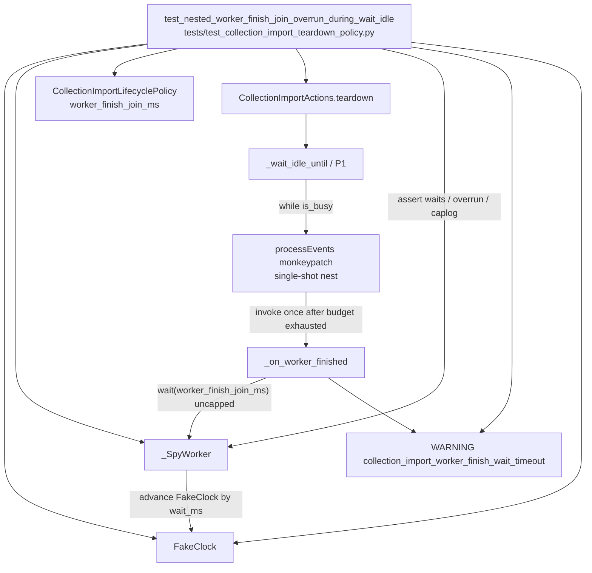

# PYPOST-1322: Test nested worker-finish join during collection import teardown

## Research

### Problem and accepted contract (verified)

PYPOST-1264 design Risk 3 documents that when `_on_worker_finished` runs inside teardown
phase P1 (`_wait_idle_until` → `QApplication.processEvents()`), its
`wait(worker_finish_join_ms)` is **intentionally not** capped by
`ImportTeardownDeadline.remaining_ms()`. The pathological stall case is still bounded by
`CollectionImportLifecyclePolicy.worker_finish_join_ms` (default 100) and surfaced by the
existing WARNING `collection_import_worker_finish_wait_timeout wait_ms=…`.

Source of the follow-up: [PYPOST-1264 follow-up 7](../PYPOST-1264/60-tech-debt.md)
(Missing Tests §2 / Performance §2 / Follow-up 7 → this ticket). Docs already name the
exception and point here: `doc/dev/collection_import.md` (shared-deadline exceptions;
troubleshooting for `collection_import_worker_finish_wait_timeout`).

Production already implements that contract. This task is **characterization only** — pin
the nested overrun bound and warning so a future change cannot silently lengthen the hang
or drop the diagnostic.

### Production seams (current tree)

| Location | Role for this ticket |
| --- | --- |
| `pypost/core/collection_import_lifecycle_policy.py` | Named `worker_finish_join_ms`; `ImportTeardownDeadline` shared across P1–P3; constructor `clock` seam already used by teardown tests |
| `CollectionImportActions.teardown` | Starts one deadline; P0 interrupt/cancel; P1 `_wait_idle_until`; docstring already names the uncapped nested join (Risk 3) |
| `CollectionImportActions._wait_idle_until` | While `is_busy()`, with a live `QApplication`, calls `app.processEvents()` each iteration — the nesting entry point |
| `CollectionImportActions._on_worker_finished` | Clears `_worker`, `deleteLater()`, then `finished.wait(self._policy.worker_finish_join_ms)` **without** `deadline.bounded(...)`; on timeout logs `collection_import_worker_finish_wait_timeout wait_ms=%d` |
| `is_busy()` | `_state is not IDLE` — independent of `_worker`; finish handler does **not** force IDLE |

No production API change is required. The clock and lifecycle policy constructor kwargs are
sufficient seams.

### Existing test helpers (reuse)

`tests/test_collection_import_teardown_policy.py` already provides:

- Module `pytestmark = pytest.mark.timeout(30)` (do-testing compliant).
- `FakeClock` — monotonic seconds; `advance(ms)` and optional `tick_ms` on each read.
- `_SpyWorker` — records `wait(ms)`, advances the fake clock by `ms`, returns
  `join_ok` (default `False` → stall / timeout path).
- `_make_actions(...)` — builds `CollectionImportActions` with fake request manager and
  injectable `lifecycle_policy` / `clock`.

Gap today: `_SpyWorker.finished` is a disconnect-only stub; no test forces
`_on_worker_finished` to run **inside** P1's `processEvents()`. Grep of
`tests/` shows **no** assert on `collection_import_worker_finish_wait_timeout` for
collection import (only peer products / UI comments). That is the coverage gap this ticket
closes.

### External research

- **Characterization tests** (Feathers / Working Effectively with Legacy Code): pin what the
  system *does*, including accepted edge contracts, before future edits. Recipe: harness →
  assert → observe → lock. For a coverage-gap ticket where production is already correct,
  the “red” phase proves the suite cannot yet observe the nested path; green comes from
  completing the harness, not from changing product code.
  Sources: [Characterization testing overview](https://mariocervera.com/characterization-testing-adding-tests-to-legacy-code),
  [Characterization Tests for Legacy Code](https://techdebt.works/techniques/test-characterization/).
- **Qt / pytest-qt event pumping**: `processEvents()` can run arbitrary queued slots
  (including `QThread.finished` handlers). Tests must keep waits bounded and avoid unbounded
  nested `exec()`; this design stays on the existing fake-clock + spy path and only
  *simulates* a nested slot via a controlled `processEvents` monkeypatch — no real thread,
  no nested `QEventLoop.exec()`. Guidance aligned with project
  `doc/dev/gui_testing.md` and pytest-qt event-processing behavior
  ([pytest-qt QApplication notes](https://pytest-qt.readthedocs.io/en/stable/qapplication.html);
  [Qt test suite hang / nested-loop pitfalls](https://czaki.github.io/blog/2024/09/16/preventing-segfaults-in-test-suite-that-has-qt-tests/)).

### Test-design constraints (do-testing / lsr-python)

- Keep the new case in the existing module (or a sibling under `tests/` only if clarity
  suffers — prefer same file).
- Explicit timeout already present at module scope; do not rely on a global pytest.ini
  timeout.
- Prefer fake clock + spy waits over wall-clock timing (deterministic CI).
- Caplog contract **C1**: assert the WARNING via
  `caplog.at_level(logging.WARNING, logger="pypost.ui.presenters.collection_import_actions")`
  (or INFO+ with level check); match the structured prefix
  `collection_import_worker_finish_wait_timeout`.
- No unbounded `Event.wait` / event-loop polling; nesting hook must be single-shot and
  exit P1 by setting IDLE (or exhausting the deadline) after the nested join.

## Implementation Plan

1. **Extend helpers only as needed** in `tests/test_collection_import_teardown_policy.py`:
   optionally give `_SpySignal` `connect`/`emit` so the test can mirror
   `finished.connect(_on_worker_finished)`; not required if the nesting hook calls
   `_on_worker_finished` directly (acceptable characterization white-box for a private slot
   that is already the documented Risk 3 subject).
2. **Add one characterization test** (name suggestion:
   `test_nested_worker_finish_join_overrun_during_wait_idle`) that:
   - Injects a policy with known `worker_finish_join_ms` (e.g. 100) and a small caller
     `timeout_ms` strictly less than that join (e.g. 50).
   - Places actions in a busy state (`CollectionImportState.PARSING`) with a `_SpyWorker`
     (`join_ok=False`) so the finish join stalls.
   - Monkeypatches `QApplication.instance().processEvents` so the **first** P1 pump:
     1. Advances the fake clock enough that remaining budget is 0 (or near 0).
     2. Invokes `_on_worker_finished` (or emits `finished` into the connected slot).
     3. Sets `_state` to `IDLE` so `_wait_idle_until` can return without further pumps.
   - Asserts:
     - Spy recorded an uncapped wait of exactly `policy.worker_finish_join_ms` (not
       `deadline.bounded(...)` / not `0`).
     - Teardown wall time on the fake clock (or `elapsed_ms` from
       `collection_import_teardown_completed`) exceeds the caller budget by at most
       `worker_finish_join_ms` (overrun attributable to the nested join ≤ that allowance).
     - Caplog contains WARNING
       `collection_import_worker_finish_wait_timeout wait_ms=<worker_finish_join_ms>`.
3. **No production edits** to `collection_import_actions.py` or the policy module unless a
   Step 4 review finds an unavoidable test seam (out of scope by default).
4. Run repository gates via `make` (`make test` focused path / `make check` as required by
   later steps).

**Mandatory — Failing Repro (next Step 3):**

This is a **coverage-gap characterization** ticket: production already behaves correctly, so
a fully wired nested harness would go green immediately and would not prove the gap.

| Item | Plan |
| --- | --- |
| **Location** | `tests/test_collection_import_teardown_policy.py` (same module as `FakeClock` / `_SpyWorker`; inherits `pytestmark = pytest.mark.timeout(30)`) |
| **Desired behavior asserted** | Nested `_on_worker_finished` during P1 `processEvents` waits the full `worker_finish_join_ms` even when remaining budget is exhausted; teardown overrun attributable to that join ≤ `worker_finish_join_ms`; WARNING `collection_import_worker_finish_wait_timeout wait_ms=…` is emitted |
| **How Step 3 stays red** | Introduce the test with setup (busy state, spy worker, small budget, fake clock) and the **full Risk 3 assertions**, but **omit** the single-shot `processEvents` nesting hook (or leave it as a no-op). Without nesting, current teardown only exercises deadline-bounded P1/P2 waits — so the warning is absent and the uncapped `worker_finish_join_ms` wait is not recorded. Assertions fail → RED proves the suite cannot yet observe Risk 3 |
| **How to force failure without live deps** | No real `QThread`, no disk, no network; reuse `FakeClock`, `_SpyWorker`, `_make_actions`, `qapp` |
| **Sequencing** | Research (this step) → Step 3 red test (assertions + incomplete nesting) → Step 4 complete the `processEvents` hook (and any tiny helper extension) until the **same** assertions pass against **unchanged** production → cleanup / observability / debt / docs as later steps |
| **Not N/A** | There *is* a behavioral contract to lock; “no production change” does not mean “no failing repro.” The red phase characterizes the **missing coverage**, not a product defect |

Do **not** change production in Step 3. Do **not** mark the test xfail once the harness is
complete — green means the characterization is in place.

## Architecture

### Pattern selection

| Pattern | Why |
| --- | --- |
| **Characterization test** | Pin accepted Risk 3 behavior without changing it |
| **Test doubles** (`FakeClock`, `_SpyWorker`) | Deterministic join duration and stall without real threads |
| **Monkeypatch seam** on `processEvents` | Force the nested slot path that Qt would take when `finished` is queued during P1 pumping, without a live worker lifecycle |
| **Existing DI** (`clock`, `lifecycle_policy`) | Already on `CollectionImportActions`; no new production seams |

### Module / interaction diagram

### Module responsibilities

| Module / component | Responsibility in this task |
| --- | --- |
| `tests/test_collection_import_teardown_policy.py` | Own the new characterization test and any minimal helper extension; host FakeClock / spy reuse |
| `CollectionImportActions` | Unchanged production under test: teardown P1 nesting + finish join + warning |
| `CollectionImportLifecyclePolicy` / `ImportTeardownDeadline` | Unchanged: supply `worker_finish_join_ms` and deadline arithmetic for budget exhaustion |
| Logger `pypost.ui.presenters.collection_import_actions` | Existing WARNING event asserted via caplog |

### Interfaces under test (observation only)

- **Input**: `teardown(timeout_ms=B)` with `B < worker_finish_join_ms`, busy import state,
  stalling spy worker, nested finish during P1.
- **Observable outputs**:
  1. Spy `waits` includes `worker_finish_join_ms` (uncapped).
  2. Fake-clock / logged `elapsed_ms` overrun past `B` ≤ `worker_finish_join_ms`.
  3. Caplog WARNING `collection_import_worker_finish_wait_timeout wait_ms=<join>`.
- **Non-goals**: capping the join by remaining budget; APPLYING GUI-slot Risk 3 facet;
  main-window registration (PYPOST-1321); library interruptibility (PYPOST-1324).

### Out of scope (architecture)

- Production behavior or policy default changes.
- New logging/metrics.
- Real-thread / wall-clock latency gates (covered elsewhere / slow module).
- Broader cancellation matrices (PYPOST-1265).

## Q&A

- **Why not write a fully wired green characterization test in Step 3?** Top-down Step 3
  requires a failing repro. With production already correct, a complete harness would pass
  immediately and would not demonstrate the coverage gap. Red = assertions without nesting;
  green = same assertions after Step 4 wires nesting.
- **Why monkeypatch `processEvents` instead of a real `QThread.finished`?** Matches the
  existing teardown-policy style (no real threads, fake clock). A real thread would add
  flakiness and fight do-testing bounded-wait rules without improving the contract proof.
- **Why call `_on_worker_finished` from the hook?** It is the exact slot Risk 3 names; the
  alternative (`finished.connect` + emit) is equivalent if `_SpySignal` gains connect/emit.
  Either is fine; prefer the smallest helper change.
- **Why set IDLE after the nested join in the hook?** `_on_worker_finished` does not clear
  busy state. Leaving PARSING would spin P1 until the deadline expires and still allow the
  join assert, but forcing IDLE keeps the scenario focused on the nested overrun and avoids
  mixing P1 timeout noise into the primary assertions.
- **Is `budget_tolerance_ms` asserted?** No. Requirements target the join allowance bound and
  the stall warning; tolerance remains a documented contract value (PYPOST-1264), not a CI
  gate for this ticket.
- **Caplog contract?** C1 — assert the WARNING prefix on the actions logger; no allowlist
  change expected for an existing production log line.
