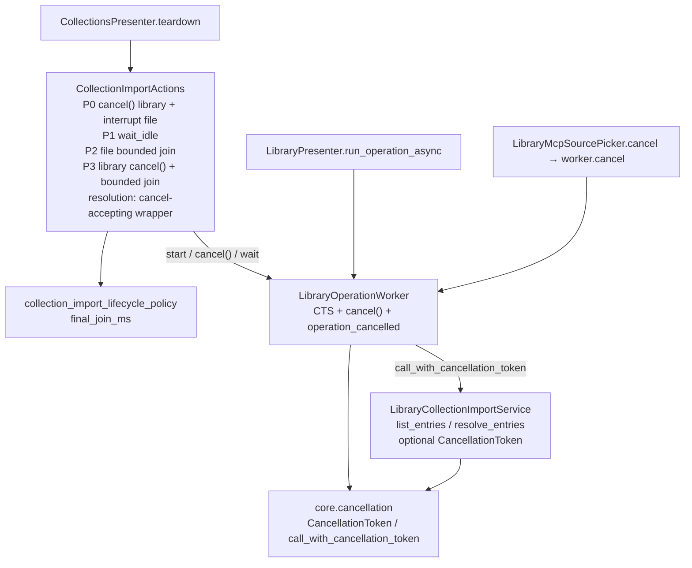

# PYPOST-1324: Make LibraryOperationWorker interruptible

## Research

### Current code facts (verified)

- `pypost/core/qt/library_operation_worker.py`
  - Thin one-shot `QThread`: stores an injected callable plus args/kwargs, runs it in
    `run()`, emits `operation_completed(object)` or `operation_failed(object)`.
  - No `cancel()`, no `CancellationTokenSource`, no `isInterruptionRequested()` checks, no
    cancelled signal. `requestInterruption()` from callers is therefore a no-op for the
    injected operation.
- `pypost/ui/presenters/collection_import_actions.py`
  - Connected-library import starts background work via `_start_library_operation`
    (`:399-407`): builds `LibraryOperationWorker(operation)`, connects completed/failed/
    finished, stores `_library_worker`, starts the thread.
  - Listing phase (`:330-335`): operation is the service bound method `list_entries`.
  - Resolution phase (`:364-367`): operation is a **zero-arg**
    `lambda: self._resolve_library_candidates(service, selected, mode)`, which calls
    `service.resolve_entries` / `materialize_candidate` (`:509-546`) with **no** cancel
    argument. That lambda’s signature rejects `cancellation_token=`, so even after the
    worker wraps the op in `call_with_cancellation_token`, the injected kwarg never
    reaches `_resolve_library_candidates` / `resolve_entries` / the materialize loop
    unless the start-site callable is reshaped (nested `def` / wrapper that accepts
    `cancellation_token=`). Listing phase can keep the bound `list_entries` method once
    that method gains the optional kwarg.
  - Teardown (`:190-280`), post-PYPOST-1264 shared deadline:
    - **P0**: `requestInterruption()` only on the **file** parse worker when busy and
      running (`:197-201`). Library worker is never interrupted here.
    - **P1**: `_wait_idle_until(deadline)` while `is_busy()` (covers `PREPARING` during
      library listing/resolution).
    - **P2**: file worker disconnect → interrupt → `wait(deadline.bounded(final_join_ms))`.
    - **P3**: library worker **join-only** —
      `wait(deadline.remaining_ms())` with no prior `requestInterruption()` (`:246-269`);
      then disconnect / `deleteLater` / clear. This is PYPOST-1264 Risk 4 / follow-up 3.
    - File-parse interrupt-only is **not** enough for library: parse worker polls
      `isInterruptionRequested()` inside Qt-aware code; library service loops are
      Qt-free and only see `CancellationToken`. Sibling workers
      (`ManifestDiscoveryWorker` / `CollectionFetchWorker`) put both
      `requestInterruption()` and `cts.cancel(...)` inside `cancel()` — they do **not**
      bridge bare `requestInterruption()` to the CTS. Library teardown must therefore
      call `cancel()` (not treat `requestInterruption()` as equivalent), unless an
      explicit run-loop bridge is added.
  - On library success/failure, handlers call `_finish_library_import()` (sets `IDLE`).
    There is no cancelled path: if the worker exited without emitting completed/failed,
    state would stay `PREPARING` and P1 would burn the budget until forced `IDLE` in P4.
- `pypost/core/library_collection_import.py`
  - `LibraryCollectionImportService.list_entries` (`:179-273`) loops connections and
    declared collection paths; each iteration can block on manifest I/O and
    `load_collection_import_candidates`. **No** `cancellation_token` parameter and no
    checkpoint.
  - `resolve_entries` (`:275-360`) loops selected entries with the same blocking pattern;
    likewise no cancel hook.
  - Contrast: `pypost/core/library_manager_service.py` already accepts optional
    `cancellation_token: CancellationToken | None` on `list_connections`,
    `list_manifest_collections`, and `read_collection`, and checks it at loop boundaries.
- Shared consumers of `LibraryOperationWorker`:
  - `pypost/ui/presenters/library_presenter.py` `run_operation_async` (`:840-864`): starts
    workers keyed by `(library_id, operation)`; no cancel/teardown interrupt today; only
    success/failure callbacks. Must keep working for normal outcomes (DoD 6).
  - `pypost/ui/mcp_library_source_picker.py`: already owns request-id cancellation.
    `_cancel_worker` (`:116-119`) calls `worker.cancel()` **if** present, then drops the
    reference. Today `LibraryOperationWorker` has no `cancel`, so cancel only invalidates
    callbacks and abandons the thread — cooperative stop is unused but the hook is ready.
- File-parse precedent (target shape for library):
  - `CollectionImportParseWorker` checks `isInterruptionRequested()` before/during/after
    reader work and emits `parse_cancelled` (never surfaces cancel as `parse_failed`).
  - Teardown interrupts then bounded-joins (`final_join_ms`).
- Cancellation precedent for Qt workers that call Qt-free services:
  - `ManifestDiscoveryWorker` / `CollectionFetchWorker`: own `CancellationTokenSource`;
    `cancel()` sets a flag, calls `requestInterruption()`, and `cts.cancel(...)`; `run()`
    uses `call_with_cancellation_token(...)` so services that accept
    `cancellation_token=` receive it, and legacy callables keep working without the kwarg
    (`pypost/core/cancellation.py`).
  - `OperationCancelledError` is swallowed as a quiet abort (no failure signal).

### External research

- Qt 6 / PySide6 `QThread::requestInterruption()` is advisory; the worker must poll
  `isInterruptionRequested()` (or an equivalent token) at safe checkpoints.
  `terminate()` is out of scope and discouraged.
  Sources: [QThread (Qt 6)](https://doc.qt.io/qt-6/qthread.html),
  [PySide6 QThread](https://doc.qt.io/qtforpython-6/PySide6/QtCore/QThread.html).
- Cooperative pattern used industry-wide for PySide6: UI/teardown calls
  `requestInterruption()` then `wait(timeout)`; worker returns after cleanup. Matches
  collection-import file teardown and the ManifestDiscoveryWorker / CollectionFetchWorker
  design already in this repo.
- `QThread.requestInterruption()` is a one-shot flag for that thread run; bridging it to
  `CancellationTokenSource.cancel()` (as sibling workers do) is the right way to reach
  Qt-free service loops that cannot import Qt.

### Gap summary (maps to requirements)

| DoD | Gap today |
| --- | --- |
| 1 Cooperative stop | Library listing/resolution never observe cancel; worker never checks interruption |
| 2 Interrupt then bounded final wait | P3 joins for all remaining budget with no stop request; P0 ignores library |
| 3 Clean vs unclean | Unclean path exists, but clean stop of a stuck library op is impossible |
| 4 No late results | Disconnect order is fine; need cancel not to emit completed into UI |
| 5 Non-cancelled unchanged | Success/failure signals stay; cancel must not look like failure |
| 6 Shared consumers | Adding `cancel()` + token injection must be opt-in for callables |
| 7 Regression | No test proves library interrupt + bounded final join |

## Implementation Plan

1. **Make `LibraryOperationWorker` cooperatively interruptible** (shared runner):
   - Own a `CancellationTokenSource` for the lifetime of one `run()`.
   - Add `cancel()` that mirrors sibling workers: set any local cancel flag,
     `requestInterruption()`, **and** `cts.cancel(...)`. That is the single stop API
     that reaches both Qt interruption and the token injected into Qt-free services.
   - **Do not** treat bare `requestInterruption()` as sufficient for library stop.
     Sibling workers do not bridge interrupt → CTS; file-parse interrupt-only works
     only because that worker polls `isInterruptionRequested()` itself. Library
     service checkpoints see only `CancellationToken`. Therefore collection-import
     P0/P3 (and MCP’s `_cancel_worker`) **must call `cancel()`**. Optional alternative
     (only if teardown kept interrupt-only): an explicit `run()` bridge that, before/
     around the op, polls `isInterruptionRequested()` and calls `cts.cancel(...)` —
     default design is **require `cancel()`**, no interrupt-only bridge.
   - In `run()`: invoke the operation via `call_with_cancellation_token(..., cancellation_token=token)`;
     check interruption / token before emitting success; on `OperationCancelledError` or
     interruption, emit a new `operation_cancelled` signal (do **not** emit
     `operation_failed`); dispose the token source in `finally`.
   - Keep `operation_completed` / `operation_failed` semantics for non-cancelled runs so
     library presenter and MCP stay green without mandatory wiring of the new signal.
2. **Propagate cancel into connected-library discovery/resolution** (Qt-free core):
   - Add optional `cancellation_token: CancellationToken | None = None` to
     `LibraryCollectionImportService.list_entries` and `resolve_entries`.
   - Check at safe loop boundaries (per connection, per declared path / selected entry,
     and before expensive load/resolve steps) via `throw_if_cancellation_requested()`.
   - Forward the token through `CollectionImportActions._resolve_library_candidates`
     (add optional `cancellation_token=` and pass it into `resolve_entries` / check
     between materialize candidates).
   - **Start-site callable shape (resolution)**: replace the zero-arg
     `lambda: self._resolve_library_candidates(...)` at `_start_library_operation`
     (`collection_import_actions.py` ~364–366) with a nested `def` / wrapper whose
     signature accepts `cancellation_token: CancellationToken | None = None` (and
     forwards it). A bare zero-arg lambda **rejects** the kwarg that
     `call_with_cancellation_token` injects, so the token never reaches resolve /
     materialize. Listing may keep the bound `list_entries` method once that method
     accepts the optional kwarg.
3. **Align collection-import teardown with interrupt-then-bounded-join** (actions only):
   - **P0**: if `_library_worker` is running, call **`cancel()`** (not bare
     `requestInterruption()`) as well as interrupting the file worker (no wait).
     File worker stays interrupt-only (Qt-aware parse loop).
   - Connect `operation_cancelled` → `_finish_library_import()` (and any existing metrics/
     log) so a cooperative stop returns the action to `IDLE` and lets P1 succeed.
   - **P3**: mirror P2’s disconnect-then-stop-then-bounded-join, but the library stop
     call is **`cancel()`** again (reaches CTS + interruption). Then
     `wait(deadline.bounded(policy.final_join_ms))`, log interrupt vs timeout (reuse /
     extend existing library timeout log fields; Step 6 owns final event names),
     `deleteLater`, clear reference. Do **not** join for the full remaining budget
     with no stop request. Do **not** treat file-style interrupt-only as equivalent
     for the library worker.
   - Reuse `final_join_ms` (100) as the documented short library final-join bound; do not
     add a second policy field unless measurement later demands it.
4. **Shared-consumer safety (minimal)**:
   - Library presenter: no product redesign; unconnected `operation_cancelled` is fine;
     finished handler still pops the worker. Optional: call `cancel()` from any existing
     close path only if one already stops work (out of scope to invent new UX).
   - MCP picker: existing `cancel()` / `cancel_active()` begin interrupting the real
     worker once `cancel()` exists — no workflow redesign.
5. **Tests / docs** (Steps 3–4 / 8): red repro below; update PYPOST-1264 spy expectations
   that asserted P3 == remaining to P3 == `min(final_join_ms, remaining)` after interrupt;
   document interruptible library teardown in `doc/dev/collection_import.md`.

**Mandatory — Failing Repro (next Step 3):**

- **Location**: `tests/test_library_operation_interrupt_repro.py` (new), with
  `pytestmark = pytest.mark.timeout(30)`, using the existing `qapp` fixture.
- **Primary behavioural red (collection-import teardown + honoring library op)**:
  - Start a real `LibraryOperationWorker` through `_start_library_operation` whose
    operation blocks on a test `threading.Event` **and** polls an optional
    `cancellation_token` (or `QThread.currentThread().isInterruptionRequested()`) at a
    short interval so it can exit when stop is requested — the production shape after
    Step 4. For the **red** phase on today’s code, the same test asserts teardown
    behaviour that fails now:
    1. After `teardown(timeout_ms=B)` with `B` small but above `final_join_ms` (e.g. 300),
       library **`cancel()`** was **never** invoked (spy wrapper or instrumented subclass
       recording `cancel` — not merely `requestInterruption`) — red today.
    2. Library `wait` argument equals the full remaining budget path (join-only), not
       `<= final_join_ms` after `cancel()` — red today via spy or by asserting that a
       token-honoring op is still abandoned only after burning remaining budget.
  - **Preferred deterministic split** (mirror PYPOST-1264):
    - **Test A (actions teardown API, spy library worker)**: IDLE state, install spy
      `_library_worker` that records `cancel` (and optionally `requestInterruption`) and
      `wait(ms)`. Assert teardown **calls `cancel()` before wait** and
      `wait_ms <= final_join_ms` (and `<= B`). **Red today**: no `cancel()` recorded;
      wait is `remaining` (e.g. full `B` when P2 skipped / no file worker, or remaining
      after file join when both spies present).
    - **Test B (end-to-end cooperative stop)**: real worker + cancel-aware op that
      accepts `cancellation_token=` (signature must allow injection — same constraint as
      production resolution wrapper) and clears an event when cancelled; `teardown(B=1000)`;
      assert `clean is True`, op observed cancel via token, no `operation_completed`
      delivery into apply hooks, and elapsed well under full default budget. **Red today**:
      op never sees cancel; teardown returns unclean after joining for remaining budget /
      abandons running work.
- **Unclean path guard** (same module or adjacent): op that **ignores** cancel and blocks
  on an Event; short `B`; assert `clean is False`, teardown returns within caller budget
  (loose wall bound `< 2B` as in PYPOST-1264), and `finally` releases the Event + bounded
  join so no thread leak.
- **No live external deps**: use in-process Events / spy workers only; no network or disk
  library roots required for the primary red.
- **Sequencing**: research (this step) → red tests (Step 3, no production change) → worker
  + service token hooks + teardown P0/P3 + cancelled wiring (Step 4) until green → update
  existing teardown arithmetic tests that hard-code P3 == remaining.

## Architecture

### Module diagram



Dependency direction: UI presenters → `LibraryOperationWorker` (Qt) → Qt-free
`cancellation` + `LibraryCollectionImportService`. No Qt imports in the service.

### Component responsibilities

| Module | Responsibility |
| --- | --- |
| `LibraryOperationWorker` | One-shot background runner; owns per-run `CancellationTokenSource`; **`cancel()`** = `requestInterruption()` + `cts.cancel(...)` (sibling pattern); injects token into callables that accept it; emits completed, failed, or **cancelled**. Bare `requestInterruption()` alone does **not** cancel the CTS |
| `LibraryCollectionImportService` | Qt-free listing/resolution with optional cancel checkpoints at loop boundaries |
| `CollectionImportActions` | Starts library ops with cancel-accepting callables (resolution: nested `def` / wrapper, **not** zero-arg lambda); wires `operation_cancelled`; teardown P0/P3 call library **`cancel()`**; P3 + `bounded(final_join_ms)` join; disconnect before reap (no late UI) |
| `CollectionImportLifecyclePolicy` | Unchanged fields; `final_join_ms` becomes the documented bound for **both** file and library post-disconnect joins |
| `LibraryPresenter` / `LibraryMcpSourcePicker` | Unchanged product flows; gain real cooperative stop where they already call `cancel` |

### Teardown phase change (library)

```text
teardown(timeout_ms=None):  # shared deadline unchanged
  P0  if file worker running: requestInterruption()                 # Qt-aware parse; interrupt-only OK
      if library worker running: cancel()                           # NEW — MUST call cancel(), not bare interrupt
  P1  if busy: wait_idle until deadline                             # can succeed when library cancels → IDLE
  P2  file: disconnect; interrupt; wait(bounded(final_join_ms)); reap
  P3  library: disconnect completed/failed/cancelled/finished;      # order preserves DoD 4
      if still running: cancel(); wait(bounded(final_join_ms));     # was wait(remaining) only; cancel() not interrupt-only
      reap
  P4  IDLE; processEvents(); completed log
```

Library stop API: **`cancel()` only** at P0/P3. File-parse-style `requestInterruption()` alone
does not cancel the CTS, so Qt-free `list_entries` / `resolve_entries` checkpoints never
fire. Optional alternative (not the default): keep interrupt-only teardown **and** add an
explicit `run()` bridge that polls `isInterruptionRequested()` and calls `cts.cancel(...)`
before/around the injected op — sibling workers do not do this; prefer requiring `cancel()`.

Wait arithmetic after the change: P2 + P3 each `<= final_join_ms` and both capped by
remaining, so sum of joins `<= B` still holds (often tighter than today’s P3 = remaining).

### Selected patterns and justification

- **Cooperative cancellation via `cancel()` (Qt interruption + CTS.cancel)**: matches Qt
  guidance and ManifestDiscoveryWorker / CollectionFetchWorker; reaches Qt-free I/O loops
  without forcible kill (NFR / out of scope). Library teardown must call `cancel()`, not
  bare `requestInterruption()`, unless an explicit interrupt→CTS `run()` bridge is added.
- **`call_with_cancellation_token` duck-typing**: shared runner stays compatible with
  callables that do not take a token (library presenter ops, simple MCP lambdas, tests).
  Callables that *must* observe cancel (resolution path) need a signature that accepts
  `cancellation_token=` — nested `def` / wrapper, not a zero-arg lambda.
- **Dedicated `operation_cancelled` signal**: mirrors `parse_cancelled`; avoids treating
  cancel as failure (no error dialogs) and gives actions a clear IDLE transition for P1.
- **Reuse `final_join_ms`**: one documented short grace for native thread exit after stop;
  aligns library with file teardown; avoids policy sprawl until measurement says otherwise.
- **`cancel()` before wait-idle (P0)**: without early library `cancel()` (CTS + interrupt),
  P1 cannot observe stop while state stays `PREPARING`, recreating the budget burn this
  ticket removes.

### Main interfaces / APIs

```python
# LibraryOperationWorker (additive)
operation_cancelled = Signal()
def cancel(self) -> None: ...
# cancel() MUST: requestInterruption() + cts.cancel(...)  (ManifestDiscoveryWorker shape)
# Bare requestInterruption() does NOT cancel the CTS — teardown/MCP must call cancel().
# Optional (non-default) run()-loop bridge: if isInterruptionRequested(): cts.cancel(...)
# run() uses call_with_cancellation_token; may emit operation_cancelled

# LibraryCollectionImportService (additive kwargs)
def list_entries(
    self,
    connection: LibraryConnectionRecord | None = None,
    *,
    cancellation_token: CancellationToken | None = None,
) -> list[LibraryCollectionImportEntry]: ...

def resolve_entries(
    self,
    entries: Iterable[LibraryCollectionImportEntry],
    *,
    cancellation_token: CancellationToken | None = None,
) -> LibraryCollectionImportResolution: ...

# CollectionImportActions — resolution start-site callable (NOT zero-arg lambda)
def _start_resolution_op(...):
    def operation(*, cancellation_token: CancellationToken | None = None):
        return self._resolve_library_candidates(
            service, selected, mode, cancellation_token=cancellation_token,
        )
    self._start_library_operation(operation, self._on_library_candidates_resolved)

# _resolve_library_candidates gains optional cancellation_token=; forwards to
# resolve_entries / checks between materialize_candidate calls.
# Listing may pass bound list_entries once that method accepts the kwarg.

# CollectionImportActions.teardown — same public signature; P0/P3 call library cancel()
# CollectionImportLifecyclePolicy — no new fields required
```

### Risks

1. **Uninterruptible single OS/network call**: cancel is checkpoint-based; a stuck syscall
   can still miss the final join → unclean within budget (accepted by requirements).
2. **Existing P3 arithmetic tests**: fake-clock cases that expect P3 == remaining
   (`tests/test_collection_import_teardown_budget_repro.py`,
   `tests/test_collection_import_teardown_policy.py`) must be updated in Step 4 to
   `min(final_join_ms, remaining)` and to expect a **`cancel()`** call on the library spy
   (not merely `requestInterruption`).
3. **Silent cancel without `operation_cancelled` wiring**: if Step 4 forgot the IDLE
   transition, P1 would still burn the budget; the cancelled signal + handler is mandatory.
4. **Pre-start interruption**: Qt ignores `requestInterruption` before the thread is
   running (known file-worker caveat); P3’s post-disconnect `cancel()` + bounded join remains
   the safety net; repro should start the worker and wait until the op has entered before
   teardown when testing the honoring path.
5. **Shared consumer surprise**: emitting `operation_cancelled` instead of failed is safer
   than failing; consumers that only listen for completed/failed treat cancel as “no result”,
   which matches MCP request-id invalidation.
6. **Zero-arg resolution lambda**: if Step 4 leaves
   `lambda: self._resolve_library_candidates(...)` as the start-site op,
   `call_with_cancellation_token` cannot inject the token (signature rejects the kwarg);
   resolution/materialize loops never observe cancel even when the worker and service APIs
   are otherwise correct. Nested `def` / wrapper accepting `cancellation_token=` is mandatory.
7. **Interrupt-only library teardown**: if P0/P3 call only `requestInterruption()` (file-parse
   style) without `cancel()` and without an explicit interrupt→CTS `run()` bridge, service
   loops never see cancellation and P1/P3 recreate the budget-burn failure mode.

## Q&A

- **Why not only poll `QThread.isInterruptionRequested()` inside the service?** The service
  is Qt-free by design (`library_collection_import.py`). A `CancellationToken` keeps core
  independent of Qt and matches `LibraryManagerService` / ManifestDiscoveryWorker.
- **Why add `operation_cancelled` instead of failing with `OperationCancelledError`?**
  Failure handlers show user-facing library errors and count failures; cancel during
  teardown must be quiet and must clear busy state without UI noise (parity with
  `parse_cancelled`).
- **Why reuse `final_join_ms` instead of a new `library_final_join_ms`?** Same grace purpose
  after cooperative stop; requirements ask for alignment with the file pattern, not a second
  knob. Revisit only if latency evidence demands it.
- **Does P3 still use remaining budget when larger than `final_join_ms`?** No. After the
  stop request, the join is `deadline.bounded(final_join_ms)` — short and documented —
  capped by whatever budget remains (so exhausted budget still issues `wait(0)`).
- **Must library presenter call `cancel()`?** No. DoD 6 only requires normal success/failure
  to keep working and allows existing cancel paths (MCP) to use interruption. Inventing new
  Library Manager cancel UX is out of scope.
- **Why can’t resolution keep the zero-arg lambda?** Worker `run()` injects
  `cancellation_token=` via `call_with_cancellation_token`. A zero-arg
  `lambda: self._resolve_library_candidates(...)` rejects that kwarg, so the token never
  reaches `_resolve_library_candidates` / `resolve_entries` / materialize. Use a nested
  `def` (or equivalent wrapper) that accepts `cancellation_token=` and forwards it.
- **Why must P0/P3 call `cancel()` instead of `requestInterruption()`?** Sibling workers
  cancel the CTS only inside `cancel()`; bare interrupt does not. Library checkpoints are
  token-based (Qt-free). File-parse interrupt-only works because that worker polls
  interruption itself. Without `cancel()` (or an explicit interrupt→CTS `run()` bridge),
  service loops never stop.
- **Who accepts this architecture?** Autonomous sprint orchestrator after independent review
  (Step 2 left `[/]` until that gate passes).
