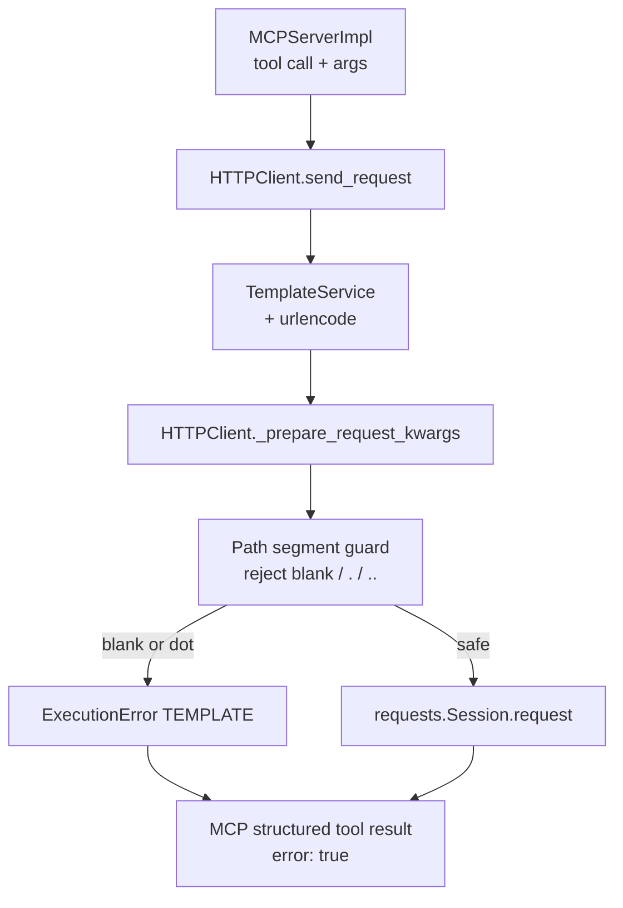

# PYPOST-1332: Fail closed when a rendered request path segment is blank

## Research

### Defect mechanism

1. Collection templates render path placeholders (often via Jinja `urlencode`). An empty
   string argument or environment override yields an empty path piece after substitution.
2. Examples from PYPOST-1316 TD-2 / R2:
   - Blank `gitlab_project` in a mid-path template → `/api/v4/projects//…`
   - Blank `gitlab_project` on `gitlab_get_project` → `/api/v4/projects/` (trailing blank
     segment), which GitLab may treat as list-projects rather than get-one.
3. `HTTPClient._prepare_request_kwargs` already runs
   `_assert_no_dot_path_segments` (PYPOST-1346). That helper **skips** empty pieces from
   `path.split("/")`, so blank segments still dispatch today.
4. Empty **query** params are already dropped when `rendered_v == ""`; this ticket is
   path-only.

### Requirements alignment

| Need | Implication |
| ---- | ----------- |
| FR1–FR3: detect after render; no dispatch; clear TEMPLATE MCP error | Guard on rendered URL path before `session.request` |
| FR4: leave non-blank alone; keep `.` / `..` | Extend seam; do not weaken PYPOST-1346 |
| FR5 / US3–4: GitLab + GitHub offline proof | Shared HTTP guard + representative collection tests |
| Jira “opt-in” wording | Prefer **always-on** blank-segment rejection at the same seam as dots (matches product summary “fail closed”); document that a per-variable required flag is not required for DoD |

### Existing seam (PYPOST-1346)

Documented in `doc/dev/http_path_segment_rejection.md` and
`ai-tasks/PYPOST-1346/20-architecture.md`:

- Checkpoint: `HTTPClient._prepare_request_kwargs` after the URL string is final.
- Helper: `_assert_no_dot_path_segments(url)` — rejects `.` / `..`; skips empties.
- ERROR log: `dot_path_segment_rejected` with origin-bounded URL.
- Tech debt explicitly deferred blanks to PYPOST-1332 and asked to extend this helper.

### Peer / prior art

- LiteLLM rejects **empty** path parameters before encode (same family as `.` / `..`).
- Always-on transport-boundary validation matches IntegerConversionError → TEMPLATE and
  PYPOST-1346; clearer MCP errors than a collection-only required flag.

### Placement decision

**Extend the PYPOST-1346 path-safety helper at `_prepare_request_kwargs`.**

| Option | Verdict |
| ------ | ------- |
| A. Manifest/env `required: true` only | Incomplete (env blank / multi-collection); defer as optional later |
| B. Reject blank segments in `_prepare_request_kwargs` via extended helper | **Adopt** — shared, always-on, same TEMPLATE mapping |
| C. Encode-time rejection in `_urlencode` alone | Misses non-urlencode paths; changes Jinja helper semantics |

Normative blank rules for Step 4:

- Input: full rendered request URL.
- Path: `urllib.parse.urlsplit(url).path` (ignore query/fragment).
- Segments: `path.split("/")`.
- **Skip** only index `0` when it is `""` **and** `path.startswith("/")` (synthetic
  absolute-path empty).
- **Reject** any other `""` segment (mid-path `//` or trailing blank).
- Keep existing `.` / `..` rejection unchanged.
- Do not reject legitimate non-empty segments (`ci.yml`, encoded multipaths, etc.).

## Implementation Plan

1. **Step 3 — Failing repro (red):** Core HTTPClient tests + representative GitLab/GitHub
   blank prepares (see below). Must fail without the blank guard.
2. **Step 4 — Development:** Extend path helper; ERROR log for blank rejects; update docs
   that still call blanks an open risk; keep dot tests green.
3. **Steps 5–8:** Cleanup, observability allowlist, tech-debt (no new Jira), `doc/dev`
   update of the path-segment rejection guide.

### Mandatory — Failing Repro (next Step 3)

**Primary red test (core):**

| Field | Plan |
| ----- | ---- |
| **Where** | `tests/test_http_client.py` — new `TestHTTPClientBlankPathSegmentRejection` |
| **Arrange** | Concrete URLs with mid-path `//` and trailing blank (e.g.
  `http://example.test/api/projects//issues`,
  `http://example.test/api/v4/projects/`); template URL with
  `urlencode(project)` and `variables={"project": ""}`. Mock session. |
| **Assert** | `_prepare_request_kwargs` / `send_request` raise `ExecutionError` with
  `category == ErrorCategory.TEMPLATE`, blank/path-segment wording;
  `session.request` never called. |
| **Why red today** | Prepare succeeds; empty segments are skipped by the dot helper. |
| **Control** | Non-blank legitimate path still prepares (reuse / mirror FR4 style). |
| **Timeout** | Module `pytestmark` already present on `test_http_client.py`. |

**Collection red coverage:**

| Collection | File | Case | Assert |
| ---------- | ---- | ---- | ------ |
| GitLab | `tests/test_gitlab_mcp_collection.py` | `gitlab_project=""` on `gitlab_get_project` (and optionally a mid-path project-scoped tool) | `_prepare` raises TEMPLATE `ExecutionError` |
| GitHub | `tests/test_github_mcp_collection.py` | `github_owner=""` or `github_repo=""` on a path-using tool | Same |

**Sequencing:** research → Step 3 red tests → Step 4 implement until green → docs +
`make check` / scoped `make test`.

**N/A?** Not applicable — runtime behavioural change.

## Architecture

### Module diagram



### Modules and responsibilities

| Module | Responsibility |
| ------ | -------------- |
| `pypost/core/http_client.py` | Extend path-segment helper to reject blank segments; call from `_prepare_request_kwargs`; ERROR log with origin-bounded URL (new event name for blanks, keep `dot_path_segment_rejected` for dots). |
| `pypost/models/errors.py` | Reuse `ErrorCategory.TEMPLATE` + `ExecutionError`. |
| `pypost/core/mcp_server_impl.py` | Unchanged mapping. |
| Collections | Unchanged templates; shared HTTP guard protects them. |
| Docs | Update `http_path_segment_rejection.md`, request_execution, GitLab/GitHub collection notes that still say blanks are deferred. |
| Tests | Core red→green; GitLab/GitHub blank prepares; keep dot suite green. |

### Interfaces (conceptual)

```text
def _assert_no_dot_path_segments(url: str) -> None:
    """Also reject blank path segments (PYPOST-1332); keep . / .. (PYPOST-1346)."""

# Or thin sibling _assert_no_blank_path_segments called from the same try/except
# block — prefer one helper to avoid dual checkpoint drift.
```

Preferred: **one helper** (extend `_assert_no_dot_path_segments` docstring/name if needed,
e.g. `_assert_safe_path_segments`, with optional alias) so prepare stays a single call.

Logging:

- Blank reject → `blank_path_segment_rejected method=<METHOD> url=<origin-only>`
- Dot reject → existing `dot_path_segment_rejected`

### Patterns

- Fail-closed validation at the transport boundary (same as `to_int` / PYPOST-1346).
- Single authoritative check after template render.
- Always-on blank rejection (not opt-in) at the shared seam.

## Q&A

- **Q: Why always-on instead of opt-in?** A: Soft defaults already exist; the defect is
  explicit blanks and wrong-endpoint dispatch. Always-on matches PYPOST-1346 and the
  ticket summary. A required-flag layer remains optional future UX, not DoD.
- **Q: Why reject trailing blank?** A: `/projects/` with empty project is the
  list-projects hazard called out in PYPOST-1316 R2 / TD-2.
- **Q: Why skip only the leading absolute-path empty?** A: `urlsplit(...).path` for
  `https://host/a/b` is `/a/b`; `split("/")` yields `["", "a", "b"]`. That first `""` is
  not a missing variable.
- **Q: Rename helper?** A: Optional in Step 4; behaviour extension is mandatory. If
  renamed, update `doc/dev/http_path_segment_rejection.md` in Step 8.

### References

- Requirements: [`10-requirements.md`](./10-requirements.md)
- Seam: [`../PYPOST-1346/20-architecture.md`](../PYPOST-1346/20-architecture.md)
- Debt source: [`../PYPOST-1316/60-tech-debt.md`](../PYPOST-1316/60-tech-debt.md) TD-2
- Dev doc: `doc/dev/http_path_segment_rejection.md`
