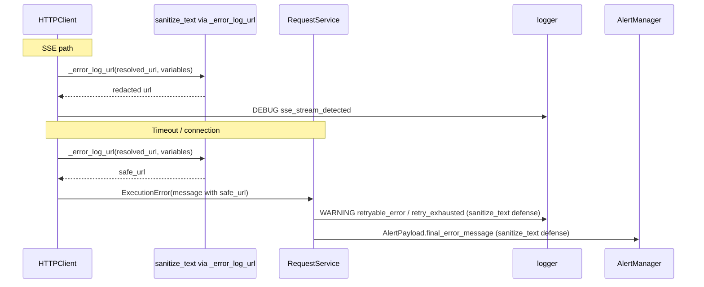

# PYPOST-1333: Architecture — sanitize SSE and retry URL sinks

## Research

- PYPOST-741 introduced `HTTPClient._error_log_url(url, variables)` →
  `sanitize_text(url, env_vars=...)` for transport ERROR URLs.
- PYPOST-1122 (commit `3b4e5114`) already routes `response_body_truncated` WARNING
  through `_error_log_url`. Do not re-touch that path except to keep tests green.
- Remaining gaps (PYPOST-1316 TD-1 / `50-observability.md`):
  - `http_client.py` `sse_stream_detected` DEBUG logs raw rendered `url`.
  - `http_client.py` timeout / connection `ExecutionError.message` embeds raw
    `url` (`Request to {url} timed out.` / `Could not connect to {url}.`).
  - `request_service.py` `retryable_error` / `retry_exhausted` log `exc.message` /
    `error.message`, so those WARNINGs inherit the unsanitized URL.
  - `_emit_exhaustion_alert` copies `error.message` into
    `AlertPayload.final_error_message` (scope note from PYPOST-1334); alert JSON /
    webhooks inherit the same leak. Endpoint / metric labels already use the
    **template** URL and stay unchanged.
- `request_service` does not receive resolved variables, so log-site-only
  sanitization cannot apply env-value redaction unless the message is already
  safe or heuristics alone suffice.
- `sanitize_text` query heuristics (`token` / `api_key` / …) cover common query
  secrets even without `env_vars`; env-value redaction needs variables at the
  raise site.

## Implementation Plan

**Design decision:** Sanitize the URL **at raise** inside `HTTPClient` for
timeout and connection `ExecutionError.message` via `_error_log_url`, and switch
`sse_stream_detected` to log `_error_log_url(url, variables)`.

Rationale vs alternatives:

| Option | Pros | Cons |
| --- | --- | --- |
| A. `log_message` field on `ExecutionError` | UI keeps raw URL | New API surface; every log/alert site must remember to prefer it |
| B. Sanitize only in `request_service` | Local to retry logger | No variables → weaker redaction; SSE untouched; alert still needs care |
| **C. Sanitize at raise (chosen)** | One source of truth; logs, alerts, and UI error text all safe; SSE is a one-line twin of 1122 | UI timeout/connection text shows redacted query values (acceptable) |

Defense in depth: also pass `sanitize_text(error.message)` when writing
`retryable_error` / `retry_exhausted` / `final_error_message` so injected or
third-party `ExecutionError` messages with query-token patterns cannot bypass
the retry sinks.

Steps:

1. Red tests (Step 3) for SSE DEBUG, timeout message / retry WARNING, and
   exhaustion alert message.
2. Production: SSE log uses `_error_log_url`; timeout/connection messages use
   `_error_log_url`; request_service wraps logged/alert messages with
   `sanitize_text`.
3. Docs: `doc/dev/logging.md`, GitLab/GitHub MCP follow-up notes for PYPOST-1333.

**Failing Repro (next Step 3):**

| Item | Detail |
| --- | --- |
| SSE | `tests/test_http_client.py::TestHTTPClientSSEStreamLogging::test_sse_stream_detected_logs_redacted_resolved_url` — DEBUG contains `sse_stream_detected`, host kept, secret absent, `token=***` |
| Raise message | `tests/test_http_client.py::TestHTTPClientErrorLogging::test_timeout_execution_error_message_redacts_resolved_url` — raised `ExecutionError.message` redacts secret |
| Retry WARNING | `tests/test_retry.py::TestRetryLogSanitization::test_retryable_error_log_redacts_url_in_error_message` — real `HTTPClient` + `RequestService`, `max_retries>=1`, timeout side_effect; WARNING `retryable_error` must not contain secret |
| Alert | `tests/test_retry.py::TestRetryLogSanitization::test_exhaustion_alert_message_redacts_url` — `final_error_message` redacts secret |
| Force | Mocked `session.request`; no live network |
| Sequencing | Write red tests → confirm fail on secret presence → fix → green |

## Architecture

| Component | Change |
| --- | --- |
| `HTTPClient.send_request` SSE branch | Log `_error_log_url(url, variables)` |
| `HTTPClient` timeout / connection raises | Embed `_error_log_url(...)` in `message` |
| `RequestService` retry WARNING + alert | `sanitize_text` on error message fields |
| Tests | New SSE / message / retry / alert redaction cases |
| Docs | Mark PYPOST-1333 resolved; note sanitized sinks |

### Non-goals

- No change to `response_body_truncated` (PYPOST-1122 done).
- No path-segment rejection changes (PYPOST-1346 / 1332).
- No rename of `_error_log_url`.
- No new metrics or event-name renames.
- Template URL fields on retry logs (`url=%r` = request template) stay as-is.

## Q&A

- **Q:** Origin-only (`_template_error_log_url`) for these messages?
  **A:** No. Match ERROR / truncation behavior: full path retained, secrets
  redacted. Operators still need path context for retries.
- **Q:** Sanitize `RequestException` generic message too?
  **A:** That path already uses a URL-free message (`An unexpected request error
  occurred.`). Out of scope.
