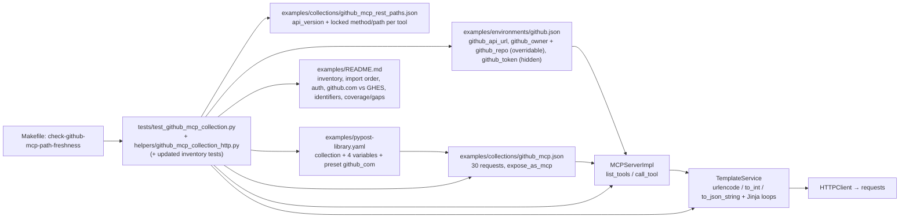

# PYPOST-1334: Create a GitHub collection for MCP in PyPost (Actions, pull requests, issues)

## Research

### Sources (GitHub, checked 2026-10-09)

- REST API versions — <https://docs.github.com/en/rest/about-the-rest-api/api-versions>:
  github.com supports `2026-03-10` (end of support not scheduled) and `2022-11-28` (end of
  support **2028-03-10**). A request without `X-GitHub-Api-Version` defaults to `2022-11-28`.
- GHES API versions —
  <https://docs.github.com/en/enterprise-server@3.19/rest/about-the-rest-api/api-versions>
  lists **only** `2022-11-28`;
  <https://docs.github.com/en/enterprise-server@3.22/rest/about-the-rest-api/api-versions>
  lists both. Supported GHES releases therefore share exactly one version: `2022-11-28`.
- Breaking changes in `2026-03-10` —
  <https://docs.github.com/en/rest/about-the-rest-api/breaking-changes>: singular `assignee`
  removed from issue create/update (use `assignees[]`); `merge_commit_sha` removed from PR
  payloads; `return_run_details` removed from workflow dispatch (always `200` with run details);
  `has_downloads` removed from repository objects embedded in run payloads.
- Authentication — <https://docs.github.com/en/rest/authentication/authenticating-to-the-rest-api>:
  "In most cases, you can use `Authorization: Bearer` or `Authorization: token` to pass a
  token"; JWTs require `Bearer`. All examples use `Bearer`.
- Workflow dispatch — <https://docs.github.com/en/rest/actions/workflows>:
  `POST /repos/{owner}/{repo}/actions/workflows/{workflow_id}/dispatches`, body `ref` (required,
  branch or tag) and `inputs` (object, at most 25 properties). `workflow_id` is the numeric ID
  **or** the workflow file name (e.g. `main.yaml`).
- Endpoint references used for the tool table (one doc page per group, recorded in the
  catalog `doc_refs`): users, repos, actions/workflows, actions/workflow-runs,
  actions/workflow-jobs, pulls, pulls/comments, pulls/reviews, issues, issues/comments.
  Listing endpoints take `page` and `per_page` (GitHub default 30, max 100). Pull request
  conversation comments use the issue-comments endpoint `/issues/{issue_number}/comments`
  (a pull request is an issue).
- Token prefixes (GitHub token format): classic PAT `ghp_`, OAuth `gho_`, user-to-server
  `ghu_`, server-to-server `ghs_`, refresh `ghr_`, fine-grained PAT `github_pat_`.
- Pull request reviews — <https://docs.github.com/en/rest/pulls/reviews>:
  `POST /repos/{owner}/{repo}/pulls/{pull_number}/reviews` takes `event`
  (`APPROVE`/`REQUEST_CHANGES`/`COMMENT`), `body`, `commit_id`, `comments`. Omitting `event`
  creates a **PENDING** review that is submitted only via
  `POST /repos/{owner}/{repo}/pulls/{pull_number}/reviews/{review_id}/events`; a user may hold
  only one pending review per pull request (a further create may return `422`).
  `REQUEST_CHANGES` and `COMMENT` require `body`; GitHub returns `422` for an invalid `event`.

### PyPost runtime facts (re-verified for this design; PYPOST-1316 table still holds)

| Fact | Source | Consequence |
| ---- | ------ | ----------- |
| `urlencode(v)` = `quote(str(v), safe="")`; `to_int` is strict (native int or ASCII decimal) | `pypost/core/function_registry.py` | Owner, repo and workflow ID become one segment each; numeric IDs fail before HTTP. |
| `HTTPClient._render_request_field` uses `render_string_strict_conversion` for URL, headers, params **and body** | `pypost/core/http_client.py` | `to_int` may be used inside JSON bodies (e.g. `line`), with fail-before-send semantics. |
| `to_json_string(v)` = `json.dumps(str(v))` — always a JSON **string** | `pypost/core/json_string.py` | Arrays, objects and booleans cannot go through it. They need Jinja loops / literals (below). |
| `{{ … }}` allows only safe dotted paths and allow-listed single-arg calls; `` is ordinary (non-sandboxed) Jinja | `function_expression_resolver.py`, `template_service.py` (`Environment()`) | Loops (``) and `` are allowed; `{{ to_json_string(x) }}` with loop var `x` is a safe path. |
| MCP param types include `boolean`, `array`, `object`; runtime check is strict (`bool` only for boolean, `list` for array, `dict` for object, `bool` rejected for integers) | `pypost/models/models.py`, `mcp_tool_contract.py::is_mcp_runtime_value_compatible` | Typed GitHub arrays (`labels`, `assignees`), objects (`inputs`) and booleans (`draft`, `enable_debug_logging`) are expressible without new runtime features. |
| `integer_or_string` publishes `anyOf [integer, string ^[+-]?[0-9]+$]` | `mcp_tool_contract.py::build_tool_input_schema` | Not usable for `workflow_id` (file names); that arg is `string`. |
| Env names come from `jinja2.meta.find_undeclared_variables` (loop vars, `ns`, `true` excluded) | `mcp_secrets_policy.py` | Loop variables do not leak into env coverage or agent schemas. |
| JSON body `"{}"`/`"{ }"` is non-empty after strip → sent as `json={}` | `http_client.py` | Body-less GitHub writes (cancel, rerun) can still send a valid JSON body. |
| Sanitizer redacts the `authorization` header name and `Bearer <token>` text | `pypost/core/sensitive_text_sanitizer.py` | Drives the auth-header choice (Q2). |

No new runtime feature is needed (requirements scope boundary holds).

## Implementation Plan

1. **Step 3 (red):** add `tests/test_github_mcp_collection.py` (design below) and deliberately
   extend the inventory assertions of the existing tests listed under "Existing tests to update".
   All fail because the GitHub artifacts do not exist yet.
2. **Step 4 (green):** add `examples/collections/github_mcp.json`,
   `examples/environments/github.json`, `examples/collections/github_mcp_rest_paths.json`,
   `tests/helpers/github_mcp_collection_http.py`; edit `examples/pypost-library.yaml`,
   `examples/README.md` and `Makefile` (`check-github-mcp-path-freshness`). Iterate with
   `make test PYTEST_ARGS=...`, finish with `make check`.
3. **Steps 5–8:** cleanup; observability expected N/A (fixture-only, no `pypost/` change);
   tech debt (record helper duplication with the GitLab test and the dispatch run-details gap);
   Step 8 adds `doc/dev/github_mcp_collection.md` mirroring `doc/dev/gitlab_mcp_collection.md`.

**Mandatory — Failing Repro (next Step 3):**

- **Location:** new module `tests/test_github_mcp_collection.py`,
  `pytestmark = pytest.mark.timeout(30)`; the loopback e2e case has
  `@pytest.mark.timeout(60)`. Offline only.
- **Imports:** only existing modules (same set as `tests/test_gitlab_mcp_collection.py`:
  `collection_import`, `environment_import`, `library_manifest`, `template_service`,
  `mcp_tool_contract`, `mcp_secrets_policy`, `mcp_server_impl`, `http_client`). Module-level
  constants are plain `Path` objects; missing files are detected by assertions at test time,
  never at import/collection time, so every failure is an `AssertionError`, not a collection
  error. The loopback helper `tests/helpers/github_mcp_collection_http.py` is test code and
  may be added in Step 3 (it is needed only to *run* the e2e test; it creates no production
  artifact).
- **Red cases (fail today for the intended reason — artifact missing):**
  1. `test_github_mcp_collection_imports_via_native_loader` — "examples/collections/github_mcp.json
     missing (PYPOST-1334)"; then loader `parse_errors == []`, id `github-mcp`, 30 requests.
  2. `test_github_environment_imports_with_placeholders` — `environments/github.json` missing.
  3. `test_github_mcp_published_tools_match_documented_set` — tool-name set equals
     `EXPECTED_GITHUB_TOOLS` (30 names below) and every input schema matches the spec table
     (e.g. `github_create_pull_request_review` required list is exactly
     `["event", "pull_number"]`, `event` type `string`).
  4. `test_github_mcp_http_contracts_match_locked_catalog` — catalog missing.
  5. `test_github_mcp_requests_send_github_headers` — exact `Accept`,
     `X-GitHub-Api-Version` (= catalog `api_version`) and `Authorization: Bearer` on all tools.
  6. Encoding table and invalid-numeric parametrized cases (`test_github_template_encoding`,
     `test_github_numeric_path_ids_reject_non_decimal`).
  7. `test_github_library_manifest_lists_collection_variables_and_preset`,
     `test_github_library_manifest_repo_defaults_match_environment_placeholders`.
  8. `test_github_readme_documents_inventory_and_tool_parity`.
  9. `test_github_fixtures_contain_no_real_tokens` (scan over tracked files fails: files missing).
  10. `test_github_makefile_path_freshness_target_declared` — target absent.
  11. Deliberate inventory updates in existing tests (red until Step 4).
- **Must be green in Step 3 (allowed):** mutation twins that run the pure test checkers on
  synthetic data — `..._secret_scan_rejects_ghp_and_github_pat_values`,
  `..._auth_convention_rejects_token_scheme_and_missing_version`,
  `..._catalog_check_rejects_path_drift`, `..._params_checker_rejects_dangling_and_dead_arguments`,
  `..._query_wire_checker_rejects_prejoined_reserved_value`. They prove the checkers can fail.
- **Verification:** `make test PYTEST_ARGS="tests/test_github_mcp_collection.py
  tests/test_examples_modernization.py tests/test_predefined_library_pypost_1281_repro.py
  tests/test_gitlab_mcp_collection.py"`. Every failure must name a missing GitHub artifact or
  entry; no `ImportError`, no fixture-not-found, no `xfail`/`skip`.
- **Sequencing:** research (this doc) → red tests (Step 3, reviewed) → fixtures, manifest,
  README, make target until green (Step 4).

## Architecture

### Module diagram

### Components and responsibilities

| Component | Responsibility | Status |
| --------- | -------------- | ------ |
| `examples/collections/github_mcp.json` | `id: github-mcp`, `name: GitHub MCP`, `version: 1.0.0`, description "Curated GitHub REST API collection with 30 MCP tools (github.com and GitHub Enterprise Server).", `variables[]` (4, below), 30 requests: `expose_as_mcp: true`, non-empty `mcp_description`, explicit `mcp_params` for every `mcp.request.*`, `body_type: json`, `retry_policy: null`. Request `id` = kebab form of tool name. | new |
| `examples/environments/github.json` | One environment: `id: github-mcp-environment`, `name: GitHub MCP`, placeholders, `hidden_keys: [github_token]`, `mcp_overridable_keys: [github_owner, github_repo]`, `enable_mcp: true`. | new |
| `examples/collections/github_mcp_rest_paths.json` | Locked catalog: `version: 1`, `description`, `reviewed_on`, `api_version: "2022-11-28"`, `doc_refs[]`, `tools[]` of `{id, tool, capability, method, path}`; `path` is the URL after `{{ github_api_url }}`. Not importable, not in the manifest. | new |
| `examples/pypost-library.yaml` | Append collection, 4 variables, preset `github_com`; description mentions GitHub; `version` stays `2.0.0`. Jira and GitLab entries unchanged. | edit |
| `examples/README.md` | GitHub sections (see "Library manifest and README integration"). | edit |
| `Makefile` | `check-github-mcp-path-freshness` (`.PHONY`, `##` help), recipe shape identical to the GitLab target. | edit |
| `tests/test_github_mcp_collection.py`, `tests/helpers/github_mcp_collection_http.py` | All offline contracts; loopback stub. | new |
| Existing inventory tests | Deliberate updates (list below). | edit |
| `pypost/` runtime | **No change.** | none |

### Resolved Step 1 open questions

**Q1 — Merge pull request: excluded (documented gap).** Rationale:

- It is the only irreversible repository write in scope: it changes the base branch. The
  collection, like GitLab's (which has no merge-MR tool) and the "no delete tools" rule, keeps
  agent writes reversible (close/reopen, edit, comment, re-run/cancel).
- For fine-grained tokens it needs **Contents: write** on top of Pull requests: write, which
  would raise the documented minimum permission of the whole PR group; for classic tokens the
  `repo` scope already grants it, so the only effective guard would be the tool's absence.
- Branch protection and required reviews are better enforced by a human merge; the README gap
  entry says so and states that a user may add `PUT /repos/{owner}/{repo}/pulls/{pull_number}/merge`
  to their imported copy. If product later confirms merge, it is a follow-up (one request, one
  catalog row, permission note).

**Q2 — Authorization header: `Authorization: Bearer {{ github_token }}`.** Rationale: GitHub
documents Bearer for PATs (and requires it for JWTs, so it is the universally valid form); the
PyPost sanitizer redacts both the `authorization` header and `Bearer <token>` text; it matches
the GitLab convention (one `Authorization` header from one hidden variable). `token <PAT>` is
mentioned in the README as an accepted alternative but not used. Offline check: header value
equals the exact string on all 30 tools; no other header, param or body carries the token;
mutation twin rejects `token {{ github_token }}`.

**Q3 — Pinned API version: `X-GitHub-Api-Version: 2022-11-28`.** Rationale: it is the only
version shared by github.com and every supported GHES release (GHES 3.19 lists only it), it is
supported on github.com until 2028-03-10, and it is GitHub's default when the header is
omitted, so behaviour is identical to un-versioned clients. The design is forward-compatible
with `2026-03-10`: issues use only `assignees[]` (never singular `assignee`), no tool depends on
`merge_commit_sha`, and dispatch does not send `return_run_details`. Moving to `2026-03-10`
later is a catalog `api_version` change plus the 30 header values (test-enforced in lockstep);
recorded as a Step 7 follow-up with the 2028-03-10 deadline. Every request also sends
`Accept: application/vnd.github+json`.

**Q4 — Owner/repo shape: two variables `github_owner` and `github_repo`.** Both visible, both
in `mcp_overridable_keys`, placeholders `your-org` / `your-repo`. Rationale:

- GitHub routes are `/repos/{owner}/{repo}/…` — two path segments. Each variable is
  `urlencode`d on its own, so a value with `/`, space, `#`, `?`, `%` or `+` cannot add or split
  segments (AC3.3). A single `owner/repo` variable would either need template-side splitting
  (fragile string logic in ``) or, if `urlencode`d whole, produce `owner%2Frepo`, which
  GitHub does not route.
- Overridable keys follow the GitLab/Jira convention: `list_tools` publishes optional string
  properties `github_owner` and `github_repo` on every repository-scoped tool (29 of 30; not on
  `github_get_authenticated_user`). Soft default, not a security boundary.
- Blank-value behaviour mirrors GitLab Q3: tools stay declarative (no `` in URLs); a
  blank default yields `/repos//…` and an upstream 404. Mitigations: non-empty placeholders
  test-enforced in environment, preset **and** manifest defaults; descriptions say "Uses the
  endpoint's github_owner/github_repo; pass github_owner and/or github_repo to target another
  repository; if no default is configured you must pass them"; runtime fail-closed is
  PYPOST-1332.

**Q5 — Run listing: ship both** `github_list_workflow_runs` (repository-wide) and
`github_list_workflow_runs_for_workflow` (per workflow). The repository-wide endpoint has no
workflow filter; the per-workflow endpoint is the one the requirement needs for "runs of
workflow X". Both are cheap and use the same filter set.

**Q6 — File and identifier names.** Collection `examples/collections/github_mcp.json`
(`github-mcp`), environment `examples/environments/github.json` (`github-mcp-environment`; one
file for github.com and GHES because the REST paths and headers are identical — only
`github_api_url` changes), catalog `examples/collections/github_mcp_rest_paths.json`, preset
`github_com`, make target `check-github-mcp-path-freshness`, tests
`tests/test_github_mcp_collection.py`, helper `tests/helpers/github_mcp_collection_http.py`,
dev doc `doc/dev/github_mcp_collection.md` (Step 8). Variables: `github_api_url` (named for
what it holds — the API base URL, which on GHES is `https://<host>/api/v3`, not the web URL),
`github_owner`, `github_repo`, `github_token`.

**Q7 — Tool list: 30 tools, prefix `github_`.**

Notation:

- `R` = `{{ github_api_url }}/repos/{{ urlencode(github_owner) }}/{{ urlencode(github_repo) }}`.
- `pg` = optional `page` (default `1`) and `per_page` (default `30`, GitHub's default), both
  `integer_or_string`, rendered `{{ to_int(mcp.request.page) }}` / `{{ to_int(mcp.request.per_page) }}`.
- `(s)` = optional string query param rendered raw `{{ mcp.request.<n> }}` (dropped when omitted).
- Numeric path IDs (`pull_number`, `issue_number`, `run_id`, `job_id`, `comment_id`) are
  required `integer_or_string`, rendered `{{ to_int(mcp.request.<n>) }}`.
- `workflow_id` is a required `string` rendered `{{ urlencode(mcp.request.workflow_id) }}`
  (numeric ID as a decimal string, or file name such as `ci.yml`).
- Body: `R` required, `o` optional (emitted only when defined and not null). Type suffix:
  `[]` array of strings, `{}` object, `b` boolean, `i` integer (`to_int`); default string via
  `to_json_string`. Body arg names equal GitHub field names (including `body`), so no
  arg→field mapping table is needed (unlike GitLab `note_body`).

| # | Tool | Method | Path (after `{{ github_api_url }}`) | Path args | Query | JSON body | Capability |
| - | ---- | ------ | ----------------------------------- | --------- | ----- | --------- | ---------- |
| 1 | `github_get_authenticated_user` | GET | `/user` | — | — | — | Identity |
| 2 | `github_get_repository` | GET | `R` | (owner/repo) | — | — | Repository: get |
| 3 | `github_list_workflows` | GET | `R/actions/workflows` | — | pg | — | Actions: list workflows |
| 4 | `github_list_workflow_runs` | GET | `R/actions/runs` | — | `branch`(s), `status`(s), `event`(s), pg | — | Actions: list runs (repository) |
| 5 | `github_list_workflow_runs_for_workflow` | GET | `R/actions/workflows/{workflow_id}/runs` | `workflow_id` | `branch`(s), `status`(s), `event`(s), pg | — | Actions: list runs (workflow) |
| 6 | `github_get_workflow_run` | GET | `R/actions/runs/{run_id}` | `run_id` | — | — | Actions: get run |
| 7 | `github_rerun_workflow_run` | POST | `R/actions/runs/{run_id}/rerun` | `run_id` | — | `enable_debug_logging` o b | Actions: re-run run |
| 8 | `github_cancel_workflow_run` | POST | `R/actions/runs/{run_id}/cancel` | `run_id` | — | `{}` (static) | Actions: cancel run |
| 9 | `github_list_workflow_run_jobs` | GET | `R/actions/runs/{run_id}/jobs` | `run_id` | `filter`(s: `latest`/`all`), pg | — | Actions: list jobs |
| 10 | `github_get_workflow_job` | GET | `R/actions/jobs/{job_id}` | `job_id` | — | — | Actions: get job |
| 11 | `github_dispatch_workflow` | POST | `R/actions/workflows/{workflow_id}/dispatches` | `workflow_id` | — | `ref` R, `inputs` o {} | Actions: dispatch |
| 12 | `github_list_pull_requests` | GET | `R/pulls` | — | `state`(s), `head`(s, `user:branch`), `base`(s), pg | — | PRs: list |
| 13 | `github_get_pull_request` | GET | `R/pulls/{pull_number}` | `pull_number` | — | — | PRs: get |
| 14 | `github_create_pull_request` | POST | `R/pulls` | — | — | `title` R, `head` R, `base` R, `body` o, `draft` o b | PRs: create |
| 15 | `github_update_pull_request` | PATCH | `R/pulls/{pull_number}` | `pull_number` | — | `title` o, `body` o, `state` o (`open`/`closed`), `base` o | PRs: update/close/reopen |
| 16 | `github_list_pull_request_files` | GET | `R/pulls/{pull_number}/files` | `pull_number` | pg | — | PR contents: files |
| 17 | `github_list_pull_request_commits` | GET | `R/pulls/{pull_number}/commits` | `pull_number` | pg | — | PR contents: commits |
| 18 | `github_list_pull_request_review_comments` | GET | `R/pulls/{pull_number}/comments` | `pull_number` | pg | — | PR discussion: list review comments |
| 19 | `github_create_pull_request_review_comment` | POST | `R/pulls/{pull_number}/comments` | `pull_number` | — | `body` R, `commit_id` R, `path` R, `line` o i, `side` o, `start_line` o i, `start_side` o, `subject_type` o (`line`/`file`) | PR discussion: create review comment |
| 20 | `github_reply_to_pull_request_review_comment` | POST | `R/pulls/{pull_number}/comments/{comment_id}/replies` | `pull_number`, `comment_id` | — | `body` R | PR discussion: reply to review comment |
| 21 | `github_list_pull_request_comments` | GET | `R/issues/{pull_number}/comments` | `pull_number` | pg | — | PR discussion: list conversation comments |
| 22 | `github_create_pull_request_comment` | POST | `R/issues/{pull_number}/comments` | `pull_number` | — | `body` R | PR discussion: create conversation comment |
| 23 | `github_list_pull_request_reviews` | GET | `R/pulls/{pull_number}/reviews` | `pull_number` | pg | — | PR reviews: list |
| 24 | `github_create_pull_request_review` | POST | `R/pulls/{pull_number}/reviews` | `pull_number` | — | `event` R (`APPROVE`/`REQUEST_CHANGES`/`COMMENT`), `body` o, `commit_id` o | PR reviews: create (submitted only) |
| 25 | `github_list_issues` | GET | `R/issues` | — | `state`(s), `labels`(s, comma-separated), `assignee`(s), `creator`(s), pg | — | Issues: list |
| 26 | `github_get_issue` | GET | `R/issues/{issue_number}` | `issue_number` | — | — | Issues: get |
| 27 | `github_create_issue` | POST | `R/issues` | — | — | `title` R, `body` o, `labels` o [], `assignees` o [] | Issues: create |
| 28 | `github_update_issue` | PATCH | `R/issues/{issue_number}` | `issue_number` | — | `title` o, `body` o, `state` o (`open`/`closed`), `state_reason` o, `labels` o [], `assignees` o [] | Issues: update/close/reopen |
| 29 | `github_list_issue_comments` | GET | `R/issues/{issue_number}/comments` | `issue_number` | pg | — | Issue comments: list |
| 30 | `github_create_issue_comment` | POST | `R/issues/{issue_number}/comments` | `issue_number` | — | `body` R | Issue comments: create |

In the table `{workflow_id}` stands for `{{ urlencode(mcp.request.workflow_id) }}` and every
other `{x}` for `{{ to_int(mcp.request.x) }}`; the catalog stores the full template text.

Design rules behind the table:

- **Methods:** read = GET with body `""`; create, dispatch, re-run, cancel, reply = POST;
  update = PATCH (GitHub's update verb, unlike GitLab PUT). No DELETE, no PUT (merge excluded).
- **Headers:** every request has exactly `Accept: application/vnd.github+json`,
  `X-GitHub-Api-Version: 2022-11-28`, `Authorization: Bearer {{ github_token }}`; POST and
  PATCH add `Content-Type: application/json`.
- **Writes always send a JSON body.** Field-carrying bodies use the GitLab `namespace(sep="")`
  guard pattern starting with `{ ` (brace + space). Re-run with no args renders `{ }`; cancel
  is a static `{}` (GitHub documents no body fields for cancel). Success is GitHub's documented
  status (`201` re-run, `202` cancel, `204`/`200` dispatch); no tool requires a response body.
- **Typed values without new runtime functions:**
  - string field: `"x": {{ to_json_string(mcp.request.x) }}`;
  - integer field (`line`, `start_line`): `"line": {{ to_int(mcp.request.line) }}`
    (`integer_or_string` arg; fails before send on non-decimal);
  - boolean field (`draft`, `enable_debug_logging`, MCP type `boolean`):
    `"draft": truefalse`;
  - string array (`labels`, `assignees`, MCP type `array`):
    `"labels": [, {{ to_json_string(x) }}]`
    — an empty list sends `[]` (GitHub: clear all), documented in the description;
  - object (`inputs`, MCP type `object`):
    `"inputs": { , {{ to_json_string(k) }}: "true""false"{{ to_json_string(v) }} }`
    — values are sent as strings (GitHub's documented form for dispatch inputs; booleans become
    `"true"`/`"false"`); descriptions say "scalar values only, at most 25 keys".
- **Review create body** (`github_create_pull_request_review`): `event` is a **required**
  MCP `string` arg rendered unconditionally first, `{ "event": {{ to_json_string(mcp.request.event) }}`,
  followed by the guarded optional `body` and `commit_id` fields, so every rendered body
  carries `event` and the tool can never create a PENDING review. Enforcement layers:
  (1) presence — `event` is in the published `required` list and PyPost's
  `validate_mcp_required_arguments` rejects a call without it before any HTTP request;
  (2) value — PyPost MCP params have no `enum` support (`build_tool_input_schema` publishes
  plain `{"type": "string"}`), so the allowed set `APPROVE | REQUEST_CHANGES | COMMENT` is
  stated in the tool and argument descriptions and any other value is rejected upstream by
  GitHub with `422` (no client-side enum check; see R6). Pending reviews and submitting a
  pending review (`.../reviews/{review_id}/events`) are an explicit documented gap.
- **Query values** are raw `{{ mcp.request.x }}` (never `urlencode` — `requests` encodes once).
  `labels` in `github_list_issues` is GitHub's comma-separated query form, a string; in issue
  bodies it is an array — descriptions state the difference.
- **Argument names** are GitHub's own names; none shadows a `dict` attribute (test-enforced;
  `filter`, `state`, `body`, `inputs`, `head`, `base` are not `dict` attributes).
- **Descriptions** state: PR and issue numbers are repository-scoped numbers shown in the UI
  (not global IDs); run, job and comment IDs are numeric IDs ("decimal string or integer");
  `workflow_id` accepts the numeric ID as a decimal string or the workflow file name;
  `github_list_issues` also returns pull requests (GitHub behaviour);
  `github_dispatch_workflow` requires a `workflow_dispatch` trigger and a branch or tag `ref`;
  `github_create_pull_request_review` says "`event` is required and must be one of APPROVE,
  REQUEST_CHANGES, COMMENT (other values are rejected by GitHub with 422); REQUEST_CHANGES
  and COMMENT also need `body`; the review is submitted immediately — pending (draft) reviews
  are not supported".
- **Review IDs** do not appear in any path (no tool reads one review by ID); `review_id` is
  therefore not an argument. If added later, the numeric-ID rule applies.

**Q8 — Catalog and make target: yes, both,** exactly like PYPOST-1316 but with one extra
catalog field `api_version` (single source for the header pin). The target runs
`tests/test_github_mcp_collection.py::test_github_mcp_http_contracts_match_locked_catalog` and
`::test_github_mcp_catalog_check_rejects_path_drift` via `$(BIN)/python -m pytest -q` with the
same prerequisites (`$(VENV_MARKER) venv-test venv-otel`) and `QT_QPA_PLATFORM=offscreen`.

### Templating and encoding contract

| Input | Template | Sample | Rendered |
| ----- | -------- | ------ | -------- |
| Owner | `{{ urlencode(github_owner) }}` | `my org/x#y` | `my%20org%2Fx%23y` |
| Repo | `{{ urlencode(github_repo) }}` | `repo?a=b%c+d` | `repo%3Fa%3Db%25c%2Bd` |
| Workflow file name | `{{ urlencode(mcp.request.workflow_id) }}` | `ci.yml` / `dir/ci.yml` | `ci.yml` / `dir%2Fci.yml` |
| Workflow numeric ID | same | `"161335"` | `161335` |
| PR / issue / run / job / comment ID | `{{ to_int(mcp.request.x) }}` | `7` / `"7"` | `7`; `"7a"`, `"1.5"`, `""` → `IntegerConversionError` before HTTP |
| Branch filter (query) | raw `{{ mcp.request.branch }}` | `feature/x&y=1#z` | template verbatim; wire `branch=feature%2Fx%26y%3D1%23z` (one key) |
| `head` filter (query) | raw | `octo:feature/x` | wire `head=octo%3Afeature%2Fx` |
| Dispatch `ref` (body) | `{{ to_json_string(mcp.request.ref) }}` | `feature/x"y` | JSON `"feature/x\"y"` |
| Labels (body array) | Jinja loop | `["bug", "a\"b"]` | `["bug", "a\"b"]` |
| Inputs (body object) | Jinja loop | `{"env": "prod", "dry": true, "n": 3}` | `{"env": "prod", "dry": "true", "n": "3"}` |
| Line (body int) | `{{ to_int(mcp.request.line) }}` | `"12"` | `12` |
| GHES base URL | `{{ github_api_url }}/repos/...` | `https://ghe.example.com/api/v3` | `https://ghe.example.com/api/v3/repos/...` |

Layers (same as PYPOST-1316): template layer via `TemplateService().render_string_strict_conversion`
with `{**env, "mcp": {"request": args}}`; wire layer via loopback stub (raw `self.path`, raw
query parsed with `parse_qs(keep_blank_values=True)`) and the prepared-request check
(`HTTPClient()._prepare_request_kwargs` → `requests.Request(...).prepare()`).

**Dot segments:** `urlencode` leaves `.` unencoded. GitHub forbids `.`/`..` as owner or
repository names and a workflow file cannot be named `.`/`..`, so this is documented, not
tested (same stance as PYPOST-1316).

### Secret handling

- Collection variable `github_token`: `secret: true`, `required: true`, default `""`;
  manifest variable `github_token`: `secret: true`, default `""`, absent from every preset.
- Environment: `github_token` = `your-github-token`; `hidden_keys == {"github_token"}` exactly;
  not overridable. Published schemas never contain `github_token` or `github_api_url`.
- Offline scan of `github_mcp.json`, `github.json`, `github_mcp_rest_paths.json`,
  `pypost-library.yaml`, `examples/README.md` with
  `\b(?:gh[pousr]_[A-Za-z0-9]{20,}|github_pat_[A-Za-z0-9_]{20,})`; any match fails. Mutation
  twins prove `ghp_` + 36 chars and `github_pat_` + 82 chars are flagged in synthetic strings.

### Library manifest and README integration

- `pypost-library.yaml`: `collections` becomes `[jira_mcp.json, gitlab_mcp.json,
  github_mcp.json, mcp.json]`; variables `github_api_url` (default `https://api.github.com`),
  `github_owner` (`your-org`), `github_repo` (`your-repo`), all `secret: false`, and
  `github_token` (`""`, `secret: true`); preset `github_com = {github_api_url:
  https://api.github.com, github_owner: your-org, github_repo: your-repo}`; description
  mentions Jira Cloud, GitLab **and GitHub**.
- `examples/README.md` (headings are test anchors):
  - "Git Collection Library" list and presets gain `github_mcp.json` / `github_com`.
  - "Standalone Inventory": collection ("**End users.** … (30 REST tools)"), catalog
    ("**Contributors.** … `make check-github-mcp-path-freshness` … Not an importable
    collection."), environment.
  - "Recommended import order (GitHub pair)".
  - "GitHub authentication": fine-grained (recommended) vs classic PAT; minimum permissions per
    group — fine-grained: Metadata read (implicit), Actions read (list/get) / write (dispatch,
    re-run, cancel), Pull requests read / write, Issues read / write; classic: `repo`
    (`public_repo` for public-only). Step 4 verifies each against the per-endpoint "Fine-grained
    access tokens" sections. Merge is excluded and would need Contents write. `Bearer` used;
    `token` scheme accepted by GitHub as alternative. Pinned `X-GitHub-Api-Version: 2022-11-28`.
  - "GitHub.com vs GitHub Enterprise Server": `https://api.github.com` vs
    `https://<host>/api/v3`, no trailing slash; TLS trust and reachability are the user's concern.
  - "GitHub default repository and identifiers": soft default, not a security boundary,
    per-call override, blank default unsupported; numbers vs IDs; workflow ID vs file name;
    encoding rules; labels string (query) vs array (body).
  - "GitHub coverage vs gaps": 30 tools by area; gaps = AC2 list + merge PR + workflow run
    details from dispatch (`return_run_details`) + review by ID + pending (draft) reviews and
    submitting a pending review (`POST .../pulls/{pull_number}/reviews/{review_id}/events`);
    the coverage entry for `github_create_pull_request_review` states that `event` is required
    (`APPROVE`/`REQUEST_CHANGES`/`COMMENT`) and the review is submitted on create.
  - "Secret handling" bullet: placeholder `your-github-token`, never `ghp_…`/`github_pat_…`.
- Parity (test-enforced): README contains all 30 names; the set matched by
  `\bgithub_(?:get|list|create|update|rerun|cancel|dispatch|reply)_[a-z_]+` in the coverage
  section equals the catalog set; inventory says `(30 REST tools)` = catalog length =
  collection request count = number in the collection description.

### Test strategy (offline only, via `make test` / `make check`)

Mirrors the nine groups of `tests/test_gitlab_mcp_collection.py` with GitHub constants:

1. **Format and load** — loader, id/name, 30 requests, all exposed with descriptions;
   environment via `load_import_candidates` in `tmp_path`.
2. **Tool publication and exact schemas** — `MCPServerImpl` with `hidden_keys={"github_token"}`,
   `overridable_keys={"github_owner","github_repo"}`; `tools_map` keys == `EXPECTED_GITHUB_TOOLS`;
   per-tool `_generate_schema` equals a test-local spec table (types incl. `boolean`, `array`,
   `object`, `integer_or_string`, required list, defaults `page=1`, `per_page=30`); override
   properties present exactly on the 29 repo-scoped tools; names unique, ≤ 64 chars,
   `^github_[a-z_]+$`. Spec-table entry for `github_create_pull_request_review`: required
   `pull_number` (`integer_or_string`) and `event` (`string`), optional `body`, `commit_id`;
   its description contains `APPROVE`, `REQUEST_CHANGES`, `COMMENT` and "pending".
3. **HTTP contracts** — method + path == catalog; query key set per tool; read bodies `""`;
   write bodies `json.loads` to exactly the documented key set with all args, only required
   keys with minimal args, valid JSON for each single-optional subset; JSON value types
   checked (`line` int, `draft` bool, `labels` list, `inputs` dict of strings). For
   `github_create_pull_request_review` the minimal-args body is exactly `{"event": ...}` and
   **every** rendered subset contains `event` (no body without `event` is possible).
4. **Headers and auth** — exact three/four headers per tool; version == catalog `api_version`;
   mutation twin (`token` scheme, missing version, wrong `Accept`).
5. **Placeholder integrity** — declared ↔ used `mcp.request.*`; env refs ⊆ environment keys;
   no `dict`-attribute arg names; full render leaves no `{{`/`{%`.
6. **Encoding** — parametrized table above; invalid numeric IDs per numeric arg raise
   `IntegerConversionError`; numeric args' descriptions contain "decimal", "string", "integer".
7. **Wire** — 7a loopback e2e `test_github_mcp_loopback_e2e_wire_contract` through
   `live_mcp_server`: `github_list_workflow_runs_for_workflow` with overrides
   `github_owner="my org/x"`, `workflow_id="dir/ci.yml"`, `branch="feature/x&y=1#z"` (raw path
   `/repos/my%20org%2Fx/your-repo/actions/workflows/dir%2Fci.yml/runs`, query exactly
   `{"branch": ["feature/x&y=1#z"], "page": ["1"], "per_page": ["30"]}`);
   `github_create_issue` (array body); `github_dispatch_workflow` (object body);
   `github_cancel_workflow_run` (`{}` body); received `Authorization`, `Accept`,
   `X-GitHub-Api-Version`. 7b prepared-request check for `branch`, `head`, `labels` (query)
   with a pre-joined mutation twin.
8. **Library and README parity** — as above, plus
   `test_github_library_manifest_repo_defaults_match_environment_placeholders` (manifest
   defaults non-empty and equal to environment and `github_com` preset values) and secret
   flags equal between collection `variables[]` and manifest.
9. **Secret hygiene** — scan + twins; environment placeholder and hidden-key assertions.
10. **Makefile** — `check-github-mcp-path-freshness` in `.PHONY`, rule present, recipe runs
    exactly the two catalog test nodes.

**Existing tests to update deliberately (not weaken):**

- `tests/test_examples_modernization.py::test_examples_manifest_discovery_and_structure`: add
  `collections/github_mcp.json`, the 4 GitHub variable names, `github_token.secret is True`,
  `github_com` preset.
- `tests/test_examples_modernization.py::test_examples_collections_load_as_collections`: load
  GitHub collection, `name == "GitHub MCP"`, `len(requests) == 30`.
- `tests/test_predefined_library_pypost_1281_repro.py::test_predefined_library_lists_valid_manifest_collections`:
  exact list `[jira_mcp.json, gitlab_mcp.json, github_mcp.json, mcp.json]`.
- `tests/test_gitlab_mcp_collection.py::test_gitlab_library_manifest_lists_collection_variables_and_preset`:
  its exact `collections == [...]` list gains `collections/github_mcp.json` (shared-manifest
  consequence; GitLab assertions otherwise unchanged).

### Interfaces (between modules)

- **Collection ↔ environment:** env names `github_api_url`, `github_owner`, `github_repo`,
  `github_token`.
- **Collection ↔ MCP:** request `name` → tool name (`normalize_mcp_tool_name`, e.g. "GitHub
  Get Workflow Run" → `github_get_workflow_run`); `mcp_description`; `mcp_params` + overridable
  env refs → input schema.
- **Collection ↔ catalog:** request `id` ↔ `{tool, capability, method, path}`; header version
  ↔ `api_version`.
- **Catalog ↔ README:** tool-name set and count.
- **Manifest ↔ collection / environment:** relative path; variable names, `secret` flags and
  placeholder defaults.

### Risks

- **R1 — API version sunset.** `2022-11-28` ends 2028-03-10 on github.com. Mitigation: pin in
  one catalog field, forward-compatible field choices, Step 7 follow-up with the date.
- **R2 — Blank `github_owner`/`github_repo`** → `/repos//…` 404. Mitigation as GitLab R2;
  runtime fix tracked in PYPOST-1332.
- **R3 — Render fallback hides template errors.** Mitigation: no-surviving-marker assertions.
- **R4 — Loop/conditional bodies** (arrays, object, booleans) are more complex than GitLab's.
  Mitigation: subset rendering + `json.loads` + value-type assertions; special characters in
  array elements and object keys/values in the encoding table.
- **R5 — Dispatch inputs are stringified;** nested values would be sent as Python `str()`
  text. Documented ("scalar values only"); GitHub rejects malformed inputs upstream.
- **R6 — String enums** (`state`, `event`, `side`, `filter`, `state_reason`) are not
  schema-validated (PyPost MCP params carry no `enum`); bad values get an upstream 422.
  Accepted and documented; allowed values are listed in each description. Step 7 tech-debt
  candidate: `enum` support in `mcp_params`.
- **R10 — Review `event` and pending reviews.** Omitting `event` would create a PENDING
  review that no tool can submit, and GitHub allows one pending review per user per PR (later
  creates may `422`). Mitigation: `event` is required (presence enforced by PyPost before
  HTTP, always rendered in the body; value set documented, invalid values `422` upstream).
  Pending reviews / submitting a pending review are a documented gap (README coverage vs gaps).
- **R11 — Array schemas without `items`.** `build_tool_input_schema` publishes
  `{"type": "array"}` with no `items` for `labels`/`assignees`, so some MCP clients may reject
  the schema or validate element types loosely (non-string elements are still sent through
  `to_json_string`, i.e. stringified). Known limitation; PyPost runtime is not changed in this
  task; Step 7 tech-debt candidate (publish `items: {"type": "string"}`).
- **R7 — Inventory churn** in 4 existing tests (listed above).
- **R8 — Test-code duplication** with `tests/test_gitlab_mcp_collection.py` (checkers, stub).
  Accepted to keep GitLab tests untouched beyond the manifest list; Step 7 records a follow-up
  to extract shared fixture-contract helpers.
- **R9 — Permission documentation accuracy** (fine-grained permissions per endpoint). Mitigation:
  Step 4 checks each endpoint's documented permission and records the pages in `doc_refs`.

## Q&A

- **Q: Why exclude merge?** A: Irreversible base-branch write, extra Contents-write permission,
  consistency with GitLab (no merge tool). Documented gap; user can add it to their copy.
- **Q: Why `Bearer`, not `token`?** A: Documented for PATs, required for JWTs, redacted by the
  PyPost sanitizer, same as GitLab.
- **Q: Why `2022-11-28`, not `2026-03-10`?** A: Only version common to github.com and all
  supported GHES releases; GitHub's default; supported until 2028-03-10; design avoids fields
  removed in `2026-03-10`.
- **Q: Why two owner/repo variables?** A: GitHub uses two path segments; separate `urlencode`
  per segment guarantees AC3.3 without template string splitting.
- **Q: Why separate PR conversation-comment tools if they hit the issue-comments path?** A:
  Clear agent tool choice (US6) and an explicit AC2 capability; the catalog records both tools
  with the same path, distinguished by argument name (`pull_number` vs `issue_number`).
- **Q: New runtime features?** A: None. Arrays, objects and booleans use existing MCP types and
  plain Jinja statements; strict `to_int` covers body integers.
- **Q: Why is `event` required on review create?** A: Without it GitHub creates a PENDING
  review that only `.../reviews/{review_id}/events` (not in the tool set) can submit, and a
  second pending review per user per PR may fail with `422`. Pending reviews are a documented
  gap.
- **Q: Observability (Step 6)?** A: Expected N/A — no runtime code changes.
- References: `ai-tasks/PYPOST-1316/20-architecture.md`, `doc/dev/gitlab_mcp_collection.md`,
  `examples/collections/gitlab_mcp.json`, GitHub docs listed under Research.
