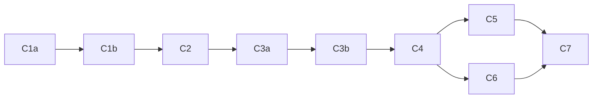

# PYPOST-1335: Decomposition Notes

Decomposition of epic [PYPOST-1335](https://pypost.atlassian.net/browse/PYPOST-1335)
("Built-in collections source for MCP server creation") into child tasks. Produced by
PYPOST-1336 Step 4. The full design, research and review history live in
`ai-tasks/PYPOST-1336/20-architecture.md`; this file is the hand-off for the sprint runner and
for each child task's own Top-Down run.

This folder intentionally has **no** `00-roadmap.md`: it holds notes, not a Top-Down task.

## Jira Creation Status

Nine children created and added to sprint 2025 (37 SP); Debt PYPOST-1347 stays outside
this sprint and epic. PYPOST-1334 is linked to the epic and remains Done in sprint 2024.
PYPOST uses Story for the planned Task drafts (C1a, C1b, C7); Jira rejects Task.

## Orchestrator Notes

- Creation is complete. Each fenced `text` block records the Jira-ready description with
  actual issue keys; the `Jira:` and `Story points:` fields and coverage table are filled.
- The child list records the binding estimates from the `jira-create-issue` estimation
  subagents. All nine children are Stories in sprint 2025, totaling 37 SP; each is below
  the 8 SP cap. C1a, C1b and C7 were planned as Tasks but created as Stories because Jira
  rejects Task in this project.
- Execute the existing issues in dependency order; do not create duplicate issues from
  these drafts. PYPOST-1347 is independent Debt outside the epic and sprint.

## Epic Scope

- E1: Scope item: "Built-in" source option in the MCP server create/edit dialog, next to Collection
  (workspace) and Library
- E2: Scope item: Read-only curated bundled collections: GitLab MCP, Jira MCP, GitHub MCP
- E3: Scope item: Single source of files: bundled collections are an application package resource
  and the same files the official examples library uses
- E4: Scope item: Built-in collections are visibly marked read-only
- E5: Scope item: Copy for editing: the user can create an editable copy of a built-in collection
- E6: Scope item: Paired environment: the built-in collection's environment is copied as an editable
  user environment; shipped resources are never edited
- E7: Scope item: Reference by identifier and auto-update: a Built-in server refers to the
  collection by stable identity and uses the newest shipped version after app start
- E8: Scope item: Out of scope: no migration of existing MCP servers that point at the examples
  library or workspace copies

## Resolved Design Decisions

Full rationale and rejected alternatives: `ai-tasks/PYPOST-1336/20-architecture.md`, section
"Resolved open questions".

- **(a) Single source of files (E3)** — `examples/` stays the only tracked copy and ships
  unchanged as package data of the mapped sub-package `pypost.bundled_examples`
  (`[tool.setuptools.package-dir]` → `examples`, explicit `packages`, `package-data`,
  `examples/__init__.py`, `setuptools>=64`). One locator `pypost/core/bundled_resources.py`
  (`bundled_examples_root()`) prefers the `examples/` sibling of the imported `pypost`, then
  the package resource, then `None`. Moving the tree into `pypost/` was rejected (16 Python
  files, 72 Markdown lines, `.gitignore`, protected live-smoke test; same runtime result).
- **(b) Copy for editing (E5)** — creates a **workspace collection** (fresh id, "(copy)" name),
  never a library entry; the open editor switches to Workspace source with the copy selected,
  persisted only on Save. Reuses the existing `collection_id` unit; Save semantics unchanged.
- **(c) Environment of a Built-in server (E6)** — variables come only from the workspace
  environment selected by `environment_id`; manifest variables give declarations and defaults
  for missing keys; **no preset and no library overlay** for Built-in rows. "Create editable
  copy of paired environment" is optional (default action when none exists). A structural
  consistency test (keys, `hidden_keys`, secret placeholders, `mcp_overridable_keys` ⊆ keys;
  values not compared) ties each `environments/*.json` to the manifest.
- **(d) `mcp.json`** — not built-in. Built-in collections are exactly the entries of
  `examples/builtin-collections.yaml`: Jira (`jira-cloud-mcp`), GitLab (`gitlab-mcp`), GitHub
  (`github-mcp`). `mcp.json` is a generated test fixture without a paired environment.
- **(e) Built-in identity (added in Step 2 review)** — Built-in is a filtered read-only view
  over the shipped `pypost-examples` library. A Built-in row persists the library identity
  (`library_id = manifest_id = "pypost-examples"`, `library_collection_path`) plus
  `bundled_library: bool = True`; it resolves against the `PredefinedLibraryService` record
  directly (a connected clone with the same id must not shadow it) via
  `LibraryRuntimeResolver`, which re-reads the collection on every start (E7).

Validator rule (owned by C3a): `library_id` precedence unchanged; `bundled_library=True`
requires `library_id == "pypost-examples"`; `bundled_library=True` without `library_id` is
rejected; files without the field load as `False`; legacy rows (including library rows that
also carry a stale `collection_id`) behave as today. A Built-in row whose path is not a view
entry loads but is never served ("missing built-in collection").

## Coverage Table

| Epic item | Created Jira issues |
| --- | --- |
| E1 Built-in source | PYPOST-1353, PYPOST-1356 |
| E2 Bundled collections | PYPOST-1348, PYPOST-1349, PYPOST-1350, PYPOST-1334 |
| E3 Single source of files | PYPOST-1348, PYPOST-1349 |
| E4 Read-only marker | PYPOST-1353, PYPOST-1352 (no shared overlay writes) |
| E5 Copy for editing | PYPOST-1355 |
| E6 Paired environment | PYPOST-1350 (consistency test), PYPOST-1354 |
| E7 Reference by id + auto-update | PYPOST-1350, PYPOST-1351, PYPOST-1352, PYPOST-1356 |
| E8 No migration | **Explicit exclusion**; guards and documentation listed below |

E8: no child migrates existing servers. Legacy-row regression guards are in PYPOST-1351,
PYPOST-1352 and PYPOST-1353; the user documentation statement is in PYPOST-1356. The
pre-existing library-row lifecycle defect is tracked separately by Debt PYPOST-1347,
which is outside the epic and sprint.

## Child List

| Draft | Type | Rough SP | Depends on | Jira | Story points |
| --- | --- | --- | --- | --- | --- |
| C1a | Story | 5 | — | PYPOST-1348 | 5 |
| C1b | Story | 3 | C1a | PYPOST-1349 | 3 |
| C2 | Story | 3 | C1b | PYPOST-1350 | 3 |
| C3a | Story | 5 | C2 | PYPOST-1351 | 5 |
| C3b | Story | 5 | C3a | PYPOST-1352 | 5 |
| C4 | Story | 5 | C3b | PYPOST-1353 | 5 |
| C5 | Story | 3 | C4 | PYPOST-1354 | 3 |
| C6 | Story | 5 | C4 | PYPOST-1355 | 5 |
| C7 | Story | 3 | C5, C6 | PYPOST-1356 | 3 |
| DEBT | Debt | 3 | — (independent) | PYPOST-1347 | 3 |

Rough total for the nine children: 37 SP; largest 5 SP (cap 8 SP).

## Dependency Graph and Execution Order



Recommended order: `C1a → C1b → C2 → C3a → C3b → C4 → C5 → C6 → C7`; Debt PYPOST-1347
was created before C3b because C3b's description references it.

The graph is acyclic. C5 and C6 are logically independent but both edit
`pypost/ui/dialogs/mcp_servers_dialog.py`; run them sequentially. The Debt issue is outside the
epic and the sprint and can be scheduled independently (its later fix widens the C3b branch).

## PYPOST-1334 Link

[PYPOST-1334](https://pypost.atlassian.net/browse/PYPOST-1334) (GitHub MCP collection and
environment) is already **Done** (commit `31f2b25a`). It is linked to PYPOST-1335 as a child
for traceability (covers E2, GitHub content). It is not moved to sprint 2025, not reopened and
not re-estimated.

## Out of Scope

- Migration of existing MCP servers that point at the examples library or at workspace copies
  (E8); they keep working unchanged.
- Making `mcp.json` a built-in collection (decision d).
- Moving `examples/` into the `pypost/` package or changing existing `examples/` paths.
- Fixing ordinary (non-Built-in) library rows in the registry lifecycle — tracked by the Debt
  issue below.

## Issue Drafts

### C1a — Ship examples as package data

- **Summary**: `[PYPOST-1335] Ship examples/ as package data of pypost.bundled_examples`
- **Type**: Story
- **Priority**: Medium
- **Labels**: `mcp`, `builtin-collections`, `packaging`
- **Parent**: PYPOST-1335
- **Sprint**: 2025 (Built-in MCP Collections)
- **Depends on**: none
- **Rough size**: ~5 SP
- **Scope**:
  - `examples/__init__.py` (docstring only)
  - `pyproject.toml`: `setuptools>=64`, explicit `packages`, `package-dir`, `package-data`
  - New `tomllib`-based guard test under `tests/`
  - `Makefile`: `check-package-data` in the slow tier
  - `tests/makefile_test_helpers.py`, `tests/test_makefile_install_seed_contract.py`
- **Acceptance criteria**:
  1. Guard test (no `setuptools` import) fails on a missing package or unmatched data file.
  2. Seed contract covers `examples/__init__.py`, manifest, collections, environments.
  3. `make test-slow`, `make check-package-data`, `make install`, `make check` pass.
  4. `make check-lock-dev` unchanged; `examples/` references unchanged.
- **Jira:** [PYPOST-1348](https://pypost.atlassian.net/browse/PYPOST-1348)
- **Story points:** 5

```text
Epic: PYPOST-1335. Design: ai-tasks/PYPOST-1336/20-architecture.md, decision (a); notes:
ai-tasks/PYPOST-1335/decomposition.md.

Business goal
Installed PyPost must carry the official examples (the future Built-in collections) as package data,
while examples/ stays the single tracked copy (E3, shipping part of E2).

Scope in
- examples/__init__.py (docstring only) so pypost.bundled_examples is a regular package.
- pyproject.toml: [build-system] requires setuptools>=64; replace [tool.setuptools.packages.find]
  with an explicit packages list (the 18 packages find returns today + "pypost.bundled_examples");
  [tool.setuptools.package-dir] "pypost.bundled_examples" = "examples";
  [tool.setuptools.package-data] "pypost.bundled_examples" = pypost-library.yaml,
  builtin-collections.yaml, README.md, collections/*.json, environments/*.json.
- Guard test: parses pyproject.toml with tomllib (no setuptools import; the dev venv lacks
  setuptools/wheel) and walks pypost/ for __init__.py dirs.
- make check-package-data: venv pip wheel --no-deps WITH build isolation into a temp dir + zipfile
  inspection; wired into the slow tier (make test-slow), not make test.
- tests/makefile_test_helpers.py (_paths_from_package_data, _required_seed_paths_from_pyproject)
  honour package-dir and seed __init__.py of every explicitly listed package; new cases in
  tests/test_makefile_install_seed_contract.py.

Scope out
Locator and PredefinedLibraryService (PYPOST-1349); Built-in view; adding setuptools/wheel to dev
deps or requirements-dev.in; moving or renaming anything under examples/.

Acceptance criteria
1. The guard test fails when a pypost/**/__init__.py package is missing from packages, or a
   manifest-declared file or environments/*.json is not matched by package-data (globs resolved
   against the mapped directory); it runs under make test in the current venv.
2. Seed-contract tests assert the seed contains examples/__init__.py, examples/pypost-library.yaml,
   every declared collection and environment, and __init__.py of all listed packages; a missing
   mapped directory fails loudly (no silent skip).
3. make test-slow (tests/test_makefile_slow_smoke.py) passes with the explicit packages list.
4. make check-package-data lists every manifest-declared file and every environments/*.json under
   pypost/bundled_examples/ in the wheel.
5. make install succeeds; make check-lock-dev unchanged; files referencing examples/ paths are
   unchanged.
6. make check passes.

Dependencies: none (first task of the epic).
```

### C1b — Single locator for the shipped examples root

- **Summary**: `[PYPOST-1335] Single locator for the shipped examples root`
- **Type**: Story
- **Priority**: Medium
- **Labels**: `mcp`, `builtin-collections`, `packaging`
- **Parent**: PYPOST-1335
- **Sprint**: 2025 (Built-in MCP Collections)
- **Depends on**: C1a
- **Rough size**: ~3 SP
- **Scope**:
  - New `pypost/core/bundled_resources.py` (`bundled_examples_root()`)
  - `pypost/core/predefined_library.py` (default root, `copy_to` filter)
  - `doc/dev/predefined_collection_library.md` (short note)
  - Unit tests under `tests/`
- **Acceptance criteria**:
  1. All three locator branches unit-tested, including a stale package mapping.
  2. Foreign or incomplete sibling `examples/` ignored.
  3. `pypost-examples` still discovered with four collections; copies stay pure data.
  4. `make check` passes.
- **Jira:** [PYPOST-1349](https://pypost.atlassian.net/browse/PYPOST-1349)
- **Story points:** 3

```text
Epic: PYPOST-1335 (Built-in collections source for MCP server creation). Design:
ai-tasks/PYPOST-1336/20-architecture.md, decision (a); notes: ai-tasks/PYPOST-1335/decomposition.md.

Business goal
One place decides where the shipped examples live, for both the examples library and the future
Built-in source, in a source checkout, an editable install and an installed wheel (E3 lookup, E2).

Scope in
- New pypost/core/bundled_resources.py: bundled_examples_root() -> Path | None, in this order:
  1) sibling source tree: Path(pypost.__file__).resolve().parents[1] / "examples" when it contains
  __init__.py and a pypost-library.yaml with id pypost-examples;
  2) package resource: importlib.resources.files("pypost.bundled_examples") if it is a pathlib.Path
  containing pypost-library.yaml (installed wheel);
  3) None.
  The imported pypost always decides; a stale editable finder mapping to another tree is never
  consulted when the sibling tree exists.
- pypost/core/predefined_library.py: PredefinedLibraryService default root comes from the locator;
  None keeps the existing "Predefined library is unavailable" diagnostic; copy_to ignores
  __init__.py and __pycache__ so editable copies stay pure data.
- Short note in doc/dev/predefined_collection_library.md.

Scope out
Packaging (PYPOST-1348); Built-in view (PYPOST-1350); any examples/ path change.

Acceptance criteria
1. Unit tests cover all three branches.
2. With pypost.__file__ inside a tree that has examples/ and a fake pypost.bundled_examples
   resolving to a different tree, the locator returns the sibling tree.
3. A sibling examples/ without __init__.py, or with a foreign manifest id, is ignored.
4. Without a sibling tree the package resource is used; with neither the result is None and the
   existing unavailable diagnostic is reported.
5. After make install, pypost-examples is still discovered with four collections.
6. An editable copy (copy_to) contains no __init__.py and no __pycache__.
7. make check passes.

Dependencies: PYPOST-1348 (examples/__init__.py and package mapping).
```

### C2 — Built-in view over the examples library

- **Summary**: `[PYPOST-1335] Built-in collection view over the examples library`
- **Type**: Story
- **Priority**: Medium
- **Labels**: `mcp`, `builtin-collections`
- **Parent**: PYPOST-1335
- **Sprint**: 2025 (Built-in MCP Collections)
- **Depends on**: C1b
- **Rough size**: ~3 SP
- **Scope**:
  - New `examples/builtin-collections.yaml`
  - New `pypost/core/builtin_collections.py` (`BuiltinCollectionView`, `BuiltinCollectionEntry`)
  - Structural paired-environment consistency test under `tests/`
- **Acceptance criteria**:
  1. Exactly three entries (Jira, GitLab, GitHub) with name/version from collection JSON.
  2. Each collection and paired environment loads.
  3. Invalid view file → empty list plus diagnostic, no exception.
  4. Consistency test passes on shipped files, fails on seeded defects; no value comparison.
  5. Shipped environments and pinned tests unchanged; `make check` passes.
- **Jira:** [PYPOST-1350](https://pypost.atlassian.net/browse/PYPOST-1350)
- **Story points:** 3

```text
Epic: PYPOST-1335 (Built-in collections source for MCP server creation). Design:
ai-tasks/PYPOST-1336/20-architecture.md, decisions (c), (d), (e); notes:
ai-tasks/PYPOST-1335/decomposition.md.

Business goal
Define which shipped collections are "built-in" (Jira, GitLab, GitHub MCP) as a read-only view over
the pypost-examples library, with a paired environment per collection (E2, identity part of E7).

Scope in
- examples/builtin-collections.yaml: entries with collection path, environment path, display name:
  collections/jira_mcp.json + environments/jira_cloud.json; collections/gitlab_mcp.json +
  environments/gitlab.json; collections/github_mcp.json + environments/github.json. (Already covered
  by PYPOST-1348 package-data.)
- pypost/core/builtin_collections.py:
  BuiltinCollectionEntry(collection_path, environment_path, name, collection_id, version) with
  selection() returning the library identity (library_id = manifest_id = "pypost-examples",
  library_collection_path).
  BuiltinCollectionView(predefined: PredefinedLibraryService): list_entries(),
  is_builtin(configuration), load_collection(path) (fresh read every call),
  load_paired_environment(path).
- Validation: entry not manifest-declared, missing file, unreadable JSON -> diagnostics.
- Structural consistency test per paired environment: variable keys = manifest variables used by the
  collection; hidden_keys = those marked secret; every secret value is a non-empty committed
  placeholder; mcp_overridable_keys is a subset of keys. Values are NOT compared with presets or
  defaults (environments/jira_cloud.json intentionally differs from preset jira_cloud).

Scope out
mcp.json (not built-in, decision d); settings model, registry, controller, UI; any change to
examples/environments/*.json, tests/test_example_fixtures.py, tests/test_jira_mcp_live_smoke.py.

Acceptance criteria
1. list_entries() returns exactly three entries (jira-cloud-mcp, gitlab-mcp, github-mcp) with name
   and version taken from the collection JSON.
2. load_collection and load_paired_environment succeed for each entry.
3. An invalid view file yields an empty list and a diagnostic, not an exception.
4. The consistency test passes on shipped files and fails on a seeded extra key, a missing key, or
   an unhidden secret.
5. examples/environments/*.json, tests/test_example_fixtures.py and
   tests/test_jira_mcp_live_smoke.py are unchanged.
6. make check passes.

Dependencies: PYPOST-1349 (locator-backed PredefinedLibraryService).
```

### C3a — Built-in identity in server configuration and startup

- **Summary**: `[PYPOST-1335] Built-in identity in MCP server configuration and startup`
- **Type**: Story
- **Priority**: Medium
- **Labels**: `mcp`, `builtin-collections`
- **Parent**: PYPOST-1335
- **Sprint**: 2025 (Built-in MCP Collections)
- **Depends on**: C2
- **Rough size**: ~5 SP
- **Scope**:
  - `pypost/models/settings.py` (`McpServerConfiguration.bundled_library`, validator)
  - `pypost/core/mcp_server_registry.py` (`__init__` bundled adapter, `_runtime_inputs`,
    `_missing_reference`)
  - Tests for `pypost/ui/mcp_server_controller.py` and `pypost/core/qt/daemon_runtime.py`
    construction points (no change to those files)
- **Acceptance criteria**:
  1. Built-in row starts; upgraded bundle changes tools on next start.
  2. Shadowing clone, preset and overlay do not affect a Built-in row.
  3. Unknown or non-entry path → "missing built-in collection".
  4. Legacy rows unchanged; invalid marker combinations rejected.
  5. Works under `DaemonRuntime` and an injected registry; `make check` passes.
- **Jira:** [PYPOST-1351](https://pypost.atlassian.net/browse/PYPOST-1351)
- **Story points:** 5

```text
Epic: PYPOST-1335. Design: ai-tasks/PYPOST-1336/20-architecture.md, decision (e) and "Validator
rule"; notes: ai-tasks/PYPOST-1335/decomposition.md.

Business goal
A persisted MCP server can reference a built-in collection by stable identity and always serves the
collection shipped with the running PyPost (E7), while existing servers are untouched (E8).

Scope in
- pypost/models/settings.py: McpServerConfiguration.bundled_library: bool = False.
  validate_server_type_requirements keeps precedence: proxy unchanged; library_id set -> manifest_id
  and library_collection_path required, collection_id ignored, and if bundled_library is true
  library_id must equal "pypost-examples"; otherwise collection_id required and bundled_library true
  is rejected.
- pypost/core/mcp_server_registry.py: MCPServerRegistry.__init__ builds a bundled adapter by default
  (PredefinedLibraryService() + BuiltinCollectionView), independent of the injected library_service.
  _runtime_inputs: for bundled_library rows, get_connection("pypost-examples") returns
  PredefinedLibraryService.discover() (never a shadowing stored connection) and
  LibraryRuntimeResolver.resolve runs with an empty overlay and no preset. View-membership check: a
  non-entry path loads but is never started. _missing_reference text "missing built-in collection".
- No change needed at construction points: McpServerSettingsController.__init__
  (pypost/ui/mcp_server_controller.py; registry injected from main_window.py) and DaemonRuntime
  (pypost/core/qt/daemon_runtime.py).

Scope out
Lifecycle (reconcile/reconfigure/refresh_environment) and controller save (PYPOST-1352); dialog UI;
copies.

Acceptance criteria
1. A Built-in row starts and exposes the shipped tools.
2. Replacing the bundle root with a newer collection (upgrade double) changes the tools on next
   start without settings changes.
3. A connected library with id pypost-examples, a preset and a pypost-examples overlay change
   neither the served collection nor the selected environment's values.
4. Unknown path -> "missing built-in collection"; a bundled_library row on collections/mcp.json
   loads, is not started, reports the same.
5. Legacy rows (workspace; library; library row also carrying a stale collection_id; files without
   bundled_library) load and start as before.
6. bundled_library with a non-pypost-examples id, or without library_id, is rejected by the
   validator.
7. An enabled Built-in row starts under DaemonRuntime (no mcp_failed) and via a registry injected
   into McpServerSettingsController.
8. make check passes.

Dependencies: PYPOST-1350 (BuiltinCollectionView).
```

### C3b — Built-in rows in registry lifecycle and controller save

- **Summary**: `[PYPOST-1335] Built-in rows in MCP registry lifecycle and controller save`
- **Type**: Story
- **Priority**: Medium
- **Labels**: `mcp`, `builtin-collections`
- **Parent**: PYPOST-1335
- **Sprint**: 2025 (Built-in MCP Collections)
- **Depends on**: C3a
- **Rough size**: ~5 SP
- **Scope**:
  - `pypost/core/mcp_server_registry.py` (`reconcile_references`,
    `_validate_replacement_references`, `refresh_environment`)
  - `pypost/ui/mcp_server_controller.py` (`upsert_mcp_server` Built-in branch)
  - Tests under `tests/`
- **Acceptance criteria**:
  1. Running Built-in row survives reconcile; stopped only when its environment is deleted.
  2. `reconfigure` succeeds; `refresh_environment` keeps manifest defaults.
  3. Save validates against the shipped bundle and never touches the overlay file.
  4. Non-entry save raises `builtin_invalid`; other rows unchanged; `make check` passes.
- **Jira:** [PYPOST-1352](https://pypost.atlassian.net/browse/PYPOST-1352)
- **Story points:** 5

```text
Epic: PYPOST-1335 (Built-in collections source for MCP server creation). Design:
ai-tasks/PYPOST-1336/20-architecture.md, decisions (c), (e), "Interaction scheme" items 2-3; notes:
ai-tasks/PYPOST-1335/decomposition.md.

Business goal
A Built-in server keeps running through collection refreshes, environment edits and reconfiguration,
and can be saved from the UI without writing any shared library state (E7 refresh, E4, E8 guard).

Scope in
- pypost/core/mcp_server_registry.py: branches keyed on bundled_library=True in
  reconcile_references, _validate_replacement_references and refresh_environment. Validity = view
  entry resolves + environment exists (no collection_id check). Environment refresh re-runs
  LibraryRuntimeResolver with the bundled adapter and empty overlay so manifest defaults survive.
- pypost/ui/mcp_server_controller.py upsert_mcp_server: Built-in branch placed BEFORE the library_id
  branch: view membership; resolution via the bundled adapter (not registry.library_service);
  persistence reuses the workspace checked save LibraryMcpSaveTransaction(store=..., overlay={})
  (ConfigManagerSettingsStore.commit writes no overlay when empty); never builds or reads an overlay
  candidate; transactional reconfigure for running rows; settings rollback on failure as for
  workspace rows.

Scope out
Behavior of ordinary (non-Built-in) library rows - a pre-existing defect tracked in PYPOST-1347;
keep the branch keyed on bundled_library so that fix can widen it. Dialog UI (PYPOST-1353).

Acceptance criteria
1. A running Built-in row (collection_id=None) stays running after reconcile_references with and
   without valid_collection_ids (collection refresh, Environment Manager close).
2. It is stopped with "missing environment" only when its environment is deleted.
3. reconfigure of a Built-in row succeeds.
4. After refresh_environment the snapshot still contains manifest defaults for keys the environment
   lacks.
5. Saving a Built-in row while a connected clone with id pypost-examples exists validates against
   the shipped bundle.
6. Saving never creates or modifies the pypost-examples overlay file (byte-identical or absent
   before and after).
7. Saving a non-entry path raises ValueError("builtin_invalid: ...").
8. Ordinary library and workspace rows behave exactly as before (existing tests green, no assertion
   edits).
9. make check passes.

Dependencies: PYPOST-1351 (bundled_library model field and bundled adapter).
```

### C4 — Built-in source in the MCP server dialog

- **Summary**: `[PYPOST-1335] "Built-in" source with read-only marker in the MCP server dialog`
- **Type**: Story
- **Priority**: Medium
- **Labels**: `mcp`, `builtin-collections`, `ui`
- **Parent**: PYPOST-1335
- **Sprint**: 2025 (Built-in MCP Collections)
- **Depends on**: C3b
- **Rough size**: ~5 SP
- **Scope**:
  - `pypost/ui/dialogs/mcp_servers_dialog.py` (`_McpServerEditor`, server table)
  - `pypost/ui/presenters/mcp_controls_presenter.py` (pass the view)
  - `tests/test_mcp_servers_dialog.py` and related GUI tests
- **Acceptance criteria**:
  1. Create, edit and save a Built-in server with any workspace environment.
  2. "(read-only)" marker in picker and table.
  3. Workspace and Library flows unchanged; legacy `pypost-examples` row opens as Library.
  4. Headless GUI tests per repo patterns; `make check` passes.
- **Jira:** [PYPOST-1353](https://pypost.atlassian.net/browse/PYPOST-1353)
- **Story points:** 5

```text
Epic: PYPOST-1335 (Built-in collections source for MCP server creation). Design:
ai-tasks/PYPOST-1336/20-architecture.md, "Interaction scheme" items 4 and 6; notes:
ai-tasks/PYPOST-1335/decomposition.md.

Business goal
The user picks "Built-in" as the collection source when creating or editing a local MCP server and
sees that built-in collections are read-only (E1, E4).

Scope in
- pypost/ui/dialogs/mcp_servers_dialog.py (_McpServerEditor): third _collection_source item
  "Built-in" next to Workspace collection and Library; picker over
  BuiltinCollectionView.list_entries() with a "(read-only)" marker and a tooltip explaining the
  collection is shipped with PyPost and updated on upgrade; no preset/overlay widgets for Built-in;
  environment combo over workspace environments; configuration() emits the library identity
  (entry.selection()) + bundled_library=True + collection_id=None; editing a Built-in row preselects
  Built-in and its entry.
- Server table text "Built-in / <name> (read-only)" for Built-in rows.
- pypost/ui/presenters/mcp_controls_presenter.py: pass the view (and save callbacks) to the dialog;
  it does not build the registry.

Scope out
Copy for editing (PYPOST-1355); paired-environment copy (PYPOST-1354); registry/controller behavior
(done in PYPOST-1351, PYPOST-1352).

Acceptance criteria
1. A Built-in server can be created, edited and saved (through the PYPOST-1352 controller branch)
   with any workspace environment; Save is blocked without an environment.
2. The "(read-only)" marker is shown in the picker and in the server table.
3. Existing Workspace and Library flows are unchanged (existing GUI tests green, no assertion
   edits).
4. A legacy library row on pypost-examples without bundled_library still opens and renders as
   Library (E8).
5. GUI tests are headless and follow the repo patterns (do-testing: explicit timeouts, bounded
   waits).
6. make check passes.

Dependencies: PYPOST-1352 (controller save branch for Built-in rows).
```

### C5 — Editable copy of the paired environment

- **Summary**: `[PYPOST-1335] Editable copy of the paired environment for Built-in MCP servers`
- **Type**: Story
- **Priority**: Medium
- **Labels**: `mcp`, `builtin-collections`, `ui`
- **Parent**: PYPOST-1335
- **Sprint**: 2025 (Built-in MCP Collections)
- **Depends on**: C4
- **Rough size**: ~3 SP
- **Scope**:
  - `pypost/ui/dialogs/mcp_servers_dialog.py` (editor action)
  - `pypost/ui/presenters/mcp_controls_presenter.py` (save callback)
  - `pypost/core/storage.py` (`save_environments`, reused)
  - Tests under `tests/`
- **Acceptance criteria**:
  1. New environment carries paired variables, `hidden_keys`, `mcp_overridable_keys`.
  2. Secrets emptied; shipped file byte-identical.
  3. Repeated copies do not collide; Save without environment blocked.
  4. `make check` passes.
- **Jira:** [PYPOST-1354](https://pypost.atlassian.net/browse/PYPOST-1354)
- **Story points:** 3

```text
Epic: PYPOST-1335 (Built-in collections source for MCP server creation). Design:
ai-tasks/PYPOST-1336/20-architecture.md, decision (c); notes: ai-tasks/PYPOST-1335/decomposition.md.

Business goal
A user creating a Built-in server gets the built-in collection's paired environment as an editable
workspace environment in one click; shipped files and credentials are never edited in place (E6).

Scope in
- Editor action "Create editable copy of paired environment" in
  pypost/ui/dialogs/mcp_servers_dialog.py, visible for the Built-in source.
- BuiltinCollectionView.load_paired_environment(entry.collection_path) -> new workspace Environment:
  fresh id, conflict-safe name (e.g. "<built-in name>", "<built-in name> (2)"), secret values
  emptied, hidden_keys and mcp_overridable_keys kept; saved through a callback
  (pypost/core/storage.py save_environments, wired in
  pypost/ui/presenters/mcp_controls_presenter.py) and selected in the environment combo.
- It is the default (highlighted) action when no environment derived from that paired environment
  exists. It stays optional: any workspace environment may be chosen (decision c: variables come
  only from the selected workspace environment; no preset, no overlay).

Scope out
Collection copy (PYPOST-1355); editing any file under examples/ (never); changing how the registry
resolves variables.

Acceptance criteria
1. The new environment carries the paired variable keys, hidden_keys and mcp_overridable_keys;
   secret values are empty.
2. The shipped examples/environments/*.json file is byte-identical before and after.
3. Repeated copies do not collide (unique id and name).
4. The copy is selected in the editor; Save without any environment stays blocked.
5. Choosing another existing workspace environment instead of copying still works.
6. Headless GUI tests per repo patterns; make check passes.

Dependencies: PYPOST-1353 (Built-in source in the editor).
```

### C6 — Copy for editing a built-in collection

- **Summary**: `[PYPOST-1335] Copy for editing a built-in MCP collection`
- **Type**: Story
- **Priority**: Medium
- **Labels**: `mcp`, `builtin-collections`, `ui`
- **Parent**: PYPOST-1335
- **Sprint**: 2025 (Built-in MCP Collections)
- **Depends on**: C4 (run after C5: same editor file)
- **Rough size**: ~5 SP
- **Scope**:
  - `pypost/ui/dialogs/mcp_servers_dialog.py` (editor action, source switch)
  - `pypost/ui/presenters/mcp_controls_presenter.py` (save callback)
  - `pypost/core/storage.py` (`save_collection`, reused)
  - Tests under `tests/`
- **Acceptance criteria**:
  1. Copy appears in the workspace with identical requests and is editable.
  2. Cancel keeps the server on Built-in; Save switches it to the copy.
  3. Shipped resource unchanged; "no shipped updates" note shown.
  4. `make check` passes.
- **Jira:** [PYPOST-1355](https://pypost.atlassian.net/browse/PYPOST-1355)
- **Story points:** 5

```text
Epic: PYPOST-1335 (Built-in collections source for MCP server creation). Design:
ai-tasks/PYPOST-1336/20-architecture.md, decision (b); notes: ai-tasks/PYPOST-1335/decomposition.md.

Business goal
A user who needs to customize a built-in collection gets a private, editable copy in the workspace
and can point the server at it, knowing the copy no longer receives shipped updates (E5).

Scope in
- Editor action "Copy for editing" in pypost/ui/dialogs/mcp_servers_dialog.py, visible for the
  Built-in source.
- BuiltinCollectionView.load_collection(entry.collection_path) -> new workspace Collection: fresh
  unique id, name "<built-in name> (copy)" with a conflict-safe suffix; saved via a callback
  (pypost/core/storage.py save_collection, wired in pypost/ui/presenters/mcp_controls_presenter.py).
- The open editor switches its source to Workspace collection with the copy selected. The persisted
  server changes only on Save; Cancel keeps it on Built-in while the copy stays in the workspace.
- UI note that the copy no longer receives shipped updates.

Scope out
Creating library entries (the Library Manager whole-library copy already exists); paired environment
copy (PYPOST-1354); rewiring other servers; any change under examples/.

Acceptance criteria
1. The copy appears in the workspace with requests identical to the built-in collection and is
   editable.
2. Cancel leaves the persisted server on Built-in (bundled_library=True); the copy remains in the
   workspace.
3. Save switches the server to the copy (workspace collection_id, bundled_library=False, no library
   fields).
4. Repeated copies get unique ids and names.
5. The shipped collection file is byte-identical before and after.
6. The "no longer receives shipped updates" note is visible.
7. Headless GUI tests per repo patterns; make check passes.

Dependencies: PYPOST-1353 (Built-in source in the editor). Independent of PYPOST-1354, but run after
it: both edit mcp_servers_dialog.py.
```

### C7 — End-to-end verification and user documentation

- **Summary**: `[PYPOST-1335] End-to-end test and user documentation for the Built-in MCP source`
- **Type**: Story
- **Priority**: Medium
- **Labels**: `mcp`, `builtin-collections`, `docs`
- **Parent**: PYPOST-1335
- **Sprint**: 2025 (Built-in MCP Collections)
- **Depends on**: C5, C6
- **Rough size**: ~3 SP
- **Scope**:
  - One offline end-to-end test under `tests/`
  - `doc/user/mcp-client.md` (or a linked new page under `doc/user/`)
  - `doc/dev/` pointer to locator and view
- **Acceptance criteria**:
  1. End-to-end test green under `make test`.
  2. User docs cover Built-in source, marker, copies, auto-update and the E8 exclusion.
  3. `make lint-docs`, `make check-docs-links`, `make check` pass.
- **Jira:** [PYPOST-1356](https://pypost.atlassian.net/browse/PYPOST-1356)
- **Story points:** 3

```text
Epic: PYPOST-1335 (Built-in collections source for MCP server creation). Design:
ai-tasks/PYPOST-1336/20-architecture.md; notes: ai-tasks/PYPOST-1335/decomposition.md.

Business goal
Prove the Built-in source works end to end and tell users how to use it (E1-E7 end to end, E8
statement).

Scope in
- One offline end-to-end test under tests/: create a Built-in server with a copied paired
  environment -> start -> simulate an upgrade (replace the bundle root with a newer collection) ->
  next start exposes the updated tools; then Copy for editing -> server saved on the workspace copy
  keeps working.
- User documentation in doc/user/ (extend doc/user/mcp-client.md or add a linked page): the Built-in
  source, the read-only marker, Copy for editing, the paired environment copy, auto-update on
  upgrade, relation to the examples library and the Library Manager copy, and an explicit statement
  that existing servers (examples library or workspace copies) are not migrated.
- doc/dev/ pointer to pypost/core/bundled_resources.py and pypost/core/builtin_collections.py.

Scope out
New behavior; changing existing examples/ path references (unchanged by PYPOST-1348 and
PYPOST-1349).

Acceptance criteria
1. The end-to-end test is green under make test and needs no network or credentials.
2. User docs describe all items listed above, including the E8 exclusion.
3. make lint-docs and make check-docs-links pass.
4. make check passes.

Dependencies: PYPOST-1354 and PYPOST-1355.
```

### DEBT — Library MCP rows in reconcile, reconfigure and environment refresh

Not a child of PYPOST-1335 and not in sprint 2025 (pre-existing defect of ordinary library
rows; E8 keeps existing rows unchanged inside the epic).

- **Summary**: `[PYPOST-1335] Library MCP rows stopped as missing collection on
  reconcile/reconfigure; env refresh drops manifest defaults`
- **Type**: Debt
- **Priority**: Medium
- **Labels**: `mcp`, `tech-debt`
- **Parent**: none
- **Sprint**: none (backlog)
- **Depends on**: none (best done after C3b, whose `bundled_library` branch it widens)
- **Rough size**: ~3 SP (binding estimator result recorded below)
- **Scope**:
  - `pypost/core/mcp_server_registry.py` (`reconcile_references`,
    `_validate_replacement_references`, `refresh_environment`)
  - Tests under `tests/`
- **Acceptance criteria**:
  1. Running library row survives reconcile; `reconfigure` succeeds.
  2. `refresh_environment` keeps manifest defaults, preset and overlay values.
  3. Workspace rows unchanged; `make check` passes.
- **Jira:** [PYPOST-1347](https://pypost.atlassian.net/browse/PYPOST-1347)
- **Story points:** 3

```text
Origin: found while designing epic PYPOST-1335 (ai-tasks/PYPOST-1336/20-architecture.md, Research
"Registry lifecycle checks" and C3b "Recorded debt"). Pre-existing defect; not part of the epic (E8:
existing rows unchanged there). Notes: ai-tasks/PYPOST-1335/decomposition.md.

Problem
Ordinary (non-Built-in) library MCP server rows have collection_id = None. In
pypost/core/mcp_server_registry.py:
- reconcile_references treats every local row as a workspace row: collection_id is None -> the row
  is stopped with "cannot run: missing collection" (triggered by refresh_tools and on Environment
  Manager close).
- _validate_replacement_references raises ValueError for such rows, so reconfigure of a running
  library row fails.
- refresh_environment swaps the raw workspace environment variables into the running snapshot,
  dropping manifest defaults (and preset/overlay values) that LibraryRuntimeResolver added at start.

Goal
Library rows keep running through collection refreshes, environment edits and reconfiguration, with
the same variables they would get on a fresh start.

Scope in
- Library-row branches in reconcile_references, _validate_replacement_references and
  refresh_environment: validity = library connection + manifest collection resolves + environment
  exists (no collection_id check); environment refresh re-runs LibraryRuntimeResolver (same overlay
  and preset rules as start()).
- If the Built-in branch (PYPOST-1352) exists, widen it rather than duplicating logic.

Scope out
Built-in rows (handled by PYPOST-1352); workspace rows; any migration of persisted settings.

Acceptance criteria
1. A running library row (collection_id=None) stays running after reconcile_references with and
   without valid_collection_ids; it is stopped only when its library collection or environment is
   really missing.
2. reconfigure of a running library row succeeds.
3. After refresh_environment the snapshot equals what a fresh start would resolve (manifest
   defaults, active preset, overlay values preserved).
4. Workspace rows behave exactly as before (existing tests green, no assertion edits).
5. A red regression test reproduces each defect before the fix.
6. make check passes.
```
