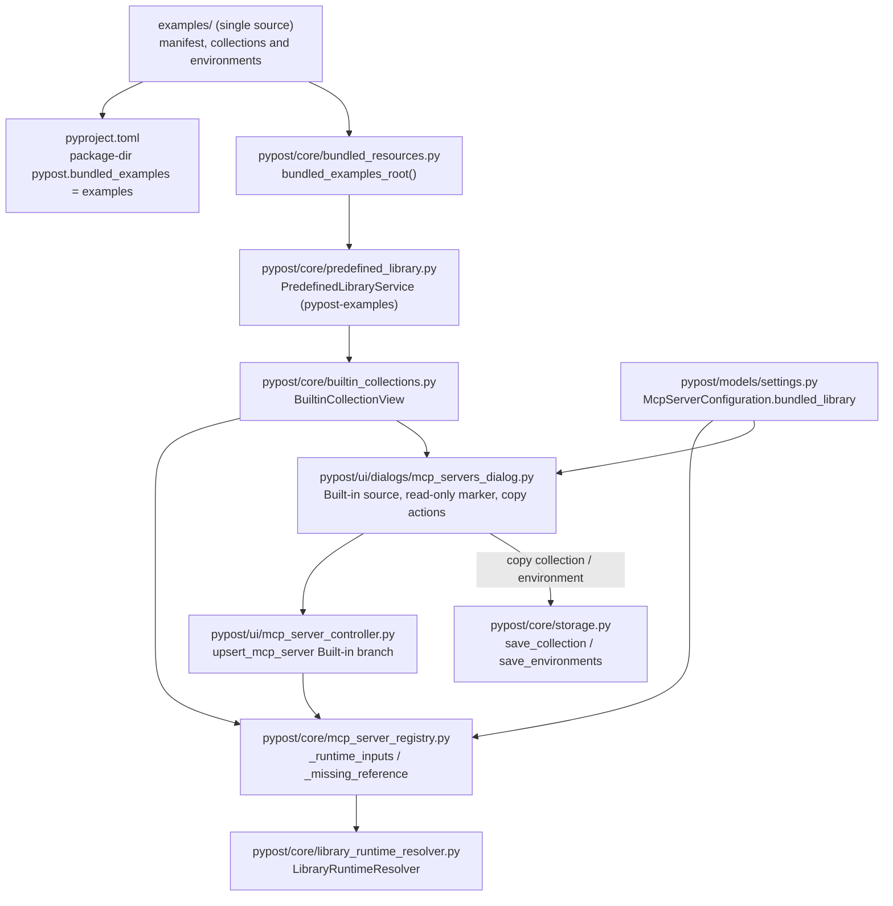

# PYPOST-1336: Decompose epic PYPOST-1335 into child tasks

PYPOST-1336 is a decomposition task. Its "architecture" is the high-level design of epic
[PYPOST-1335](https://pypost.atlassian.net/browse/PYPOST-1335) ("Built-in collections source
for MCP server creation"), detailed only as far as needed to split the epic into child tasks
with clear boundaries, interfaces and dependencies. No production code changes in this task.

## Research

### Current code (read-only scan, 2026-10-09)

- **Examples library location** — `pypost/core/predefined_library.py`,
  `PredefinedLibraryService.__init__` defaults its root to
  `Path(__file__).resolve().parents[2] / "examples"`, i.e. the repository `examples/`
  directory **outside** the `pypost/` package. It validates `examples/pypost-library.yaml`
  (id `pypost-examples`, collections `jira_mcp.json`, `gitlab_mcp.json`, `github_mcp.json`,
  `mcp.json`) and returns a `LibraryConnectionRecord` with `is_read_only=True`.
  `_declared_collection_path` forbids manifest paths that escape the library root.
  `copy_to` copies the whole tree into an editable library with stable id
  `pypost-examples-copy`.
- **Examples library is already an MCP source** — `LibraryManagerService()` (built without a
  connection store / overlay manager, as `pypost/ui/mcp_server_controller.py:401` does)
  includes the predefined record in `list_connections()`, but only when no stored connection
  has the same stable id (a connected clone of this repository, which `examples/README.md`
  suggests, has manifest id `pypost-examples` and **shadows** the shipped record).
- **Library runtime resolution** — `McpServerRegistry._runtime_inputs`
  (`pypost/core/mcp_server_registry.py`) resolves library rows through
  `LibraryRuntimeResolver.resolve` (`pypost/core/library_runtime_resolver.py`) at **every**
  `start()`: it re-reads the manifest and the collection file (auto-update for free) and
  builds variables from the manifest `variables` (defaults, `secret`), an active preset
  (`overlay.active_profile` from the per-library `LocalOverlayManager` overlay, or a preset
  whose name equals `environment_id`), the workspace environment selected by
  `environment_id`, and overlay overrides/secrets. When both a workspace environment and an
  active preset exist, the preset values **override** the environment values. In the editor,
  `_McpServerEditor._populate_library_environment` (`pypost/ui/dialogs/mcp_servers_dialog.py`)
  renders the manifest variables, the preset combo and overlay values for library rows.
- **Packaging** — `pyproject.toml`: `requires = ["setuptools>=61.0"]`,
  `[tool.setuptools.packages.find] where = ["."]`, `include = ["pypost*"]`, no
  `package-dir`, no `package-data`. `find` only returns directories with `__init__.py`
  (18 packages under `pypost/`; `pypost/ui/resources`, `pypost/ui/styles`, `pypost/ui/theme`
  have none). There is no `pypost/resources/` directory. An installed wheel contains no
  examples today; `make install` uses `pip install -e ".[dev,otel]"` (editable).
- **Persisted MCP server** — `McpServerConfiguration` (`pypost/models/settings.py`): workspace
  source `collection_id`; library source `library_id`, `manifest_id`,
  `library_collection_path`, `library_collection_index`; `environment_id: str` required.
  Validator `validate_server_type_requirements` (lines 33-47) for `local`: if `library_id` is
  set, `manifest_id` and `library_collection_path` are required and `collection_id` is
  ignored; otherwise `collection_id` is required. A row with **both** `library_id` and
  `collection_id` is valid and resolves as a library row (`_runtime_inputs` checks
  `library_id` first).
- **Dialog** — `McpServersDialog` / `_McpServerEditor` in
  `pypost/ui/dialogs/mcp_servers_dialog.py`: combo `_collection_source` (`workspace` /
  `library`), `configuration()` builds the model; constructed in
  `pypost/ui/presenters/mcp_controls_presenter.py` (~line 331).
- **Built-in candidates** (collection JSON `id` / `version`; manifest preset; paired
  environment): `jira-cloud-mcp` 2.0.0, preset `jira_cloud`, `environments/jira_cloud.json`;
  `gitlab-mcp` 1.0.0, `gitlab_com`, `environments/gitlab.json`; `github-mcp` 1.0.0,
  `github_com`, `environments/github.json`. Each environment file has the same variable
  **keys** as the collection-declared manifest variables, marks the manifest `secret`
  variables in `hidden_keys` (secret values are placeholders) and adds
  `mcp_overridable_keys`, which the manifest cannot express. **Values do not always match
  the preset** (corrected after review): GitLab and GitHub non-secret values equal their
  presets, but `environments/jira_cloud.json` has `https://your-team.atlassian.net` /
  `YOUR_PROJECT_KEY` while preset `jira_cloud` has `https://your-company.atlassian.net` /
  `DEMO` and the manifest default of `jira_project_key` is `PROJ`. The environment values are
  pinned by `tests/test_example_fixtures.py` (`PLACEHOLDER_BASE_URL` line 31, line 350) and by
  the protected `tests/test_jira_mcp_live_smoke.py` (`_COMMITTED_PLACEHOLDERS`, lines 41-43).
- **`examples/collections/mcp.json`** (`test-collection-mcp`) is generated by
  `pypost/fixtures/mcp_test_fixtures.py` (`make generate-mcp-fixtures` /
  `make check-mcp-fixtures`) and has no paired environment.
- **`.gitignore` lines 63-67** ignore every `collections/` directory and re-include only
  `!examples/collections/*.json` and `!examples/environments/*.json`.
- **Controller save path** — `pypost/ui/mcp_server_controller.py`
  `upsert_mcp_server` (line 576) routes **every** row with `library_id` to
  `save_library_server` (line 439): it resolves through the generic
  `registry.library_service` (which a connected clone with id `pypost-examples` shadows),
  builds and persists a per-library `LocalLibraryOverlay` via `LibraryMcpSaveTransaction`
  (line 276), and validates/installs through `registry.validate_library_candidate` /
  `install_library_candidate`, which also use the generic service.
- **Registry lifecycle checks** — `McpServerRegistry.reconcile_references` (lines 284-353)
  and `_validate_replacement_references` (line 634) treat every local row as a workspace
  row: `collection_id is None` → "cannot run: missing collection" (on `refresh_tools`,
  Environment Manager close) or `ValueError` on `reconfigure`. `refresh_environment`
  (line 355) swaps the raw environment variables into the running snapshot, dropping
  manifest defaults that `LibraryRuntimeResolver` added. Existing library rows
  (`collection_id = None`) already hit these paths today.
- **Slow-smoke install seed** — `tests/makefile_test_helpers.py::_paths_from_package_data`
  (line 187) maps a package name to `repo_root / package.replace(".", "/")` and silently
  skips missing directories; it ignores `[tool.setuptools.package-dir]`, so
  `pypost.bundled_examples` → `examples/` would not be seeded, and with an explicit
  `packages` list setuptools needs every listed package directory. Contract tests:
  `tests/test_makefile_install_seed_contract.py`, `tests/test_makefile_slow_smoke.py`.
- **Build tooling in the dev venv** — `.venv` (Python 3.13) has neither `setuptools` nor
  `wheel`, and `requirements-dev.in` lists neither; `pip install -e` builds with isolation
  from `[build-system] requires`. So a test importing `setuptools` fails under `make test`,
  and a `--no-build-isolation` wheel build cannot run.
- **Test import root** — `[tool.pytest.ini_options] pythonpath = "."` imports `pypost` from
  the repository, while an editable finder may map `pypost.bundled_examples` to another tree
  (seen in review), so the package resource and `pypost.__file__` can disagree.
- **Persistence APIs for copies** — `pypost/core/storage.py` `save_collection`,
  `save_environments`; `pypost/core/environment_import.py` (`find_conflicts`, `plan_import`).

### Inventory of `examples/` references (grep, 2026-10-09)

Command: `grep -rlE '"examples"|examples/' --include=*.py pypost tests scripts` and
`grep -rnE 'examples/' --include=*.md . --exclude-dir=ai-tasks --exclude-dir=.git`.

- **16 Python files**: `pypost/core/predefined_library.py`,
  `pypost/fixtures/mcp_test_fixtures.py`, `scripts/check_user_docs_links.py` (line 22),
  `tests/helpers/mcp_test_collection.py`, `tests/test_doc_user_relative_links.py`,
  `tests/test_example_fixtures.py`, `tests/test_examples_modernization.py`,
  `tests/test_examples_modernization_repro.py`, `tests/test_github_mcp_collection.py`,
  `tests/test_gitlab_mcp_collection.py`, `tests/test_google_drive_collection_example.py`,
  `tests/test_jira_mcp_live_smoke.py` (protected CI job `make test-jira-mcp-live`),
  `tests/test_mcp_collection_e2e.py`, `tests/test_mcp_server_integration.py`,
  `tests/test_mcp_user_docs.py`, `tests/test_predefined_library_pypost_1281_repro.py`.
- **72 Markdown lines in 18 files**, including user-facing `README.md:48`,
  `doc/user/README.md:41`, `doc/user/collections.md:167-171`,
  `doc/user/environments.md:132-134`, `doc/user/workflows.md:35`, `config/test/README.md`
  (lines 17, 26), `examples/README.md`, and 11 files under `doc/dev/` (most in
  `testing.md`, `github_mcp_collection.md`, `gitlab_mcp_collection.md`).
- **Config**: `.gitignore` lines 63-67 (above). `Makefile` has no literal `examples/` path.

### External references

- setuptools data files and package discovery —
  <https://setuptools.pypa.io/en/latest/userguide/datafiles.html>,
  <https://setuptools.pypa.io/en/latest/userguide/package_discovery.html>: `package-data`
  globs are relative to the package directory; `package-dir` maps a package name to any
  directory; `packages` is either an explicit list or a `find` directive, and `find` only
  discovers directories under `where`, so a package mapped to `examples/` must be listed
  explicitly. Flat globs (`*.json`) need no `**` (no setuptools bump for globs).
- setuptools editable installs (PEP 660, setuptools ≥ 64) —
  <https://setuptools.pypa.io/en/latest/userguide/development_mode.html>: custom
  `package-dir` layouts are served by an import finder that maps each package root,
  including a sub-package mapped outside its parent directory.
- `importlib.resources.files()` —
  <https://docs.python.org/3.11/library/importlib.resources.html>: for a regular package
  installed on the file system it returns a `pathlib.Path`; for a namespace package
  (no `__init__.py`) Python 3.11 returns a `MultiplexedPath`, and `as_file()` supports
  directories only from Python 3.12, so the anchor must be a regular package.

## Implementation Plan

### Resolved open questions (from Step 1)

**(a) Single source of files (E3).** Decision: **`examples/` stays the single repository
source** and is shipped unchanged as package data of a mapped sub-package
`pypost.bundled_examples` (setuptools `package-dir` → `examples`). A built wheel is a build
artifact, not a second source copy. One locator, `pypost/core/bundled_resources.py`
(`bundled_examples_root() -> Path | None`), serves both the examples library and the
Built-in view.

Packaging detail (owned by C1a; locator owned by C1b):

```toml
[build-system]
requires = ["setuptools>=64"]          # PEP 660 editable finder for package-dir mappings

[tool.setuptools]
packages = [ ...the 18 packages find returns today..., "pypost.bundled_examples" ]

[tool.setuptools.package-dir]
"pypost.bundled_examples" = "examples"

[tool.setuptools.package-data]
"pypost.bundled_examples" = [
  "pypost-library.yaml", "builtin-collections.yaml", "README.md",
  "collections/*.json", "environments/*.json",
]
```

- `examples/__init__.py` (docstring only) makes it a **regular** package, so
  `importlib.resources.files("pypost.bundled_examples")` returns a `pathlib.Path` on 3.11.
- `[tool.setuptools.packages.find]` is replaced by the explicit list. **Guard without
  setuptools** (gap 2 decision): `setuptools`/`wheel` are not in the dev venv or
  `requirements-dev.in`, and adding them would change the dev lock only for a guard test, so
  the guard test parses `pyproject.toml` with `tomllib` and walks `pypost/` for directories
  containing `__init__.py`; it asserts `packages` equals that set plus
  `pypost.bundled_examples`, that every `package-dir` target exists with `__init__.py`, and
  that the `package-data` globs, resolved against the **mapped** directory, cover
  `pypost-library.yaml`, `builtin-collections.yaml` (once C2 adds it), every
  manifest-declared collection and every `environments/*.json`. No dependency or lock change.
- **Wheel check** — `make check-package-data` runs the venv `pip wheel --no-deps` **with**
  build isolation (setuptools comes from `[build-system] requires`, exactly as `make install`
  does today) into a temp dir, and a small script inspects the wheel with `zipfile`; it runs
  in the slow tier (`make test-slow`), not in `make test`.
- **Slow-smoke seed** — `tests/makefile_test_helpers.py` resolves `package-data` through
  `[tool.setuptools.package-dir]` (mapped package → its directory, else dotted path) and
  materializes `__init__.py` of every package in an explicit `packages` list (including
  mapped ones); a missing mapped directory is an assertion error, not a silent skip.
- Locator order (gap 6 decision): (1) **sibling source tree** —
  `Path(pypost.__file__).resolve().parents[1] / "examples"` when it contains
  `__init__.py` and a `pypost-library.yaml` with id `pypost-examples` (source checkout,
  tests with `pythonpath = "."`, any editable install); (2) **package resource** —
  `importlib.resources.files("pypost.bundled_examples")` if it is a `pathlib.Path`
  containing `pypost-library.yaml` (installed wheel); (3) `None` → existing
  "Predefined library is unavailable" diagnostic. The imported `pypost` always decides: a
  stale editable finder mapping to another tree is never consulted when the imported
  `pypost` sits in a tree with `examples/`.
- `PredefinedLibraryService.copy_to` ignores `__init__.py` and `__pycache__` so editable
  copies stay pure data.
- `.gitignore` needs no change (paths unchanged; `__init__.py` and the new YAML are not
  ignored).

Rejected alternative — **move to `pypost/resources/examples/`**: touches 16 Python files,
72 Markdown lines in 18 files (including user docs and `README.md`), `.gitignore` 63-67 and
the protected live-smoke test, and changes user-facing import paths; it also needs an
`__init__.py` anchor and `package-data` anyway. Same runtime result, much higher churn and
regression risk. Symlink / build-time copy remain rejected (not preserved in wheels/Windows,
or a second copy).

**(b) Copy for editing (E5).** Decision: Copy for editing creates a **workspace collection**
(new unique id, name "<built-in name> (copy)", conflict-safe suffix), saved through normal
collection storage. It never creates a library entry (the whole-library copy in the Library
Manager already serves that). It never rewires a persisted server by itself: from the server
editor, the **open editor** switches its source to Workspace collection with the copy
selected; the change is persisted only on Save (Cancel keeps the server on Built-in, the
copy stays in the workspace). The UI states that the copy no longer receives shipped updates.
Rationale: a workspace collection is the editable unit already referenced by
`collection_id`; no new storage concept; Save semantics unchanged.

**(e) Built-in identity (E1, E4, E7) — new decision prompted by review.** Decision:
"Built-in" is a **filtered read-only view over the shipped `pypost-examples` library**, not a
separate catalog with its own `builtin_collection_id`. A Built-in server persists the
existing library identity (`library_id = manifest_id = "pypost-examples"`,
`library_collection_path = "collections/<x>.json"`) plus one marker
`bundled_library: bool = True`. The view is defined by `examples/builtin-collections.yaml`
(entries: `collection` path, `environment` path, display `name`), validated so that every
entry is a manifest-declared collection. Resolution reuses `LibraryRuntimeResolver`, which
already re-reads the collection on every start (E7) and whose record is
`is_read_only=True` (E4).
Rationale: reuses the proven library path (identity, validation, diagnostics, metrics,
auto-update) and removes the separate catalog loader and registry branch; the marker is
needed because a connected repository clone can shadow the shipped record under the same
`pypost-examples` id (see Research), so Built-in rows must resolve against the
`PredefinedLibraryService` record directly, never through the generic connection lookup.
Rejected: separate `BuiltinCollectionCatalog` + `builtin_collection_id` — a second
resolution path and second variable model for the same files, more code, same behavior.

**(c) Environment of a Built-in server (E6).** Decision: a Built-in server's variables come
from **one place: the workspace environment selected by `environment_id`** (model rule
unchanged). Manifest `variables` contribute only declarations (type, required, secret →
hidden) and defaults for keys the environment lacks. For Built-in rows the resolver applies
**no preset and no library overlay** (it is called with an empty candidate overlay and
`environment_id` never matches a preset), so the preset-over-environment override described
in Research cannot clobber user values, and the shared `pypost-examples` overlay of ordinary
library rows does not leak in. The editor offers "Create editable copy of paired environment"
(one click; default action when no environment derived from it exists); the copy is optional,
any workspace environment may be chosen; Save stays blocked until one is chosen.
Single definition of **shape** (gap 5 decision): the paired `environments/*.json` file is a
user-facing starting point, not a copy of the preset. C2 adds a consistency test that checks
structure only: environment variable keys = names of manifest variables used by the
collection; `hidden_keys` = those marked `secret`; every secret value is a committed
placeholder (non-empty, not a real token); `mcp_overridable_keys` ⊆ keys. **Values are not
compared** with presets or defaults, because the Jira file intentionally differs (Research)
and its placeholders are pinned by `tests/test_example_fixtures.py` and the protected live
smoke test. No data change; neither test file is touched. A Built-in server never uses the
preset (above), so value differences cannot affect runtime. Rationale: secrets never live in
shipped resources (E6); one runtime variable source;
no new "built-in environment" resolution path.

**(d) `mcp.json`.** Decision: **not** built-in. Built-in collections are exactly the entries of
`builtin-collections.yaml`: Jira (`jira-cloud-mcp`), GitLab (`gitlab-mcp`), GitHub
(`github-mcp`). `mcp.json` stays a member of the examples library only. Rationale: generated
test fixture without a paired environment; the epic lists only GitLab, Jira and GitHub.

### Validator rule for the new identity (E8)

Precedence is preserved exactly; only one branch is added inside the existing library branch:

1. `server_type == "proxy"` — unchanged.
2. `library_id` set → `manifest_id` and `library_collection_path` required (unchanged);
   `collection_id`, if present, is ignored (unchanged). If additionally
   `bundled_library` is true, `library_id` must equal `"pypost-examples"`.
3. Otherwise `collection_id` required (unchanged); `bundled_library: true` without
   `library_id` is rejected.

Built-in membership (gap 7 decision): the model validator cannot see the view, so membership
is checked where the view is available. A `bundled_library=True` row whose
`library_collection_path` is not an entry of `builtin-collections.yaml` (for example
`collections/mcp.json`) **loads** (the settings file is never rejected as a whole) but is
**never served**: the registry stops it with "cannot start: missing built-in collection" and
the controller rejects saving it (`ValueError("builtin_invalid: ...")`). Owner: C3a.

Settings files without `bundled_library` load as `False`; legacy rows (workspace, library,
and library rows that also carry a stale `collection_id`) validate and resolve exactly as
today. The dialog writes `collection_id = None` for library and Built-in rows on Save.

### Sequencing

Research (done here) → decomposition plan (below) → Step 4: create child issues in Jira via
the Jira MCP (each estimated per `jira-create-issue`), link them and PYPOST-1334 to the epic,
add the new ones to sprint 2025, create the library-row lifecycle Debt issue (C3b note),
write `ai-tasks/PYPOST-1335/decomposition.md`.

**Mandatory — Failing Repro (next Step 3):** `N/A — no behavioral change`. PYPOST-1336 changes
no production code, tests or fixtures; its deliverables are Markdown notes and Jira issues, so
there is no runtime behavior that a red test could assert. Verification instead is:
`make verify-ai-tasks` passes, and the Step 4 checklist holds — every E1–E7 maps to ≥ 1 child
key, E8 is an explicit exclusion, the library-row lifecycle Debt issue exists (C3b note),
every child task is ≤ 8 SP with a Jira estimate, parent = PYPOST-1335, new tasks are in
sprint 2025, and the dependency order is acyclic. Each child
task brings its own red test in its own Step 3 (seeded in the acceptance criteria below).

## Architecture

### Target module layout



### Modules and responsibilities

- `examples/`: Responsibility: Single source of the examples library and Built-in content; Change:
  `__init__.py` and `builtin-collections.yaml` added
- `pyproject.toml`: Responsibility: Explicit `packages`, `package-dir`, `package-data` (see decision
  a); setuptools ≥ 64; Change: Changed
- `pypost/core/bundled_resources.py`: Responsibility: Locate the shipped root: sibling `examples/`
  of the imported `pypost`, then package resource; Change: New
- `pypost/core/predefined_library.py`: Responsibility: Default root from the locator; `copy_to`
  skips `__init__.py`/`__pycache__`; Change: Changed
- `pypost/core/builtin_collections.py`: Responsibility: `BuiltinCollectionView`: entries filtered
  from the predefined record; paired environment loader; validation against the manifest; Change:
  New
- `pypost/models/settings.py`: Responsibility: `bundled_library: bool = False` + validator branch
  (see Validator rule); Change: Changed
- `pypost/core/mcp_server_registry.py`: Responsibility: `MCPServerRegistry.__init__` (line 54)
  builds the bundled adapter by default (`PredefinedLibraryService()` + `BuiltinCollectionView`),
  independent of the injected `library_service`; Built-in rows: resolve against the predefined
  record, empty overlay, no preset; missing-reference text "built-in collection"; Change: Changed
- `pypost/core/mcp_server_registry.py` (lifecycle): Responsibility: `reconcile_references`,
  `_validate_replacement_references`, `refresh_environment` handle Built-in rows; Change: Changed
- `pypost/ui/mcp_server_controller.py`: Responsibility: GUI registry construction point:
  `McpServerSettingsController.__init__` (line 427) builds `MCPServerRegistry` or accepts the
  injected one; neither path has to pass the bundled adapter (C3a, unchanged). `upsert_mcp_server`
  Built-in branch: bundled resolution, workspace checked save with `overlay={}`, no overlay
  candidate (C3b); Change: Changed
- `pypost/ui/main_window.py`: Responsibility: Injects `registry=mcp_registry` into the controller
  (line 112); no change, covered by C3a AC; Change: Unchanged
- `pypost/core/qt/daemon_runtime.py`: Responsibility: Headless registry construction point (lines
  125-130, no `library_service`); no change, Built-in rows start through the registry default (C3a
  AC); Change: Unchanged
- `tests/makefile_test_helpers.py`: Responsibility: Slow-smoke seed honours `package-dir` and
  explicit `packages`; Change: Changed
- `pypost/ui/dialogs/mcp_servers_dialog.py`: Responsibility: "Built-in" source, read-only marker,
  table text, copy actions; Change: Changed
- `pypost/ui/presenters/mcp_controls_presenter.py`: Responsibility: Pass the view and save callbacks
  to the dialog (C4); does not build the registry; Change: Changed

### Main interfaces

```python
# pypost/core/bundled_resources.py
def bundled_examples_root() -> Path | None: ...

# pypost/core/builtin_collections.py
@dataclass(frozen=True)
class BuiltinCollectionEntry:
    collection_path: str       # manifest-declared, e.g. "collections/github_mcp.json"
    environment_path: str      # e.g. "environments/github.json"
    name: str                  # display name
    collection_id: str         # collection JSON "id", e.g. "github-mcp"
    version: str | None        # collection JSON "version" (informational)

    def selection(self) -> dict[str, object]:  # library identity for McpServerConfiguration
        ...

class BuiltinCollectionView:
    def __init__(self, predefined: PredefinedLibraryService) -> None: ...
    def list_entries(self) -> list[BuiltinCollectionEntry]: ...   # [] + diagnostics if invalid
    def is_builtin(self, configuration: McpServerConfiguration) -> bool: ...
    def load_collection(self, collection_path: str) -> Collection: ...      # fresh read
    def load_paired_environment(self, collection_path: str) -> Environment: ...
```

### Interaction scheme

1. **App start** — the registry is built at `McpServerSettingsController.__init__`
   (`pypost/ui/mcp_server_controller.py:427`, or injected from `pypost/ui/main_window.py:112`)
   and, headless, at `pypost/core/qt/daemon_runtime.py:125-130` (no `library_service`); in
   every case `MCPServerRegistry.__init__` creates the bundled adapter itself.
   `start_enabled()` → `start(id)` → `_runtime_inputs`: for a row with
   `bundled_library=True`, the registry uses that bundled adapter whose
   `get_connection("pypost-examples")` returns `PredefinedLibraryService.discover()` (never a
   shadowing user connection) and calls `LibraryRuntimeResolver.resolve` with an empty
   overlay. The collection file of the **installed** package is re-read on every start (E7).
   Unavailable bundle, or a path that is not a view entry → "cannot start: missing built-in
   collection".
2. **Lifecycle** — `reconcile_references`, `_validate_replacement_references` and
   `refresh_environment` treat a Built-in row as valid when its view entry resolves (no
   `collection_id` check) and re-run the resolver on environment change, so manifest
   defaults survive (C3b).
3. **Save** — `upsert_mcp_server` checks `bundled_library` **before** the library branch:
   membership in the view, resolution through the bundled adapter, then the same checked
   save as workspace rows (`LibraryMcpSaveTransaction(store=..., overlay={})`, where
   `ConfigManagerSettingsStore.commit` writes no overlay); no overlay candidate is ever built
   or read; a running row goes through `reconfigure` (C3b).
4. **Create server** — editor source "Built-in" → picker lists `list_entries()` marked
   "(read-only)"; environment combo plus "Create editable copy of paired environment" →
   `load_paired_environment` → new workspace `Environment` (fresh id, conflict-safe name,
   secrets emptied) saved and selected → Save persists the library identity +
   `bundled_library=True` + `environment_id`.
5. **Copy for editing** — `load_collection` → new workspace `Collection` (fresh id, "(copy)")
   saved → editor switches to Workspace source with the copy selected → persisted on Save.
6. **Server table** — Built-in rows render "Built-in / <name> (read-only)"; library rows on
   `pypost-examples` without the marker keep their current "Library" rendering (E8).
7. **Examples library** — unchanged behavior and paths; installed wheels now carry it.

### Patterns and justification

- **Single source + build-time packaging** — `examples/` is the only tracked copy; the wheel
  is derived (E3); one locator owns lookup.
- **View over an existing aggregate** — Built-in is a filter over the read-only
  `pypost-examples` library, reusing its identity, validation and per-start re-read (E4, E7).
- **Additive flag on the tagged union** — one boolean inside the existing library branch;
  precedence and legacy rows unchanged (E8).
- **Copy-on-write into workspace** — edits happen only on user-owned copies (E5, E6).

### Decomposition plan (child tasks of PYPOST-1335)

Sizes are realistic Fibonacci estimates for one full Top-Down run (Steps 1–8); the binding
estimate is set in Step 4 by the `jira-create-issue` estimation subagent. Any estimate above
8 is split before creation.

#### C1a — Ship `examples/` as package data (Task, ~5 SP)

- **Scope in**: `examples/__init__.py` (docstring only); `pyproject.toml` per decision (a)
  (`setuptools>=64` in `[build-system] requires`, explicit `packages`, `package-dir`,
  `package-data`); `tomllib`-based package-list / package-data guard test (no `setuptools`
  import); `make check-package-data` (isolated `pip wheel --no-deps` into a temp dir +
  `zipfile` inspection) wired into the slow tier; **slow-smoke seed contract**:
  `tests/makefile_test_helpers.py` (`_paths_from_package_data` and
  `_required_seed_paths_from_pyproject`) honour `package-dir` and seed `__init__.py` of every
  explicitly listed package, with new cases in `tests/test_makefile_install_seed_contract.py`.
- **Scope out**: locator, `PredefinedLibraryService`, Built-in view; adding `setuptools` or
  `wheel` to the dev extra or `requirements-dev.in` (gap 2 decision: not needed).
- **AC**: guard test fails when a new `pypost/**/__init__.py` package is missing from
  `packages` or a manifest-declared file is not matched by `package-data`, and runs under
  `make test` in the current venv (no `setuptools`/`wheel`); seed-contract tests assert the
  seed contains `examples/__init__.py`, `examples/pypost-library.yaml`, every declared
  collection and environment, and the `__init__.py` of all listed packages; a missing mapped
  directory fails loudly; `make test-slow` (`tests/test_makefile_slow_smoke.py`) passes with
  the explicit `packages` list; `make check-package-data` reports every manifest-declared
  file and every `environments/*.json` under `pypost/bundled_examples/` in the wheel;
  `make install` still succeeds; `make check-lock-dev` unchanged; the 16 Python files
  referencing `examples/` and the 18 Markdown files are unchanged (the changed test helper and
  seed-contract test do not reference `examples/` paths today and are in scope);
  `make check` passes.
- **Depends on**: none. **Covers**: E3, shipping part of E2.

#### C1b — Single locator for the shipped examples root (Task, ~3 SP)

- **Scope in**: `pypost/core/bundled_resources.py` with the gap 6 order (sibling source
  tree of the imported `pypost`, then package resource, then `None`);
  `PredefinedLibraryService` default root via the locator; `copy_to` ignores `__init__.py`
  and `__pycache__`; short `doc/dev/predefined_collection_library.md` note.
- **Scope out**: packaging (C1a), Built-in view.
- **AC**: unit tests cover all three branches; with `pypost.__file__` inside a tree that has
  `examples/` and a fake `pypost.bundled_examples` resolving to a **different** tree, the
  locator returns the sibling tree; a sibling `examples/` without `__init__.py` or with a
  foreign manifest id is ignored; without a sibling the package resource is used; neither →
  `None` and the existing "Predefined library is unavailable" diagnostic; `make install`
  still discovers `pypost-examples` with four collections; editable copy contains no
  `__init__.py`/`__pycache__`; `make check` passes.
- **Depends on**: C1a. **Covers**: E3 (lookup), E2.

#### C2 — Built-in view over the examples library (Story, ~3 SP)

- **Scope in**: `examples/builtin-collections.yaml` (Jira, GitLab, GitHub entries with paired
  environments; already listed in C1a's package-data); `BuiltinCollectionView` per the
  interface; validation (entry not manifest-declared, missing file, unreadable JSON) reported
  as diagnostics; structural paired-environment consistency test per decision (c).
- **Scope out**: `mcp.json` (decision d), settings model, registry, UI.
- **AC**: view lists exactly three entries with name/version from the collection JSON;
  loads each collection and paired environment; an invalid view file yields an empty list
  and a diagnostic, not an exception; the structural consistency test (keys, `hidden_keys`,
  secret placeholders, `mcp_overridable_keys` ⊆ keys; **no value comparison**, gap 5) passes
  on the shipped files and fails on a seeded extra key, missing key, or unhidden secret;
  `examples/environments/*.json`, `tests/test_example_fixtures.py` and
  `tests/test_jira_mcp_live_smoke.py` are unchanged; `make check` passes.
- **Depends on**: C1b. **Covers**: E2, identity part of E7.

#### C3a — Built-in identity in MCP server configuration and startup (Story, ~5 SP)

- **Scope in**: `McpServerConfiguration.bundled_library` + validator rule above; registry
  start branch resolving Built-in rows against the predefined record with empty overlay and
  no preset; view-membership check (gap 7); `_missing_reference` text; the bundled adapter
  is constructed by default inside `MCPServerRegistry.__init__` (from
  `PredefinedLibraryService()` + `BuiltinCollectionView`), independent of the injected
  `library_service`, so both construction points — `McpServerSettingsController.__init__`
  (`pypost/ui/mcp_server_controller.py:427`, registry injected from
  `pypost/ui/main_window.py:112`) and the headless `DaemonRuntime`
  (`pypost/core/qt/daemon_runtime.py:125-130`) — serve Built-in rows without changes.
- **Scope out**: lifecycle refresh/reconcile/reconfigure and controller save (C3b), dialog
  UI, copies.
- **AC**: a Built-in row starts and exposes the shipped tools; replacing the bundle root with
  a newer collection (upgrade double) changes the tools on next start without settings
  changes; a connected library with id `pypost-examples` does not change what a Built-in
  row serves; a preset and a `pypost-examples` overlay do not override the selected
  environment's values; unknown path → "missing built-in collection"; a
  `bundled_library=True` row pointing at `collections/mcp.json` (manifest-declared but not a
  view entry) loads, is not started, and reports "missing built-in collection"; **legacy
  rows** (workspace; library; library row carrying both `library_id` and a stale
  `collection_id`; files without `bundled_library`) load and start exactly as before;
  `bundled_library` with a non-`pypost-examples` id or without `library_id` is rejected by
  the model validator; an enabled Built-in row starts under `DaemonRuntime` (registry built
  without `library_service`) and the daemon does not fail with `mcp_failed`; a registry
  injected into `McpServerSettingsController` serves Built-in rows the same way;
  `make check` passes.
- **Size**: stays ~5 SP — the default adapter is a constructor default in the registry
  already changed here; the daemon and injected-registry checks are two extra tests, no new
  module.
- **Depends on**: C2. **Covers**: E7 (incl. `make run-daemon`), E8 (regression guard),
  decision (d) enforcement.

#### C3b — Built-in rows in registry lifecycle and controller save (Story, ~5 SP)

- **Scope in**: `McpServerRegistry.reconcile_references`,
  `_validate_replacement_references` and `refresh_environment` branches for
  `bundled_library=True` (validity = view entry resolves + environment exists; environment
  refresh re-runs `LibraryRuntimeResolver` with the bundled adapter and empty overlay);
  `pypost/ui/mcp_server_controller.py` `upsert_mcp_server` Built-in branch placed **before**
  the `library_id` branch: view membership, resolution via the bundled adapter (not
  `registry.library_service`); persistence reuses the workspace checked save
  `LibraryMcpSaveTransaction(store=..., overlay={})` (`mcp_server_controller.py:610-612`;
  `ConfigManagerSettingsStore.commit` writes no overlay when it is empty) and never builds
  or reads an overlay candidate; transactional `reconfigure` for running rows; settings
  rollback on failure as for workspace rows.
- **Scope out**: changing behavior of ordinary library rows (see debt below), dialog UI.
- **AC**: a running Built-in row (`collection_id=None`) stays running after
  `reconcile_references` with and without `valid_collection_ids` (collection refresh,
  Environment Manager close) and is stopped with "missing environment" only when its
  environment is deleted; `reconfigure` of a Built-in row succeeds; after
  `refresh_environment` the snapshot still contains manifest defaults for keys the
  environment lacks; saving a Built-in row while a connected clone with id `pypost-examples`
  exists validates against the shipped bundle; saving never creates or modifies the
  `pypost-examples` overlay file (byte-identical / absent before and after); saving a
  non-entry path raises `builtin_invalid`; ordinary library and workspace rows behave exactly
  as before (existing tests green, no assertion edits); `make check` passes.
- **Depends on**: C3a. **Covers**: E7 (refresh), E4 (no shared overlay writes), E8 guard.
- **Recorded debt (gap 4)**: ordinary library rows (non-Built-in, `collection_id=None`)
  suffer the same `reconcile_references` / `_validate_replacement_references` /
  `refresh_environment` defects today. Out of epic scope (pre-existing, E8: existing rows
  unchanged). Owner: PYPOST-1336 Step 4 creates one Jira **Debt** issue ("Library MCP rows
  stopped as missing collection on reconcile/reconfigure; env refresh drops manifest
  defaults"), not a child of PYPOST-1335, not in sprint 2025, and records its key in
  `ai-tasks/PYPOST-1335/decomposition.md`. C3b's branch is keyed on `bundled_library` so the
  later fix can widen it.

#### C4 — "Built-in" source in the MCP server dialog with read-only marker (Story, ~5 SP)

- **Scope in**: third `_collection_source` item "Built-in"; picker over `list_entries()` with
  "(read-only)" marker and tooltip; no preset/overlay widgets for Built-in;
  `configuration()` emits the library identity + `bundled_library=True` and
  `collection_id=None`; editing preselects Built-in; table text "Built-in / <name>
  (read-only)".
- **Scope out**: Copy for editing, paired-environment copy.
- **AC**: create, edit and save (through the C3b controller branch) a Built-in server with any
  workspace environment; marker in
  picker and table; existing Workspace and Library flows unchanged (GUI tests green); a
  legacy library row on `pypost-examples` still opens as Library; headless GUI tests per
  repo patterns; `make check`.
- **Depends on**: C3b. **Covers**: E1, E4.

#### C5 — Editable copy of the paired environment for Built-in servers (Story, ~3 SP)

- **Scope in**: editor action "Create editable copy of paired environment"; new workspace
  environment (fresh id, conflict-safe name, secret values emptied) saved via callback and
  selected; default action when no derived environment exists; optional per decision (c).
- **Scope out**: collection copy; editing shipped files (never).
- **AC**: new environment carries the paired variables, `hidden_keys`,
  `mcp_overridable_keys`; shipped file byte-identical before/after; repeated copies do not
  collide; Save without an environment stays blocked; `make check`.
- **Depends on**: C4. **Covers**: E6.

#### C6 — Copy for editing a built-in collection (Story, ~5 SP)

- **Scope in**: editor action "Copy for editing"; new workspace collection (fresh id,
  "(copy)"); editor switches to Workspace source with the copy selected; persisted on Save
  only; UI note that the copy no longer receives shipped updates.
- **Scope out**: library entries, paired environment copy, other servers.
- **AC**: copy appears in the workspace with identical requests and is editable; Cancel
  leaves the persisted server on Built-in; Save switches it to the copy; shipped resource
  unchanged; `make check`.
- **Depends on**: C4 (independent of C5). **Covers**: E5.

#### C7 — End-to-end verification and user documentation of the Built-in source (Task, ~3 SP)

- **Scope in**: one offline end-to-end test (Built-in server with copied environment → start
  → simulated upgrade → updated tools; copy for editing → workspace server); user doc in
  `doc/user/` (Built-in source, read-only marker, copies, auto-update, relation to the
  examples library and Library Manager copy, explicit statement that existing servers are
  not migrated); `doc/dev/` pointer to locator and view.
- **Scope out**: new behavior; existing `examples/` path references (unchanged by C1a/C1b).
- **AC**: end-to-end test green under `make test`; `make lint-docs` and
  `make check-docs-links` pass; docs describe the E8 exclusion.
- **Depends on**: C5, C6. **Covers**: E1–E7 end to end (US6), E8 statement.

#### Existing work

- **PYPOST-1334** (GitHub MCP collection and environment, Done, commit `31f2b25a`) — link to
  PYPOST-1335 as child only; not moved, not re-estimated. Covers E2 (GitHub content).

### Execution order

```text
C1a → C1b → C2 → C3a → C3b → C4 → { C5, C6 } (any order) → C7
```

The graph is acyclic; C5 and C6 touch the same editor file, so run them sequentially in the
sprint to avoid merge conflicts.

### Coverage table

- E1 Built-in source: Child tasks: C4, C7
- E2 Bundled collections: Child tasks: C1a, C1b, C2, PYPOST-1334
- E3 Single source of files: Child tasks: C1a, C1b
- E4 Read-only marker: Child tasks: C4 (read-only `pypost-examples` record), C3b (no overlay writes)
- E5 Copy for editing: Child tasks: C6
- E6 Paired environment: Child tasks: C2 (consistency), C5
- E7 Reference by id + auto-update: Child tasks: C2, C3a (library re-read per start), C3b (refresh),
  C7
- E8 No migration (out of scope): Child tasks: Exclusion; legacy-row guard in C3a, C3b and C4;
  library-row lifecycle debt issue (C3b note); documented in C7

Rough total: 37 SP over 9 new tasks (C1a 5, C1b 3, C2 3, C3a 5, C3b 5, C4 5, C5 3, C6 5,
C7 3); largest ~5 SP (≤ 8 SP rule). The former C1 and C3 (~8 SP each after review gaps
1-4, 6, 7) were split to keep headroom under the 8 SP cap.

### Where the decomposition notes live

Step 4 writes `ai-tasks/PYPOST-1335/decomposition.md` (epic scope summary, coverage table with
real Jira keys, child list with story points and dependencies, execution order, decisions
(a)–(e) and the validator rule handed to child tasks, out-of-scope statement). No
`00-roadmap.md` is created there, so `scripts/verify_ai_task_artifacts.py` skips the folder.

## Q&A

- **Q**: Why keep `examples/` instead of moving it into the package?
  **A**: `package-dir` ships it from where it is; moving would touch 16 Python files, 72 doc
  lines in 18 files, `.gitignore` and user-facing paths for the same runtime result.
- **Q**: Does the mapped package work in editable installs?
  **A**: Yes, but the locator does not depend on it: it prefers the `examples/` sibling of
  the imported `pypost` (source checkout, editable installs, tests with `pythonpath = "."`)
  and uses the package resource only for installed wheels, so a stale editable mapping to
  another tree cannot win. All branches are unit-tested in C1b; the wheel is checked by
  `make check-package-data` (C1a).
- **Q**: Why a marker field if Built-in reuses the library identity?
  **A**: A connected clone of this repository has the same `pypost-examples` id and shadows
  the shipped record in `list_connections()`; the marker makes Built-in rows resolve against
  the shipped bundle and keeps legacy library rows untouched (E8).
- **Q**: How is "newest version on app start" achieved?
  **A**: The row stores only the identity; `LibraryRuntimeResolver` re-reads the installed
  collection on each start.
- **Q**: Who owns each decision during implementation?
  **A**: (a) C1a (packaging, seed) + C1b (locator), (b) C6, (c) C2 + C5, (d) C2 + C3a
  (membership), (e) C2 + C3a + C3b, validator rule C3a, library-row lifecycle debt: Step 4
  of PYPOST-1336.
