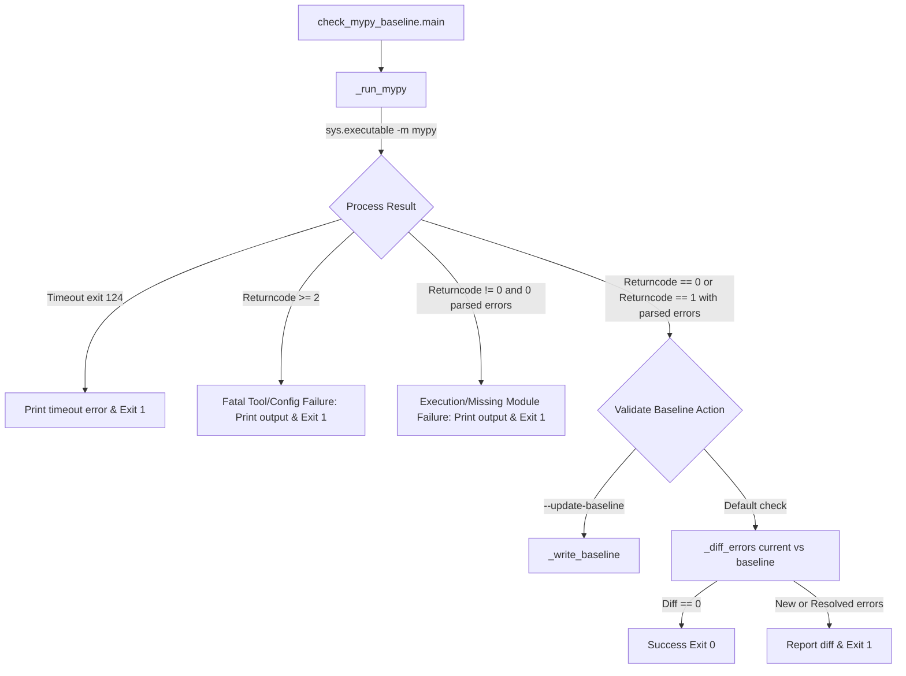

# PYPOST-1337: Trustworthy live type-quality gate outcomes

## Research

### Background and Defect Analysis
When `scripts/check_mypy_baseline.py` is executed, it runs:
```python
def _run_mypy() -> tuple[int, str]:
    cmd = [
        sys.executable,
        "-m",
        "mypy",
        *MYPY_PATHS,
        "--show-error-codes",
    ]
...
```
`_run_mypy()` executes `sys.executable -m mypy ...` and returns `completed.returncode, output`.

In `main()`:
```python
returncode, output = _run_mypy()
if returncode == MYPY_TIMEOUT_EXIT_CODE:
    print(output, file=sys.stderr, end="")
    return 1

current = _parse_errors(output)
...
```

Notice that `main()` **only** checks if `returncode == MYPY_TIMEOUT_EXIT_CODE`.
It completely ignores all other return codes! Specifically:
1. When `sys.executable` does not have `mypy` installed (such as running with system python3, or if the python environment is missing mypy):
   - Command: `/usr/bin/python3 -m mypy ...`
   - Stderr: `/usr/bin/python3: No module named mypy\n`
   - Exit code: `1`
   - Output string: `/usr/bin/python3: No module named mypy\n`
2. `_parse_errors(output)` attempts to match lines against `_ERROR_RE`:
   ```python
   _ERROR_RE = re.compile(
       rf"^(?P<path>(?:{_MYPY_PATH_RE})/[^:]+):(?P<line>\d+): error: "
       r"(?P<message>.*) \[(?P<code>[^\]]+)\]$",
   )
   ```
   Because `/usr/bin/python3: No module named mypy` does not match `_ERROR_RE`, `_parse_errors(output)` returns `[]` (an empty list, representing **0 type errors**).
3. Then `_diff_errors(current, baseline)` compares `current = []` against `baseline = 181 entries`:
   - `new_keys = []`
   - `fixed_keys = 181 entries`
4. The script assumes all 181 errors have been resolved!
   - Under normal validation: it prints 181 resolved errors and reports `Baseline: 181 errors; current: 0 errors` with exit code 1.
   - Even worse: if `--update-baseline` were run, `_write_baseline([])` would overwrite `mypy-baseline.json` with an empty error list (`error_count: 0`), completely wiping out the baseline!
5. In addition to missing module execution (`No module named mypy`), mypy itself uses specific exit codes:
   - Exit code `0`: No type errors found.
   - Exit code `1`: Type check failed (type errors found).
   - Exit code `2`: Fatal error (syntax errors, configuration errors, unreadable files, crash).
   - Other exit codes (e.g. `127`, `137` / killed, etc.): Non-zero failure.
6. Crucially, when `returncode != 0`:
   - If mypy ran and found type errors, `returncode == 1` and `len(current) > 0`.
   - But if `returncode != 0` and `len(current) == 0`: mypy either could not be executed (`No module named mypy`, exit code 1), or mypy exited with a fatal configuration/syntax error (exit code 2), or crashed. In NONE of these cases did mypy successfully report 0 type errors. Treating `returncode != 0` with 0 parsed errors as a valid typecheck that "resolved all errors" is a critical fail-open defect in tool verification.
   - Furthermore, even if `returncode >= 2`, mypy explicitly encountered fatal errors preventing checking (e.g., `mypy: error: ...`). If `returncode >= 2`, it must fail immediately with diagnostic output regardless of parsed error lines.
   - If `returncode == 1` and `len(current) == 0`, it indicates either the runner failed to execute mypy or mypy emitted an error that could not be parsed as standard typecheck diagnostics (such as module load failure, invalid command line flags, or unhandled exceptions).

### Existing System and Test Analysis
- `scripts/check_mypy_baseline.py`: The single executable script enforcing the mypy baseline.
- `tests/test_mypy_baseline.py`: Contains unit and integration tests for `check_mypy_baseline.py`.
- `tests/test_mypy_baseline_live.py`: Contains `test_mypy_baseline_live_gate_passes()`, which runs `_run_mypy()`, parses errors, and invokes `check_mypy_baseline.main()`.
- Currently, when running under `make test` or `make typecheck`, `.venv/bin/python` is used, where `mypy` is installed and emits 181 errors matching the baseline.
- However, when run under an environment or interpreter without `mypy` or when mypy fails fatally, `check_mypy_baseline.py` misreports that 181 errors were resolved instead of failing closed with a tool execution error.

## Implementation Plan

1. **Step 3: Failing Repro Test (Mandatory Automated Red Test):**
   - Create/add test in `tests/test_mypy_baseline.py` (or a dedicated regression test file).
   - Test scenario 1: When `_run_mypy()` returns non-zero returncode and stderr indicating mypy is missing or invocation failed (e.g. returncode 1, output `No module named mypy\n`), `main()` must fail with an execution error indicating mypy failed to run or produced unparseable diagnostics, instead of reporting resolved baseline errors or claiming 0 current errors.
   - Test scenario 2: When `_run_mypy()` returns exit code 2 (mypy fatal error / syntax error / configuration error), `main()` must fail and print the fatal diagnostic to stderr instead of diffing against baseline.
   - Test scenario 3: When `--update-baseline` is specified but mypy invocation failed (non-zero return code and 0 parsed errors, or exit code >= 2), `main()` must refuse to overwrite the baseline file and exit with non-zero code.
   - Verify that this test fails (RED) against the current `scripts/check_mypy_baseline.py` implementation, which currently treats `No module named mypy` as 0 errors and attempts to diff/update.

2. **Step 4: Development / Architecture Implementation:**
   - Modify `scripts/check_mypy_baseline.py`:
     - In `_run_mypy()`: keep capturing stdout and stderr.
     - In `main()` (and/or a helper function `_validate_run(returncode: int, output: str, errors: Sequence[MypyError])`):
       - If `returncode == MYPY_TIMEOUT_EXIT_CODE`: handle timeout as existing.
       - If `returncode >= 2`: fail closed, print `output` to `sys.stderr`, and return exit code 1 (or returncode).
       - If `returncode != 0 and len(errors) == 0`: fail closed! Mypy exited with non-zero exit code but zero type errors were parsed. This indicates execution failure (e.g. `No module named mypy`, unhandled internal crash, or unsupported CLI flag). Print the output to `sys.stderr` with a clear diagnostic (e.g., `Failed to run mypy or no errors parsed from non-zero mypy exit:`), and return exit code 1.
       - If `args.update_baseline`: protect against updating baseline when validation fails.
   - Update tests in `tests/test_mypy_baseline.py` to assert both the failure behavior and the successful flow.
   - Run `make typecheck` and `make test` to ensure zero regressions across the codebase.

3. **Step 5: Code Cleanup:**
   - Ensure clean code style conforming to PEP 8 / `make lint`.

4. **Step 6-8: Observability, Tech Debt, Dev Docs:**
   - Document error diagnostics and behavior in dev docs / workflow artifacts.

## Architecture



### Module Responsibilities
- `scripts/check_mypy_baseline.py`:
  - `_run_mypy()`: Executes `mypy` subprocess with timeout and captures output and exit code.
  - `_parse_errors(output)`: Parses error lines matching `_ERROR_RE`.
  - Execution Integrity Gate (`_check_mypy_result` / validation in `main`):
    - Validates that `mypy` actually ran and completed trustworthy type analysis.
    - Rejects any run where `returncode != 0` but `errors` is empty.
    - Rejects any run where `returncode >= 2`.
    - Protects `_write_baseline()` from ever being called on an invalid or uninterpretable run.
  - `_diff_errors()`: Pure multiset difference between parsed errors and baseline.
  - `_load_baseline()` / `_write_baseline()`: Reads and updates `mypy-baseline.json`.

### Main Interfaces
- `_run_mypy() -> tuple[int, str]`: Returns subprocess exit code and combined output.
- `_parse_errors(output: str) -> list[MypyError]`: Parses standard mypy error lines.
- `_diff_errors(current: Sequence[MypyError], baseline: Sequence[BaselineEntry]) -> tuple[list[tuple[str, str, str]], list[tuple[str, str, str]]]`: Unchanged pure multiset diff.

## Q&A

- **Q: Why did `tests/test_mypy_baseline_live.py::test_mypy_baseline_live_gate_passes` pass when run with `.venv/bin/python` via `make test`?**
  A: Because the `.venv` has `mypy 1.20.2` installed, and `mypy` correctly finds 181 errors matching `mypy-baseline.json`. The reported failure happened when run in an environment or python interpreter where `mypy` was not installed or failed to execute, causing `_parse_errors` to see 0 errors and falsely assert that all 181 baseline entries were resolved.
- **Q: Why must `returncode != 0 and len(errors) == 0` fail closed?**
  A: In Python / UNIX CLI semantics, if a tool exits non-zero and no errors were parsed, the tool execution itself failed (e.g. `No module named mypy`, interpreter error, missing file, or crash). Treating this as "0 type errors" causes a catastrophic false positive where all known debt is reported as "fixed" and can wipe the entire baseline if `--update-baseline` is run.
