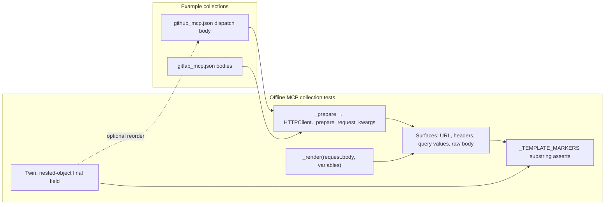

# PYPOST-1339: Trustworthy surviving-template-marker checks for MCP collections

## Research

Parent debt: [PYPOST-1334](https://pypost.atlassian.net/browse/PYPOST-1334) TD-1
(`ai-tasks/PYPOST-1334/60-tech-debt.md`). Requirements are fixed in
[`10-requirements.md`](10-requirements.md). Implementation language: Python (test-suite and
optional example-collection field-order clarity only; no production MCP runtime change).

### Current marker-check path

Both provider suites share the same body-scanning mistake:

| Module | Test | Body surface today |
| ------ | ---- | ------------------ |
| `tests/test_github_mcp_collection.py` | `test_github_mcp_full_render_leaves_no_template_markers` (~1101) | `json.dumps(kwargs.get("json", kwargs.get("data", "")))` |
| `tests/test_gitlab_mcp_collection.py` | `test_gitlab_mcp_full_render_leaves_no_template_markers` (~882) | same |

Flow today:

1. `_prepare(request, variables)` → `HTTPClient()._prepare_request_kwargs(...)`.
2. For `body_type == "json"`, the client renders the body template, then
   `json.loads(body)` into `kwargs["json"]` (`pypost/core/http_client.py` ~136–168). The raw
   rendered string is kept on `ResolvedRequestFields.body` but `_prepare` discards that second
   return value.
3. The marker test re-serializes the **parsed** object with `json.dumps` and searches the result
   for `_TEMPLATE_MARKERS = ("{{", "}}", "")`.

Local confirmation of the false positive (Python 3 `json.dumps`, insertion-ordered dicts):

- `json.dumps({"ref": "main", "inputs": {"env": "prod"}})` → ends with `}}` (nested object last).
- `json.dumps({"inputs": {"env": "prod"}, "ref": "main"})` → ends with `"main"}` (scalar last).

So any correctly rendered body whose last field is a nested object fails the `}}` check even
though the Jinja template produced no surviving markers. The GitHub
`github_dispatch_workflow` body in `examples/collections/github_mcp.json` emits `inputs`
before `ref` solely to dodge that failure (documented in
`doc/dev/github_mcp_collection.md` and the PYPOST-1334 roadmap Iteration 1 note).

### Correct body surface already available in-module

Both modules already have `_render(content, variables)` wrapping
`TemplateService().render_string_strict_conversion(...)`, and GitHub’s `_render_body_json`
uses `_render(request.body, …)` before `json.loads`. The debt fix is to use that same raw
rendered body text for the marker scan, not a second serialization of the parsed payload.

Empty / absent bodies: read tools use `request.body == ""`. `_render("", …)` yields `""`.
Today `json.dumps("")` yields `'""'`; neither form contains template markers. Prefer the raw
render (or `""` when the body template is blank) for a single consistent body surface.

### External references (checked 2026-11-06)

- [GitHub REST: Create a workflow dispatch event](https://docs.github.com/en/rest/actions/workflows?apiVersion=2022-11-28#create-a-workflow-dispatch-event)
  — body requires `ref`; `inputs` is optional. Official curl example uses `ref` then `inputs`.
  JSON object field order is not part of the contract; restoring natural order is semantics-safe.
- [RFC 8259 JSON objects](https://www.rfc-editor.org/rfc/rfc8259#section-4) — object members are
  unordered; producers may emit any order.
- Jinja / template-test practice (e.g. [jinjatest](https://github.com/SimplifyJobs/jinjatest),
  common pytest render-then-assert patterns): assert on the **rendered text** the template
  produced. Re-dumping parsed JSON invents structural `}` / `}}` that are not template markers.
- Substring checks for `{{` / `}}` on arbitrary JSON strings can still false-positive if a
  **string value** contains those characters; that residual risk is accepted and unchanged —
  this ticket only removes the structural nested-object false positive called out in TD-1.

### Scope boundaries (architecture)

- **In scope**: GitHub + GitLab full-render marker tests; one nested-object-final-field twin
  (GitHub is the natural home); optional restore of `ref` before `inputs` in the dispatch
  example body and the matching doc note.
- **Out of scope**: shared MCP collection test helpers ([PYPOST-1340][] / TD-2), production
  `pypost/` request execution, other PYPOST-1334 follow-ups.

## Architecture

No production modules, public APIs, or MCP request-execution semantics change. The architecture
is a **test-verification correction** inside the two existing MCP example-collection test
modules, with an optional clarity edit to one example body template.



### Modules and responsibilities

| Component | Role |
| --------- | ---- |
| `tests/test_github_mcp_collection.py` | Own GitHub full-render marker check; add nested-object-final twin; keep existing `_render` / `_prepare` helpers; do **not** extract shared helpers (PYPOST-1340). |
| `tests/test_gitlab_mcp_collection.py` | Apply the same body-surface correction (latent same bug); no nested-object tool required today. |
| `examples/collections/github_mcp.json` | Optional: restore dispatch body field emission order to `ref` then `inputs`. |
| `doc/dev/github_mcp_collection.md` | If order restored, drop the “inputs before ref to avoid false positive” note (or point at this ticket as resolved). |
| `pypost/core/http_client.py` | Unchanged. Continues to render then `json.loads` for outbound kwargs; tests stop using re-serialized kwargs as the marker body surface. |

### Selected patterns

- **Render-then-assert on source text** — marker detection inspects the same string Jinja
  produced for the body, aligned with how URL/header/query values are already taken from
  prepared kwargs (those fields are already rendered strings, not re-parsed).
- **Local duplication over premature abstraction** — mirror the one-line body-surface fix in
  both test modules; shared helpers remain PYPOST-1340.
- **Mutation / contract twin** — explicit regression case for nested-object-final bodies so a
  future return to `json.dumps(parsed)` fails loudly (same twin style family as other checkers
  in the GitHub module).
- **Optional clarity cleanup** — restore API-doc-natural field order once the check no longer
  constrains it; GitHub semantics unchanged.

### Interface: body surface for marker checks

Desired contract for each full-render iteration (`full` / `minimal` args):

```text
surfaces = [url, *header_values, *param_values, body_text]
body_text = _render(request.body, variables)   # "" when template empty
for content in surfaces:
    for marker in _TEMPLATE_MARKERS:
        assert marker not in str(content)
```

Do **not** use `json.dumps(kwargs["json"])` (or `data`) as `body_text`. URL / headers /
params remain as today from `_prepare` kwargs. Existing URL-prefix and query-key assertions
on the same test stay untouched.

Optional small local helper (inline or module-private) is allowed if it keeps both GitHub and
GitLab readable; it must not move into `tests/helpers/` under this ticket.

### Optional dispatch field-order restore

**Recommendation (in scope of DoD item 4):** restore `ref` before `inputs` in the
`github_dispatch_workflow` Jinja body so the example matches GitHub’s documented example shape
and author intent. After the marker fix, that order no longer false-positives. Wire-level
assertions that compare parsed JSON objects (order-insensitive) should remain green; only
string-equality against the exact body template order would need updates if any exist (none
expected beyond the marker check itself and the field-order doc note).

### Interaction with existing coverage

- Subset / `json.loads` body validity tests (`_render_body_json`, value-type cases) stay as-is.
- Encoding, auth-convention, catalog, and loopback e2e tests are out of this change set unless
  a string snapshot of the dispatch body order appears (unlikely).
- Module `pytestmark = pytest.mark.timeout(30)` remains; no new live network deps.

## Implementation Plan

1. **Architecture gate** — leave Step 2 `[/]` for orchestrator review; no code until accepted.
2. **Step 3 — failing repro (mandatory)** — see below; land red tests via Make before any fix.
3. **Step 4 — development**
   - Change GitHub and GitLab full-render marker tests to append raw rendered body text.
   - Keep twin green under the corrected check.
   - Apply optional `ref`-before-`inputs` restore if chosen in Step 3 (recommended).
   - Update `doc/dev/github_mcp_collection.md` field-order note if restore lands.
4. **Steps 5–8** — cleanup, observability (likely N/A for test-only), tech debt, any residual
   dev-doc polish; verify with Make (`make test` scoped suites, then quality gates per runner).

### Failing Repro (next Step 3)

**Not N/A** — this ticket changes observable test-gate behavior (which bodies the marker check
accepts). Step 3 must introduce an automated red before the production-of-test fix.

**Desired behavior (what the red asserts):** a correctly rendered request body whose last JSON
field is a nested object must **not** fail the surviving-marker check solely because of that
structure; real leftover `{{` / `}}` / `` in rendered URL, headers, query, or body
must still fail.

**Where it lives:**

- Primary twin in `tests/test_github_mcp_collection.py`, e.g.
  `test_github_mcp_nested_object_final_body_field_does_not_false_positive_markers`
  (name may vary; keep the nested-object-final contract obvious).
- Force the nested-object-final shape by either:
  - **Recommended:** restore `ref` then `inputs` emission order in
    `examples/collections/github_mcp.json` for `github_dispatch_workflow`, **or**
  - Render dispatch with full args after a temporary body-order change only if restore is
    deferred — still prefer restoring the fixture so the suite itself carries the natural
    order once green.
- Twin should drive the **same scanning rule** the full-render test uses (shared private
  helper or duplicated surface list) against a body that ends with a nested object and
  contains no real template markers.

**How it fails without live deps:** offline only — load the GitHub collection, `_prepare` /
`_render` with `OFFLINE_ENV` + sample `inputs` object. No GitHub/GitLab network. Expected RED
under today’s `json.dumps(parsed)` body append: `}}` from the nested final field trips the
assert (either the twin and/or
`test_github_mcp_full_render_leaves_no_template_markers` for `github_dispatch_workflow`
`[full]` after field-order restore).

**Sequencing:**

1. Research already done (this artifact).
2. Step 3: restore (recommended) field order and/or add twin → run
   `make test` with `PYTEST_ARGS` targeting the GitHub (and if touched, GitLab) marker tests →
   confirm RED.
3. Step 4: switch body surface to `_render(request.body, …)` in both modules → same command
   GREEN; GitLab gets the latent fix without requiring its own nested-object tool.
4. Do not weaken `_TEMPLATE_MARKERS` or remove body scanning.

## Q&A

- **Why not keep scanning `kwargs["json"]` via `json.dumps`?** Parsed-then-dumped JSON invents
  structural `}}` when a nested object is last; it also fails to inspect the raw rendered body
  where an unrendered marker would appear. See TD-1 and local dumps above.
- **Why not use `ResolvedRequestFields.body` from `_prepare_request_kwargs`?** Equivalent raw
  text, but modules already expose `_render` and `_prepare` discards the resolved fields today.
  Calling `_render(request.body, variables)` matches `_render_body_json` and avoids widening
  `_prepare`’s return type under this ticket.
- **Is the twin mandatory on GitLab too?** No. Requirements ask for one twin proving the
  nested-object-final case; GitHub dispatch is the reproducing fixture. GitLab only needs the
  same scan fix.
- **Is restoring `ref` before `inputs` mandatory?** No (Jira optional). Architecture
  recommends it as the clarity cleanup and as the cleanest way to keep a real nested-final
  body in the suite after the fix.
- **Does this change runtime MCP behavior?** No. Offline verification (and optional example
  body field order with equivalent JSON semantics) only.
- **Shared helpers?** Deferred to [PYPOST-1340][].

[PYPOST-1340]: https://pypost.atlassian.net/browse/PYPOST-1340
