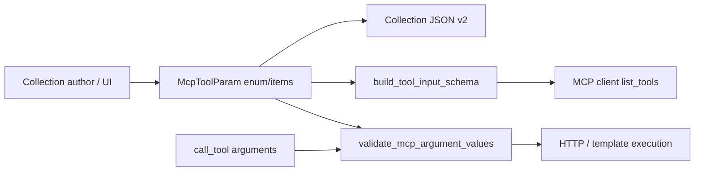

# PYPOST-1342: Support enum and array items in MCP tool parameter schemas

## Research

### Requirements and Baseline

- **Origin:** [PYPOST-1334](https://pypost.atlassian.net/browse/PYPOST-1334) TD-5 /
  [PYPOST-1342](https://pypost.atlassian.net/browse/PYPOST-1342); architecture risks R6,
  R11 in the GitHub MCP collection work.
- **Goal:** Optional `enum` and `items` on `McpToolParam`, emit in
  `build_tool_input_schema`, enforce in `validate_mcp_argument_values`, persist via
  collection format v2 / request editor, tighten GitHub and GitLab curated params.
- **Stack:** Python 3.13, Pydantic v2, MCP JSON Schema tool contracts, PySide6
  `McpParamsTable`, pytest offline suites.

### JSON Schema / MCP conventions

MCP tool `inputSchema` is a JSON Schema object. Closed sets use property-level `enum`.
Arrays declare element shape with `items` (commonly `{"type": "string"}`). Omitting
these fields remains valid; clients that require `items` on arrays reject
`{"type":"array"}` alone.

### Current code

1. **`McpToolParam`** (`pypost/models/models.py`): `type`, `description`, `required`,
   `default` only. `model_post_init` validates type whitelist and default compatibility.
2. **`build_tool_input_schema`** (`pypost/core/mcp_tool_contract.py` ~166): emits
   `{"type": ...}` (or `integer_or_string` anyOf), plus `description` / `default`.
   No `enum` / `items`.
3. **`validate_mcp_argument_values`**: checks runtime type compatibility only via
   `is_mcp_runtime_value_compatible`. No enum membership or array-element checks.
   `McpArgumentValidationError` stays value-safe (name + expected type only).
4. **Persistence:** `Collection.model_dump(mode="json")` serializes nested
   `McpToolParam`; new optional fields round-trip if present on the model. Import uses
   Pydantic reconstruction.
5. **UI:** `McpParamsTable` (`request_editor.py`) columns Name/Type/Description/
   Required/Default — must gain Enum and Items editors (JSON text cells) so metadata
   is not dropped on `get_data()`.
6. **Fixtures:** `examples/collections/github_mcp.json` and `gitlab_mcp.json` document
   closed sets in descriptions; array `labels`/`assignees` lack `items`.

### Target param tightenings

| Collection | Param | Constraint |
| --- | --- | --- |
| GitHub | review `event` | enum APPROVE, REQUEST_CHANGES, COMMENT |
| GitHub | list/update `state` | enum per description (open/closed[/all]) |
| GitHub | `side` / `start_side` | enum LEFT, RIGHT |
| GitHub | jobs `filter` | enum latest, all |
| GitHub | `state_reason` | enum completed, not_planned, reopened |
| GitHub | `subject_type` | enum line, file |
| GitHub | create/update `labels`, `assignees` | array + items string |
| GitLab | `state_event` | enum close, reopen |
| GitLab | `membership`, `recursive` | enum "true", "false" |

Workflow-run `event` filters remain free-form (open-ended GitHub event names); only
closed documented sets gain `enum`.

## Implementation Plan

1. Extend `McpToolParam` with optional `enum: Optional[List[Any]] = None` and
   `items: Optional[Dict[str, Any]] = None`. Validate: non-empty enum list when set;
   `items` only meaningful for `array` (reject or ignore elsewhere — prefer reject on
   construct if `items` set and type ≠ array); enum values should be type-compatible
   with `type` when feasible; default (if set) must be in enum when enum present.
2. Update `build_tool_input_schema` to copy `enum` / `items` onto each property when set.
3. Extend `validate_mcp_argument_values`: after type check, if `spec.enum` then require
   `value in spec.enum`; if array and `spec.items` has `"type"`, validate each element
   with `is_mcp_runtime_value_compatible`. Expected-type string for errors may mention
   `enum[...]` or `array items <type>` without embedding the bad value.
4. Extend `McpParamsTable` with Enum and Items columns (JSON serialize/parse, empty =
   None).
5. Update GitHub/GitLab JSON fixtures per table above.
6. Update collection contract tests that assert exact schemas; add core unit tests.
7. Docs: `doc/dev/mcp_integration.md` (+ GitHub/GitLab notes that referenced the gap).

### Mandatory — Failing Repro (Step 3)

Add red tests in `tests/test_mcp_tool_contract.py` (module already has
`pytestmark = pytest.mark.timeout(30)`):

1. **`test_schema_emits_enum_and_array_items`** — build schema from params with
   `enum=["APPROVE","COMMENT"]` and `type="array", items={"type":"string"}`; assert
   properties include those keys. Fails today (fields rejected or omitted).
2. **`test_validate_rejects_value_outside_enum`** — `validate_mcp_argument_values` with
   enum spec and illegal string raises `McpArgumentValidationError` without the raw
   value in the message.
3. **`test_validate_rejects_array_item_type_mismatch`** — array + items string, value
   `[1]` raises safe validation error.

Sequencing: research → red tests (Step 3) → production fix until green (Step 4) →
fixture/UI/docs.

## Architecture

### Modules

| Module | Responsibility |
| --- | --- |
| `pypost/models/models.py` | Own optional `enum` / `items` on `McpToolParam` + construct-time checks |
| `pypost/core/mcp_tool_contract.py` | Schema emission + runtime enum/items enforcement |
| `pypost/ui/widgets/request_editor.py` | Edit/persist enum and items in `McpParamsTable` |
| `examples/collections/*_mcp.json` | Curated closed sets and string arrays |
| `tests/test_mcp_tool_contract.py` (+ collection tests) | Red/green contract coverage |
| `doc/dev/mcp_integration.md` | Developer-facing contract docs |

### Patterns

- **Additive optional fields** — None means unconstrained (backward compatible).
- **Fail closed locally** — illegal enum/item values never reach the remote API.
- **Value-safe diagnostics** — reuse `McpArgumentValidationError` style.

### Risks

| Risk | Mitigation |
| --- | --- |
| Over-tightening open-ended filters | Only closed documented sets get enum |
| UI drops new fields | Explicit Enum/Items columns |
| Enum vs default mismatch | Construct-time validation |
| Collection test schema snapshots | Update expected props in GitHub/GitLab tests |

## Q&A

**Q: Should `items` support nested schemas beyond `{type}`?**
**A:** Persist a dict and emit it as-is; validation only enforces a top-level
`items.type` against known MCP scalar/array/object types for this task.

**Q: Enum on `integer_or_string`?**
**A:** Allowed if needed later; curated tightenings use string enums only.
