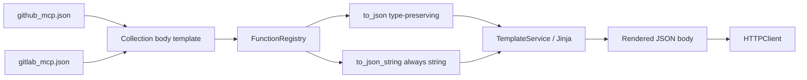

# PYPOST-1343: Type-preserving JSON serialization for request body templates

## Research

### Requirements and baseline

- **Origin:** [PYPOST-1334](https://pypost.atlassian.net/browse/PYPOST-1334) TD-6 /
  [PYPOST-1343](https://pypost.atlassian.net/browse/PYPOST-1343); architecture risks R4, R5.
- **Goal:** Add a Jinja-registered helper (e.g. `to_json`) that emits JSON with native
  types; simplify GitHub MCP bodies that hand-build arrays/objects/booleans; update locked
  tests and "scalar values only" docs; keep GitLab string bodies working; do not break
  PYPOST-1342 enum/items.
- **Stack:** Python 3.13, `json.dumps`, Jinja2 via `FunctionRegistry` /
  `TemplateService`, curated `examples/collections/*_mcp.json`, pytest offline suites.

### Current code

1. **`to_json_string`** (`pypost/core/json_string.py`): `json.dumps(str(text))` — always a
   JSON **string** literal (quotes included). Registered in
   `pypost/core/function_registry.py` `_DEFAULT_CATALOG`.
2. **GitHub bodies** that work around the limitation:
   - `labels` / `assignees`: `{{ to_json_string(x) }}`
   - `inputs`: `` with `sameas true/false` → `"true"`/`"false"`
   - `draft` / `enable_debug_logging`: `truefalse`
3. **GitLab bodies:** string fields only (labels are comma-separated strings) via
   `to_json_string`. No Jinja array/object loops today — no mandatory body rewrite.
4. **Locked tests:** `tests/test_github_mcp_collection.py` asserts dispatch input values
   are all `str`; encoding cases expect stringified bools/numbers. Catalog-allow lists in
   `tests/test_function_registry.py` and verification artifacts omit `to_json`.
5. **Docs:** `doc/dev/github_mcp_collection.md` and the `inputs` MCP param description in
   `github_mcp.json` say "scalar values only" / values sent as strings.
   `doc/dev/template_expression_functions.md` documents `to_json_string` only.

### External notes (workflow_dispatch inputs)

GitHub REST docs/examples commonly show input values as JSON strings
(`"dry_run": "false"`). The OpenAPI model types inputs as a map of arbitrary JSON values,
and official client libraries use `map[string]any` / `serde_json::Value`. This task
preserves caller JSON types at the template layer (ticket intent). Collection docs should
note that GitHub examples often use strings, while PyPost no longer forces stringification.

### Target body simplifications (GitHub)

| Field | Today | After |
| --- | --- | --- |
| `labels`, `assignees` | Jinja `for` + `to_json_string` | `"labels": {{ to_json(mcp.request.labels) }}` |
| `inputs` | Jinja `for` + stringify bools | `"inputs": {{ to_json(mcp.request.inputs) }}` |
| `draft`, `enable_debug_logging` | `true`/`false` literals | `{{ to_json(mcp.request.draft) }}` etc. |
| Plain strings | `to_json_string` | unchanged (still correct for string slots) |
| Integers (`line`) | `to_int` | unchanged |

## Implementation Plan

1. Add `to_json(value) -> str` beside `to_json_string` in `pypost/core/json_string.py`
   using `json.dumps(value, ensure_ascii=False)` (or project-default dumps settings
   matching safe escaping). Document: None → `null`; bool/int/float/str/list/dict keep
   JSON types; non-serializable raises (fail closed at render).
2. Register `"to_json": to_json` in `FunctionRegistry` `_DEFAULT_CATALOG`.
3. Rewrite GitHub MCP bodies listed above to call `to_json`.
4. Update `inputs` MCP description (drop "scalar values only" / always-strings wording).
5. Update locked GitHub tests: remove "all inputs are str" assert; encoding cases expect
   native `True`/`3`; allow-list catalogs include `to_json`.
6. Confirm GitLab collection tests still pass without body churn (or minimal doc-only).
7. Dev docs: `template_expression_functions.md`, `github_mcp_collection.md`; touch
   `examples/README.md` only if it still encodes the old contract.

### Mandatory — Failing Repro (Step 3)

Add red tests in a focused module (prefer new
`tests/test_json_string_to_json.py` with `pytestmark = pytest.mark.timeout(30)`, and/or
extend `tests/test_function_registry.py`):

1. **`test_to_json_preserves_list_dict_bool_number`** — call `to_json` (or registry
   `get("to_json")`) on `[1, True, "a"]`, `{"k": False}`, `3`, `2.5`; parse with
   `json.loads` and assert native types. Fails today (`to_json` missing /
   `to_json_string` would stringify).
2. **`test_function_registry_includes_to_json`** — `FunctionRegistry().allowed_names()`
   contains `"to_json"`. Fails today.
3. **`test_to_json_string_still_stringifies_list`** — lock that `to_json_string([1, 2])`
   remains a JSON string of the Python `str()` form (compatibility).

Sequencing: research → red tests (Step 3) → production fix + collection/test/doc updates
until green (Step 4).

## Architecture

### Modules

| Module | Responsibility |
| --- | --- |
| `pypost/core/json_string.py` | Own `to_json` (+ existing `to_json_string`) |
| `pypost/core/function_registry.py` | Register `to_json` in default catalog |
| `examples/collections/github_mcp.json` | Replace loops/literals with `to_json`; update inputs description |
| `examples/collections/gitlab_mcp.json` | No required rewrite (string-only); remain compatible |
| `tests/test_json_string_to_json.py` (+ registry / GitHub collection tests) | Red/green coverage |
| `doc/dev/template_expression_functions.md`, `doc/dev/github_mcp_collection.md` | Document helper and body patterns |

### Patterns

- **Two helpers, clear roles:** `to_json_string` = JSON string slot; `to_json` = typed JSON
  value substitution (unquoted in templates).
- **Minimal surface:** one pure function + catalog entry; no new services.
- **Fail closed:** non-serializable values raise rather than silent `str()`.

### Risks

| Risk | Mitigation |
| --- | --- |
| GitHub rejects non-string dispatch inputs | Preserve types per ticket; document that official examples often use strings; OpenAPI allows JSON values |
| Collection test snapshot churn | Update encoding / value-type asserts with the body rewrite |
| Break PYPOST-1342 enum/items | Do not edit `mcp_params` enum/items fields except the inputs description text |
| Accidental change to `to_json_string` | Explicit compatibility test |

## Q&A

**Q: Should `to_json` coerce None like `to_json_string` (`""`)?**
**A:** No — emit JSON `null`. Call sites already guard `is not none` before optional
fields.

**Q: Rewrite every GitHub string field to `to_json`?**
**A:** No. Keep `to_json_string` for string slots; use `to_json` where type preservation
matters (array/object/boolean) or when substituting a whole JSON value.

**Q: GitLab body rewrite?**
**A:** Not required for DoD; labels remain comma-separated strings. Helper availability is
enough.
