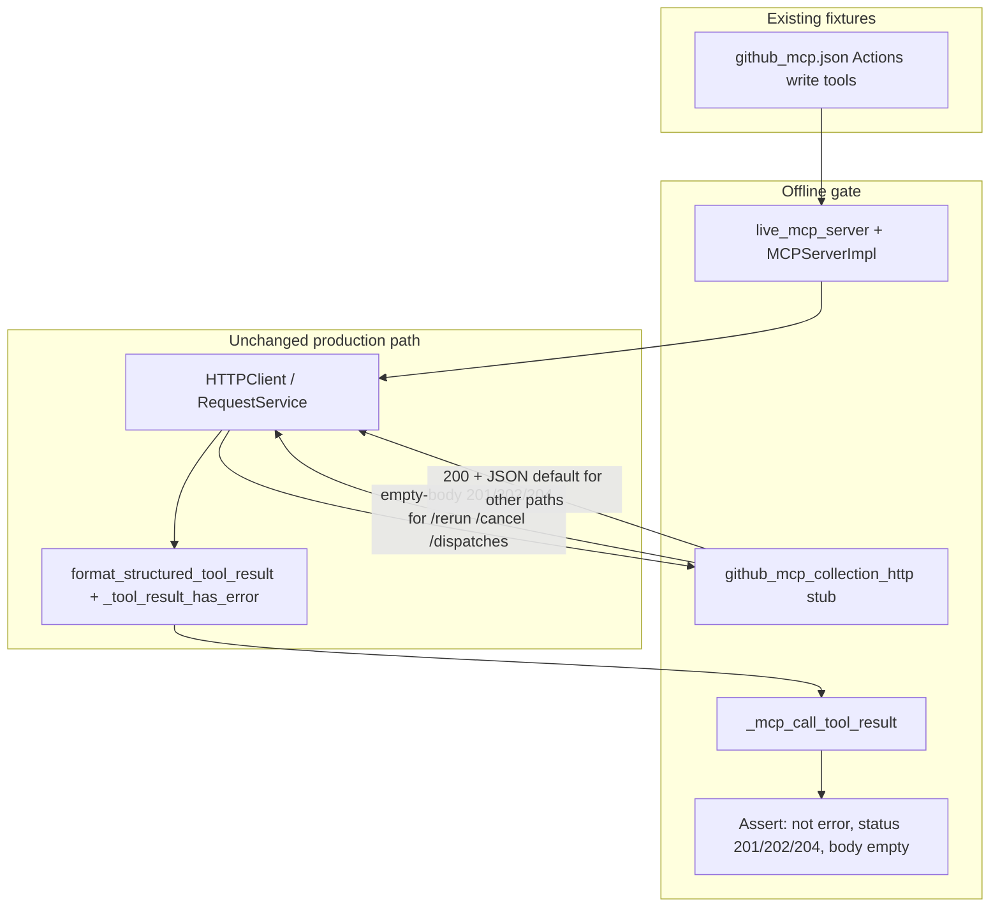

# PYPOST-1345: Guard empty-body success for GitHub dispatch, cancel, and re-run

## Research

Parent debt: [PYPOST-1334](https://pypost.atlassian.net/browse/PYPOST-1334) TD-16
(`ai-tasks/PYPOST-1334/60-tech-debt.md`). Requirements are fixed in
[`10-requirements.md`](10-requirements.md). Implementation language: Python
(test-suite only; no production MCP runtime change).

### Documented GitHub success statuses (checked 2026-11-06)

| Tool | REST path suffix | Documented success | Body |
| ---- | ---------------- | ------------------ | ---- |
| `github_rerun_workflow_run` | `…/actions/runs/{run_id}/rerun` | **201** Created | Empty / no content (OpenAPI may show `{}`; product requirement and TD-16 treat success as empty body) |
| `github_cancel_workflow_run` | `…/actions/runs/{run_id}/cancel` | **202** Accepted | Empty |
| `github_dispatch_workflow` | `…/actions/workflows/{workflow_id}/dispatches` | **204** No Content when `return_run_details` is not set | Empty |

Sources:

- [Re-run a workflow](https://docs.github.com/en/rest/actions/workflow-runs#re-run-a-workflow) — `201`.
- [Cancel a workflow run](https://docs.github.com/en/rest/actions/workflow-runs#cancel-a-workflow-run) — `202`.
- [Create a workflow dispatch event](https://docs.github.com/en/rest/actions/workflows?apiVersion=2022-11-28#create-a-workflow-dispatch-event)
  and [changelog 2026-02-19](https://github.blog/changelog/2026-02-19-workflow-dispatch-api-now-returns-run-ids/)
  — default remains **204** with no body; optional `return_run_details` yields `200` + JSON
  (out of scope for this debt; collection still pins `2022-11-28` without that field —
  see PYPOST-1341 / TD-3+4).

Parent architecture (`ai-tasks/PYPOST-1334/20-architecture.md` ~282–283) already names
these statuses and states that no tool requires a response body.

### Current offline gate (gap)

| Piece | Today | Gap |
| ----- | ----- | --- |
| `tests/helpers/github_mcp_collection_http.py` | Capture-everything loopback; every method replies **200** + `{"id":1,"offline":true}` | Never emits empty-body `201` / `202` / `204` |
| `tests/test_github_mcp_collection.py` `_successful_envelope` | Asserts `isError is False`, envelope `error is False`, **`status == 200`** | Rejects documented empty-body successes |
| `_LOOPBACK_CALLS` | Includes dispatch + cancel (and list/create); **omits re-run** | Re-run never exercises wire or MCP result for empty-body success |
| Runtime path (unchanged) | `read_streamed_body` → `ResponseData(status, body="")` → `_tool_result_has_error` only for `execution_error` or status `0` → `format_structured_tool_result` emits `{"status": N, "error": false, "body": ""}` | Already correct; untested for these three writes |

So the suite can stay green while a future change mis-classifies empty-body success: the stub
never presents that shape, and the success helper hard-codes `200`.

### Patterns to preserve

- Offline only: `stub_github_mcp_collection_http` + `live_mcp_server` + `_mcp_call_tool_result`
  (same stack as `test_github_mcp_loopback_e2e_wire_contract`).
- Module `pytestmark = pytest.mark.timeout(30)`; loopback-style tests that spin MCP + HTTP
  keep a higher per-test timeout (existing loopback uses `@pytest.mark.timeout(60)`).
- Make-only verification (`make test` / `make check`); no live GitHub.
- Do not fold this into the shared-stub extraction ([PYPOST-1340][]); keep changes local to
  the GitHub helper and GitHub collection suite.

### Scope boundaries (architecture)

- **In scope**: path-aware empty-body replies on the GitHub loopback stub for the three Actions
  writes; MCP tool-call assertions (`error: false`, expected status, empty body); any small
  adjustment to shared success helpers / loopback call list needed so existing wire e2e and the
  new guard stay consistent.
- **Out of scope**: production `pypost/` success/error classification; live smoke; dispatch
  `return_run_details` / API version migration; other PYPOST-1334 follow-ups.

## Implementation Plan

1. **Step 3 — failing repro (red):** Add automated coverage that drives MCP `call_tool` for
   `github_rerun_workflow_run`, `github_cancel_workflow_run`, and `github_dispatch_workflow` and
   asserts each result is success with the documented empty-body status. On the current tree
   the stub still answers `200` + JSON, so the assertions fail (red) without any production
   change.
2. **Step 4 — green the guard:** Extend the GitHub loopback stub so those three path suffixes
   reply with empty bodies and statuses `201` / `202` / `204`. Generalize the success-envelope
   helper (or add a sibling) so expected status and empty body are explicit. Ensure the
   existing wire-contract loopback still passes (update its status expectations for dispatch /
   cancel if those calls still share the stub defaults; add re-run to empty-body coverage).
3. **Step 5–8:** Cleanup, observability note (N/A or test-log only if needed), tech-debt scan,
   and a short `doc/dev/github_mcp_collection.md` note that empty-body success is guarded.

No production runtime modules are modified. Behavior already required by PYPOST-1334 is only
locked by tests.

### Mandatory failing repro for Step 3

| Item | Plan |
| ---- | ---- |
| **What it asserts** | For each of the three tools, after a full MCP tool call against the live MCP test server pointed at the GitHub loopback stub: `result.isError is False`; JSON envelope `error is False`; `status` equals **201** (re-run), **202** (cancel), or **204** (dispatch); `body` is empty (`""` or equivalent empty string after sanitization). |
| **Where it lives** | `tests/test_github_mcp_collection.py` — preferred: a dedicated test (e.g. `test_github_mcp_empty_body_write_success`) in the wire/loopback section (§7), parametrized over the three tools; reuse `_mcp_call_tool_result`, `live_mcp_server`, and `stub_github_mcp_collection_http`. Optionally extend `_LOOPBACK_CALLS` later in Step 4; Step 3 may keep a focused red test so wire-path capture expectations stay untouched until the stub changes. |
| **How to force failure without live GitHub** | Use the existing loopback double only. Today every stub reply is `200` + JSON, so assertions on `201`/`202`/`204` and empty `body` fail immediately. Do **not** change the stub or production code in Step 3. |
| **Sequencing** | Research (this doc) → Step 3 red test (prove gap) → Step 4 stub + assertion helper until green → cleanup / docs. |
| **Timeouts** | Follow [do-testing](../../.agents/skills/do-testing/SKILL.md): keep module `pytestmark` timeout; mark the loopback-style test `@pytest.mark.timeout(60)` (or equivalent) like `test_github_mcp_loopback_e2e_wire_contract`. |
| **N/A?** | Not N/A. Requirements mandate a behavioral regression gate even though production code already implements the rule; the missing behavior is **test coverage**, demonstrated by a red automated test before the stub/assertion fix. |

## Architecture

No production modules, public APIs, or MCP request-execution semantics change. The architecture
is a **test-double fidelity + assertion** upgrade inside the GitHub MCP collection offline gate.



### Modules and responsibilities

| Module | Responsibility | Change |
| ------ | -------------- | ------ |
| `tests/helpers/github_mcp_collection_http.py` | Loopback GitHub stand-in; capture requests; reply | Path-suffix (or equivalent) empty-body success map for `/rerun` → 201, `/cancel` → 202, `/dispatches` → 204; keep default `200` + small JSON for all other paths so unrelated wire/list/create coverage stays valid |
| `tests/test_github_mcp_collection.py` | Offline collection contracts | New empty-body success MCP coverage; generalize `_successful_envelope` (expected status + empty-body option) so loopback e2e and the new guard share one success contract |
| `pypost/core/http_client.py`, `http_response_body_reader.py`, `request_service.py`, `mcp_server_impl.py` | Real empty-body success path | **No change** (already correct per TD-16 code reading) |
| `examples/collections/github_mcp.json` / catalog | Tool definitions | **No change** |

### Module interaction

1. Test starts `stub_github_mcp_collection_http`, sets `github_api_url` to the stub base URL.
2. `live_mcp_server` loads the GitHub collection; MCP client calls each write tool with minimal
   valid arguments (same shapes as existing loopback / body tests).
3. Runtime renders the request, hits the stub; stub returns empty body + documented status.
4. MCP envelope is parsed; assertions lock success without requiring response content.
5. Optional: capture still records method/path/body for wire confidence if the dedicated test
   or updated loopback e2e includes those calls.

### Selected patterns

- **Test double / loopback stub** — preserve capture-everything, add response fidelity for the
  three documented empty-body writes (not a second fake MCP layer).
- **Contract testing** — assert agent-visible MCP JSON (`status`, `error`, `body`), not only
  that HTTP returned.
- **Parametrized pytest** — one test body × three tools keeps DoD coverage explicit and avoids
  three near-copies.
- **Default-vs-specialized replies** — empty-body map only for the three suffixes; default
  `200`+JSON elsewhere minimizes blast radius on existing stub consumers.

### Main interfaces (test-level)

```text
stub_github_mcp_collection_http()
  -> GitHubMcpCollectionHttpStub
  reply policy (conceptual):
    path endswith "/rerun"      -> status 201, body b""
    path endswith "/cancel"     -> status 202, body b""
    path endswith "/dispatches" -> status 204, body b""
    else                        -> status 200, JSON {"id": 1, "offline": True}

success envelope helper (conceptual):
  _successful_envelope(result, operation, *, expected_status: int = 200,
                       expect_empty_body: bool = False) -> dict
  asserts: not isError; envelope.error is False; status == expected_status;
           if expect_empty_body: body == ""
```

Exact function names and whether the reply map is hard-coded vs injectable are Step 4 details;
the contract above is the architectural boundary.

### Dependencies

- **Depends on**: existing GitHub collection fixtures, `live_mcp_server`,
  `_mcp_call_tool_result`, Make test targets, do-testing timeout rules.
- **Does not depend on**: live GitHub, production classifier changes, PYPOST-1340 shared stub
  merge, PYPOST-1341 dispatch run-details.

## Q&A

- **Q: Why change the stub instead of mocking `ExecutionResult`?**  
  A: Requirements demand a full MCP tool call through the collection’s loopback approach so
  request execution, body reading, and structured tool formatting are all on the path.

- **Q: Will path-suffix empty-body replies break the current loopback e2e?**  
  A: Dispatch and cancel already participate in `_LOOPBACK_CALLS` under `_successful_envelope`’s
  hard-coded `status == 200`. Step 4 must update that helper (or those call expectations) when
  the stub becomes path-aware. Prefer fixing the shared helper over keeping a dual stub mode
  unless a short-lived dual mode is needed to stage the red test.

- **Q: Why include re-run if wire e2e never called it?**  
  A: TD-16 and DoD explicitly list all three tools; re-run is the `201` case and is absent from
  `_LOOPBACK_CALLS` today.

- **Q: Empty object `{}` vs empty body for 201?**  
  A: Product requirements and TD-16 specify empty body (`body: ""`). Prefer no entity body and
  `Content-Length: 0` (or omit body bytes) so the reader yields `""`. Do not send JSON `{}`.

- **Q: Does dispatch’s new optional `200` + run details matter?**  
  A: No for this ticket. Collection does not send `return_run_details`; guard the default
  empty-body `204` path. `200`+details belongs to PYPOST-1341.

- **Q: Who accepts this architecture?**  
  A: Autonomous sprint orchestrator after independent review (gate owner marks Step 2 `[x]`).
