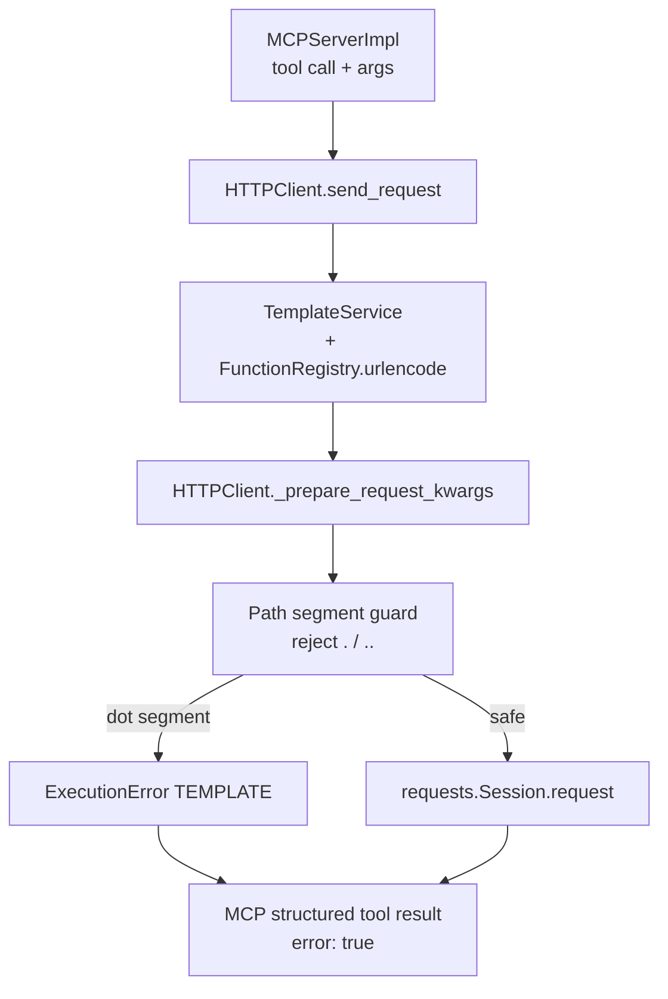

# PYPOST-1346: Reject `.` and `..` as rendered URL path segments

## Research

### Defect mechanism

1. Collection templates render path placeholders through Jinja `urlencode`, implemented as
   `urllib.parse.quote(str(v), safe="")` in `pypost/core/function_registry.py`
   (`_urlencode`). Per [Python `urllib.parse.quote`](https://docs.python.org/3/library/urllib.parse.html),
   unreserved characters including `.` are never percent-encoded, so a whole-segment value
   `.` or `..` survives encoding unchanged.
2. `HTTPClient.send_request` renders the URL, builds kwargs via `_prepare_request_kwargs`,
   then calls `self.session.request(**kwargs)` with no path-segment safety check
   (`pypost/core/http_client.py`).
3. Downstream `requests` / urllib3 apply RFC 3986 remove-dot-segments normalisation on
   HTTP(S) URLs ([RFC 3986 §3.3 / §5.2.4](https://www.rfc-editor.org/rfc/rfc3986);
   urllib3 `_remove_path_dot_segments`). Confirmed in-repo (PYPOST-1334 TD-17): e.g.
   `https://api.github.com/repos/../user` becomes a request to `/user` on the same host,
   still using the tool method and collection token.

### Requirements alignment

| Need | Implication |
| ---- | ----------- |
| FR1–FR3: detect after substitution **and** encoding; no dispatch; clear MCP error | Guard must run on the **rendered URL path**, before `session.request` |
| FR4: leave non-dot segments alone (`ci.yml`, `foo.bar`, `..%2Fx`) | Compare whole segments only; no decode-then-compare of `%2e` |
| FR5 / US3: GitHub + GitLab offline proof | Shared runtime guard + representative collection tests |
| US4: all MCP collection path rendering | Guard in HTTP stack, not a per-collection patch |
| PYPOST-1332 blank segments | Related seam; separate DoD — design a shared hook, do not absorb blank rejection into this ticket |

### Industry / peer patterns

- **LiteLLM** rejects empty / `.` / `..` **before** `quote(..., safe="")` when encoding a
  path parameter ([`encode_url_path_segment`](https://github.com/BerriAI/litellm/blob/84c1414a/litellm/litellm_core_utils/url_utils.py)).
- **Anthropic Python SDK** rejects `.` / `..` **and** percent-encoded forms (`%2e`, `%2E`)
  **after** path assembly
  ([`_path.py`](https://github.com/anthropics/anthropic-sdk-python/blob/04b468da/src/anthropic/_utils/_path.py)).
- For this ticket, product scope matches LiteLLM’s literal-segment policy and Anthropic’s
  post-assembly timing: check the **assembled** path for segments exactly equal to `.` or
  `..`. Percent-encoded lookalikes (`%2e`) are **out of scope** (requirements Q&A / NFR4);
  note as optional follow-up if proxies decode before normalising.

### Existing PyPost seams

- `IntegerConversionError` → `ExecutionError(category=ErrorCategory.TEMPLATE)` in
  `send_request`, with `mock_session.request.assert_not_called()` coverage in
  `tests/test_http_client.py`. MCP already surfaces `execution_error` as
  `error: true`, `error_category`, `error_message` (`mcp_server_impl.format_structured_tool_result`).
- GitHub/GitLab offline tests already call `HTTPClient()._prepare_request_kwargs` via
  `_prepare(...)` helpers — natural place to assert rejection without network.
- Docs today call `.` / `..` an unsupported **limitation** (`examples/README.md`,
  `doc/dev/github_mcp_collection.md`, `doc/dev/gitlab_mcp_collection.md`); DoD-6 requires
  aligning those notes with fail-closed rejection.
- [PYPOST-1332](https://pypost.atlassian.net/browse/PYPOST-1332) (Debt, To Do): fail closed
  on **blank** rendered path segments; description already points at
  `HTTPClient.send_request` / TEMPLATE `ExecutionError` as the natural checkpoint.

### Placement decision (preferred)

**Authoritative fail-closed guard in `HTTPClient` at `_prepare_request_kwargs` (after the
URL string is final), not inside `_urlencode` alone.**

| Option | Pros | Cons | Verdict |
| ------ | ---- | ---- | ------- |
| A. Reject only in `_urlencode` | Early, per-argument | Misses non-`urlencode` paths; changes template function semantics; does not match “rendered URL path” wording | Reject as sole guard |
| B. Reject in `_prepare_request_kwargs` / immediately after URL render | Matches FR1; covers all collections; same checkpoint as PYPOST-1332; mirrors existing TEMPLATE fail-closed | Message is URL-level, not argument-name-level | **Adopt** |
| C. Both A and B | Defense in depth | Dual error paths / messages; over scope | Defer; B only for this ticket |

Optional tiny pure helper (e.g. `_assert_no_dot_path_segments(url: str) -> None`) living next
to the HTTP client keeps the rule unit-testable and leaves a documented extension point for
PYPOST-1332 empty-segment rules without expanding this ticket’s product scope.

## Implementation Plan

High-level sequence (no production code in Step 2 / 3):

1. **Step 3 — Failing repro (red):** Add automated tests that assert fail-closed behaviour
   (see mandatory section below). They must fail on current `main`/tree without the guard.
2. **Step 4 — Development:** Implement the path-segment guard in `HTTPClient`; map to
   `ExecutionError` (`ErrorCategory.TEMPLATE`); keep legitimate segments green; update
   limitation docs to describe rejection.
3. **Steps 5–8:** Cleanup, observability (structured log on reject, no sensitive path dump
   beyond existing URL sanitizers), tech-debt note for `%2e` / shared blank-segment helper
   if not already ticketed, short `doc/dev/` note if needed.

### Mandatory — Failing Repro (next Step 3)

**Goal:** One or more offline red tests proving that a rendered path containing a whole
segment `.` or `..` must refuse dispatch with a clear `ExecutionError`, and that today’s
code does not.

**Primary red test (core — write first):**

| Field | Plan |
| ----- | ---- |
| **Where** | `tests/test_http_client.py` (existing `HTTPClient` / `_prepare_request_kwargs` suite; module already uses `ExecutionError` + mocked session) |
| **Arrange** | `RequestData` with a concrete URL that already contains a dot segment after “render”, e.g. `http://example.test/api/repos/../user` **or** a template URL `http://example.test/repos/{{ urlencode(owner) }}/x` with `variables={"owner": ".."}` (and the `.` twin). Inject a mocked `session` so network is impossible. |
| **Assert (desired)** | `send_request` (and/or `_prepare_request_kwargs`) raises `ExecutionError` with `category == ErrorCategory.TEMPLATE`, message/detail clearly indicating a rejected path segment (`. ` or `..`); `session.request` is **never** called. |
| **Why red today** | Prepare succeeds; `send_request` would call `session.request` with the unsafe URL (urllib3 would normalise on a real call). |
| **Force failure offline** | No live host; use the existing mock session pattern in `test_http_client.py`. |
| **Timeout** | `@pytest.mark.timeout(...)` or class/module `pytestmark` per do-testing. |

**Representative collection red coverage (same Step 3 or early Step 4, still red until guard):**

| Collection | File | Representative args | Assert |
| ---------- | ---- | ------------------- | ------ |
| GitHub | `tests/test_github_mcp_collection.py` | `github_owner` / `github_repo` / `workflow_id` ∈ `{".", ".."}` on a path-using tool (e.g. get repository / workflow) via `_execution_variables` + `_prepare` | `_prepare` raises `ExecutionError`; no capture of an outbound call |
| GitLab | `tests/test_gitlab_mcp_collection.py` | `gitlab_project` and/or `file_path` / `branch` / `sha` ∈ `{".", ".."}` on a path-using tool | Same |

Parametrize `.` and `..`. Add at least one **green control** in the same area (`ci.yml` or
`owner=octocat`) so FR4 stays visible; that control stays green before and after the fix.

**Sequencing:** research (this doc) → Step 3 red core HTTPClient test → optional collection
reds in the same step → Step 4 implement guard until all reds green → docs + `make check`.

**N/A?** Not applicable — this task has runtime behavioural change.

### PYPOST-1332 relationship (delivery note)

- Share the **checkpoint** (`_prepare_request_kwargs` after URL finalisation) and optionally
  a small path-safety helper.
- Do **not** implement blank-segment rejection under PYPOST-1346 DoD.
- If both tickets ship in the same sprint, one PR may host both predicates behind one helper;
  acceptance criteria remain separate.

## Architecture

### Module diagram



### Modules and responsibilities

| Module | Responsibility for this task |
| ------ | ---------------------------- |
| `pypost/core/http_client.py` | After URL render, split `urlsplit(url).path` on `/`; if any segment is exactly `.` or `..`, raise `ExecutionError(TEMPLATE)` and never call `session.request`. Preferred home for a private helper used from `_prepare_request_kwargs`. |
| `pypost/core/function_registry.py` | **Unchanged** for this ticket: keep `quote(..., safe="")`. Encoding still prevents `/` from splitting segments; it does not encode dots. |
| `pypost/models/errors.py` | Reuse `ErrorCategory.TEMPLATE` + `ExecutionError` (no new category required). |
| `pypost/core/mcp_server_impl.py` | **Unchanged** mapping: existing `execution_error` → MCP JSON error envelope. |
| GitHub / GitLab example collections | **Unchanged** templates; shared HTTP guard protects them. |
| User-facing docs | Replace “limitation / may be normalised” wording with fail-closed rejection behaviour. |
| Tests | Core HTTPClient red→green; offline GitHub/GitLab representative cases; legitimate segment regression. |

### Interaction scheme

1. MCP builds execution variables (defaults + overrides) and runs the request through the
   existing request pipeline into `HTTPClient.send_request`.
2. URL field is rendered (placeholders + `urlencode` where the collection uses it).
3. `_prepare_request_kwargs` receives the final URL string.
4. **New:** path-segment guard inspects path segments; on `.` / `..`, raise TEMPLATE
   `ExecutionError` (log at ERROR with existing safe URL helpers — origin-bounded where
   appropriate; do not log raw attacker-controlled full paths if that would expand
   sensitive logging — follow patterns used for `IntegerConversionError`).
5. On success, proceed as today (`session.request`).
6. MCP formats the error for the agent (`error_message` actionable: path segment rejected).

### Patterns

- **Fail-closed validation at the transport boundary** — same pattern as strict `to_int`
  conversion: refuse construction before I/O.
- **Single authoritative check** after template render — avoids drift between encode-time
  and assemble-time policies.
- **Shared seam, separate tickets** for blank vs dot segments (PYPOST-1332 / PYPOST-1346).

### Interfaces

```text
# Conceptual — Step 4 implements; not stubs in this step

def _assert_no_dot_path_segments(url: str) -> None:
    """Raise ExecutionError(TEMPLATE) if any path segment is '.' or '..'."""

# Called from HTTPClient._prepare_request_kwargs after `url` is final:
#   _assert_no_dot_path_segments(url)
```

Detection rules (normative for Step 4):

- Input: full rendered request URL string.
- Path: `urllib.parse.urlsplit(url).path` (ignore query/fragment).
- Segments: `path.split("/")` — skip inspecting the empty strings that come from a leading
  `/` or from `//` **for this ticket** (empty → PYPOST-1332).
- Reject iff a segment `== "."` or `== ".."` (string equality; no Unicode NFKC; no
  percent-decode).
- Do not reject `ci.yml`, `foo.bar`, `.github`, `..%2Fx`, or `%2e`.

### Docs touchpoints (Step 4 / 8)

- `examples/README.md` (GitHub + GitLab limitation bullets).
- `doc/dev/github_mcp_collection.md`, `doc/dev/gitlab_mcp_collection.md` limitation /
  troubleshooting rows that still describe silent normalisation.

## Q&A

- **Q: Why not fix urllib3 / disable normalize_path?**  
  A: Operators need a clear local MCP error, not preservation of literal `..` on the wire.
  Fail-closed rejection is the product contract.

- **Q: Why TEMPLATE category?**  
  A: Matches existing pre-dispatch template/construction failures (`to_int`); MCP already
  exposes `error_category=template`. Not a network/timeout failure.

- **Q: Why leave `_urlencode` alone?**  
  A: Requirements require checking the **rendered URL path**. Encode-time rejection alone
  is incomplete and changes a shared Jinja helper. HTTP-client guard covers every
  collection path in one place (preferred per task guidance).

- **Q: Should we reject `%2e` / `%2E`?**  
  A: Out of scope for PYPOST-1346. With `safe=""`, literal `.`/`..` inputs stay unencoded;
  `%2e` only appears if the caller already supplied that spelling. Optional tech-debt
  follow-up if decode-then-normalise proxies are a concern.

- **Q: Must every GitHub/GitLab tool be tested?**  
  A: No. Shared HTTP guard + representative path-segment arguments (owner/repo/workflow and
  GitLab project/file/branch/sha-style) satisfy FR5 / DoD-4–5.

- **Q: Deliver with PYPOST-1332?**  
  A: Optional shared helper/checkpoint; do not merge DoDs. This architecture designs the
  seam; blank-segment behaviour remains PYPOST-1332.

### References

- Requirements: [`10-requirements.md`](./10-requirements.md)
- Source debt: [PYPOST-1334 TD-17](../PYPOST-1334/60-tech-debt.md)
- Related: [PYPOST-1332](https://pypost.atlassian.net/browse/PYPOST-1332)
- RFC 3986 path / dot-segments: https://www.rfc-editor.org/rfc/rfc3986
- Python `quote`: https://docs.python.org/3/library/urllib.parse.html
- Peer patterns: LiteLLM `url_utils.encode_url_path_segment`; Anthropic SDK `_path.py`
