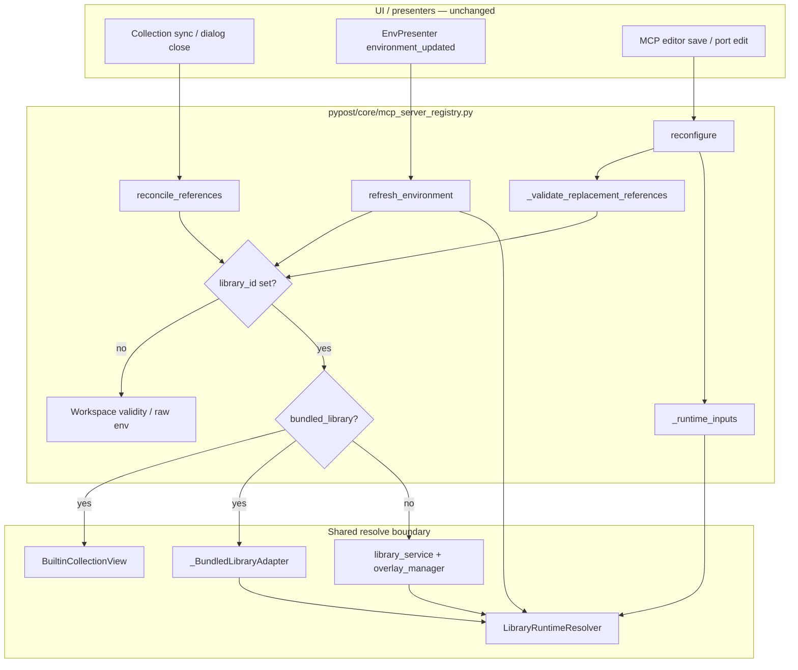

# PYPOST-1347: Ordinary library MCP lifecycle (reconcile, reconfigure, env refresh)

## Research

### Problem (from requirements and epic debt)

Ordinary (non-Built-in) library MCP rows persist `library_id` / `manifest_id` /
`library_collection_path` and typically `collection_id=None`. They must stay running across
workspace collection sync and Environment Manager dismissal, accept `reconfigure` when the
library connection, library collection, and environment remain valid, and refresh environment
snapshots to the same layered result a fresh `start()` would produce (manifest defaults, active
preset, overlay, workspace environment).

Original failure modes (recorded in `ai-tasks/PYPOST-1335/decomposition.md` DEBT and
`ai-tasks/PYPOST-1336/20-architecture.md` C3b gap 4):

1. **Reconcile** — local rows were validated as workspace rows; `collection_id=None` → stop with
   `"cannot run: missing collection"`.
2. **Reconfigure** — `_validate_replacement_references` required a workspace `collection_id` →
   `ValueError("references a missing collection")`.
3. **Env refresh** — `refresh_environment` replaced the running snapshot with raw
   `environment.variables`, dropping library layers that `LibraryRuntimeResolver` applied at start.

### Current code (read-only, post PYPOST-1352 / PYPOST-1410)

`pypost/core/mcp_server_registry.py` already contains:

| Path | Built-in (`bundled_library`) | Ordinary library (`library_id`, not bundled) | Workspace |
| ---- | ---------------------------- | -------------------------------------------- | --------- |
| `reconcile_references` | Curated `BuiltinCollectionView` path + env; ignores `valid_collection_ids` | Connection via `library_service.get_connection` + env; ignores workspace collections | `collection_id` ∈ valid set / lookup + env |
| `_validate_replacement_references` | Curated path membership | Connection presence only | `collection_id` lookup |
| `refresh_environment` | Re-resolve via `LibraryRuntimeResolver` + `_BundledLibraryAdapter` + empty overlay | **Still raw `environment.variables`** (same as workspace) | Raw `environment.variables` |
| `_runtime_inputs` / `start` | Resolver + bundled adapter | Resolver + `library_service` (overlay from service) | Workspace collection + env copy |

Implications for this Debt:

- Prefer **widening** the Built-in / library-sourced branches delivered by PYPOST-1352 (and the
  lighter ordinary `library_id` stubs from PYPOST-1410) rather than adding a fourth parallel
  control flow.
- Remaining product gap that still matches the original env-refresh defect: ordinary library rows
  in `refresh_environment` do not re-enter `LibraryRuntimeResolver`.
- Reconcile / reconfigure ordinary paths exist but validity is **connection-thin**: decomposition
  requires `library connection + manifest collection resolves + environment exists`. Collection
  resolution should align with `_runtime_inputs` / `LibraryRuntimeResolver` (or an equivalent
  manifest-path check), not only `get_connection`.
- Built-in and workspace behavior stay owned elsewhere; this task must not regress
  `tests/test_mcp_builtin_lifecycle.py` or existing workspace registry tests.

### `LibraryRuntimeResolver` contract (fresh-start baseline)

`pypost/core/library_runtime_resolver.py` is the single preparation boundary for library-backed
rows. `resolve(selection, environment_id, candidate_overlay)`:

- Validates connected library, manifest id, and collection path readability.
- Layers variables through `LibraryVariableResolver` (manifest/collection defaults, active preset,
  overlay overrides/secrets, selected workspace environment).
- Returns `RuntimeInputs` (`environment`, `hidden_keys`, `overridable_keys`,
  `collection_requests`).

`MCPServerRegistry._runtime_inputs` already uses that contract for every library `start()` /
running `reconfigure`. Lifecycle refresh must reuse the same call shape so snapshots stay equal
to a fresh start.

### External patterns (MCP env resolution)

Industry MCP host patterns (config merge hierarchies, connect-time env materialization, restart
only when execution settings change) reinforce a single resolve-at-apply rule: do not hot-patch a
partial env dict when startup already merges defaults + overlays + user env. Re-invoking the
existing resolver on refresh matches that pattern without inventing a second merge algorithm.

### Related artifacts

- Requirements: `ai-tasks/PYPOST-1347/10-requirements.md`
- Built-in architecture to widen: `ai-tasks/PYPOST-1352/20-architecture.md`
- Built-in repro suite (template for ordinary tests): `tests/test_mcp_builtin_lifecycle.py`
- Standalone library fixture helper: `tests/test_mcp_standalone_execution_repro.py`
  (`_create_test_library`)
- Live port helpers: `tests/helpers/mcp_live_server.py`

## Implementation Plan

### High-level approach — widen library-sourced branches

Do **not** invent divergent stop/refresh rules. Collapse Built-in and ordinary library into one
**library-sourced** outer branch keyed on `configuration.library_id`, with an inner
`bundled_library` discriminator for adapter and collection-validity source:

```text
if server_type == proxy:          # unchanged
elif library_id is set:           # library-sourced (Built-in OR ordinary)
    if bundled_library:           # curated view + _BundledLibraryAdapter + empty overlay
        ...
    else:                         # library_service + overlay_manager + collection resolve
        ...
else:                             # workspace local — unchanged
    ...
```

That matches C3b’s recorded intent: “C3b’s branch is keyed on `bundled_library` so the later
fix can widen it.”

### Module changes (Step 4 — no production code in this step)

1. **`MCPServerRegistry.reconcile_references`** (`pypost/core/mcp_server_registry.py`)
   - Unify / widen the existing `bundled_library` and `library_id` blocks under library-sourced
     rules.
   - Ordinary validity: connected library **and** selected library collection still resolves
     (manifest declares path and file readable — same failure categories as
     `LibraryRuntimeResolver`) **and** selected environment present when `environment_id` is set
     (standalone `environment_id is None` keeps skipping env checks per PYPOST-1410).
   - Never consult `valid_collection_ids` / `_collection_lookup` for library-sourced rows.
   - Stop diagnostics: `"missing library"` / `"missing … collection"` / `"missing environment"`
     (mirror Built-in wording style; ordinary collection miss must not say workspace
     `"missing collection"` alone without library context).

2. **`MCPServerRegistry._validate_replacement_references`**
   - Widen ordinary library validation beyond connection-only: reject when the library
     collection no longer resolves, with a clear `ValueError` (aligned with Built-in’s curated
     path check).
   - Keep Built-in curated-path check and workspace `collection_id` check unchanged in outcome.

3. **`MCPServerRegistry.refresh_environment`**
   - Widen the Built-in resolver branch to all `configuration.library_id` rows:
     - Built-in: `_bundled_adapter` + `LocalLibraryOverlay(DEFAULT_LIBRARY_ID)` (unchanged).
     - Ordinary: `self.library_service` + `candidate_overlay=None` (service overlay_manager),
       same as `_runtime_inputs`.
   - Apply resolved `environment` / `hidden_keys` / `overridable_keys` to thread managers or
     `ProcessServerRunner.update_variables` exactly as today.
   - Workspace-only rows stay on raw `environment.variables`.

4. **Out of scope**
   - Controller save / UI / Built-in product behavior / workspace semantics / settings migration.

### Mandatory — Failing Repro (Step 3)

Write an automated red suite **before** production edits. Prefer a dedicated module parallel to
the Built-in suite:

- **Path**: `tests/test_mcp_library_lifecycle.py`
- **Marker**: module-level `pytestmark = pytest.mark.timeout(30)` (per `do-testing`)
- **Fixtures**: reuse `_create_test_library` pattern (or extract shared helper only if Step 3 needs
  it), `free_port` / `wait_for_port`, in-process `MCPServerRegistry` with real
  `LibraryManagerService` + temp overlay dir — **no live external network deps**.
- **Identity under test**: `bundled_library=False`, `library_id` set, `collection_id=None`,
  selected workspace `environment_id` that omits at least one library default key.

#### Defect 1 — Reconcile

`test_ordinary_library_server_survives_reconcile_references`

- Start a running ordinary library server with a valid connection, collection, and environment.
- Call `reconcile_references(valid_collection_ids=set())` and again with
  `valid_collection_ids={"unrelated-workspace-id"}` (and env still valid).
- **Assert**: status remains `"running"`; no `"missing collection"` failure.
- Companion (desired stop): `test_ordinary_library_server_stops_when_library_collection_missing`
  — disconnect library or remove/rename the collection file so resolver would raise
  `collection_missing` / `library_invalid`; reconcile must stop with a library/collection
  diagnostic, not leave a zombie and not blame workspace collections.

#### Defect 2 — Reconfigure

`test_ordinary_library_server_reconfigure_running_row`

- Start ordinary library server on port A.
- `reconfigure` with a new free port B (same library selection + environment).
- **Assert**: call does not raise `ValueError` about missing collection; after bind completion /
  watcher, instance is running on B (or committed replacement semantics match Built-in
  `test_builtin_server_reconfigure_running_row`).
- Forces failure if validation still treats the row as a workspace collection reference.

#### Defect 3 — Environment refresh

`test_ordinary_library_server_refresh_environment_preserves_library_layers`

- Library collection/manifest declares a required default (e.g. `base_url` default
  `https://api.example.com`) and optionally an overlay or preset contribution.
- Workspace environment supplies only a subset (e.g. overrides one key, omits the defaulted key).
- Start server; mutate environment variables; call `refresh_environment(environment_id)`.
- **Assert**: manager (or process runner) variable snapshot equals a fresh
  `LibraryRuntimeResolver(...).resolve(...)` for the same selection/env/overlay — at minimum
  preserves omitted manifest defaults (and preset/overlay keys when the fixture sets them).
- **Expected red on current mainline**: ordinary path still assigns
  `vars_dict = dict(environment.variables)`.

#### Regression guards (must stay green without assertion edits to workspace suites)

- `test_workspace_row_reconcile_and_refresh_unchanged` — workspace server still stops when its
  collection id leaves `valid_collection_ids`; refresh still uses raw env vars.
- Do not weaken Built-in assertions in `tests/test_mcp_builtin_lifecycle.py`.

#### Sequencing

1. Research complete (this document).
2. **Step 3**: add `tests/test_mcp_library_lifecycle.py`; run `make test` — confirm red on at
   least the env-refresh case; reconcile/reconfigure cases red if residual validity gaps remain,
   otherwise they lock the widened contract before Step 4 refactors.
3. **Step 4**: widen registry branches until the new suite is green; `make check`.

## Architecture

### Module diagram



### Component responsibilities

| Component | Responsibility for PYPOST-1347 |
| --------- | ------------------------------ |
| `MCPServerRegistry` | Own lifecycle branches; widen library-sourced reconcile / validate / refresh; keep workspace and Built-in outcomes stable. |
| `LibraryRuntimeResolver` | Authoritative layered env + collection validation; reused by `_runtime_inputs` and widened `refresh_environment`. |
| `_BundledLibraryAdapter` | Built-in-only library facade (unchanged). |
| `library_service` | Ordinary connected libraries + overlays (unchanged API). |
| Presenters / controller | Unchanged; they already call reconcile / refresh / reconfigure. |

### Selected patterns

- **Widen-existing-branch (preferred over duplicate)** — extend PYPOST-1352 library-sourced
  handling so ordinary rows share resolve/refresh semantics with Built-in, differing only by
  adapter and collection membership source.
- **Single resolve boundary** — no second merge algorithm in `refresh_environment`; call
  `LibraryRuntimeResolver` with the same overlay rules as `_runtime_inputs`.
- **Discriminator nesting** — outer `library_id`, inner `bundled_library`, else workspace
  (explicit, PEP-friendly, matches existing start path).
- **Dependency injection** — continue using injected `library_service`,
  `environment_lookup`, and `_builtin_view` (no new globals).

### Main interfaces (target shape)

```python
# Conceptual — Step 4 implementation detail; not applied in this step.

def reconcile_references(
    self,
    valid_collection_ids: set[str] | None = None,
    valid_environment_ids: set[str] | None = None,
) -> bool:
    """Stop only endpoints whose library/workspace inputs were removed."""
    ...

def _validate_replacement_references(
    self, instance_id: str, configuration: McpServerConfiguration
) -> None:
    """Library-sourced: connection + collection resolve (+ curated path if bundled)."""
    ...

def refresh_environment(self, environment_id: str) -> None:
    """Library-sourced rows: re-resolve via LibraryRuntimeResolver; workspace: raw env."""
    ...
```

Ordinary refresh sketch (widening Built-in):

```python
if configuration.library_id:
    selection = configuration.library_selection
    if selection is None:
        continue
    if configuration.bundled_library:
        service = self._bundled_adapter
        candidate_overlay = LocalLibraryOverlay(
            library_id=PredefinedLibraryService.DEFAULT_LIBRARY_ID
        )
    else:
        service = self.library_service
        candidate_overlay = None
    resolved = LibraryRuntimeResolver(
        library_service=service,
        environment_lookup=self._environment_lookup,
    ).resolve(
        selection,
        environment_id=environment_id,
        candidate_overlay=candidate_overlay,
    )
    vars_dict = dict(resolved.environment)
    hidden_set = set(resolved.hidden_keys)
    overridable_set = set(resolved.overridable_keys)
else:
    vars_dict = dict(environment.variables)
    ...
```

### Interaction scheme (env refresh)

1. User edits workspace environment → `EnvPresenter` → `refresh_environment(env_id)`.
2. Registry selects instances with that `environment_id`.
3. For each ordinary library instance, resolver rebuilds the full snapshot (defaults + preset +
   overlay + env).
4. Suppliers / process runner receive the new immutable snapshot; server process stays up.
5. A subsequent `stop` + `start` yields an equal variable map for the same configuration.

## Q&A

- **Q: Why widen Built-in branches instead of a separate ordinary-only patch?**
  A: C3b explicitly keyed Built-in handling on `bundled_library` so this Debt could widen the
  same lifecycle seams. Duplicating three more nearly identical blocks increases drift risk
  between Built-in and ordinary library users.

- **Q: Why must refresh call `LibraryRuntimeResolver` instead of merging defaults ad hoc?**
  A: Start already uses the resolver. Any hand-rolled merge will diverge on preset/overlay edge
  cases. Equality with fresh start is the acceptance criterion.

- **Q: How does this relate to PYPOST-1410 standalone servers?**
  A: Standalone rows (`environment_id is None`) already skip env checks on reconcile and are
  ignored by `refresh_environment` filters. This Debt focuses on ordinary library rows that
  **do** select a workspace environment, and on completing collection-resolve validity for all
  ordinary library rows.

- **Q: What stays unchanged?**
  A: Built-in curated-view rules and empty-overlay save (PYPOST-1352); workspace collection_id
  reconcile/refresh; persisted settings schema; MCP dialog UI.
