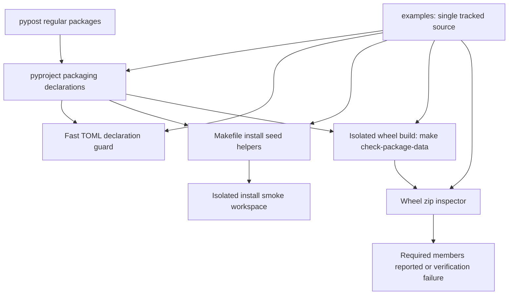

# PYPOST-1348: Ship the official examples with installed PyPost

## Research

Research performed on 2026-10-09 against approved [requirements](10-requirements.md),
[epic architecture, decision (a)](../PYPOST-1336/20-architecture.md), and
[C1a scope](../PYPOST-1335/decomposition.md).

- The current `pyproject.toml` discovers `pypost*` packages and has no examples mapping or
  package-data declaration. There are 18 regular application packages with `__init__.py`.
  `examples/` contains the official manifest, README, collections, and environments; its
  Built-in declaration does not exist yet and belongs to PYPOST-1350.
- `tests/makefile_test_helpers.py::_paths_from_package_data` resolves dotted names directly
  and silently skips absent directories. `_required_seed_paths_from_pyproject` includes
  metadata and script modules but does not seed every explicitly listed package initializer.
  Both behaviors must change together to keep isolated installation workspaces representative.
- Setuptools allows explicit package names with independently mapped source directories;
  setting `packages` disables automatic discovery. This supports the approved mapping while
  retaining all existing regular application packages.
  [Package discovery](https://setuptools.pypa.io/en/latest/userguide/package_discovery.html).
- Explicit `package-data` maps package names to file globs. These files need neither a
  `MANIFEST.in` entry nor a version-control plugin; path separators in globs use `/`.
  [Setuptools data files](https://setuptools.pypa.io/en/latest/userguide/datafiles.html).
- Editable installations can expose files differently from regular installations, so a source
  declaration check cannot replace checking the built wheel. The approved backend requirement
  is `setuptools>=64`; build dependencies remain separate from development dependencies.
  [Editable installs](https://setuptools.pypa.io/en/latest/userguide/development_mode.html).
- `importlib.resources.files` resolves a package's resource container; `as_file` gained directory
  extraction support in Python 3.12. A regular package anchor preserves the approved Python 3.11
  resource strategy. Runtime lookup is implemented by PYPOST-1349, not this task.
  [Python resource access](https://docs.python.org/3/library/importlib.resources.html).

## Implementation Plan

1. Step 3 first adds and demonstrates failing automated packaging and seed contracts through
   Make. Preserve the accepted red evidence before changing production configuration/helpers.
2. Step 4 replaces package discovery with the explicit package list below, maps the examples
   package, adds its docstring-only initializer, and declares the resource patterns.
3. Update installation seed resolution and its exact minimum-tree policy together. Keep
   existing version, script-entry-point, README, and license-file handling.
4. Add the wheel inspector and `make check-package-data`; integrate it into `make test-slow`.
   Keep `make test` and consequently `make check` free of wheel building.
5. Validate changed contracts with focused `make test`, run `make check`, and verify an actual
   isolated wheel through `make check-package-data` and the relevant slow Make workflow.
   Document the package contract and target in developer docs at Step 8.

### Mandatory failing repro for Step 3

Add `tests/test_bundled_examples_packaging.py` with a module timeout. A fast test reads committed
`pyproject.toml` with `tomllib` and asserts the explicit package set equals the regular packages
found under `pypost/` plus `pypost.bundled_examples`. It also asserts the mapped source exists,
has `__init__.py`, and package-data globs cover required files. On the current tree it fails
because the explicit list/mapping/package-data are absent. No setuptools import or build is
allowed in these fast tests.

Add focused contracts to `tests/test_makefile_install_seed_contract.py` using temporary source
trees: resolve a mapped package's data under `examples/`, include every explicit package's
initializer, fail with the package/source path when a declared source directory is absent,
and materialize the complete committed seed. Before helper changes the mapping and initializer
contracts fail. Test examples coverage independently against the manifest and environments,
so computing both expected and actual content through the same helper cannot conceal omissions.

Mutation cases remove an application package, omit a declared collection or environment glob,
and remove a mapped source directory. Each must be rejected with a useful failure. A temporary
`builtin-collections.yaml` proves its reserved pattern works, while its absence in committed
source remains valid until PYPOST-1350 adds it.

Wheel inspection receives synthetic zip archives for offline missing-member failures and a
slow integration test exercises the real Make target. Assert initializer and resource member
names, with each required resource reported. Network access is confined to isolated backend
installation during the real build; it is not needed for the automated red contracts.

Existing unrelated failure tickets PYPOST-1298, PYPOST-1299, and PYPOST-1357 remain outside scope.
Use a separate Make-managed verification environment when necessary. Never pass a shared
absolute `VENV` override into nested Make tests: their `clean` target may remove that environment.

## Architecture

### Components and dependencies



| Component | Responsibility | Dependencies |
| --- | --- | --- |
| `examples/` | Canonical resource files and regular-package marker | None |
| `pyproject.toml` | Packages, source mapping, resource globs, backend | Source tree |
| Fast packaging contract | Detect omitted packages and resources | TOML, paths, YAML |
| `makefile_test_helpers.py` | Seed complete install-time source | TOML and source files |
| Wheel inspector | Validate archive members, report resources | `zipfile`, source inventory |
| `Makefile` | Isolated build and fast/slow workflow boundaries | Existing managed venv and pip |

Use declarative mapping with independent source and artifact checks. There are no new domain
models or runtime services in this task. Existing application APIs and examples paths remain
stable; no second tracked resource copy is created.

### Package declarations

Replace `[tool.setuptools.packages.find]` with `[tool.setuptools] packages` containing:

```text
pypost
pypost.agent
pypost.core
pypost.core.key_sources
pypost.core.qt
pypost.fixtures
pypost.models
pypost.ui
pypost.ui.delegates
pypost.ui.dialogs
pypost.ui.presenters
pypost.ui.widgets
pypost.ui.widgets.environments
pypost.ui.widgets.fold
pypost.ui.widgets.mcp_client
pypost.ui.widgets.settings
pypost.ui.widgets.validate
pypost.ui.widgets.websocket
pypost.bundled_examples
```

Set `[build-system] requires = ["setuptools>=64"]`. Map
`[tool.setuptools.package-dir] "pypost.bundled_examples" = "examples"` and create
`examples/__init__.py` with only a module docstring. The package-data patterns are:

```toml
[tool.setuptools.package-data]
"pypost.bundled_examples" = [
  "pypost-library.yaml", "builtin-collections.yaml", "README.md",
  "collections/*.json", "environments/*.json",
]
```

The explicit list is guarded against the actual regular-package tree so future additions
cannot silently disappear. Existing non-package directories without initializers are outside
that list. Neither the development extra nor requirement inputs/locks gain setuptools or wheel.

### Main interfaces and invariants

- **Package source resolution:** resolve a package through `[tool.setuptools.package-dir]`
  first; otherwise use its dotted path. Share the seed helper's resolution logic between
  package-data enumeration and explicit-package initializer enumeration. The exact assigned
  mapping is mandatory; guards reject an absent directory or initializer with its path.
- **Required resource inventory:** `pypost-library.yaml`, `README.md`, every `collections`
  path named by that library manifest, and all existing `environments/*.json`. Include
  `builtin-collections.yaml` when it exists, and always assert its declared pattern is present.
  Keep manifest-relative paths inside the examples root. YAML parsing uses existing PyYAML;
  there is no new dependency or runtime import of application services.
- **Fast declaration guard:** parse TOML, walk regular package initializers, and compare
  mapped glob matches to the independent required inventory. Fail on missing source files,
  omitted packages, wrong mapping, or missing coverage. Do not invoke setuptools or pip.
- **Seed interface:** extend `_paths_from_package_data` to accept the mapping configuration;
  `_required_seed_paths_from_pyproject` adds each listed package's resolved `__init__.py`.
  Preserve unmapped package-data compatibility. Missing declared package directories fail
  explicitly rather than being skipped. Copy actual examples/resources and initializers
  through existing materialization; retain minimal script stubs where already supported.
- **Seed policy:** update `SLOW_SMOKE_MINIMUM_PYPPOST_FILES` to include the 18 regular package
  initializers and existing required version/entry modules. Assert mapped `examples/__init__.py`
  and independently required examples in a separate contract; they are outside `pypost/`.
- **Wheel command:** `make check-package-data` uses the managed venv's `pip wheel --no-deps`
  with build isolation enabled and a temporary output directory. Backend dependencies come
  from `[build-system]`; do not use `--no-build-isolation`. Clean temporary output on success
  and failure. A bounded subprocess timeout applies in the slow integration test.
- **Wheel inspector:** a small typed script accepts a wheel path and source root, derives
  the independent required inventory, and checks every existing application's initializer
  under its normal archive path plus resources under `pypost/bundled_examples/`. Check the
  mapped initializer too. Missing members cause a nonzero exit naming the missing paths;
  success prints each required resource member, including all environments. Byte comparison
  with canonical resources can establish that packaging preserved content.
- **Slow tier integration:** add the new target as a prerequisite or explicit operation of
  `test-slow`, with `.PHONY` and a target-line `##` description visible through the default
  help target and `make help`. Document the repeatable `make check-package-data` command in
  developer docs per the `run-makefile` skill. `test` remains the fast TOML/seed/inspector
  contracts only. No wheel subprocess is invoked by those contracts.
- **Isolated Make workspace dependencies:** if the wheel inspector lives in
  `scripts/check_package_data.py`, copy that script and any inventory helper it imports into
  the slow-smoke workspace and any other fixture that executes `test-slow`. Seed all source
  inventory needed by that inspector through the complete packaging seed. Add a fixture
  contract proving the newly wired target's scripts exist, so nested Make runs cannot fail
  solely because their minimal workspace omitted the new target's dependencies.

The wheel inspector and guard may reuse a small inventory function if useful; expected package
names remain independently derived from source initializers, and seed contracts independently
derive required manifest/environment files. Do not introduce a generalized packaging framework.

## Q&A

- **Why does the declaration mention a file not yet created?** The pattern reserves the agreed
  future Built-in declaration. Missing current content is valid; coverage and wheel membership
  become mandatory automatically once PYPOST-1350 introduces that file.
- **Why check both TOML and the wheel?** The fast guard catches configuration drift without build
  dependencies; the slow check proves the backend actually emitted the required content.
- **Why preserve the existing paths?** The epic explicitly retains `examples/` as the single
  source; mapping satisfies installed distribution needs without changing existing references.
- **Who resolves these resources at runtime?** PYPOST-1349 owns the resource locator and
  predefined-library integration. This task provides its package anchor and shipped resources.
- **What is the acceptance gate?** The sprint orchestrator obtains an independent architecture
  review and marks Step 2 accepted before Step 3. This execution leaves Step 2 in progress.
