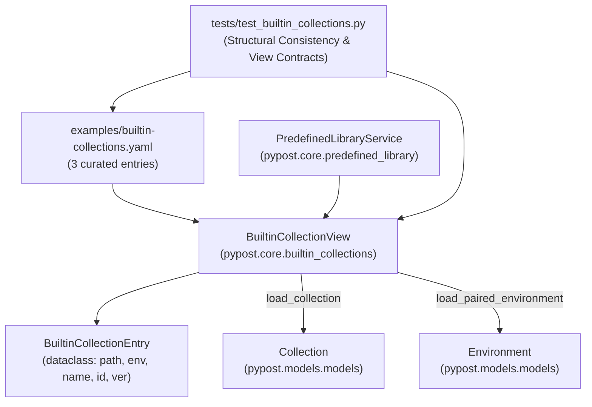

# PYPOST-1350: Built-in collection view over the examples library

## Research

Research performed on 2026-10-10 against approved [requirements](10-requirements.md),
[epic architecture, decisions (c), (d), (e)](../PYPOST-1336/20-architecture.md),
[decomposition notes Child C2](../PYPOST-1335/decomposition.md), and the current codebase.

### Current Code & Architectural State

1. **Packaging & Locator Infrastructure (PYPOST-1348, PYPOST-1349)**:
   - `pyproject.toml` packages `pypost.bundled_examples` mapped to `examples/` via `[tool.setuptools.package-dir]`, with package data declared covering `builtin-collections.yaml` (reserved pattern), `pypost-library.yaml`, `collections/*.json`, and `environments/*.json`.
   - `pypost/core/bundled_resources.py` (`bundled_examples_root()`) provides the single source of truth for the shipped examples directory root, resolving sibling checkouts or installed package resources.
   - `PredefinedLibraryService` (`pypost/core/predefined_library.py`) validates the examples library (`id: pypost-examples`), its manifest `examples/pypost-library.yaml`, and collections against escaping paths.

2. **Shipped Collections and Environments Inventory**:
   - `examples/collections/jira_mcp.json` (`id: jira-cloud-mcp`, `version: 2.0.0`, `name: Jira Cloud MCP`) paired with `examples/environments/jira_cloud.json`.
   - `examples/collections/gitlab_mcp.json` (`id: gitlab-mcp`, `version: 1.0.0`, `name: GitLab MCP`) paired with `examples/environments/gitlab.json`.
   - `examples/collections/github_mcp.json` (`id: github-mcp`, `version: 1.0.0`, `name: GitHub MCP`) paired with `examples/environments/github.json`.
   - `examples/collections/mcp.json` (`id: test-collection-mcp`) is a synthetic test fixture generated by `make generate-mcp-fixtures`; it has no paired environment and is explicitly excluded from the Built-in catalog.

3. **Structural Characteristics of Paired Environments vs Manifest**:
   - `pypost-library.yaml` declares library-level variables with `default` and `secret: true/false`.
   - Each collection JSON declares collection-level `variables` with `name`, `type`, `default`, `secret`, `required`.
   - In each paired environment file (`examples/environments/*.json`):
     - The variable dictionary keys match exactly the manifest variable names used by that collection.
     - Keys marked `secret: true` in the manifest/collection appear in `hidden_keys`.
     - Values corresponding to secrets are non-empty committed placeholder strings (e.g. `"you@example.com:your-api-token"`, `"your-gitlab-access-token"`, `"your-github-token"`).
     - Keys marked in `mcp_overridable_keys` are a strict subset of the environment's variable keys.
     - *Important*: Environment variable values intentionally differ from manifest presets/defaults (e.g. `jira_cloud.json` uses `https://your-team.atlassian.net` and `YOUR_PROJECT_KEY`, while the manifest preset `jira_cloud` uses `https://your-company.atlassian.net` and `DEMO`). Structural consistency must verify keys, secret masking, and overridable subsets, but **never compare values**.

4. **Error Handling & Diagnostic Requirements**:
   - Built-in collections must be resilient to corruptions, missing files, or bad configuration.
   - If `builtin-collections.yaml` is missing, malformed, or references an undeclared manifest path, `BuiltinCollectionView.list_entries()` must not raise unhandled exceptions; it must return an empty list `[]` (or omit the broken entry) and record descriptive diagnostics on the view service.

---

## Implementation Plan

### High-Level Steps

1. **Step 3: Failing Repro Test (Automated Red Tests)**:
   - Create `tests/test_builtin_collections.py` declaring `@pytest.mark.timeout(30)`.
   - Write comprehensive tests asserting:
     - `list_entries()` returns exactly 3 entries (`jira-cloud-mcp`, `gitlab-mcp`, `github-mcp`) with display names and versions populated from collection JSONs.
     - `selection()` method on each entry returns `{"library_id": "pypost-examples", "manifest_id": "pypost-examples", "path": entry.collection_path}`.
     - `load_collection()` and `load_paired_environment()` return fresh `Collection` and `Environment` models.
     - `is_builtin(config)` returns `True` for configurations matching built-in entries and `False` otherwise.
     - Resilient error handling: missing view file, malformed YAML, or entry referencing a path not declared in `pypost-library.yaml` returns `[]` (or filters invalid entry) and sets `diagnostics` without throwing.
     - Structural consistency tests verifying paired environments (`jira_cloud.json`, `gitlab.json`, `github.json`) against manifest declarations without comparing values.
     - Seeded defect tests proving structural test fails on missing key, unhidden secret, or extra key.
   - Run `make test PYTEST_ARGS='tests/test_builtin_collections.py'` to verify failing red status before implementing production files.

2. **Step 4: Development**:
   - Create `examples/builtin-collections.yaml` with the three curated entries.
   - Create `pypost/core/builtin_collections.py` implementing `BuiltinCollectionEntry` and `BuiltinCollectionView`.
   - Run `tests/test_builtin_collections.py` until all tests pass.
   - Verify `make check` passes, confirming no regressions in existing fixtures (`test_example_fixtures.py`, `test_jira_mcp_live_smoke.py`).

3. **Step 5: Code Cleanup**:
   - Code cleanup and lint verification. Document in `40-code-cleanup.md`.

4. **Step 6: Observability**:
   - Add structured logging for discovery and diagnostics. Document in `50-observability.md`.

5. **Step 7: Technical Debt**:
   - Analyze technical debt. Document in `60-tech-debt.md`.

6. **Step 8: Developer Docs**:
   - Document `BuiltinCollectionView` and `builtin-collections.yaml` in developer docs.

---

### Mandatory — Failing Repro (next Step 3)

The failing repro tests will be located in `tests/test_builtin_collections.py`:
- **Module timeout**: `pytestmark = pytest.mark.timeout(30)`.
- **Planned Red Assertions**:
  1. `test_builtin_collections_list_entries`: Asserts `view.list_entries()` returns 3 entries:
     - Jira Cloud MCP: path `collections/jira_mcp.json`, env `environments/jira_cloud.json`, id `jira-cloud-mcp`, version `2.0.0`.
     - GitLab MCP: path `collections/gitlab_mcp.json`, env `environments/gitlab.json`, id `gitlab-mcp`, version `1.0.0`.
     - GitHub MCP: path `collections/github_mcp.json`, env `environments/github.json`, id `github-mcp`, version `1.0.0`.
  2. `test_builtin_collection_entry_selection`: Asserts `entry.selection()` returns `{"library_id": "pypost-examples", "manifest_id": "pypost-examples", "path": entry.collection_path}`.
  3. `test_builtin_collections_load_fresh`: Asserts `load_collection()` and `load_paired_environment()` return valid `Collection` and `Environment` instances, and repeated calls return new distinct instances (fresh load, no caching).
  4. `test_builtin_collections_is_builtin`: Asserts `is_builtin` returns `True` for a `McpServerConfiguration` pointing to `library_id="pypost-examples"` and one of the 3 paths with `bundled_library=True`, and `False` for `mcp.json` or other libraries.
  5. `test_builtin_collections_invalid_view_file_graceful_handling`: With a nonexistent or malformed `builtin-collections.yaml`, `list_entries()` returns `[]` and records a diagnostic message without crashing.
  6. `test_builtin_collections_non_manifest_entry_rejected`: If `builtin-collections.yaml` contains an entry not in `manifest.collections`, it is rejected with a diagnostic.
  7. `test_paired_environments_structural_consistency`:
     - Verifies each environment's `variables.keys()` matches manifest variables for that collection.
     - Verifies each secret variable is in `hidden_keys`.
     - Verifies each secret value is a non-empty string.
     - Verifies `mcp_overridable_keys` is a subset of `variables.keys()`.
     - Asserts NO value comparison with presets or defaults.
  8. `test_paired_environments_seeded_defect_missing_key`: Mutated environment missing a required key fails consistency assertion.
  9. `test_paired_environments_seeded_defect_unhidden_secret`: Mutated environment with secret omitted from `hidden_keys` fails consistency assertion.
  10. `test_paired_environments_seeded_defect_extra_key`: Mutated environment with unknown extra key fails consistency assertion.

**Forcing failure in Step 3**:
`examples/builtin-collections.yaml` and `pypost/core/builtin_collections.py` do not exist yet. Running the test file will immediately fail with `ModuleNotFoundError: No module named 'pypost.core.builtin_collections'`.

---

## Architecture

### Components & Dependencies



### Module Specifications

#### 1. Catalog Specification: `examples/builtin-collections.yaml`

```yaml
version: "1.0.0"
entries:
  - collection: "collections/jira_mcp.json"
    environment: "environments/jira_cloud.json"
    name: "Jira Cloud MCP"
  - collection: "collections/gitlab_mcp.json"
    environment: "environments/gitlab.json"
    name: "GitLab MCP"
  - collection: "collections/github_mcp.json"
    environment: "environments/github.json"
    name: "GitHub MCP"
```

- Strictly 3 entries.
- `collections/mcp.json` is explicitly absent.

#### 2. Domain Models & View: `pypost/core/builtin_collections.py`

```python
from dataclasses import dataclass
from pathlib import Path
from typing import Any, Optional
import yaml

from pypost.core.collection_serializer import read_collection_file
from pypost.core.predefined_library import PredefinedLibraryService
from pypost.models.models import Collection, Environment
from pypost.models.settings import McpServerConfiguration


@dataclass(frozen=True)
class BuiltinCollectionEntry:
    collection_path: str       # e.g. "collections/jira_mcp.json"
    environment_path: str      # e.g. "environments/jira_cloud.json"
    name: str                  # display name
    collection_id: str         # collection JSON "id", e.g. "jira-cloud-mcp"
    version: Optional[str]     # collection JSON "version", e.g. "2.0.0"

    def selection(self) -> dict[str, object]:
        """Return library identity dictionary matching McpServerConfiguration expectations."""
        return {
            "library_id": PredefinedLibraryService.DEFAULT_LIBRARY_ID,
            "manifest_id": PredefinedLibraryService.DEFAULT_LIBRARY_ID,
            "path": self.collection_path,
        }


class BuiltinCollectionView:
    """Read-only view over the bundled examples library presenting curated Built-in collections."""

    CATALOG_FILENAME = "builtin-collections.yaml"

    def __init__(self, predefined: Optional[PredefinedLibraryService] = None) -> None:
        self._predefined = predefined or PredefinedLibraryService()
        self.diagnostics: list[str] = []

    @property
    def root(self) -> Optional[Path]:
        return self._predefined.root

    def list_entries(self) -> list[BuiltinCollectionEntry]:
        """List curated built-in collection entries validated against the library manifest."""
        ...

    def is_builtin(self, configuration: McpServerConfiguration) -> bool:
        """Check whether an McpServerConfiguration targets a curated built-in collection."""
        ...

    def load_collection(self, collection_path: str) -> Collection:
        """Load and parse the collection file freshly from disk."""
        ...

    def load_paired_environment(self, collection_path: str) -> Environment:
        """Load and parse the paired template environment file freshly from disk."""
        ...
```

#### Detailed Method Behaviors

- **`list_entries()`**:
  1. Clear `self.diagnostics`.
  2. If `self.root` is `None` or does not exist: record diagnostic `"Bundled examples root not found"` and return `[]`.
  3. Validate predefined library via `self._predefined.discover()`. If discovery fails, transfer/record diagnostic and return `[]`.
  4. Look for `self.root / CATALOG_FILENAME`. If file does not exist, record diagnostic `"Built-in collections catalog not found"` and return `[]`.
  5. Parse YAML safely (`yaml.safe_load`). If malformed or not a dict containing `entries: list`, record diagnostic and return `[]`.
  6. Read manifest (`pypost-library.yaml`) to verify that each entry's `collection` path is declared in `manifest.collections`.
     - If an entry's collection is not declared in the manifest, record diagnostic and skip that entry.
  7. For each valid entry:
     - Load collection JSON from `self.root / entry["collection"]` to read its actual `name`, `id` (`collection_id`), and `version`.
     - Construct `BuiltinCollectionEntry`.
  8. Return the list of entries.

- **`load_collection(collection_path: str) -> Collection`**:
  - Look up entry for `collection_path`. If not found, raise `ValueError(f"Collection {collection_path} is not a built-in collection")`.
  - Resolve absolute path `target = (self.root / collection_path).resolve()`.
  - Read freshly from disk using `read_collection_file(target)`.

- **`load_paired_environment(collection_path: str) -> Environment`**:
  - Look up entry for `collection_path`. If not found, raise `ValueError(f"Collection {collection_path} is not a built-in collection")`.
  - Resolve absolute path `target = (self.root / entry.environment_path).resolve()`.
  - Read freshly from disk. Parse JSON: since environment JSON files are stored as a list `[ {...} ]`, load the first item and deserialize into `Environment(**item)`.

- **`is_builtin(configuration: McpServerConfiguration) -> bool`**:
  - Check if `getattr(configuration, "bundled_library", False)` is `True` (or if `library_id == "pypost-examples"` and `library_collection_path` is in the known built-in entries).
  - Explicitly: `configuration.library_id == PredefinedLibraryService.DEFAULT_LIBRARY_ID` and `configuration.library_collection_path in {e.collection_path for e in self.list_entries()}`.

---

## Q&A

- **Q: Why does `load_collection` and `load_paired_environment` take `collection_path` instead of an ID?**
  **A**: In PyPost's library architecture, `library_collection_path` (e.g. `collections/jira_mcp.json`) is the canonical unique relative identifier declared in the library manifest and referenced by `McpServerConfiguration.library_collection_path`.

- **Q: How are environment JSON files formatted?**
  **A**: Shipped environments (e.g. `examples/environments/jira_cloud.json`) contain a JSON list with one environment dictionary `[ { "id": "...", "name": "...", "variables": {...}, "hidden_keys": [...], "mcp_overridable_keys": [...] } ]`. `load_paired_environment` reads this structure and instantiates an `Environment` model.

- **Q: Why are values not compared in the consistency test?**
  **A**: As documented in PYPOST-1336 Decision (c), `environments/jira_cloud.json` intentionally provides user placeholder defaults (`https://your-team.atlassian.net` and `YOUR_PROJECT_KEY`) which differ from preset values (`https://your-company.atlassian.net` and `DEMO`). The live smoke tests and fixture tests pin these values. Testing structure (keys, hidden secrets, overridable subset) ensures integrity without breaking intentional templates.
