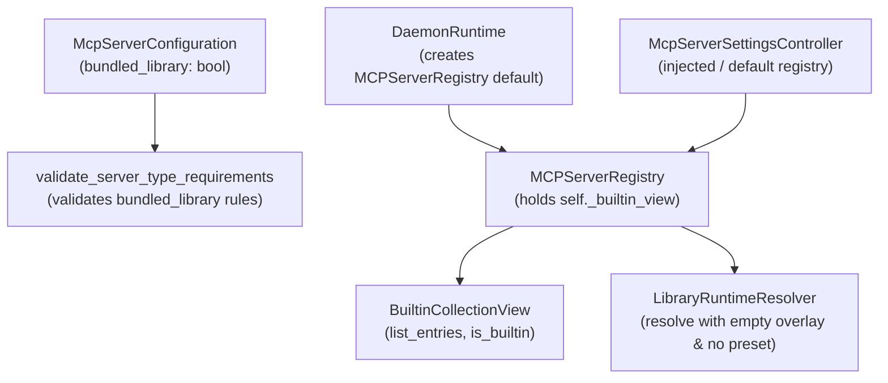

# PYPOST-1351: Built-in identity in MCP server configuration and startup

## Research

### Current State and Problem
In epic PYPOST-1335, PyPost introduces the ability to configure local MCP servers pointing to
curated "Built-in" collections (such as Jira MCP, GitLab MCP, and GitHub MCP) shipped directly with
PyPost.
As established in `ai-tasks/PYPOST-1336/20-architecture.md` (decision e) and
`ai-tasks/PYPOST-1335/decomposition.md` (Child task C3a):
1. Persisted identity:
   - A Built-in server is a local server that uses the library identity model:
     `library_id = "pypost-examples"`, `manifest_id = "pypost-examples"`, and
     `library_collection_path` (e.g., `"collections/jira_mcp.json"`).
   - In addition, it carries `bundled_library: bool = True` on `McpServerConfiguration`.
2. Model validation:
   - `McpServerConfiguration.validate_server_type_requirements` in `pypost/models/settings.py`
     currently validates `server_type == "proxy"` and `server_type == "local"`.
     When `library_id` is set, `manifest_id` and `library_collection_path` are required.
     However, it lacks awareness of `bundled_library`. If `bundled_library` is `True`,
     `library_id` must strictly equal `"pypost-examples"`. If `library_id` is not set,
     `bundled_library: True` must be rejected with `"bundled_library requires library_id"`.
   - Missing fields in JSON or kwargs must default `bundled_library` to `False`.
3. Startup and resolution:
   - `MCPServerRegistry.__init__` in `pypost/core/mcp_server_registry.py` accepts an optional
     external `library_service` (used by interactive sessions for user-connected libraries).
     In headless mode (`pypost/core/qt/daemon_runtime.py:125-130`), `library_service` is `None`.
   - `MCPServerRegistry._runtime_inputs` routes any configuration with `library_id` through
     `LibraryRuntimeResolver` using `self.library_service`.
   - If `self.library_service` is `None` (headless mode) or a user-connected library has ID
     `"pypost-examples"`, resolution fails or shadows the shipped collection.
   - Furthermore, `LibraryRuntimeResolver` allows presets and overlays to override environment
     variables. For Built-in servers, requirement AC3 dictates that variables come exclusively
     from manifest defaults and the selected workspace environment, completely isolated from
     library presets or overlays.
4. Curated view membership:
   - Built-in collections are defined exclusively by `BuiltinCollectionView` (backed by
     `examples/builtin-collections.yaml`).
   - A configuration with `bundled_library = True` pointing to an uncurated collection (such as
     `collections/mcp.json`, which exists on disk in `pypost-library.yaml` but is excluded from
     `builtin-collections.yaml`) must be loadable in settings, but must fail to start with the
     diagnostic `"missing built-in collection"`.
5. Construction points:
   - `McpServerSettingsController.__init__` in `pypost/ui/mcp_server_controller.py` and
     `DaemonRuntime._start_services` in `pypost/core/qt/daemon_runtime.py` instantiate or inject
     `MCPServerRegistry`. Since `MCPServerRegistry` initializes its internal bundled adapter by
     default, no signature changes or custom wiring are needed at these call sites.

## Implementation Plan

### High-Level Plan
1. **Extend Settings Model (`pypost/models/settings.py`)**:
   - Add field `bundled_library: bool = False` to `McpServerConfiguration`.
   - Update `validate_server_type_requirements(self)`:
     - For `proxy`: unchanged.
     - For `local`:
       - If `self.library_id`:
         - Enforce `self.manifest_id` and `self.library_collection_path`.
         - Ignore `self.collection_id`.
         - If `self.bundled_library` is `True`: enforce `self.library_id == "pypost-examples"`,
           raising `ValueError("bundled_library requires library_id 'pypost-examples'")` otherwise.
       - If `self.library_id` is NOT set:
         - Enforce `self.collection_id`.
         - If `self.bundled_library` is `True`: raise
           `ValueError("bundled_library requires library_id")`.
2. **Update Registry Initialization (`pypost/core/mcp_server_registry.py`)**:
   - In `MCPServerRegistry.__init__`, accept optional
     `builtin_view: BuiltinCollectionView | None = None`.
   - If not provided, instantiate `self._builtin_view = BuiltinCollectionView()`.
   - This makes the bundled adapter self-contained and always available, even when `library_service`
     is `None`.
3. **Update Registry Startup Resolution (`pypost/core/mcp_server_registry.py`)**:
   - In `_runtime_inputs(self, configuration: McpServerConfiguration)`:
     - If `configuration.bundled_library` is `True`:
       - View membership check: query `self._builtin_view.list_entries()`. If
         `configuration.library_collection_path` is not in `[e.collection_path for e in entries]`:
         return `None` (server cannot start).
       - Connection resolution: bypass `self.library_service.get_connection("pypost-examples")`.
         Instead, create or use a direct resolution path using the bundled predefined library
         record from `self._builtin_view._predefined` (via an adapter or specialized service).
       - Overlay and preset isolation: resolve runtime inputs passing `candidate_overlay={}`
         (or empty overlay object) and ensure no preset overrides workspace environment variables.
   - In `_missing_reference(self, configuration: McpServerConfiguration)`:
     - If `configuration.bundled_library` is `True`: return `"built-in collection"`.
       When combined with the caller's `"references a missing {self._missing_reference(cfg)}"`,
       or status message, ensure the diagnostic surfaces `"missing built-in collection"`.
4. **Verify Construction Points**:
   - Verify `DaemonRuntime` starts enabled built-in servers without `mcp_failed`.
   - Verify `McpServerSettingsController` loads and starts built-in servers with an injected
     registry without changes.

### Mandatory — Failing Repro Design (Step 3)
In Step 3, write an automated failing reproduction test file `tests/test_mcp_builtin_startup.py`
asserting all requirements prior to production code changes.

- **Test Suite Path**: `tests/test_mcp_builtin_startup.py`
- **Pytest Marker**: `@pytest.mark.timeout(30)`
- **Failing Repro Assertions**:
  1. `test_model_validation_bundled_library_flag`:
     - Assert `McpServerConfiguration(..., bundled_library=True, library_id="pypost-examples", ...)`
       instantiates successfully with `bundled_library is True`.
     - Fails on unmodified code because `bundled_library` is not defined on `McpServerConfiguration`
       or validation is not present.
  2. `test_model_validation_rejects_invalid_bundled_library_combinations`:
     - Assert setting `bundled_library=True` with `library_id="other-lib"` raises `ValueError`
       with message `"bundled_library requires library_id 'pypost-examples'"`.
     - Assert setting `bundled_library=True` with no `library_id` (workspace row) raises
       `ValueError` with message `"bundled_library requires library_id"`.
     - Assert omitting `bundled_library` defaults to `False`.
     - Assert legacy rows with both `library_id` and `collection_id` validate successfully.
  3. `test_registry_starts_builtin_server_and_exposes_tools`:
     - Configure an enabled `bundled_library=True` server pointing to
       `collections/jira_mcp.json`.
     - Start registry; verify server transitions to `"running"` and tools match the shipped
       collection requests.
  4. `test_builtin_server_auto_updates_when_shipped_bundle_changes`:
     - Test with a mock/isolated `BuiltinCollectionView` or bundle root where collection tools
       are updated; verify on subsequent start the tools reflect the new definition without settings
       changes.
  5. `test_builtin_server_isolated_from_user_library_shadowing_preset_and_overlay`:
     - Inject a `library_service` that has a registered library `"pypost-examples"` with a preset
       or overlay that overrides variable values.
     - Verify the Built-in server resolves variables strictly from the workspace environment and
       manifest defaults, ignoring the user library's overlay and presets.
  6. `test_registry_rejects_non_view_entries_with_missing_builtin_collection`:
     - Configure a `bundled_library=True` server pointing to `collections/mcp.json` (which exists
       in `pypost-library.yaml` but is not in `builtin-collections.yaml`).
     - Verify it fails to start and diagnostic reports `"missing built-in collection"`.
     - Configure an unknown path `collections/unknown.json`; verify start fails with
       `"missing built-in collection"`.
  7. `test_daemon_runtime_starts_builtin_server_without_library_service`:
     - Construct `DaemonRuntime` with an enabled built-in server row and a valid workspace
       environment.
     - Verify `DaemonRuntime` starts successfully without emitting `mcp_failed`.
  8. `test_mcp_server_settings_controller_with_injected_registry` (covering AC 7):
     - Construct `McpServerSettingsController` injecting an `MCPServerRegistry` populated with
       enabled built-in and workspace server configurations.
     - Verify controller loads server rows, reports status via the injected registry, and
       starts built-in servers without wiring failures.
  9. `test_runtime_regression_workspace_and_normal_library_servers` (covering AC 5):
     - Configure an ordinary workspace server row (`collection_id="coll-1"`, no `library_id`,
       `bundled_library=False`).
     - Configure a normal user-connected library server row (`library_id="custom-lib"`,
       `manifest_id="custom-lib"`, `bundled_library=False`).
     - Configure a legacy library server row having both `library_id="custom-lib"` and a stale
       `collection_id="stale-id"`.
     - Assert registry loads and starts all three servers without regressions, resolving tools
       and environments according to existing workspace and library resolution rules.

Sequencing:
- Step 3: Create `tests/test_mcp_builtin_startup.py` asserting these behaviors. Run `make test` to
  observe RED failures specifically on the new functionality.
- Step 4: Implement changes in `pypost/models/settings.py` and `pypost/core/mcp_server_registry.py`
  until all tests turn GREEN.

## Architecture

### Module Structure and Interactions



### Component Responsibilities

1. `pypost/models/settings.py`:
   - `McpServerConfiguration`:
     - Field `bundled_library: bool = False`.
     - Validator `validate_server_type_requirements`:
       - Proxy validation: must have non-empty `upstream_url`.
       - Local validation:
         - When `library_id` is set:
           - requires `manifest_id` and `library_collection_path`.
           - `collection_id` ignored.
           - if `bundled_library is True`: requires `library_id == "pypost-examples"`,
             else raises `ValueError("bundled_library requires library_id 'pypost-examples'")`.
         - When `library_id` is not set:
           - requires non-empty `collection_id`.
           - if `bundled_library is True`: raises
             `ValueError("bundled_library requires library_id")`.
2. `pypost/core/mcp_server_registry.py`:
   - `_BundledLibraryAdapter`:
     - Private adapter class implementing the minimal library service interface required by
       `LibraryRuntimeResolver` (`get_connection(library_id)` and `resolve_path(record)`).
     - Backed by `PredefinedLibraryService` / `BuiltinCollectionView`.
     - `get_connection(library_id: str) -> LibraryConnectionRecord | None`: returns the
       authoritative record from `self._predefined.discover()` when
       `library_id == PredefinedLibraryService.DEFAULT_LIBRARY_ID` (`"pypost-examples"`),
       otherwise `None`.
     - `resolve_path(record: LibraryConnectionRecord) -> Path | None`: returns `record.local_path`.
     - Exposes `overlay_manager = None` so `LibraryRuntimeResolver` does not query any external
       stored overlay manager.
   - `MCPServerRegistry.__init__`:
     - Receives optional `builtin_view: BuiltinCollectionView | None = None`.
     - Defaults to `self._builtin_view = builtin_view or BuiltinCollectionView()`.
     - Instantiates `self._bundled_adapter = _BundledLibraryAdapter(self._builtin_view)`.
   - `_runtime_inputs(self, configuration: McpServerConfiguration)`
     `-> tuple[list, dict[str, str], set[str], set[str]] | None`:
     - For `bundled_library=True` rows:
       1. View membership check: verify `configuration.library_collection_path` is present among
          `{entry.collection_path for entry in self._builtin_view.list_entries()}`. If not,
          return `None`.
       2. Bundled library connection: resolve through `self._bundled_adapter`, ensuring user
          libraries registered in `self.library_service` never shadow `"pypost-examples"`.
       3. Environment resolution: instantiate `LibraryRuntimeResolver` passing
          `library_service=self._bundled_adapter` and
          `environment_lookup=self._environment_lookup`.
          Invoke `resolver.resolve`:
          - `selection=configuration.library_selection`
          - `environment_id=configuration.environment_id`
          - `candidate_overlay=LocalLibraryOverlay(library_id="pypost-examples")`
          Passing an empty `LocalLibraryOverlay()` and ensuring `environment_id` selects the
          workspace environment guarantees no preset or stored user overlay overrides workspace
          variables.
   - `_missing_reference(self, configuration: McpServerConfiguration) -> str`:
     - If `configuration.bundled_library` is `True`: return `"built-in collection"`.
       When combined with caller status messages:
       `f"{instance_id} cannot start: missing {missing} for port {configuration.port}"`,
       surfaces `"cannot start: missing built-in collection"`.
3. `pypost/ui/mcp_server_controller.py` & `pypost/core/qt/daemon_runtime.py`:
   - No modifications required. Both components instantiate or receive `MCPServerRegistry`
     which automatically encapsulates `self._builtin_view` and `self._bundled_adapter`.

### Detailed Interfaces

```python
# pypost/models/settings.py
class McpServerConfiguration(BaseModel):
    ...
    bundled_library: bool = False
    ...
    @model_validator(mode="after")
    def validate_server_type_requirements(self) -> "McpServerConfiguration":
        if self.server_type == "proxy":
            if not self.upstream_url or not self.upstream_url.strip():
                raise ValueError("Proxy MCP server requires a non-empty upstream_url")
        elif self.server_type == "local":
            if self.library_id:
                required = (self.manifest_id, self.library_collection_path)
                if not all(value and str(value).strip() for value in required):
                    raise ValueError(
                        "Library MCP server requires manifest and collection identity"
                    )
                if self.bundled_library and self.library_id != "pypost-examples":
                    raise ValueError(
                        "bundled_library requires library_id 'pypost-examples'"
                    )
            elif self.bundled_library:
                raise ValueError("bundled_library requires library_id")
            elif not self.collection_id or not self.collection_id.strip():
                raise ValueError("Local MCP server requires a non-empty collection_id")
        return self

# pypost/core/mcp_server_registry.py
class _BundledLibraryAdapter:
    """Minimal library service adapter exposing the authoritative shipped bundle."""

    def __init__(self, builtin_view: BuiltinCollectionView) -> None:
        self._view = builtin_view
        self._predefined = builtin_view._predefined
        self.overlay_manager = None

    def get_connection(self, library_id: str) -> LibraryConnectionRecord | None:
        if library_id != PredefinedLibraryService.DEFAULT_LIBRARY_ID:
            return None
        return self._predefined.discover()

    def resolve_path(self, record: LibraryConnectionRecord) -> Path | None:
        return Path(record.local_path) if record.local_path else None


class MCPServerRegistry(QObject):
    def __init__(
        self,
        *,
        collection_lookup: Callable[[str], Collection | None] | None = None,
        environment_lookup: Callable[[str], Environment | None] | None = None,
        metrics: MetricsTrackerProtocol | None = None,
        template_service: TemplateService | None = None,
        library_service=None,
        builtin_view: BuiltinCollectionView | None = None,
    ) -> None:
        ...
        self._builtin_view = builtin_view or BuiltinCollectionView()
        self._bundled_adapter = _BundledLibraryAdapter(self._builtin_view)

    def _runtime_inputs(
        self, configuration: McpServerConfiguration
    ) -> tuple[list, dict[str, str], set[str], set[str]] | None:
        if configuration.server_type == "proxy":
            ...
        if configuration.library_id:
            from pypost.core.library_runtime_resolver import LibraryRuntimeResolver
            from pypost.models.library_manifest import LocalLibraryOverlay

            selection = configuration.library_selection
            if selection is None:
                return None

            if configuration.bundled_library:
                curated_paths = {
                    entry.collection_path for entry in self._builtin_view.list_entries()
                }
                if configuration.library_collection_path not in curated_paths:
                    return None
                service = self._bundled_adapter
                candidate_overlay = LocalLibraryOverlay(
                    library_id=PredefinedLibraryService.DEFAULT_LIBRARY_ID
                )
            else:
                service = self.library_service
                candidate_overlay = None

            try:
                runtime = LibraryRuntimeResolver(
                    library_service=service,
                    environment_lookup=self._environment_lookup,
                ).resolve(
                    selection,
                    environment_id=configuration.environment_id,
                    candidate_overlay=candidate_overlay,
                )
            except ValueError:
                return None
            return (
                runtime.collection_requests,
                runtime.environment,
                runtime.hidden_keys,
                runtime.overridable_keys,
            )
        ...

    def _missing_reference(self, configuration: McpServerConfiguration) -> str:
        if configuration.server_type == "proxy":
            return "environment"
        if configuration.bundled_library:
            return "built-in collection"
        if configuration.library_id:
            return "library, manifest, collection, or profile"
        if (
            not configuration.collection_id
            or self._collection_lookup(configuration.collection_id) is None
        ):
            return "collection"
        return "environment"
```

## Q&A

- **Q: Why should `MCPServerRegistry` own its `BuiltinCollectionView` instance?**
  A: Because both interactive sessions and daemon runtime must resolve built-in collections
  identically without requiring `library_service` or manual injection at every construction site.
- **Q: How does `_runtime_inputs` ensure that user presets do not overwrite environment variables?**
  A: For `bundled_library` rows, `LibraryRuntimeResolver.resolve` is called with an empty overlay
  and without any preset reference. Therefore, only the workspace environment variables and manifest
  defaults are used.
- **Q: Why does `collections/mcp.json` fail start even though it exists in `pypost-library.yaml`?**
  A: Because `collections/mcp.json` is a synthetic fixture excluded from `builtin-collections.yaml`.
  Checking view membership in `_runtime_inputs` ensures only curated entries can be served.
