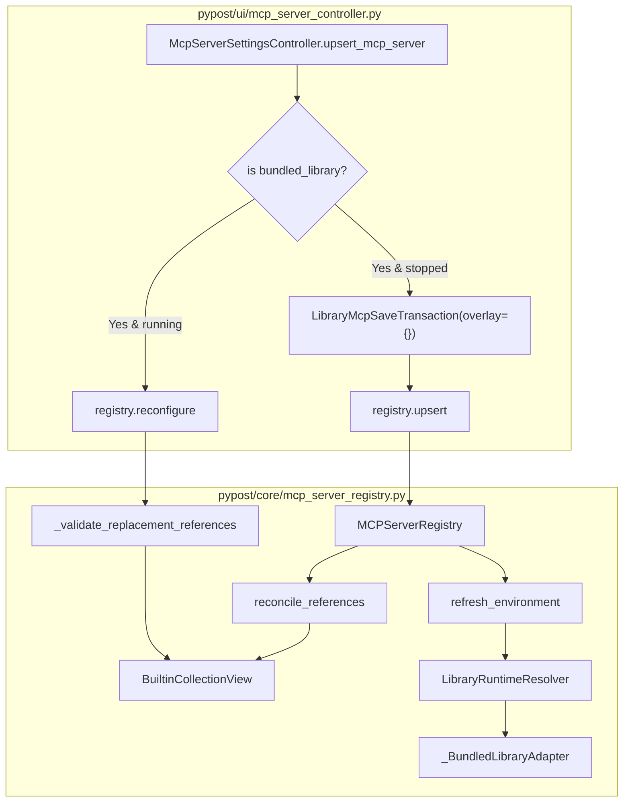

# PYPOST-1352: Built-in rows in MCP registry lifecycle and controller save

## Research

### Current State and Problem
In epic PYPOST-1335, child task PYPOST-1351 (C3a) established the persisted identity and startup
resolution for Built-in MCP servers:
- Persisted identity: `bundled_library: bool = True`, `library_id = "pypost-examples"`,
  `manifest_id = "pypost-examples"`, and `library_collection_path` (e.g.
  `"collections/jira_mcp.json"`).
- Startup resolution: `MCPServerRegistry._runtime_inputs` recognizes `bundled_library=True` and
  resolves runtime inputs through `self._bundled_adapter` and `LibraryRuntimeResolver` with an
  empty candidate overlay and no preset.

However, as identified in `ai-tasks/PYPOST-1336/20-architecture.md` (decision c, e, child task C3b)
and requirements in `ai-tasks/PYPOST-1352/10-requirements.md`:
1. `MCPServerRegistry.reconcile_references`:
   - Currently, for local servers (`server_type == "local"`), it validates `collection_id` against
     `valid_collection_ids` (or `_collection_lookup`). For Built-in rows, `collection_id` is
     `None`! Consequently, running Built-in servers are incorrectly stopped and marked
     `"cannot run: missing collection"` whenever workspace collections are updated or dialogs like
     Environment Manager close.
   - For Built-in rows (`configuration.bundled_library=True`), the collection reference is not in
     workspace collections; instead, validity requires that `configuration.library_collection_path`
     is present in `self._builtin_view.list_entries()`, and that `configuration.environment_id` is
     present in `valid_environment_ids` (or `_environment_lookup`). If the environment is absent or
     deleted, the server must stop with `"cannot run: missing environment"`. Changes to
     `valid_collection_ids` must have zero effect on running Built-in servers.
2. `MCPServerRegistry._validate_replacement_references`:
   - During `reconfigure(instance_id, configuration)`, it checks `configuration.collection_id`.
     Because Built-in rows have `collection_id=None`, reconfiguring a running Built-in server
     (e.g., port or host change) raises `ValueError("references a missing collection")`.
   - For `configuration.bundled_library=True`, `_validate_replacement_references` must verify that
     `configuration.library_collection_path` is present among curated entries in
     `self._builtin_view.list_entries()` and that `configuration.environment_id` resolves in
     `_environment_lookup`. It must never check `_collection_lookup` or require `collection_id`.
3. `MCPServerRegistry.refresh_environment(environment_id: str)`:
   - When an environment changes, `refresh_environment` replaces variable, hidden keys, and
     overridable keys suppliers with raw `environment.variables`. For Built-in servers, this drops
     manifest defaults for keys that the environment does not explicitly define.
   - For Built-in servers selecting `environment_id`, `refresh_environment` must re-invoke
     `LibraryRuntimeResolver` using `self._bundled_adapter`, `candidate_overlay` with an empty
     `LocalLibraryOverlay("pypost-examples")`, and updated `environment_id`, rebuilding the full
     snapshot with manifest defaults preserved.
4. `McpServerSettingsController.upsert_mcp_server(configuration)`:
   - Currently, `upsert_mcp_server` checks `if configuration.library_id:` and routes to
     `save_library_server`. In `save_library_server`, resolution goes through
     `self.registry.library_service` (which a user-connected clone with ID `pypost-examples` would
     shadow), builds an overlay candidate via `self._overlay_candidate`, and writes overlay files
     to disk via `LibraryMcpSaveTransaction`.
   - A dedicated `if configuration.bundled_library:` branch must precede the generic
     `if configuration.library_id:` branch.
   - The Built-in branch must:
     - Verify curated view membership: check that `configuration.library_collection_path` is in
       `{e.collection_path for e in self.registry._builtin_view.list_entries()}`. If uncurated,
       raise `ValueError("builtin_invalid: uncurated built-in collection path")`.
     - Resolve via `LibraryRuntimeResolver` using `self.registry._bundled_adapter` and
       `candidate_overlay=LocalLibraryOverlay("pypost-examples")`.
     - If the row is currently running, perform transactional replacement via
       `self.registry.reconfigure(configuration.id, configuration)`.
     - If stopped or new, execute checked save using `LibraryMcpSaveTransaction(store=store, ...)`
       with `overlay={}`. Since `overlay={}`, `ConfigManagerSettingsStore.commit` writes no overlay!
     - Roll back settings and registry state on failure.

## Implementation Plan

### High-Level Plan
1. **Registry Lifecycle Updates (`pypost/core/mcp_server_registry.py`)**:
   - `reconcile_references(valid_collection_ids, valid_environment_ids)`:
     - Add branch for `configuration.bundled_library`:
       - Check `configuration.library_collection_path` against curated entries
         `{e.collection_path for e in self._builtin_view.list_entries()}`.
       - Check `configuration.environment_id` against `valid_environment_ids` (or
         `_environment_lookup`).
       - If environment is missing, stop instance and set failed status:
         `"{instance_id} cannot run: missing environment for port {port}"`.
       - If collection entry is missing, stop instance and set failed status:
         `"{instance_id} cannot run: missing built-in collection for port {port}"`.
       - Never evaluate `valid_collection_ids` or `_collection_lookup` for Built-in rows.
   - `_validate_replacement_references(instance_id, configuration)`:
     - If `configuration.bundled_library`:
       - Ensure `configuration.library_collection_path` is in
         `{e.collection_path for e in self._builtin_view.list_entries()}`. Else raise
         `ValueError(f"MCP server {instance_id} references a missing built-in collection")`.
       - Ensure `configuration.environment_id` resolves in `_environment_lookup`. Else raise
         `ValueError(f"MCP server {instance_id} references a missing environment")`.
     - Else: retain existing logic for workspace rows and ordinary library rows.
   - `refresh_environment(environment_id: str)`:
     - Partition instances selecting `environment_id` into Built-in rows and other rows.
     - For Built-in rows:
       - Run `LibraryRuntimeResolver` with `self._bundled_adapter`, empty candidate overlay
         `LocalLibraryOverlay("pypost-examples")`, and `environment_id`.
       - Update the running manager's variable supplier, hidden keys supplier, and overridable
         keys supplier using the resolved runtime values (which preserve manifest defaults).
     - For ordinary rows: retain existing direct environment variable replacement.

2. **Controller Save Updates (`pypost/ui/mcp_server_controller.py`)**:
   - In `upsert_mcp_server(configuration: McpServerConfiguration)`:
     - Add branch `if configuration.bundled_library:` before `if configuration.library_id:`.
     - Validate view membership: check that `configuration.library_collection_path` is in
       `{e.collection_path for e in self.registry._builtin_view.list_entries()}`. If not in view,
       raise `ValueError(f"builtin_invalid: uncurated built-in collection path '{path}'")`.
     - Resolve candidate using `LibraryRuntimeResolver` with `self.registry._bundled_adapter`
       and `candidate_overlay=LocalLibraryOverlay("pypost-examples")`.
     - If row exists and is running:
       Call `self.registry.reconfigure(configuration.id, configuration)` and return.
     - If stopped or new:
       - Prepare candidate `AppSettings` with updated `mcp_servers`.
       - Execute `LibraryMcpSaveTransaction(store=store, ..., overlay={})`.
       - On commit success, call `self.registry.upsert(configuration)`.
       - Roll back store and registry snapshot if `registry.upsert` raises.

### Mandatory — Failing Repro Design (Step 3)
In Step 3, write an automated failing test suite in `tests/test_mcp_builtin_lifecycle.py`
asserting all requirements prior to production code changes.

- **Test Suite Path**: `tests/test_mcp_builtin_lifecycle.py`
- **Pytest Marker**: `@pytest.mark.timeout(30)`
- **Failing Repro Assertions**:
  1. `test_builtin_server_survives_reconcile_references`:
     - Configure and start a `bundled_library=True` server with a valid workspace environment.
     - Call `reconcile_references(valid_collection_ids=set())` (empty collection set).
     - Call `reconcile_references(valid_collection_ids={"other-id"})`.
     - Assert server remains in `"running"` state with no error status.
     - Fails on unmodified code because `configuration.collection_id is None` causes it to stop as
       missing collection.
  2. `test_builtin_server_stops_on_environment_deletion`:
     - Configure and start a `bundled_library=True` server.
     - Call `reconcile_references(valid_environment_ids=set())`.
     - Assert server stops and status message contains `"missing environment"`.
  3. `test_builtin_server_reconfigure_running_row`:
     - Start a running `bundled_library=True` server on port A.
     - Call `reconfigure` with updated port B or modified name/host.
     - Assert reconfigure completes successfully, previous manager is replaced smoothly, and
       status remains `"running"`.
     - Fails on unmodified code because `_validate_replacement_references` rejects missing
       `collection_id`.
  4. `test_builtin_server_refresh_environment_preserves_manifest_defaults`:
     - Start a `bundled_library=True` server for Jira MCP where the environment defines only
       `jira_base_url` but omits other keys that have manifest defaults (e.g. `jira_project_key`).
     - Update environment variables and call `refresh_environment`.
     - Assert manager variable supplier returns manifest defaults for omitted keys.
     - Fails on unmodified code because `refresh_environment` replaces variables with raw
       `environment.variables`.
  5. `test_controller_upsert_builtin_server_isolated_from_connected_clone`:
     - Register a user library named `"pypost-examples"` in `library_service` with conflicting tool
       definitions or custom overlays.
     - Call `controller.upsert_mcp_server` with a `bundled_library=True` configuration.
     - Assert validation and resolution use the bundled adapter, not the user library.
  6. `test_controller_upsert_builtin_server_never_touches_overlay_file`:
     - Track overlay store/files before calling `controller.upsert_mcp_server`.
     - Upsert a `bundled_library=True` configuration.
     - Assert no overlay file is created or modified in storage (`overlay={}`).
  7. `test_controller_upsert_builtin_server_rejects_uncurated_path`:
     - Attempt to save a `bundled_library=True` server pointing to `collections/mcp.json` or
       an invalid collection path.
     - Assert `ValueError` is raised with message starting with `"builtin_invalid:"`.
  8. `test_ordinary_library_and_workspace_rows_regression`:
     - Upsert and reconcile an ordinary workspace row and an ordinary library row.
     - Verify workspace row reconciles against `valid_collection_ids` and ordinary library save
       flows continue to function without regressions.

Sequencing:
- Step 3: Implement `tests/test_mcp_builtin_lifecycle.py` asserting these 8 cases. Run `make test`
  and confirm red failures on new lifecycle/save requirements.
- Step 4: Implement changes in `pypost/core/mcp_server_registry.py` and
  `pypost/ui/mcp_server_controller.py` until all tests pass green.

## Architecture

### Module Structure and Interactions



### Component Responsibilities

1. `pypost/core/mcp_server_registry.py`:
   - `reconcile_references(valid_collection_ids, valid_environment_ids) -> bool`:
     - Evaluates active server instances.
     - For `configuration.bundled_library`:
       - Checks curated entry existence via `self._builtin_view.list_entries()`.
       - Checks environment presence via `valid_environment_ids` or `self._environment_lookup`.
       - If environment is missing: stops instance, sets state to failed with
         `"{instance_id} cannot run: missing environment for port {port}"`.
       - If curated collection is missing: stops instance, sets state to failed with
         `"{instance_id} cannot run: missing built-in collection for port {port}"`.
       - Completely skips workspace collection validation (`valid_collection_ids`).
   - `_validate_replacement_references(instance_id, configuration)`:
     - For `configuration.bundled_library`:
       - Validates `configuration.library_collection_path` is in
         `{e.collection_path for e in self._builtin_view.list_entries()}`.
       - Validates `configuration.environment_id` in `self._environment_lookup`.
       - Ignores `collection_id` and `self._collection_lookup`.
   - `refresh_environment(environment_id: str)`:
     - For instances selecting `environment_id`:
       - If `configuration.bundled_library`:
         - Uses `LibraryRuntimeResolver` with `self._bundled_adapter` and
           `LocalLibraryOverlay("pypost-examples")` to compute resolved variables, hidden keys,
           and overridable keys.
         - Updates manager variable suppliers with the resolved dictionaries, ensuring manifest
           defaults remain populated.
       - If non-bundled: replaces variables directly from `environment.variables`.

2. `pypost/ui/mcp_server_controller.py`:
   - `upsert_mcp_server(configuration: McpServerConfiguration) -> None`:
     - Checks `if configuration.bundled_library:` before generic `library_id` handling.
     - Curated collection verification:
       - Asserts `configuration.library_collection_path` is in
         `{e.collection_path for e in self.registry._builtin_view.list_entries()}`.
       - Raises `ValueError("builtin_invalid: uncurated built-in collection path")` if invalid.
     - Candidate preflight:
       - Invokes `LibraryRuntimeResolver` with `self.registry._bundled_adapter` and empty overlay
         `LocalLibraryOverlay("pypost-examples")`.
     - Persistence:
       - For running rows: delegates to `self.registry.reconfigure(configuration.id, configuration)`
         for hitless manager replacement.
       - For stopped or new rows: uses `LibraryMcpSaveTransaction(store=store, ..., overlay={})`.
         Guarantees `overlay={}` so no overlay file is written.
       - Installs in registry via `self.registry.upsert(configuration)`.
       - Atomic rollback: restores previous settings and registry snapshot on failure.

### Detailed Interfaces

```python
# pypost/core/mcp_server_registry.py
class MCPServerRegistry(QObject):
    ...
    def reconcile_references(
        self,
        valid_collection_ids: set[str] | None = None,
        valid_environment_ids: set[str] | None = None,
    ) -> bool:
        changed = False
        curated_paths = {entry.collection_path for entry in self._builtin_view.list_entries()}
        for instance_id, configuration in self._configurations.items():
            if configuration.server_type == "proxy":
                ...  # proxy logic unchanged
            elif configuration.bundled_library:
                if valid_environment_ids is not None:
                    env_valid = (
                        not configuration.environment_id
                        or configuration.environment_id in valid_environment_ids
                    )
                else:
                    env = (
                        self._environment_lookup(configuration.environment_id)
                        if configuration.environment_id
                        else None
                    )
                    env_valid = not configuration.environment_id or env is not None

                coll_valid = configuration.library_collection_path in curated_paths
                if coll_valid and env_valid:
                    continue
                self.stop(instance_id)
                missing = "built-in collection" if not coll_valid else "environment"
                self._set_status(
                    instance_id,
                    "failed",
                    f"{instance_id} cannot run: missing {missing} for port {configuration.port}",
                )
                changed = True
                continue
            else:
                # Ordinary local server logic unchanged
                ...
        return changed

    def _validate_replacement_references(
        self, instance_id: str, configuration: McpServerConfiguration
    ) -> None:
        if configuration.server_type == "local":
            if configuration.bundled_library:
                curated_paths = {
                    entry.collection_path for entry in self._builtin_view.list_entries()
                }
                if configuration.library_collection_path not in curated_paths:
                    raise ValueError(
                        f"MCP server {instance_id} references a missing built-in collection"
                    )
            elif (
                not configuration.collection_id
                or self._collection_lookup(configuration.collection_id) is None
            ):
                raise ValueError(f"MCP server {instance_id} references a missing collection")
        if (
            configuration.environment_id
            and self._environment_lookup(configuration.environment_id) is None
        ):
            raise ValueError(f"MCP server {instance_id} references a missing environment")

    def refresh_environment(self, environment_id: str) -> None:
        environment = self._environment_lookup(environment_id)
        instance_ids = tuple(
            instance_id
            for instance_id, configuration in self._configurations.items()
            if configuration.environment_id == environment_id
        )
        if environment is None:
            for instance_id in instance_ids:
                self._set_status(
                    instance_id,
                    "failed",
                    f"{instance_id} cannot refresh: missing environment for "
                    f"port {self._configuration(instance_id).port}",
                )
            return

        from pypost.core.library_runtime_resolver import LibraryRuntimeResolver
        from pypost.models.library_manifest import LocalLibraryOverlay
        from pypost.core.predefined_library import PredefinedLibraryService

        for instance_id in instance_ids:
            manager = self._managers.get(instance_id)
            if manager is None:
                continue
            configuration = self._configuration(instance_id)
            if configuration.bundled_library:
                selection = configuration.library_selection
                if selection is None:
                    continue
                try:
                    runtime = LibraryRuntimeResolver(
                        library_service=self._bundled_adapter,
                        environment_lookup=self._environment_lookup,
                    ).resolve(
                        selection,
                        environment_id=environment_id,
                        candidate_overlay=LocalLibraryOverlay(
                            library_id=PredefinedLibraryService.DEFAULT_LIBRARY_ID
                        ),
                    )
                except ValueError:
                    continue
                vars_dict = dict(runtime.environment)
                hidden_set = set(runtime.hidden_keys)
                overridable_set = set(runtime.overridable_keys)
            else:
                vars_dict = dict(environment.variables)
                hidden_set = set(environment.hidden_keys)
                overridable_set = set(environment.mcp_overridable_keys)

            manager.set_variable_supplier(lambda v=vars_dict: dict(v))
            manager.set_hidden_keys_supplier(lambda h=hidden_set: set(h))
            manager.set_overridable_keys_supplier(lambda o=overridable_set: set(o))
```

## Q&A

- **Q: Why must `bundled_library` be checked before `library_id` in `upsert_mcp_server`?**
  A: Because a Built-in configuration carries both `library_id = "pypost-examples"` and
  `bundled_library = True`. If routed through the generic `library_id` branch, it would invoke
  `save_library_server` which computes an overlay file on disk and resolves through
  `registry.library_service` (potentially shadowed by user libraries).
- **Q: Why must `overlay={}` be used in `LibraryMcpSaveTransaction` for Built-in servers?**
  A: Built-in collections are shipped immutable resources. When `overlay={}` is passed to
  `LibraryMcpSaveTransaction`, `ConfigManagerSettingsStore.commit` skips writing any overlay file,
  preserving read-only integrity.
- **Q: How does `refresh_environment` preserve manifest defaults for Built-in servers?**
  A: Rather than replacing the manager's variables directly with `environment.variables`, it
  re-resolves runtime variables through `LibraryRuntimeResolver` using the bundled adapter. This
  recombines catalog defaults with the updated environment variables.
- **Q: What happens if a running Built-in server's environment is deleted?**
  A: When `reconcile_references` is called with updated valid environment IDs, it detects that
  `configuration.environment_id` is missing, stops the server, and marks its status failed with
  `"{instance_id} cannot run: missing environment for port {port}"`.
