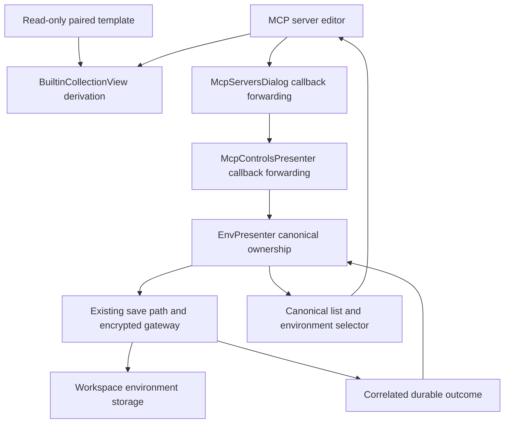

# PYPOST-1354: Editable copy of the paired environment for Built-in MCP servers

## Research

### Repository Evidence

- `BuiltinCollectionView.load_paired_environment` reads the manifest-paired template unchanged.
  Preserve this read-only loader; introduce a separate derivation helper instead of changing
  template-loading semantics for existing callers.
- `_McpServerEditor` receives an environment snapshot. `McpServersDialog` already receives a live
  `environments` supplier from `McpControlsPresenter._open_mcp_servers`.
- `EnvPresenter` constructs `McpControlsPresenter`, supplies its canonical `_environments`, and owns
  `_save_environments`. This is the composition point for injecting environment creation.
- `_save_environments` returns `False` after admission closes. Its `True` return means synchronous
  persistence completed when encryption is off, but only dispatch when encryption is on.
- `EnvironmentStorageGateway` deep-copies save snapshots. Its existing `save_outcome` associates
  update sequences with `persisted`, `failed`, or `incomplete`; a queued save can instead receive
  `coalesced_into_newer_save`. Dispatch or coalescing is not persistence acknowledgment.
- `StorageManager.save_environments` uses `EnvironmentVariablesAdapter`, including encryption,
  then replaces the workspace file atomically. Dialogs must not write files or construct a second
  storage manager, and saving a dialog-local list would risk dropping canonical environments.
- `Environment` currently has no origin field. `EnvironmentVariablesAdapter` uses
  `model_dump(mode="json")` for saving and passes decoded records into `Environment` for loading.
  A single optional model field can therefore preserve provenance without a sidecar or migration.
- PYPOST-1336 requires workspace-selected runtime variables and an optional template-copy action.
  No runtime variable-resolution or built-in collection editing change belongs to this task.

### Current Primary References and Application

Research checked on 2026-10-10 through web search and the linked official pages:

- [Qt for Python signals and slots][qt-signals] describes delivery in the receiver's thread with
  automatic or queued connections. Apply this to persistence outcome handling: publish canonical
  environments and update widgets on the GUI thread, never from a storage worker.
- [Pydantic serialization][pydantic-serialization] documents model dumping and JSON-compatible
  output. Apply this by declaring provenance as a model field and using the existing adapter;
  verify it survives actual save/reload rather than assuming arbitrary attributes are persisted.

[qt-signals]: https://doc.qt.io/qtforpython-6/tutorials/basictutorial/signals_and_slots.html
[pydantic-serialization]: https://docs.pydantic.dev/latest/concepts/serialization/

## Implementation Plan

1. Add optional `Environment.builtin_environment_path: str | None = None`. Existing workspace
   records load with `None`; this introduces no automatic legacy-origin inference or migration.
2. Add a pure derivation operation to `BuiltinCollectionView`, retaining the current loader.
   Read the selected entry's template, produce fresh ID/name and independent variable containers,
   clear hidden variable values, and set provenance to the validated entry's environment path.
3. Add `EnvPresenter.create_workspace_environment(candidate, completion) -> bool`. It owns
   admission, canonical collision rechecking, persistence, and publication. Inject this bound
   method into `McpControlsPresenter` where `EnvPresenter` already constructs that presenter.
4. Forward the callback through `McpControlsPresenter._open_mcp_servers` to `McpServersDialog`
   and each `_McpServerEditor`. Keep optional constructor defaults for existing callers, but disable
   copying when the callback is absent; manual selection remains available.
5. Add the copy button, pending state, outcome handling, and exact provenance highlighting.
   On successful persistence refresh from the live supplier and select the published ID. Future
   editors and the environment manager must see the same canonical object.
6. Exercise the normal, encrypted, rejected, and failed paths through controlled storage outcomes.
   Use existing storage/gateway interfaces; do not redesign request-update lifecycle tracking.

### Mandatory — Failing Repro (next Step 3)

Create `tests/test_mcp_builtin_paired_env.py` before production changes. Use temporary fixture
libraries and storage, existing Qt fixtures, and controlled gateway outcomes without Jira, network,
real credentials, or timing sleeps. Every test declares the required timeout. Run through
`make test PYTEST_ARGS='tests/test_mcp_builtin_paired_env.py'`; subsequent quality gates use
`make check` and `make verify-ai-tasks`.

The red repro asserts these desired outcomes:

- Derivation preserves all variable keys, hidden and MCP-overridable sets, non-secret defaults,
  and the template's `enable_mcp`. Hidden values become empty strings. Template object and file
  bytes stay unchanged. Repeated derivation produces distinct UUIDs and free display names.
- Copy visibility follows local/Built-in source selection. Missing callback disables the action;
  invoking the handler defensively still adds no candidate anywhere.
- With no exact provenance match the action is highlighted. Unrelated environments bearing an
  identical name or prefix do not suppress it. Renaming a derived copy does not restore it;
  save/reload retains this behavior. A marker for another paired path does not suppress it.
- A completion-controlled fake admits a copy but delays success. Before acknowledgment the old
  selection, canonical list, editor combo, and server-save eligibility stay unchanged. Completing
  with success publishes and selects the copy; a second editor and environment manager see it.
- Callback rejection, teardown, exception, storage failure, and incomplete completion publish no
  selectable ghost. Existing environment selection stays intact, the pending state ends, and one
  appropriate failure message appears. Retry can create and select a valid copy.
- Presenter integration verifies the actual callback wiring and storage reload, rather than only
  observing a mock invocation. The stored list includes every pre-existing canonical environment.
- Encrypted gateway tests delay the active copy save, dispatch an unrelated canonical update, then
  acknowledge the copy. Both stored snapshots retain the candidate and the unrelated update;
  canonical publication occurs once. On copy failure the queued snapshot is replaced without the
  candidate before dispatch, and later reload contains no failed copy.
- Busy-gateway admission is rejected safely, then retry succeeds once work drains. Copy save is
  never acknowledged by an unrelated earlier save or `coalesced_into_newer_save`.
- Saving a Built-in server with no selected environment remains blocked. Choosing any existing
  environment still works without copying. Changing source while pending cannot select the copy
  into an unrelated editor context; closing the editor prevents late widget access.

Sequence: research and reviewed architecture, red repro, independent repro review, implementation
until green, then the required repository gates. This step changes documentation only.

## Architecture



### Patterns and Ownership

- **Presenter ownership (existing MVP)**: `EnvPresenter` remains the sole owner of the canonical
  environment list and application selector. Publishing there prevents dialog-only environments
  and ensures later registry lookups, editors, and the environment manager share one state.
- **Callback dependency injection**: the composition point injects one narrow creation callback.
  MCP UI code depends on its admission/completion contract, not storage or a sibling presenter.
  Controlled completions make failure and delayed persistence independently testable.
- **Existing storage abstraction**: keep `StorageInterface`, the variables adapter, and the gateway.
  This retains atomic workspace writes and encrypted worker persistence without duplicate stores
  or a new repository abstraction. A small staged-copy state belongs to `EnvPresenter`.
- **Pure derivation**: separate template reading from copy construction to preserve current loader
  callers and make immutability, sanitization, naming, and provenance deterministic to test.

### Main Interfaces

```python
# Existing template-loading API remains unchanged.
BuiltinCollectionView.load_paired_environment(collection_path: str) -> Environment

# New pure operation; exact method name can follow existing project conventions.
BuiltinCollectionView.derive_paired_environment(
    collection_path: str, existing_environments: Sequence[Environment]
) -> Environment

# Forwarded unchanged through both MCP UI layers.
# completion receives (persisted_environment_or_none, user_safe_error_or_none).
CreateEnvironment = Callable[
    [Environment, Callable[[Environment | None, str | None], None]], bool
]
```

`True` means admitted, not necessarily persisted. The completion runs exactly once for an admitted
operation, synchronously or asynchronously. Only a non-null environment with no error denotes
success. `False` means rejection and no later completion. Exceptions before admission are handled
as failures by the editor. Production composition always supplies the callback; `None` is supported
only as unavailable capability for existing standalone callers.

### Persistence and Publication Contract

1. On the GUI thread, `EnvPresenter` rejects admission after teardown, during another copy, or when
   the existing storage gateway has active/pending work. The editor reports a retryable rejection;
   it does not treat a busy or missing persistence owner as successful creation.
2. Recheck candidate UUID and display-name collisions against the latest canonical list. Allocate
   another UUID if necessary and the first free name (base, then ` (2)`, ` (3)`, etc.). Stage only
   this candidate and completion separately; do not insert it into `_environments` or selectors.
3. Extend `_save_environments` narrowly to construct a snapshot from the latest canonical list
   plus the staged candidate, without mutating the canonical list. All saves during this operation
   include that candidate by ID exactly once, so background variable updates cannot drop it.
4. For unencrypted persistence, the existing synchronous save must finish successfully before
   publishing. A `False` admission result or exception discards staging and leaves selection intact.
5. For encrypted persistence, start through the existing gateway with a dedicated correlation
   token separate from request-update sequences (for example a reserved negative token space).
   Register completion before dispatch. Idle admission ensures this copy save becomes the active
   operation, so its token cannot be replaced by queued-save coalescing. Gateway return alone and
   `coalesced_into_newer_save` never authorize publication.
6. On this token's `persisted` outcome, append the candidate once to the current canonical list,
   preserve the application-wide active selection, and append it to the application selector.
   Clear staging, then invoke success. Do not replace the list with the old snapshot: unrelated
   edits made while persistence was pending remain authoritative. Queued saves already include
   the same candidate and preserve it after this acknowledgment.
7. On correlated `failed`/`incomplete`, discard staging and complete failure without adding the
   candidate. If a later snapshot was queued while staging existed, replace that queued snapshot
   through the existing save path with the latest canonical list, without the candidate, before
   the gateway starts the next worker. Existing gateway outcome delivery precedes pending-worker
   dispatch; preserve that ordering and test it. Do not undo other environments' updates.
8. Keep request-update disposition behavior intact. The gateway/presenter already reports async
   storage errors; consume copy completion for UI state without showing a second error dialog.
   Admission and template errors, which do not use that error path, get one editor message.
   Teardown completion clears state and never touches destroyed widgets.

This adds one operation's staging and callback correlation, not a general transaction framework.
No direct storage callback may bypass the presenter's admission, encryption, or latest-list rules.

### Provenance, Derivation, and UI Rules

- `builtin_environment_path` stores the exact validated manifest-relative `environment_path` from
  the selected `BuiltinCollectionEntry`. Its field name scopes the marker to the bundled library.
  Do not store an absolute installation path, a secret, or a display name as identity.
- Suppress highlighting iff a persisted canonical environment has this exact marker. Two entries
  sharing the same paired template legitimately match. Missing markers on legacy environments
  count as no known derivation; users can still select those environments manually.
- Rename and value edits retain provenance. Existing `model_copy(deep=True)` editing flows retain
  it, and the existing serialization adapter round-trips it. Test actual storage save/reload.
  No heuristics based on names, prefixes, variable values, or key overlap are used.
- Copy every template variable into independent containers. Empty values for keys in `hidden_keys`,
  retain both metadata sets and `enable_mcp`, allocate a fresh UUID, and set the provenance marker.
  Use the template name (entry name only if empty) and choose the first unoccupied numeric suffix.
- Show the button only for local Built-in source. Highlight it when the selected paired path has
  no exact known derivation, and refresh on source/entry changes and successful publication.
- While pending, disable repeated copy and prevent saving the server using that unfinished copy.
  Existing valid selections remain valid. Success reloads the live supplier, updates dialog
  lookups, selects the published ID, and refreshes highlight. Failure preserves the old selection.
- Capture the selected paired path for the operation. If the user changes source or entry while
  it persists, publish the saved environment but do not preselect it into the changed context.
  Disconnect or guard completion on editor destruction; persistence still has a presenter owner.

## Q&A

- **Why a new optional origin field?** Names are editable and non-unique evidence of derivation.
  A persisted exact template path survives rename and restart without a sidecar or legacy migration.
- **Why not call storage directly in the dialog?** The dialog has a snapshot, while `EnvPresenter`
  owns canonical environments, lifecycle admission, and encrypted persistence acknowledgment.
- **Why reject busy storage instead of queueing a copy immediately?** Existing gateway coalescing
  terminates queued sequence tracking before durable persistence. Idle admission keeps copy
  acknowledgment unambiguous with the current gateway and allows a simple safe retry.
- **Does copying change shipped files or require using the copy?** Templates stay read-only and
  byte-identical. Any existing workspace environment remains a valid manual alternative.
