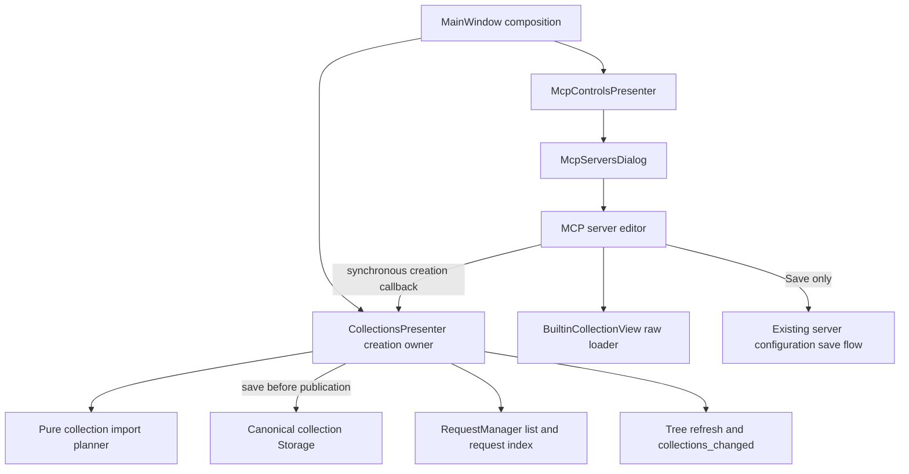

# PYPOST-1355: Copy a Built-in MCP collection for editing

## Research

The accepted [requirements](10-requirements.md) define a private workspace copy and defer
server reassociation until Save. The current editor already distinguishes Built-in and
Workspace configurations; its Workspace branch supplies a collection ID without bundled
or library association fields. `BuiltinCollectionView.load_collection` returns a fresh parsed
model and remains the raw loading API.

`CollectionsPresenter` owns the workspace tree and canonical `RequestManager`. MCP collection
lookup already uses `CollectionsPresenter.collection_by_id`. `RequestManager.find_request`
uses a global request-ID index: copying IDs unchanged repeatedly would shadow earlier copies.
The pure `plan_collection_import` already reserves request and WebSocket IDs. Its generic
conflict naming differs from the required `(copy)` naming, so supply an already unique name.
Its materialization copies presets shallowly; deep-copy the source before planning. Existing
library COPY materialization clears `library_link`, which is also required here.

Do not reuse `apply_imported_collections` for orchestration: it publishes the live list before
saving. `Storage.save_collection` is synchronous, writes directly to an ID-named JSON file,
and may leave a partial file on failure. This task needs save-before-publication and narrow
cleanup, not the encrypted asynchronous acknowledgement used by PYPOST-1354.

Current primary references checked on 2026-10-10:

- [Pydantic model copying](https://pydantic.dev/docs/validation/latest/concepts/models/):
  `model_copy(deep=True)` isolates nested models. Use it before changing identity or metadata.
- [Qt for Python signals and slots](https://doc.qt.io/qtforpython-6.11/tutorials/basictutorial/signals_and_slots.html):
  receiver thread affinity governs queued delivery. Keep this synchronous callback, tree
  publication, and editor selection on the existing GUI thread; introduce no worker or
  delayed completion for collection creation.

## Architecture

Use presenter ownership and dependency injection: the editor never writes files or maintains
a private collection registry. Reuse the pure import planner for identity reservation and
canonical manager methods for publication. Keep preparation/orchestration in a small cohesive
helper if presenter/module size caps require it; `CollectionsPresenter` remains the public owner.

### Interfaces and ownership

- Define a shared typed capability
  `CreateWorkspaceCollection = Callable[[Collection], Collection | None]`.
- Add `CollectionsPresenter.create_workspace_collection(source: Collection) -> Collection | None`.
  The source carries the curated display name and loaded contents. The owner always clones it;
  callers cannot choose the persisted identity or bypass collision checks.
- Add optional `create_collection=None` injection to `McpControlsPresenter`,
  `McpServersDialog`, and `_McpServerEditor`. A controls setter
  `set_collection_creator(callback)` supports existing MainWindow composition without routing
  collection ownership through `EnvPresenter`. MainWindow installs
  `self.collections.create_workspace_collection` before dialogs can open.
- Dialogs continue supplying the canonical collection provider. Pass that live provider to
  the editor as well as its initial choices, so a newly persisted copy can be selected by ID.
- A returned Collection means persistence and canonical publication completed. `None` means
  admission was rejected. A storage/preparation exception means failure; the editor displays
  one fixed safe error message. No callback or raw exception text enters configuration data.

### Canonical creation sequence

1. Reject creation after presenter teardown starts, during an active collection import, or
   while `CollectionsAsyncLoader.is_busy()` reports pending work. A narrow closing flag set
   at teardown entry prevents late calls. Do not run a nested event loop or wait for busy work.
2. Read the current canonical list. Deep-copy the supplied model, assign a fresh collection
   UUID, clear `library_link`, and allocate `name (copy)`, then `name (copy) (2)`, etc. against
   current workspace names. Reserve the UUID against existing IDs rather than relying only
   on probability. Preserve request payloads, variables, presets, descriptions, and versions.
3. Use `plan_collection_import(existing, [candidate])` with the already free name. Reuse its
   request/WebSocket collision reservation. Also reserve MCP client profile identities in
   this candidate if present: the planner currently deep-copies those profiles without ID
   reservation. This is a narrow copy preparation step, not a generic import rewrite. Content
   comparisons ignore identity changes; all copies remain independently editable.
4. Save only the prepared new collection through `RequestManager.storage.save_collection`.
   Until it returns successfully, leave manager collections, request index, tree, selector,
   server configuration, and shipped source untouched.
5. Publish the planned collection list via `RequestManager.apply_loaded_collections`, refresh
   the collection tree, restore tree state, and emit the established `collections_changed`
   signal. Its existing listeners refresh MCP tools and environment choices. Preserve the
   editor's selected environment while refreshing its own collection choices. Return the
   canonical new object, which is now resolvable through `collection_by_id` and `find_request`.

On save failure, the owner attempts `storage.delete_collection(new_id)` once, without
`collection_name`; this removes only the newly allocated file, including partial writes,
and cannot delete an unrelated legacy name-based file. Keep the original failure as the
operation outcome. Report a cleanup failure safely as a separate storage problem; do not
publish or switch the editor. A filesystem that also refuses cleanup cannot provide rollback
durability, so diagnostics must expose that limitation rather than claim atomic storage.
No broad storage transaction or existing save-path redesign is included.

### Editor behavior and configuration boundary

Show `Copy for editing` for local Built-in selection. Enable it only with a valid selected
entry and the injected capability. An absent capability disables the action without affecting
manual Workspace selection, Save, Cancel, proxy, or paired-environment behavior. Guard the
handler too, and suppress repeated clicks while synchronous creation is active.

Load the selected curated collection using the unchanged raw loader, deep-copy it to apply
the entry's display name, then call the capability. On rejection/failure retain the Built-in
selection and show a useful busy/failure message. On success switch source to Workspace,
refresh from the live provider, and select the returned ID after source-change handling has
reset choices. Show the visible note that workspace copies no longer receive shipped updates,
both before copying and after selecting the new copy in this editor session.

Copying changes editor state and workspace storage only. Save uses the existing configuration
construction/save flow: `collection_id=new_id`, `bundled=False`, no Built-in library/path
fields, with the selected environment preserved. Cancel retains the original server object
and association; for a new editor it creates no server. The already saved workspace copy
remains. No other server is reassociated. There is no delayed completion to arrive after
Cancel, source changes, or disposal.

## Implementation Plan

1. Write and independently review the automated red repro below before production changes.
2. Implement the typed synchronous owner, pure preparation, and narrow failure cleanup.
3. Inject the capability through composition/controls/dialog/editor and add the action/note.
4. Make the reviewed repro green, then run relevant regressions and `make check`. Preserve
   the existing raw loader API and follow module caps rather than expanding large presenters.

### Mandatory failing repro: Step 3

Create `tests/test_mcp_builtin_collection_copy.py` using existing headless Qt fixtures,
temporary curated Built-in files, real temporary `Storage`, `RequestManager`, and
`CollectionsPresenter`. No network, Jira, live server, encryption worker, or arbitrary sleeps.
Every GUI wait has an explicit finite timeout; every new test uses the repository timeout
policy. Assert desired behavior directly, never xfail or relax assertions to get green.

Cover these contracts with small tests or bounded parametrization:

- Action visibility/enabling for Built-in, Workspace, proxy, and absent capability; note
  visibility before and after copying; existing manual selection still works.
- Real callback success saves before publication, adds a visible editable tree item, selects
  its Workspace ID, and resolves through canonical collection lookup and request index.
- Two copies allocate distinct collection IDs/free `(copy)` names and collision-free request
  IDs. Rename/edit a request through `RequestManager` and reload storage to prove only the
  intended copy changed. Include existing workspace name/ID collisions and nested presets.
- Contents and request behavior match the source after normalizing identities. Deep mutation
  cannot alter either source or another copy; shipped files remain byte-identical. Include
  optional WebSocket/MCP profile identity independence in the pure preparation fixture.
- Cancel of an existing Built-in server preserves its complete configuration while the copy
  remains persisted; new-server Cancel creates no configuration. Save produces only the
  Workspace association, preserves environment selection, and leaves other servers unchanged.
- Injected rejection, busy import/load, teardown, loader exception, and storage failure leave
  no live/tree/selector ghost or server change. Simulate writing a partial candidate file then
  raising; assert ID-only cleanup, preservation of an unrelated legacy file, and successful
  retry. Separately assert safe diagnostics if cleanup itself fails.
- Exercise forwarding through controls/dialog and MainWindow composition so a direct editor
  fake alone cannot conceal missing canonical injection.

Run the red module with
`make test PYTEST_ARGS='tests/test_mcp_builtin_collection_copy.py -q'`, record actual failing
assertions, and obtain independent review before implementation. After green, run the paired
environment, MCP editor/configuration, collection import, and RequestManager regressions
through `make test`, followed by `make check`. Known full-suite baseline issues
PYPOST-1298/1299/1361/1362 remain separately classified; they do not replace task validation.

## Q&A

- **Why synchronous?** Collection JSON saving is synchronous today; success is available
  before returning. Reusing the encrypted environment acknowledgement machinery would add
  ownership and lifecycle complexity without a requirement.
- **Why not the complete library import service?** This action copies one already selected
  curated Built-in entry, requires its own naming and save boundary, and creates no link.
  Reuse compatible pure planning rather than unrelated discovery/UI/import orchestration.
- **Does copying detach or modify the current server immediately?** No. Only Save changes
  server configuration; Cancel preserves the Built-in association and keeps the workspace copy.
- **Are request IDs required to be identical?** No. Payload and behavior are identical;
  identity changes prevent the global request index from shadowing another editable copy.
