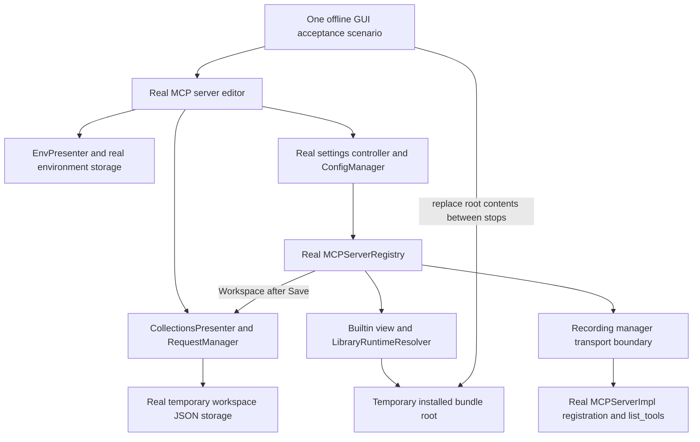

# PYPOST-1356: Offline Built-in upgrade/copy verification and guidance

## Research

The accepted [requirements](10-requirements.md) ask for verification and documentation of
behavior already delivered by PYPOST-1354/1355. `MCPServerRegistry.start` calls `_runtime_inputs`
on every start, validates the curated Built-in path, and resolves the bundled collection through
the real `LibraryRuntimeResolver`. Workspace configurations instead use canonical collection
lookup. This supports fresh shipped loading and detached copies without a production change.

The real editor accepts both canonical creation callbacks and live providers. `EnvPresenter`
owns environment persistence; `CollectionsPresenter` owns save-before-publication collection
creation. `McpServerSettingsController.upsert_mcp_server` validates/persists configuration through
the existing settings store. Stop the server before editing/saving its workspace association
so this test need not exercise the separate asynchronous running-row replacement path.

`MCPServerManager` owns transport and `MCPServerImpl` registration. The registry constructs a
manager at its module boundary, then supplies variables/hidden keys/override keys and requests.
`MCPServerImpl.register_tools` and async `list_tools` can run without opening sockets or executing
HTTP requests. Retain them rather than asserting only a fabricated list of requests passed
to a mock. Existing live-server tests remain responsible for transport integration.

Primary references checked on 2026-10-11:

- [pytest fixture finalization](https://docs.pytest.org/en/stable/how-to/fixtures.html#teardown-cleanup-aka-fixture-finalization):
  yield fixtures run cleanup after test outcomes; keep resource lifetimes explicit and register
  cleanup promptly so a setup/assertion failure cannot strand presenters or patch state.
- [Qt for Python signals and slots](https://doc.qt.io/qtforpython-6.11/tutorials/basictutorial/signals_and_slots.html):
  queued signal delivery follows receiver thread affinity. Create widgets and presenter calls
  on the existing `qapp` GUI thread; use synchronous fake transport signals and bounded event
  processing rather than workers, sleeps, or nested unbounded dialog execution.

The outbound `doc/user/mcp-client.md` already points to the inbound MCP guide. Prefer a linked
Built-in feature page over blending inbound server instructions into outbound client steps.
Existing examples-path instructions must remain intact.

## Architecture

No production component or public API changes are planned. The new test composes the existing
presenter ownership and dependency injection boundaries; documentation describes those public
workflows. Test doubles replace only server transport startup/shutdown.

### Test components and interfaces

Place the new scenario in `tests/test_mcp_builtin_upgrade_e2e.py`. Keep one test item,
`test_builtin_upgrade_then_workspace_copy_remains_usable`, with small local fixtures/helpers.
Reuse the existing `qapp`, temporary data-directory patching, and bounded event helper patterns.
Avoid importing another test module's fixture or constructing a full MainWindow unnecessarily.

- Build a tiny real shipped tree at a temporary `bundle` path: manifest ID `pypost-examples`,
  version, one declared collection, one valid curated catalog entry, and its environment JSON.
  Requests expose a clearly named original tool and a changed/new upgraded tool. URLs use
  `.invalid`; environment secrets are placeholder values, never actual credentials.
- Construct `BuiltinCollectionView(PredefinedLibraryService(root=bundle_path))` once and share
  that view with the real editor and registry. Use real `StorageManager`, `RequestManager`,
  `CollectionsPresenter`, `EnvPresenter`, and temporary `ConfigManager`. Set environment
  encryption explicitly off for this test; encrypted acknowledgement already has dedicated
  coverage. Canonical environment/collection lookups resolve from the presenters.
- Supply a small test-only `RecordingMCPServerManager` subclass of the original manager.
  Override transport startup/shutdown and running/listening state. Its `start_server` records
  snapshots, calls the real `_impl.register_tools(tools)`, and emits `status_changed(True)`
  synchronously. `stop_server` emits stopped state. Preserve inherited variable/key suppliers
  and the real implementation's `list_tools`; never bind, connect, start uvicorn, or execute a
  request. Replace the manager constructor symbol in `pypost.core.mcp_server_registry` using
  a scoped monkeypatch. Inject the same non-network manager into the settings controller /
  environment presenter where a legacy manager is required.
- Invoke the editor's actual copy buttons, source selection, validation, and configuration
  construction. Call the real settings controller on accepted Save rather than mutating
  settings lists or invoking `registry.upsert` as a substitute for persistence.
- Start/stop through the controller or registry's real public lifecycle. Assert registry status
  and inspect actual `MCPServerImpl.list_tools()` results, including normalized tool names and
  expected schema/description. This proves usable tool exposure without claiming live transport
  or remote service execution.

### Connected scenario and assertions

1. Open a local Built-in editor with no workspace environments. Click the real paired-copy
   action through `EnvPresenter.create_workspace_environment`; assert persisted fresh identity,
   selected environment, retained non-secret defaults/provenance, and cleared secret values.
   Accept Save and persist through the real controller; reload settings and assert the bundled
   association points to this copied environment.
2. Start the saved Built-in server. Assert real registry running state and real tool-list output
   contains the original tool set and the correct environment snapshot. Stop it explicitly.
3. Stage a complete valid version-two bundle and replace the directory at the same injected
   path while stopped, leaving the existing view/registry/configuration objects intact. This
   models installed resource replacement without hard-coding a different selected library.
   The next start must expose the new/changed tool set and exclude removed old tools. Do not
   monkeypatch raw loaders, resolvers, runtime inputs, or registration results to manufacture
   the upgrade. Stop before editing again.
4. Open the real editor for the existing row, click Copy for editing through
   `CollectionsPresenter.create_workspace_collection`, and assert live Workspace selection
   and the same environment ID. Accept Save through the controller; reload configuration and
   assert a workspace ID, `bundled_library=False`, and no library/manifest/path association.
   Reload collection storage to verify copied request contents match version two.
5. Preserve version-two shipped bytes, move the temporary bundle out of its installed location,
   and start the workspace-backed row. Assert it still runs and lists the copied tool set
   through canonical lookup. This closes the same scenario with a direct independence check;
   no additional product migration behavior is introduced.

Use a module-level `pytest.mark.timeout(30)` or a justified 60-second bound if required by
measured fixture work. Any GUI processing uses a finite helper deadline (at most 5000 ms).
No polling without a deadline, arbitrary sleep, real credential, network call, skip, or xfail.
Finalizers close editors, stop/clear the registry, wait for environment storage with
`wait_storage_idle(timeout_ms=5000)`, and teardown both presenters with explicit 5000 ms bounds.
Restore the patched manager constructor after cleanup. A failed assertion still triggers cleanup.

### User and developer documentation

Add `doc/user/builtin-mcp.md`, linked from `mcp-client.md` and the inbound `mcp-tools.md` guide.
Keep existing outbound instructions and examples paths unchanged. Cover all accepted topics:

- Choose local Built-in and recognize the read-only marker for curated collections.
- Create/select an editable paired environment; secret placeholders are cleared and users
  supply their own values. Explain the separate collection and environment actions.
- Start the configured server and understand that shipped collection updates appear on its
  next start after an application upgrade.
- Copy for editing creates one private workspace collection, selects it, and visibly explains
  that it no longer receives shipped updates. Save switches the server; Cancel retains its
  current association and keeps the saved copy.
- Explain that Built-in is a curated view of the examples library, while Library Manager's
  editable whole-library copy is a separate workflow.
- Explicitly state that existing examples-library servers and workspace copies are not
  automatically migrated, converted, or changed. User choice is required to reconfigure them.

Extend the existing developer guide `doc/dev/predefined_collection_library.md` with the offline
scenario command and pointers to `pypost/core/bundled_resources.py` and
`pypost/core/builtin_collections.py`. No UI text, runtime, schema, or shipped example edit is needed.

## Implementation Plan

1. Obtain architecture review and the independent Step3 N/A review.
2. Add the one connected offline acceptance scenario using real components and the recording
   transport boundary. Run it through Make; address harness issues without weakening assertions.
3. Add the linked user page and developer pointers. Review each topic against requirements,
   especially the explicit exclusion of existing examples-library servers/workspace copies.
4. Run the new module and paired-environment/collection-copy/registry-related focused regressions
   via `make test`, followed by `make lint`, `make typecheck`, `make lint-docs`,
   `make check-docs-links`, `make verify-ai-tasks`, and required `make check`.
   Classify already filed PYPOST-1298/1299/1361/1362 separately. Use existing validators through
   a temporary Make target if needed to check the developer guide explicitly, since default
   doc targets primarily cover user/README files.

### Mandatory failing repro: Step 3

**N/A - no behavioral change.** This task adds acceptance verification and documentation for
implemented behavior; no production defect has been observed in the inspected ownership,
fresh-load, or workspace-resolution paths. Independently review this N/A rationale before
Step4. The new Step4 acceptance test may pass immediately and must not force a false failure
by deleting APIs, using deliberately invalid input, or asserting a new runtime behavior.

If the real connected scenario reveals a concrete runtime defect, record its exact evidence
and reassess scope/workflow explicitly. Do not silently add a production fix, fabricate a red
Step3 test, or label a demonstrated unmet requirement as non-blocking baseline debt.

## Q&A

- **Why fake only transport?** The requirement is offline. Real resolution, persistence,
  registration, and tool listing remain exercised; existing live integration tests cover sockets.
- **Does the test execute external tools?** No. Working here means real start/state and tool
  exposure with preserved definitions, without invoking remote requests or using credentials.
- **Why replace a stable bundle path?** Existing objects must discover newer shipped contents
  on the next start; recreating the registry with a fabricated request list would miss that contract.
- **Why stop before Save?** Running-row replacement already has dedicated lifecycle coverage.
  This scenario isolates shipped refresh and explicit workspace reassociation without a new worker.
- **Will existing servers be migrated?** No. Documentation explicitly preserves current
  examples-library and workspace associations unless the user chooses to change them.
