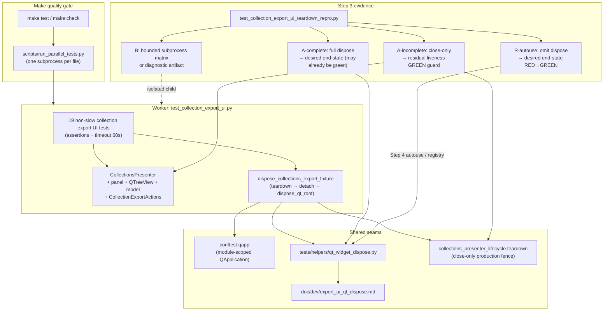

# PYPOST-1357: Collection export UI worker crashes after all assertions pass

## Research

### Symptom and evidence (repository + Jira)

- **Primary failure** ([PYPOST-1357](https://pypost.atlassian.net/browse/PYPOST-1357), found during
  planning-only [PYPOST-1336](https://pypost.atlassian.net/browse/PYPOST-1336)): focused
  `tests/test_collection_export_ui.py` (`-m "not slow"`) prints **19× PASSED**, then the native
  worker dies with `exit_code=-11` (SIGSEGV) and no Python traceback. The parallel Make
  orchestrator records the file as failed (`Passed: 0 | Failed: 1`) despite green assertions.
- **Documented repro**:

  `make test WORKERS=1 PYTEST_ARGS='tests/test_collection_export_ui.py -m "not slow"'`

- **Environment sensitivity** (ticket evidence, not a claim of every-host crash):
  - Original full `make test` and two focused pre-refresh runs: **3/3** post-PASS crashes on the
    affected dependency mix (original PySide/pydantic versions **not fully captured**).
  - Isolated clean baseline at `31f2b25a1fcacf490c5136c25ac4dac57ec41b06` for this UI module:
    passes.
  - After `make install` restore (reported: PySide6 **6.11.1**, pydantic **2.14.0**), focused
    current runs and the baseline module exit **0**.
- **Charter vs PYPOST-1315**: ticket treats collection-export post-PASS crash as **distinct** from
  environment-export dispose ([PYPOST-1315](https://pypost.atlassian.net/browse/PYPOST-1315)),
  while allowing a shared lifetime/teardown *family* when evidence supports it.

### What PYPOST-1315 already changed (current tree)

PYPOST-1315 already landed the shared export UI dispose contract and wired collections:

| Piece | Location | Role |
| --- | --- | --- |
| `dispose_qt_root` | `tests/helpers/qt_widget_dispose.py` | close → `processEvents` → `deleteLater` → `sendPostedEvents(DeferredDelete)` → `processEvents` |
| `dispose_collections_export_fixture` | same | `presenter.teardown(timeout_ms=50)` → detach tree model → `dispose_qt_root(panel)` |
| Collection export suite | `tests/test_collection_export_ui.py` | every test `finally` calls `dispose_collections_export_fixture` |
| Env contract repro only | `tests/test_environment_export_ui_teardown_repro.py` | shiboken / `topLevelWidgets` + bounded subprocess matrix |
| Dev doc | `doc/dev/export_ui_qt_dispose.md` | dispose contract + troubleshooting |

**Gap called out by PYPOST-1315 tech debt (TD-2 / [PYPOST-1479](https://pypost.atlassian.net/browse/PYPOST-1479)):**
there is still **no** deterministic collections dispose contract module (no
`shiboken6.isValid(panel)` / leftover top-level assertion for the collections fixture path).
Collections stability today rests on green suite exit under the restored host, not a dedicated
lifetime contract.

### Process model in this repo

- `make test` / `make check` → `scripts/run_parallel_tests.py`: **one OS subprocess per test
  file**, offscreen QPA, per-file worker timeout ([parallel_test_runner.md](../../doc/dev/parallel_test_runner.md)).
- `tests/conftest.py`: **module-scoped** `qapp` (`QApplication.instance() or QApplication([])`).
- Post-PASS worker death is therefore **inside the collection-export file’s subprocess** after
  assertions succeeded: interpreter / Qt / Shiboken finalization (or late deferred work) then
  SIGSEGV. Orchestrator correctly treats non-zero worker exit as file failure — a false quality
  signal relative to product assertions.

### Collections object graph under test

Nineteen non-slow nodes in `tests/test_collection_export_ui.py` (module
`pytestmark = pytest.mark.timeout(60)`):

- Build `CollectionsPresenter` → unparented panel (`build_collections_panel` → `QWidget()`),
  `QTreeView` + `QStandardItemModel` (model parented to view), `CollectionExportActions`,
  import-actions lifecycle owned by the presenter.
- Production `CollectionsPresenter.teardown` / `collections_presenter_lifecycle.teardown` fences
  import admission, tears down import workers, then **`panel.close()` only** — it does **not**
  `deleteLater` or drain DeferredDelete. That is why the test helper must still call
  `dispose_qt_root` after production teardown.
- Dialogs/file prompts are mocked (`unittest.mock.patch`); no live network.

### Distinct crash classes (do not conflate)

| Class | Ticket / doc | Relation to PYPOST-1357 |
| --- | --- | --- |
| Env export incomplete dispose | PYPOST-1315 / [export_ui_qt_dispose.md](../../doc/dev/export_ui_qt_dispose.md) | Sibling lifetime family; env contract exists; collections contract missing (TD-2) |
| Large-batch `apply_theme` | PYPOST-1212 / [gui_batch_segfault.md](../../doc/dev/gui_batch_segfault.md) | Different site; reuse subprocess + signal-decoding evidence patterns only |
| Presenter lifecycle fence | PYPOST-1256 / [presenter_teardown.md](../../doc/dev/presenter_teardown.md) | Collections production `teardown()` is necessary but insufficient alone for C++ death |
| Session static-dtor / `os._exit` hacks | industry (GPG-Meister, Ngpcraft, qiskit-metal) | **Out of scope** as primary fix — masks lifetime bugs; forbidden by requirements |

### External research (Qt / PySide teardown)

- [Preventing segfaults in test suites with Qt tests](https://czaki.github.io/blog/2024/09/16/preventing-segfaults-in-test-suite-that-has-qt-tests/)
  (Bokota): Python GC does not track Qt C++ refs; pending events against collected wrappers →
  SIGSEGV, often **after** the responsible test; environment/OS differences make reproduction
  non-deterministic. Mitigations: `deleteLater` while `QApplication` is alive, stop
  timers/threads, drain deferred work, prefer explicit top-level disposal.
- [Qt `QObject::deleteLater`](https://doc.qt.io/qt-6/qobject.html) /
  [PySide6 QObject](https://doc.qt.io/qtforpython-6/PySide6/QtCore/QObject.html): deferred
  deletion runs when control returns to the posting event loop; after the main loop has
  stopped, objects may never be deleted cleanly.
- [PySide6 `QCoreApplication.processEvents` / `sendPostedEvents`](https://doc.qt.io/qtforpython-6/PySide6/QtCore/QCoreApplication.html):
  in a local loop that only calls `processEvents()`, **DeferredDelete is not processed**; call
  `QCoreApplication.sendPostedEvents(None, QEvent.DeferredDelete)` — exactly the lesson already
  encoded in `dispose_qt_root` for `EnvironmentListWidget`.
- Industry parallels for post-summary SIGSEGV under PySide6 6.11.x: hard-exit after pytest
  summary to skip C++ static dtors; gdb diagnostic artifacts for teardown frames
  (xdart / MetalGUI). Useful as **diagnostic technique**, not as this ticket’s primary fix.
- Repo pin today: `PySide6==6.11.1` / `shiboken6==6.11.1` in `requirements.in` /
  `pyproject.toml` — matches the post-restore “passes” evidence, not the uncaptured pre-refresh
  mix.

### Working defect hypotheses (ordered; confirm in Steps 3–4)

1. **Residual collections lifetime gap** relative to the env contract: dispose is wired, but
   something in the collections graph (panel/tree/delegate/actions, orphan top-levels after
   mocked dialogs, model detach order, import lifecycle edges) still leaves C++ objects that
   finalize unsafely under some timing/dependency mixes. Detectable via a collections
   shiboken/`topLevelWidgets` contract and leftover audit after the 19-node path.
2. **Environment / dependency interaction**: older or divergent PySide/Shiboken/pydantic mixes
   amplify finalize crashes even when the dispose sequence is “complete enough” on 6.11.1.
   Original versions were not captured; acceptance therefore allows a **diagnostic crash
   artifact** (version matrix, faulthandler/gdb tails, attempt log) instead of mandatory live
   SIGSEGV on every restored host.
3. **Incomplete-path / missed-`finally` regression risk**: production `teardown()` still only
   closes the panel; if a future test drops `dispose_collections_export_fixture` (repeated
   per-test `finally`, PYPOST-1315 TD-5), the close-only path returns — classic post-PASS
   SIGSEGV class. Harden with (a) **A-incomplete** residual-liveness negative control (green
   guard) and (b) **R-autouse** desired-end-state red→green that Step 4 satisfies via autouse
   / registry dispose.
4. **Not mandated**: re-implementing PYPOST-1315 env scope, global `os._exit`, skipping tests,
   or weakening timeouts/assertions.

These are investigative hypotheses, not a mandate to change collection-export product behavior
beyond what evidence requires for safe lifetime/teardown or environment characterization.

## Implementation Plan

1. **Step 3 — Failing repro / evidence (mandatory design below):** land automated collections
   lifetime evidence **before** any further “fix” that is meant to make the gate durable.
2. **Step 4 — Cause-driven remediation:** based on Step 3’s recorded **R-*** fork, remediate
   teardown residual, environment characterization/pinning, and/or autouse dispose
   (R-autouse); keep all nineteen assertions and timeout markers; no skips; no permanently
   red suite member.
3. **Step 4 validation:** focused Make form of the ticket repro (`WORKERS=1` + non-slow
   collection export UI file) and parallel Make acceptance runs — worker exit 0 after PASS, no
   post-PASS `-11`.
4. **Steps 5–8:** cleanup; observability only if durable diagnostics are added (likely thin /
   N/A for harness-only); tech-debt for any env-only remainder or harness polish; short
   collections-specific note beside `export_ui_qt_dispose.md` if gaps are closed.

**Mandatory — Failing Repro (next Step 3):**

Not N/A — this task is runtime stability / teardown–environment behavior; Step 3 must produce
automated red/evidence artifacts before treating the defect as fixed.

### Goals of the red / evidence phase

1. **Collections dispose contract** (fills PYPOST-1315 TD-2 / PYPOST-1479 intent under this
   ticket’s charter): deterministic shiboken / `topLevelWidgets` assertions for the collections
   export fixture path — split into a permanent **positive** guard and a permanent **negative**
   control with opposite assertion polarities (see A below).
2. **Bounded native-crash evidence or diagnostic artifact** for the collection-export worker
   (historically `-11` / SIGSEGV after 19 PASSes), without an unbounded flake hunt — matching
   DoD §1.
3. **A named red→green driver** that is RED on current tree at Step 3 and GREEN after Step 4,
   including under the expected restored-host baseline (see **R-*** below) — no permanently red
   suite member.
4. **Cause fork documented** in Step 3 notes: teardown residual, environment/dependency, or
   both — relative to PYPOST-1315 (shared family vs distinct remaining gap).

### Where it lives

- New focused module (preferred name):
  `tests/test_collection_export_ui_teardown_repro.py`
  (sibling to `tests/test_environment_export_ui_teardown_repro.py`).
- Module `pytestmark` with explicit `@pytest.mark.timeout(...)` (or module mark) per
  do-testing / lsr-python — keep timeouts honest; do not disable them.
- Reuse patterns from `tests/test_environment_export_ui_teardown_repro.py` and
  `tests/test_gui_batch_segfault_repro.py`: subprocess isolation, `PYTHONFAULTHANDLER=1`,
  `QT_QPA_PLATFORM=offscreen`, signal/`returncode` decoding (`-11` → SIGSEGV, `-7` → SIGBUS,
  `139` / `135`), bounded stdout/stderr tails.
- Optional diagnostic sidecar (only if live SIGSEGV stays unavailable within the bound): a
  small Make-invoked or pytest-collected artifact writer under `tests/` / `scripts/` that records
  dependency versions (`PySide6`, `shiboken6`, `pydantic`), attempt matrix, and faulthandler /
  optional gdb backtrace tails — **bounded**, not a permanent skip of the nineteen tests.

### Assertion polarities (must not conflate)

| Member | Cleanup applied | Assertion polarity | Suite role after Step 4 |
| --- | --- | --- | --- |
| **A-complete** | Full `dispose_collections_export_fixture` | **Desired end-state:** `not shiboken6.isValid(panel)` (and tree/view roots as applicable); no leftover collections export UI panel / `QTreeView` roots in `qapp.topLevelWidgets()` | Permanent **positive** guard (green) |
| **A-incomplete** | Close-only / production `teardown` **without** `deleteLater` + `sendPostedEvents(DeferredDelete)` | **Residual liveness (negative control):** `shiboken6.isValid(panel)` is True **and/or** collections panel / `QTreeView` leftovers **remain** in `topLevelWidgets()` | Permanent **green** regression guard — proves incomplete cleanup leaves live objects; **never** asserts the desired end-state |
| **R-autouse** (restored-host default red→green) | Omit `dispose_collections_export_fixture` (missed-`finally` / TD-5 scenario); rely only on whatever automatic cleanup exists today | **Desired end-state** (same as A-complete) after that omitted-dispose path | Step 3 **RED** → Step 4 adds autouse (or equivalent registry dispose) → **GREEN**; stays as durable “missed finally still safe” guard |
| **B** | N/A (subprocess of the nineteen-test file) | Evidence matrix / diagnostic artifact; fails only on live native-crash class | Not a permanent red; zero-crash matrix is an accepted diagnostic outcome |

**Polarity rule:** A-incomplete and A-complete/R-autouse use **opposite** assert directions.
A-incomplete must **not** re-use A-complete’s desired-end-state asserts (that would leave a
member permanently red, because Step 4 does **not** make close-only satisfy the dispose
contract). If Step 4 later adds module autouse dispose, A-incomplete must opt out of that
autouse (or assert liveness **before** autouse runs) so the negative control stays meaningful.

### What each member asserts

**A. Deterministic collections lifetime contract (permanent guards — not the sole Step 3→4
flip on restored hosts):**

- Construct the same object graph the suite uses (`CollectionsPresenter` via the existing
  `_make_presenter` pattern / equivalent helpers).
- **A-complete (desired path, permanent positive guard):** run
  `dispose_collections_export_fixture(presenter, qapp)` then assert the **desired end-state**
  (invalid panel / no leftovers). Expected after PYPOST-1315 wiring: this may already be
  **green** when landed. If Step 3 finds it **red** (leftovers / still-valid roots after full
  dispose), that is cause-fork **R-residual** for Step 4 — not a license to flip A-incomplete’s
  polarity.
- **A-incomplete (permanent negative control — green by design):** after the same construction,
  apply **incomplete** cleanup mirroring production-close-only (`presenter.teardown(...)`
  and/or `panel.close()` **without** DeferredDelete drain), then assert **residual liveness**
  (panel still valid and/or leftovers present). Lands **green** and **stays green**. It
  documents why the full dispose helper is required; it is **not** a red→green driver and must
  not be left as a permanently failing suite member.

**R. Named red→green drivers for Step 3→4 (exactly the flip; no permanent red):**

Under the **expected restored-host baseline** (A-complete already green; B a zero-crash
diagnostic matrix), neither A-complete nor B nor A-incomplete is the Step 3→4 flip.
Name and land one of the following as the mandatory failing repro; Step 4 turns that same
member green:

1. **R-residual** — Triggered when Step 3 observes A-complete **red** after full dispose.
   Step 4 hardens `dispose_collections_export_fixture` / residual graph until A-complete is
   green. (A-incomplete stays the green liveness guard.)
2. **R-env-crash** — Triggered when B observes historically matching native death. Step 4
   remediates the identified teardown and/or environment cause until children exit 0 (and
   focused/parallel Make are clean). A zero-crash B matrix is **evidence**, not a red suite
   member.
3. **R-autouse (restored-host default when R-residual and R-env-crash are already green):**
   Step 3 lands a test (preferred name sketch:
   `test_missed_collections_dispose_reaches_desired_end_state`) that builds the collections
   export graph, **omits** `dispose_collections_export_fixture` (missed-`finally` / PYPOST-1315
   TD-5 risk), and asserts the **desired end-state**. Today this is **RED** because no autouse
   / registry dispose closes the panel. Step 4 adds autouse dispose (or equivalent) on the
   collection-export suite so omitted-`finally` still reaches the contract → **GREEN**. After
   green, this member remains as the durable missed-finally guard (desired-end-state polarity,
   now satisfied).

Step 3 must record which **R-*** member was red and why (cause fork). The suite after Step 4
contains only green members: A-complete, A-incomplete (liveness), the chosen R-* (now green),
and B (zero-crash or post-fix exit 0).

**B. Bounded native-crash evidence (subprocess, parent survives):**

- Spawn a child running the ticket surface:

  `python -m pytest tests/test_collection_export_ui.py -m "not slow" -q`

  under offscreen QPA + faulthandler (optionally stress: N tight child reruns within a wall
  budget ≤ worker-timeout class, e.g. 60–120s, attempt budget ≤ 5–10).
- Record return codes; decode `-11` / `-7` / `139` / `135`.
- **Acceptance for evidence:** ≥1 historically matching native death (**R-env-crash**) **or**,
  if the host cannot reproduce within the bound, archive the attempt matrix + dependency
  versions as the **diagnostic crash artifact** and keep **A-complete** + the active **R-***
  driver as the mandatory automated gate (requirements explicitly allow diagnostic fallback).
- Parent pytest must **never** be killed by the child’s SIGSEGV.
- B must **not** be designed to stay red forever when the host cannot reproduce SIGSEGV.

**C. Green after fix (Step 4):**

- A-complete passes (positive dispose contract).
- A-incomplete still passes with **residual-liveness** asserts (negative control).
- The active **R-*** driver from Step 3 is now green (R-residual hardened, R-env-crash cleared,
  and/or R-autouse wired).
- Focused + parallel Make runs: collection-export worker exits 0 after 19 PASSes; no post-PASS
  `-11`.
- Nineteen listed assertions and timeout markers unchanged; no skips; **no permanently red**
  member left in the repro module.

### How to force failure without live external deps

- No network; keep dialogs mocked as in the existing suite (or construct presenter without
  invoking export dialogs for pure disposal stress).
- Force A-incomplete by close-only / skipping `dispose_qt_root` — asserts **liveness** (green
  control), not the desired end-state.
- Force **R-autouse** red by omitting `dispose_collections_export_fixture` and asserting the
  **desired end-state** — no need to pin an old wheel set for the restored-host red.
- Prefer in-process construction for **A** / **R-autouse** / **R-residual**; subprocess only
  for **B** / diagnostic capture.
- Do not require reproducing the uncaptured pre-refresh dependency mix to land Step 3.

### Sequencing

1. Research (this document) → accepted.
2. Step 3: add `tests/test_collection_export_ui_teardown_repro.py`; land A-complete (may be
   green), A-incomplete as **green** residual-liveness negative control, bounded B (crash or
   diagnostic matrix); land the active **R-*** member **red** (default **R-autouse** when
   A-complete is already green and B is zero-crash).
3. Step 4: remediate the recorded cause fork until that **R-*** member + A-complete +
   focused/parallel Make are green (harden dispose residual, environment characterization /
   pin docs, and/or autouse dispose for missed-`finally`).
4. Do not “fix” by skipping, weakening assertions, removing timeouts, flipping A-incomplete
   to desired-end-state polarity, or global `os._exit` session hacks.

## Architecture

### Module diagram



### Modules and responsibilities

| Module / component | Responsibility in this task |
| --- | --- |
| `tests/test_collection_export_ui.py` | Keep all nineteen product assertions and `timeout(60)`; retain/strengthen dispose wiring (per-test `finally` and/or autouse fixture); never skip. |
| `tests/helpers/qt_widget_dispose.py` | Prefer reuse; harden `dispose_collections_export_fixture` / `dispose_qt_root` only if Step 3 shows residual live roots after A-complete. |
| `tests/test_collection_export_ui_teardown_repro.py` (new) | A-complete (desired end-state), A-incomplete (residual-liveness negative control), active **R-*** red→green driver (default R-autouse on restored host), bounded B / diagnostic artifact; parent isolation from child SIGSEGV. |
| `CollectionsPresenter` / `collection_export_actions` (production) | **Default: no product export behavior change.** Call existing `teardown()` from the test helper only. Touch production only if evidence proves a production ownership bug (e.g. unparented object that dispose cannot reach). |
| Parallel orchestrator / global `conftest` session purge | Out of scope for redesign (PYPOST-1315 TD-8 / PYPOST-1485 may remain debt). |
| Dependency pins (`requirements*.in` / lock) | In scope only if Step 3 classifies environment as a contributing cause and a durable pin/check is the remediation — not “restore alone” while ignoring a proven teardown residual. |

### Interaction scheme

1. Test body creates `CollectionsPresenter` and exercises export flows (dialogs mocked).
2. Teardown **while `qapp` is alive**:
   - Fence via `presenter.teardown(timeout_ms=…)`.
   - Detach tree model if still attached.
   - `dispose_qt_root(panel)` including DeferredDelete drain.
3. After dispose: `shiboken6.isValid` false for panel roots; no collections export UI leftovers
   in `topLevelWidgets()`.
4. Worker process exits normally after the last PASS; orchestrator records success.
5. Evidence path B either observes native death under affected conditions or archives a
   diagnostic artifact sufficient to justify the cause classification.

### Selected patterns and justification

| Pattern | Why |
| --- | --- |
| **Explicit dispose contract** (close → pump → deleteLater → `sendPostedEvents(DeferredDelete)` → pump) | Already proven for env export; Qt docs require DeferredDelete drain when only `processEvents` runs in a local loop. |
| **Reuse `dispose_collections_export_fixture`** | Avoid inventing a second collections shutdown path; production `teardown()` fences import but only closes the panel. |
| **Collections-specific contract + polarity-split incomplete control** | Env-only repro left collections unguarded (TD-2); A-complete guards desired end-state; A-incomplete stays a **green** residual-liveness guard; **R-autouse** is the restored-host red→green when A-complete/B are already green. |
| **Subprocess isolation + diagnostic artifact fallback** | Native SIGSEGV cannot be caught in-process; requirements allow artifact when live reproduction is unavailable. |
| **Reject global `os._exit` / skip / timeout removal** | Masks defects; violates DoD. |
| **Cause transparency vs PYPOST-1315** | Record shared-family vs distinct residual so triage does not re-litigate env export scope. |

### Main interfaces / APIs

Existing test-facing API (prefer keep; extend only if residual evidence demands):

```text
dispose_qt_root(widget: QWidget, qapp: QApplication) -> None
  # Idempotent: close/hide, deleteLater if still valid, drain DeferredDelete.

dispose_collections_export_fixture(presenter, qapp: QApplication) -> None
  # presenter.teardown(timeout_ms=…) → detach tree model → dispose_qt_root(panel)
```

Invariants after full dispose (asserted by Step 3 A-complete; maintained by Step 4):

- `not shiboken6.isValid(panel)` for disposed collections panel roots.
- No disposed collections export UI root types left among `qapp.topLevelWidgets()`.
- Existing nineteen collection export UI assertions unchanged; module `pytestmark` timeout
  remains.

Step 4 hardenings (evidence-gated; **R-autouse makes the first item the restored-host
default flip** when R-residual / R-env-crash are already green):

- Autouse fixture registering presenters (PYPOST-1315 TD-5 / PYPOST-1482) so omitted
  `finally` still reaches the dispose contract — turns **R-autouse** green.
- Stronger leftover audit (delegates, stray `QDialog` tops) if A-complete finds survivors
  (**R-residual**).
- Typed `CollectionsPresenter` parameter on the helper (TD-6) as cleanup polish.

Production interfaces for `CollectionExportActions` / export dialogs: **unchanged** unless
Step 3 proves a production ownership defect.

### Scope boundary

- **In scope:** collection export UI post-PASS worker crash under affected environments;
  collections dispose contract + bounded evidence/diagnostic; cause classification vs
  PYPOST-1315; remediation of identified teardown and/or environment cause; focused + parallel
  Make validation with assertions/timeouts preserved.
- **Out of scope:** rewriting the nineteen product tests away; skipping/quarantine; global
  harness `os._exit`; re-implementing env-export PYPOST-1315 scope except coordinated
  shared-cause handling with explicit record; unbounded flake hunting as the only proof;
  unrelated full-suite failures.

## Q&A

- **Q: PYPOST-1315 already disposed collections — why is this a separate architecture?**
  **A:** Charter owns the collection-export post-PASS crash under affected environments and
  missing collections contract evidence (TD-2). 1315 fixed the shared helper and wiring; 1357
  must prove collections-specific evidence, classify teardown vs environment, and remediate any
  residual so Make stays honest.

- **Q: What if the current host never SIGSEGVs again after `make install`?**
  **A:** Acceptance allows a diagnostic crash artifact plus cause identification. Land
  A-complete (may already be green), A-incomplete as a **green** residual-liveness negative
  control, archive B’s zero-crash matrix with dependency versions, and land **R-autouse** as
  the Step 3 **red** → Step 4 **green** driver; do not claim every host must crash, and do not
  leave A-incomplete permanently red.

- **Q: Why must A-incomplete use residual-liveness asserts instead of the desired dispose
  contract?**
  **A:** Desired-end-state asserts after close-only are RED by construction forever (Step 4
  does not make incomplete cleanup satisfy the contract). Residual-liveness asserts keep a
  green regression guard that incomplete cleanup leaves live objects, while **R-autouse** /
  **R-residual** / **R-env-crash** own the actual red→green flip.

- **Q: Is `os._exit` after pytest an acceptable fix?**
  **A:** No for this ticket — masks lifetime bugs and is a global harness policy change.

- **Q: Must product export behavior change?**
  **A:** Only if evidence shows a production ownership defect. Default fix locus is test
  dispose hardening / environment characterization, reusing production `teardown()` as the
  fence before widget destruction.

- **Q: How does this relate to PYPOST-1479?**
  **A:** PYPOST-1479 tracked the missing collections dispose contract from 1315 TD-2. Step 3
  of PYPOST-1357 is the natural place to land that contract under the crash ticket’s DoD;
  later tech-debt sync can mark 1479 addressed if the same module satisfies it.

- **Q: Links**
  - Issue: [PYPOST-1357](https://pypost.atlassian.net/browse/PYPOST-1357)
  - Related distinct: [PYPOST-1315](https://pypost.atlassian.net/browse/PYPOST-1315)
  - Discovered during: [PYPOST-1336](https://pypost.atlassian.net/browse/PYPOST-1336)
  - Collections contract debt: [PYPOST-1479](https://pypost.atlassian.net/browse/PYPOST-1479)
  - Qt deleteLater: <https://doc.qt.io/qt-6/qobject.html>
  - PySide6 processEvents / sendPostedEvents:
    <https://doc.qt.io/qtforpython-6/PySide6/QtCore/QCoreApplication.html>
  - Bokota segfault guide:
    <https://czaki.github.io/blog/2024/09/16/preventing-segfaults-in-test-suite-that-has-qt-tests/>
  - In-repo: [export_ui_qt_dispose.md](../../doc/dev/export_ui_qt_dispose.md),
    `tests/helpers/qt_widget_dispose.py`,
    `tests/test_environment_export_ui_teardown_repro.py`,
    `tests/test_gui_batch_segfault_repro.py`
