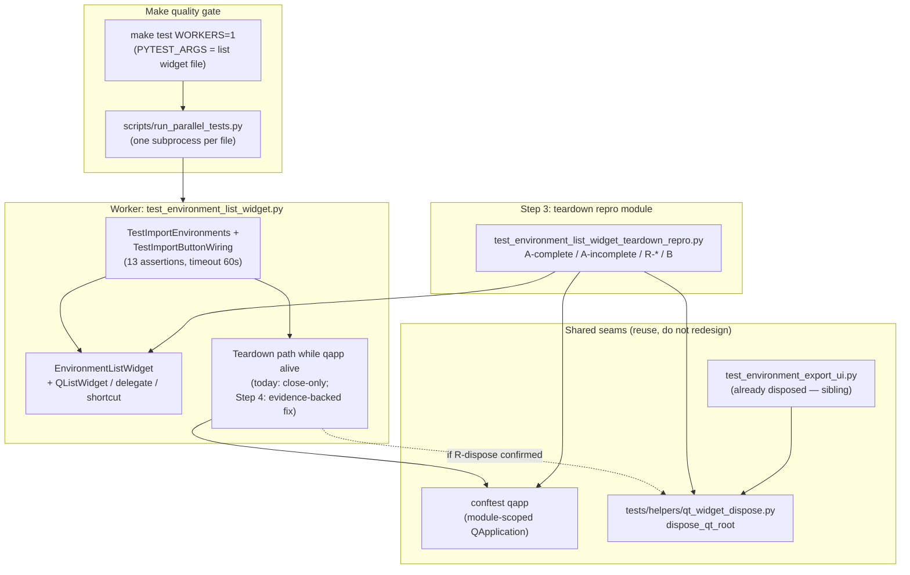

# PYPOST-1358: Environment list widget worker crashes after passing assertions

## Research

### Symptom and evidence (repository + Jira)

- **Primary failure** ([PYPOST-1358](https://pypost.atlassian.net/browse/PYPOST-1358)): focused
  `tests/test_environment_list_widget.py` reports **thirteen** `PASSED` lines, then the native
  worker dies with `exit_code=-11` (SIGSEGV) or `-7` (SIGBUS) and no Python traceback. The Make
  parallel orchestrator records the file as failed despite green assertions.
- **Documented repro**:

  `make test WORKERS=1 PYTEST_ARGS='tests/test_environment_list_widget.py'`

- **Discovery samples** (ticket; not a stable crash-probability estimate):
  - Current workspace: 3/3 post-PASS native crashes (−11 / −7) after all 13 PASS.
  - Clean baseline at `1e64239f` (`/tmp/pypost1348-baseline`): 1× exit 0, then −7 and −11 after
    all 13 PASS (2/3 crashes) — pre-existing, environment-sensitive flakiness.
  - Runtime context: Python 3.13.5, PySide6 6.11.1, pytest 8.4.2, offscreen Qt via Make.
- **Acceptance (Done)**: bounded reproduction + evidence-backed correction validated by
  **five consecutive** isolated `WORKERS=1` Make successes (exit 0, all 13 PASS). Full/parallel
  `make check` is desirable context, not the Done gate. Outcome-based: any confirmed root-cause
  class that eliminates the termination satisfies Done.

### Current teardown on the in-scope suite (code fact)

`tests/test_environment_list_widget.py` (module `pytestmark = pytest.mark.timeout(60)`):

- Builds unparented `EnvironmentListWidget` via `_make_widget` (same production type as
  environment **export** UI tests).
- Every test `finally` calls **`widget.close()` only** — no `deleteLater`, no
  `sendPostedEvents(DeferredDelete)`, no registry, no autouse dispose.
- Product import flows are exercised with `unittest.mock.patch` for dialogs / file prompts;
  no live network.

Contrast — already fixed sibling on the **same widget class**:

| Surface | File | Teardown today |
| --- | --- | --- |
| Env **list/import** (this ticket) | `tests/test_environment_list_widget.py` | `close()` only |
| Env **export** (PYPOST-1315) | `tests/test_environment_export_ui.py` | registry + autouse `dispose_qt_root` |
| Shared helper | `tests/helpers/qt_widget_dispose.py` | close → `processEvents` → `deleteLater` → `sendPostedEvents(DeferredDelete)` → `processEvents` |
| Contract / evidence | `tests/test_environment_export_ui_teardown_repro.py` | shiboken / `topLevelWidgets` + bounded subprocess matrix |
| Dev doc | `doc/dev/export_ui_qt_dispose.md` | documents export dispose; does **not** yet cover list/import suite |

`dispose_qt_root`’s own docstring names `EnvironmentListWidget` as a root that needs
`sendPostedEvents` because `processEvents` alone does not drain DeferredDelete.

### Process model in this repo

- `make test` / `make check` → `scripts/run_parallel_tests.py`: **one OS subprocess per test
  file**, offscreen QPA, per-file worker timeout ([parallel_test_runner.md](../../doc/dev/parallel_test_runner.md)).
- `tests/conftest.py`: **module-scoped** `qapp` (`QApplication.instance() or QApplication([])`) —
  no session-end widget purge, no pytest-qt / `qtbot`.
- Post-PASS worker death is therefore **inside the environment-list file’s subprocess** after
  assertions succeeded: interpreter / Qt / Shiboken finalization (or late deferred work) then
  SIGSEGV/SIGBUS. Orchestrator correctly treats non-zero worker exit as file failure — a false
  quality signal relative to product assertions.

### Object graph under test

Thirteen nodes (see `10-requirements.md`):

- `EnvironmentListWidget` (unparented `QWidget`) owning `QListWidget`,
  `EnvironmentNameDelegate`, `QShortcut`, import/export buttons.
- Import path: mocked `prompt_import_environments_file` / `prompt_import_conflict` /
  `show_import_*`; injected `read_import_file` callable.
- One mouse-click wiring test uses `QTest.mouseClick` on the import button.

No `CollectionsPresenter` / tree model in this file — simpler graph than collection export,
but the same top-level `EnvironmentListWidget` lifetime rules apply.

### Distinct crash classes (do not conflate)

| Class | Ticket / doc | Relation to PYPOST-1358 |
| --- | --- | --- |
| Env export incomplete dispose | PYPOST-1315 / [export_ui_qt_dispose.md](../../doc/dev/export_ui_qt_dispose.md) | Sibling: same widget type; export already has dispose; **list/import suite does not** |
| Collection export dispose / autouse | PYPOST-1357 | Same lifetime *family* / helper; different fixture graph; charter keeps scopes distinct unless evidence shows shared remaining gap |
| Large-batch `apply_theme` | PYPOST-1212 / [gui_batch_segfault.md](../../doc/dev/gui_batch_segfault.md) | Different site; reuse subprocess + signal-decoding evidence patterns only |
| Presenter async lifecycle | PYPOST-1256 / [presenter_teardown.md](../../doc/dev/presenter_teardown.md) | Not applicable to list-widget import tests (no collections presenter) |
| Session static-dtor / `os._exit` hacks | industry (GPG-Meister, Ngpcraft, qiskit-metal) | **Out of scope** as primary fix — masks lifetime bugs; forbidden by requirements |

### External research (Qt / PySide teardown)

- [Preventing segfaults in test suites with Qt tests](https://czaki.github.io/blog/2024/09/16/preventing-segfaults-in-test-suite-that-has-qt-tests/)
  (Bokota): Python GC does not track Qt C++ refs; pending events against collected wrappers →
  SIGSEGV, often **after** the responsible test; host/OS differences make reproduction
  non-deterministic. Mitigations: `deleteLater` while `QApplication` is alive, drain deferred
  work, prefer explicit top-level disposal (or `qtbot.add_widget`).
- [Qt / PySide6 `QObject::deleteLater`](https://doc.qt.io/qtforpython-6/PySide6/QtCore/QObject.html):
  deferred deletion runs when control returns to the posting event loop; after the main loop
  has stopped, objects may never be deleted cleanly.
- [PySide6 `processEvents` / `sendPostedEvents`](https://doc.qt.io/qtforpython-6/PySide6/QtCore/QCoreApplication.html)
  and in-repo `dispose_qt_root`: in a local loop that only calls `processEvents()`,
  **DeferredDelete is not processed** for roots such as `EnvironmentListWidget`; call
  `QCoreApplication.sendPostedEvents(None, QEvent.Type.DeferredDelete)`.
- Industry post-PASS SIGSEGV under PySide6 6.11.x: destroy widgets while the interpreter is
  alive (qiskit-metal MetalGUI atexit/`deleteLater`); last-resort `os._exit` after pytest
  summary to skip C++ static dtors — useful as **diagnostic technique**, not this ticket’s
  primary fix (requirements forbid global harness masking).
- Autouse DeferredDelete drain after each test (Image Annotator / similar conftest patterns)
  keeps session-scoped apps from accumulating live roots — same lesson as export registry
  autouse already in this repo.

### Working defect hypotheses (ordered; confirm in Steps 3–4)

Requirements mandate **not** locking design to dispose/DeferredDelete. Hypotheses below are
investigative; Step 3 records a named **R-*** fork; Step 4 remediates that fork.

1. **H1 / R-dispose (primary, code-backed):** suite teardown is `close()`-only on unparented
   `EnvironmentListWidget` roots. C++ objects remain live (`shiboken6.isValid` True; still in
   `qapp.topLevelWidgets()`) until worker finalization → classic post-PASS SIGSEGV/SIGBUS under
   timing pressure. Same class already remediated for env **export** via `dispose_qt_root`.
2. **H2 / R-autouse:** even if `finally` is upgraded to dispose, a missed-`finally` path (or
   future omission) reintroduces close-only survivors. Registry + autouse (env-export /
   PYPOST-1357 pattern) hardens the suite.
3. **H3 / R-other (non-lifecycle):** contract end-state is already met after current teardown,
   or full dispose does not eliminate native death — then pursue evidence-backed alternatives
   (finalize ordering, dependency characterization, residual non-widget edges) with a bounded
   diagnostic artifact. A confirmed non-lifecycle correction still satisfies Done.
4. **Not mandated:** re-implementing PYPOST-1315 / PYPOST-1357 scopes, global `os._exit`,
   skipping tests, or weakening timeouts/assertions; changing import product behavior beyond
   what the confirmed root cause requires.

**Related-ticket stance (provisional):** PYPOST-1358 owns the **list/import** suite gap.
Shared *family* with PYPOST-1315/1357 is strongly suggested by the same widget type and
close-only vs dispose asymmetry, but shared-cause *handling* beyond reusing the existing
helper is allowed only when Step 3 evidence supports it and is recorded explicitly.

## Implementation Plan

1. **Step 3 — Failing repro / evidence (mandatory design below):** land automated lifetime
   evidence **before** any harness “fix” meant to make the gate durable.
2. **Step 4 — Cause-driven remediation:** based on Step 3’s recorded **R-*** fork, remediate
   (default expected path: wire `dispose_qt_root` + registry/autouse into
   `tests/test_environment_list_widget.py`; if R-other, apply the confirmed non-lifecycle
   correction). Keep all thirteen assertions and timeout markers; no skips.
3. **Step 4 validation (Done gate):** **five consecutive** successful:

   `make test WORKERS=1 PYTEST_ARGS='tests/test_environment_list_widget.py'`

   Each run: all 13 PASS + process exit 0. Any unsuccessful run resets the consecutive
   counter; stop when the streak is met. Full/parallel `make check` not required for Done.
4. **Steps 5–8:** cleanup; observability only if durable diagnostics are added (likely thin /
   N/A for harness-only); tech-debt for any remaining asymmetry vs export doc; short note in
   `doc/dev/export_ui_qt_dispose.md` (or sibling) covering the list/import suite once the
   chosen fix lands.

**Mandatory — Failing Repro (next Step 3):**

Not N/A — this task is runtime stability / teardown–environment behavior; Step 3 must produce
automated red/evidence artifacts before treating the defect as fixed.

### Goals of the red / evidence phase

1. **List-widget dispose / lifetime contract** for `EnvironmentListWidget` under the import
   suite construction path — split into permanent **positive** and **negative** controls with
   opposite assertion polarities (see A below).
2. **Bounded native-crash evidence or diagnostic artifact** for the environment-list worker
   (historically −11 / −7 after 13 PASSes), without an unbounded flake hunt — matching DoD §1.
3. **A named red→green driver** that is RED on current tree at Step 3 and GREEN after Step 4
   (see **R-*** below) — no permanently red suite member.
4. **Cause fork documented** in Step 3 notes: R-dispose / R-autouse / R-other — and relation
   to PYPOST-1315 / PYPOST-1357 (shared family vs distinct remaining gap).

### Where it lives

- New focused module (preferred name):
  `tests/test_environment_list_widget_teardown_repro.py`
  (sibling to `tests/test_environment_export_ui_teardown_repro.py`).
- Module `pytestmark` with explicit `@pytest.mark.timeout(...)` (or module mark) per
  do-testing / lsr-python — keep timeouts honest; do not disable them.
- Reuse patterns from env/collection export teardown repro modules and
  `tests/test_gui_batch_segfault_repro.py`: subprocess isolation, `PYTHONFAULTHANDLER=1`,
  `QT_QPA_PLATFORM=offscreen`, signal/`returncode` decoding (`-11` → SIGSEGV, `-7` → SIGBUS,
  `139` / `135`), bounded stdout/stderr tails.
- Optional diagnostic sidecar (only if live SIGSEGV stays unavailable within the bound):
  record dependency versions (`PySide6`, `shiboken6`), attempt matrix, faulthandler tails —
  **bounded**, not a permanent skip of the thirteen tests.

### Assertion polarities (must not conflate)

| Member | Cleanup applied | Assertion polarity | Suite role after Step 4 |
| --- | --- | --- | --- |
| **A-complete** | Full `dispose_qt_root(widget, qapp)` | **Desired end-state:** `not shiboken6.isValid(widget)`; no leftover `EnvironmentListWidget` in `qapp.topLevelWidgets()` | Permanent **positive** guard (green) |
| **A-incomplete** | **Close-only** (mirrors today’s suite `finally`) — no `deleteLater` / DeferredDelete drain | **Residual liveness (negative control):** `shiboken6.isValid(widget)` is True **and/or** leftovers remain in `topLevelWidgets()` | Permanent **green** regression guard — proves close-only leaves live objects; **never** asserts the desired end-state |
| **R-dispose** (default red→green) | Apply the **suite’s current** cleanup path (close-only / whatever the product file does today), then assert **desired end-state** | Desired end-state after that path | Step 3 **RED** → Step 4 wires dispose (and preferably registry/autouse) into the product suite → **GREEN**; durable “suite teardown reaches contract” guard |
| **R-autouse** (if Step 4 chooses registry/autouse) | Omit explicit dispose in the test body; rely on registry autouse | Desired end-state after autouse | Optional durable “missed finally still safe” guard (same pattern as PYPOST-1357) |
| **B** | N/A (subprocess of the thirteen-test file) | Evidence matrix / diagnostic artifact; fails only on live native-crash class if used as a hard gate | Not a permanent red; zero-crash matrix within the bound is an accepted diagnostic outcome when host cannot reproduce |

**Polarity rule:** A-incomplete and A-complete/R-dispose use **opposite** assert directions.
A-incomplete must **not** reuse desired-end-state asserts. If Step 4 adds module autouse
dispose, A-incomplete must opt out of that autouse (or assert liveness **before** autouse
runs) so the negative control stays meaningful.

### How to force failure without live external deps

- Construct `EnvironmentListWidget` the same way as `_make_widget` in the product suite
  (minimal environments list; no dialog I/O required for disposal stress).
- No network; keep patches only if a construction path needs them.
- Prefer in-process construction + wrong teardown for **A** / **R-dispose**; subprocess only
  for **B**.

### Sequencing

1. Research (this document) → accepted.
2. Step 3: add repro module; prove red on **R-dispose** (and green polarity on A-complete /
   A-incomplete); capture bounded **B** evidence or diagnostic artifact; record **R-*** fork
   and relation to PYPOST-1315 / PYPOST-1357.
3. Step 4: remediate the recorded fork until R-driver and focused Make streak are green;
   retain all thirteen assertions/timeouts.
4. Do not “fix” by skipping, weakening assertions, removing timeouts, or global `os._exit`
   session hacks.

## Architecture

### Module diagram



### Modules and responsibilities

| Module / component | Responsibility in this task |
| --- | --- |
| `tests/test_environment_list_widget.py` | Keep all thirteen product assertions and timeout markers; replace close-only teardown with the evidence-backed fix (expected: `dispose_qt_root` + registry/autouse mirroring env export). |
| `tests/helpers/qt_widget_dispose.py` | **Reuse** existing `dispose_qt_root` if R-dispose; do not invent a second DeferredDelete sequence unless evidence requires an extension. |
| `tests/test_environment_list_widget_teardown_repro.py` (new) | Contract polarities + bounded subprocess / diagnostic evidence; not a quarantine of the thirteen tests. |
| `EnvironmentListWidget` / import actions (production) | **Default: no product import behavior change.** Production dispose/parenting only if Step 3 proves a production ownership defect. |
| `tests/conftest.py` `qapp` / parallel orchestrator | Out of scope for redesign; must remain alive for any dispose sequence. |
| Related export suites / PYPOST-1315 / PYPOST-1357 | Reference and helper reuse only unless evidence demands coordinated remaining-gap work (then record explicitly). |

### Interaction scheme

1. Test body creates an unparented `EnvironmentListWidget` and exercises import / button wiring
   (dialogs mocked).
2. Teardown **must** leave the worker able to exit 0 after the last PASS. Preferred (if H1
   confirmed) path while `qapp` is alive:
   - Register root at construction.
   - Autouse (and/or `finally`): `dispose_qt_root(widget, qapp)`.
   - After dispose: `not shiboken6.isValid(widget)`; no `EnvironmentListWidget` leftovers in
     `topLevelWidgets()`.
3. If Step 3 selects **R-other**, apply that correction instead; still validate with the
   five-consecutive isolated Make streak.
4. Worker process exits normally; orchestrator records success.

### Selected patterns and justification

| Pattern | Why |
| --- | --- |
| **Outcome-based remediation** | Requirements: eliminate post-PASS native termination via whatever evidence-backed cause is found; dispose is hypothesis, not lock-in. |
| **Explicit dispose contract** (close → processEvents → deleteLater → sendPostedEvents(DeferredDelete) → processEvents) | Proven in-repo for the **same** `EnvironmentListWidget` type on the export suite; addresses H1 better than `close()` alone. |
| **Reuse shared helper + registry/autouse** | Avoids duplicating fragile sequences; matches PYPOST-1315 / PYPOST-1357 missed-`finally` hardening without broad harness redesign. |
| **Deterministic contract red test + bounded subprocess** | Crash is intermittent; contract gives a reliable red→green loop; subprocess evidence satisfies DoD without unbounded flake hunting. |
| **Subprocess isolation for crash evidence** | Native SIGSEGV cannot be caught in-process; PYPOST-1212 / export repro already established the harness style. |
| **Reject global `os._exit` / skip / timeout removal** | Masks defects; violates DoD (assertions, timeouts, no skips, honest gate). |
| **Reject adopting pytest-qt globally** | Repo does not depend on pytest-qt; requirements forbid broad harness redesign. |

### Main interfaces / APIs

Existing test-facing API (reuse; names already landed):

```text
dispose_qt_root(widget: QWidget | None, qapp: QApplication) -> None
  # Idempotent: close → processEvents → deleteLater → sendPostedEvents(DeferredDelete)
  # → processEvents. Safe if C++ object already gone.
```

Illustrative suite wiring (Step 4 if R-dispose; mirror env export):

```text
_created_widgets: list[EnvironmentListWidget] = []

def _make_widget(...):
    w = EnvironmentListWidget(...)
    _created_widgets.append(w)
    return w

@pytest.fixture(autouse=True)
def _cleanup_widgets(qapp):
    yield
    while _created_widgets:
        dispose_qt_root(_created_widgets.pop(), qapp)
```

Invariants after successful dispose (asserted by Step 3 contract tests, maintained by Step 4):

- `not shiboken6.isValid(root)` for disposed roots.
- No disposed `EnvironmentListWidget` roots left among `qapp.topLevelWidgets()`.
- Existing thirteen assertions unchanged; module `pytestmark` timeout remains.

Production interfaces: **unchanged** for `import_environments` / button wiring unless Step 3
evidence proves a production ownership defect (then a minimal dispose/parenting fix only — still
no import behavior rewrite).

### Scope boundary

- **In scope:** environment **list/import** widget suite post-PASS native termination;
  bounded reproduction; evidence-backed fix; five-consecutive isolated `WORKERS=1`
  validation; related-ticket clarity when evidence warrants.
- **Out of scope:** weakening/skipping the thirteen tests; locking fix class to dispose without
  evidence; re-litigating PYPOST-1315/1357 except shared-cause coordination; global worker /
  `os._exit` policy; requiring full/parallel `make check` for Done; unrelated suite failures.

## Q&A

- **Q: Why is dispose/DeferredDelete not the locked design?**
  **A:** Requirements (US4 / DoD §2) make acceptance outcome-based. Code strongly suggests
  close-only teardown as H1, and export already fixed the same widget via `dispose_qt_root`,
  but Step 3 must confirm the R-* fork. A non-lifecycle root cause that removes the
  termination still satisfies Done.

- **Q: Why not only stress until SIGSEGV and skip a contract test?**
  **A:** Crash is intermittent (baseline had exit 0 then native death). A deterministic
  validity/`topLevelWidgets` contract gives a reliable red→green loop; bounded subprocess
  stress still satisfies DoD evidence without hanging the sprint on flake hunting.

- **Q: Why reuse `dispose_qt_root` instead of pytest-qt `qtbot.add_widget`?**
  **A:** The repo already owns the DeferredDelete-correct helper for `EnvironmentListWidget`
  and does not depend on pytest-qt. Requirements forbid broad harness redesign.

- **Q: Is `os._exit` in `pytest_sessionfinish` an acceptable fix?**
  **A:** No for this ticket. It can hide lifetime bugs and is a global policy change outside
  the environment-list defect scope.

- **Q: Is this the same work as PYPOST-1315 or PYPOST-1357?**
  **A:** No by charter. This ticket owns the list/import suite. Those tickets own export /
  collections dispose classes. Shared helper reuse is expected under H1; coordinated
  remaining-gap work only with explicit evidence.

- **Q: What is the Done validation bound?**
  **A:** Five consecutive successful
  `make test WORKERS=1 PYTEST_ARGS='tests/test_environment_list_widget.py'`
  runs (all 13 PASS, exit 0). Unsuccessful run resets the counter; stop when the streak is
  met. Full/parallel gate success is not required for Done.

- **Q: Links**
  - Issue: [PYPOST-1358](https://pypost.atlassian.net/browse/PYPOST-1358)
  - Related: [PYPOST-1315](https://pypost.atlassian.net/browse/PYPOST-1315),
    [PYPOST-1357](https://pypost.atlassian.net/browse/PYPOST-1357)
  - Dispose helper: `tests/helpers/qt_widget_dispose.py`
  - Export dispose doc: [export_ui_qt_dispose.md](../../doc/dev/export_ui_qt_dispose.md)
  - Bokota segfault guide:
    <https://czaki.github.io/blog/2024/09/16/preventing-segfaults-in-test-suite-that-has-qt-tests/>
  - Qt deleteLater:
    <https://doc.qt.io/qtforpython-6/PySide6/QtCore/QObject.html>
