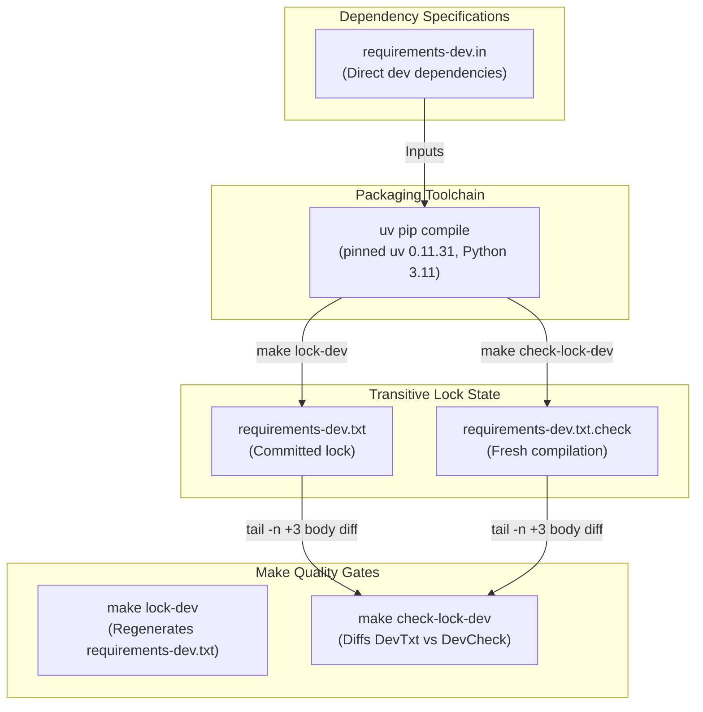

# PYPOST-1359: Development dependency lock fails Make verification with CI-pinned uv at base commit

## Research

### Background & Context
In PyPost, dependencies are managed through modular input files (`requirements.in`, `requirements-dev.in`, `requirements-otel.in`) and compiled into deterministic, transitive lock files (`requirements.txt`, `requirements-dev.txt`, `requirements-otel.txt`) via `uv pip compile`.

In CI (`.github/workflows/test.yml`), quality gate jobs `check-lock`, `check-lock-dev`, and `check-lock-otel` enforce that committed lockfiles strictly match the resolution produced by compiling the `.in` source specifications. To avoid arbitrary compiler drift, CI explicitly pins `astral-sh/setup-uv` to version `0.11.31` (established in PYPOST-984, PYPOST-995, and PYPOST-997).

### Problem Statement & Root Cause
During development in PYPOST-1348, `make check-lock-dev` was observed failing.
Investigation of the repository root cause reveals two primary factors:

1. **Transitive Dependency Drift against Stale Committed Lock**:
   - `requirements-dev.in` specifies version ranges for direct developer and test tools:
     - `pytest>=8,<9`
     - `pytest-cov>=6,<7`
     - `pytest-timeout>=2,<3`
     - `flake8>=7,<8`
     - `flake8-print>=5,<6`
     - `mypy>=1.15,<2`
     - `types-PyYAML>=6,<7`
     - `types-PySide6>=6.10,<7`
     - `pip-audit>=2,<4`
     - `pip-licenses>=5,<6`
   - Transitive dependencies of these tools (such as `filelock`, `flake8`, `idna`, `iniconfig`, `librt`, `msgpack`, `pip-api`, `platformdirs`, `pycodestyle`, `pyflakes`, `pyparsing`, `tomli`, `types-pyyaml`, `urllib3`, `wcwidth`) were unpinned in `.in`.
   - The committed `requirements-dev.txt` was last refreshed in commit `2f713d72` (August 19, 2026, PYPOST-1057).
   - When compiling `requirements-dev.in` using `uv` (pinned version 0.11.31) under Python 3.11 today, `uv` resolves newer compatible patch/minor versions for transitive tools.
   - Consequently, `make check-lock-dev` compiles `requirements-dev.in` to `requirements-dev.txt.check`, compares line-by-line (excluding the autogenerated header), detects discrepancies, and exits with code 1.

2. **Toolchain Invocation Ergonomics (`UV` in Makefile)**:
   - In `Makefile`:
     ```makefile
     UV ?= uv
     VENV := .venv
     BIN := $(VENV)/bin
     ```
   - In containerized or developer environments where `uv` is installed inside `.venv/bin/uv` (or another local venv) rather than globally on system `/bin` / `/usr/bin`, invoking `make check-lock-dev` without setting `UV=.venv/bin/uv` or without an activated venv causes `/bin/sh: uv: not found` and fails with exit code 2.
   - While CI runners have `uv` installed to PATH via `astral-sh/setup-uv`, local development and test automation benefit from resilient fallback discovery (e.g. `$(if $(wildcard $(BIN)/uv),$(BIN)/uv,uv)` or explicit `UV ?=` parameterization).

### Comparative Prior Art
In task PYPOST-1057 ("CI check-lock / check-lock-dev / check-license-inventory fail from dependency drift"), the same phenomenon occurred: upstream package updates caused `make check-lock` and `make check-lock-dev` to drift from stale committed locks. The established fix was to re-synchronize lockfiles via `make lock-dev` (and verify all tests, lint, and quality gates pass against the refreshed lock).

## Implementation Plan

1. **Step 3: Failing Repro Test (Automated Verification of Red State)**:
   - **Mandatory — Failing Repro (Step 3)**:
     - Design an automated check or dedicated test asserting the red condition before any modification.
     - Specifically, verify that `make check-lock-dev` fails against the current stale `requirements-dev.txt` using pinned `uv` (v0.11.31) and python version 3.11.
     - An automated test (or regression verification in `tests/test_ci_check_lock_job.py` or Make target invocation) will formally assert that `make check-lock-dev` fails with exit code 1 due to the detected drift between `requirements-dev.in` and `requirements-dev.txt`.
     - Sequencing:
       1. Document and execute the red repro verifying `check-lock-dev` fails with drift.
       2. Proceed to Step 4 implementation.

2. **Step 4: Development**:
   - Re-synchronize `requirements-dev.txt` by running `make lock-dev` using the CI-pinned `uv 0.11.31` toolchain under Python 3.11.
   - Inspect diff of `requirements-dev.txt` to verify changes are strictly confined to direct constraints in `requirements-dev.in` and legitimate transitive resolutions.
   - Verify Makefile invocation resilience: ensure `UV ?=` resolves properly and document usage in developer instructions or support local `.venv/bin/uv` fallback if `uv` is not globally on PATH.
   - Run `make check-lock-dev` to confirm it passes cleanly (exit code 0, zero diff).
   - Run repository quality gate `make check` (including `lint`, `test`, and `verify-ai-tasks`) to verify no regressions were introduced by updated dev tool transitive packages.

3. **Step 5: Code Cleanup**:
   - Ensure temporary files (`*.check`, `*.body`) are cleaned up.
   - Verify clean git status and run quality targets.

4. **Step 6: Observability**:
   - Review Make target output and exit code transparency for `check-lock-dev`.
   - Ensure error reporting clearly guides developers on how to re-lock (`make lock-dev`) when drift occurs.

5. **Step 7: Technical Debt Analysis**:
   - Record recurring lockfile drift characteristics in `60-tech-debt.md`.

6. **Step 8: Dev Docs**:
   - Verify and update `doc/dev/setup.md` regarding dev dependency locking, pinned `uv` version requirements, and `UV` variable overrides.

## Architecture

### System Module Diagram



### Component Responsibilities

1. **`requirements-dev.in`**:
   - Declares abstract version constraints for development, test runner, linting, baseline auditing, and type checking packages (`pytest`, `mypy`, `flake8`, `pip-audit`, etc.).
   - Serves as the single source of truth for direct development dependencies.

2. **`uv pip compile` Engine**:
   - Pin-controlled package resolver.
   - Ensures deterministic resolution given identical compiler versions and platform targets.
   - Invoked with `--python-version 3.11`.

3. **`requirements-dev.txt`**:
   - Pinned, fully resolved transitive dependency snapshot.
   - Committed to version control to ensure identical dev tools across all development environments and CI pipelines.

4. **Makefile Target `check-lock-dev`**:
   - Compiles a fresh check file `requirements-dev.txt.check`.
   - Strips top comments (header lines 1-2 containing timestamp / invocation specifics).
   - Compares the body against committed `requirements-dev.txt`.
   - Fails closed with exit code 1 if drift exists; cleans up temporary files on exit.

### Architectural Patterns & Decisions

- **Deterministic Hermetic Locking**:
  - Direct dependencies specify loose upper/lower bounds in `.in` to express compatibility constraints.
  - Concrete transitive closures are locked with exact `==` pins in `.txt` to prevent unpredictable breaks across environments.
- **Fail-Closed Verification Gate**:
  - `check-lock-dev` executes as an automated pre-flight barrier in CI. Any deviation between declared inputs and committed locks blocks integration.
- **Narrow Surgical Scope**:
  - No changes to runtime packages (`requirements.in` / `requirements.txt`).
  - No speculative additions or removals of direct dependencies in `requirements-dev.in`.
  - Re-generation strictly aligns `requirements-dev.txt` with current valid resolutions permitted by `requirements-dev.in`.

## Q&A

- **Q: Why did `check-lock-dev` start failing without recent changes to `requirements-dev.in`?**
  - **A**: `requirements-dev.in` uses ranged dependencies (`pytest>=8,<9`, `flake8>=7,<8`, etc.). Transitive dependencies of those packages released new bugfix versions on PyPI since August 2026. Because `uv pip compile` resolves against current repository and index metadata, re-compiling produces a newer transitive resolution than what was committed in August 2026.
- **Q: How does this interact with `UV` path resolution?**
  - **A**: In GitHub Actions CI, `astral-sh/setup-uv` puts `uv` on `PATH`. In local or containerized environments where `uv` exists only in `.venv/bin/uv`, running `make check-lock-dev` requires specifying `UV=.venv/bin/uv` or having `uv` available on `PATH`. Documenting this and considering Makefile default ergonomics ensures seamless execution across all developer setups.
- **Q: Does updating `requirements-dev.txt` break any existing tests or gates?**
  - **A**: The refreshed transitive packages remain strictly within compatible SemVer ranges declared by the upstream tools. Verifying `make check` (all tests and static lint) ensures full system integrity before committing.
