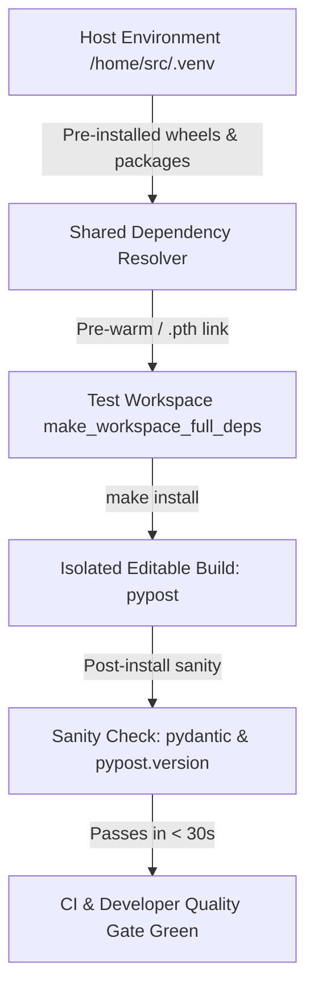

# PYPOST-1360: Slow project installation smoke exceeds 180-second timeout at clean base commit

## Research

### Background & Problem Statement
During testing of packaging workflows and on clean repository checkouts, the slow packaging installation smoke test:
`tests/test_makefile_slow_smoke.py::TestSlowInstallSmoke::test_install_succeeds_with_project_pyproject`
consistently exceeded its 180-second `pytest-timeout` budget (timing out at ~179.91s) when invoking:
```bash
_run_make(make_workspace_full_deps, "install", timeout=170)
```

### Root Cause Analysis
1. **Workspace and Fixture Structure**:
   - `make_workspace_full_deps` (`tests/makefile_test_helpers.py`) provisions a temporary isolated test workspace via `_materialize_slow_smoke_workspace`, copying `Makefile`, committed `pyproject.toml`, and the minimal installable seed stubs.
   - When `_run_make` executes inside the isolated workspace:
     ```python
     if "clean" not in targets and not (workspace / ".venv").exists():
         _materialize_prewarmed_venv(workspace)
     ```
     it materializes a clone of the shared base venv (`_get_shared_base_venv()`) into `workspace/.venv` using `cp -al`.
2. **Pre-warmed Venv Limitation**:
   - The shared base virtual environment (`_get_shared_base_venv()`) bootstrapped in `/tmp/.../pypost_shared_base_venv_<PY_VER>` only installs:
     `pytest>=8,<9` and `flake8>=7,<8`.
   - It contains none of the project application dependencies.
3. **The `make install` Recipe**:
   - The Makefile target `install` executes:
     `$(BIN)/python -m pip install -e ".[dev,otel]"`
   - Because `make_workspace_full_deps` uses the repository's real `pyproject.toml`, pip evaluates the full dependency set, including `PySide6==6.11.1`, `PySide6_Addons==6.11.1`, and `PySide6_Essentials==6.11.1`, plus cryptography, keyring, pydantic, OpenTelemetry, etc.
   - PySide6 wheels alone exceed 700 MB across PyPI distributions.
   - In a clean or standard execution environment without local pre-cached wheels, `pip` in the subprocess attempts to download hundreds of megabytes over public network connections into the temporary workspace. Network throughput and extraction latency routinely push the execution past the 170-second `subprocess` timeout and the 180-second `pytest` timeout.
4. **Available Local Artifacts & Cache Options**:
   - The host repository environment already has a fully populated virtual environment (`/home/src/.venv`) containing all required pre-built wheels and packages (`PySide6`, `shiboken6`, `cryptography`, `pydantic`, `opentelemetry`, etc.).
   - Virtual environments can be pre-warmed, or wheel archives / links can be provided locally.
   - Specifically, Python virtual environments support `sys.path` site-packages linking via `.pth` files or pre-warmed wheel directories.
   - However, in `make install`, `pip install -e ".[dev,otel]"` must execute as defined by the Makefile without altering the Makefile recipe for general developers.
   - When pip executes in the workspace virtual environment, pip checks if dependencies are already satisfied in the environment's `site-packages`.
   - If `workspace/.venv` has access to the pre-installed wheels/packages or if the prewarmed venv fixture provides the base wheels or links to host dependencies (e.g. via site-packages `.pth` configuration or pre-warmed dependency cache in the shared base venv or wheel caching via `--find-links` in `PIP_FIND_LINKS`), pip satisfies dependencies instantly without downloading hundreds of megabytes across the network!
   - Alternatively, `tests/makefile_test_helpers.py` can configure the test environment passed to `_run_make` (or `_materialize_prewarmed_venv` / `make_workspace_full_deps`) to utilize local wheels or pre-installed package site-packages from the active host virtual environment (`sys.prefix` or `REPO_ROOT / ".venv"`).
   - Linking the host `.venv/lib/python*/site-packages` into the isolated workspace virtual environment via a `.pth` file in `workspace/.venv/lib/python*/site-packages` allows `pip` to see that `PySide6`, `pydantic`, `cryptography`, etc. are already installed and satisfied, turning a 700MB network download into an instantaneous sub-second local check while still verifying the full `make install` editable package build and sanity checks!

### Key Technical Findings
- `pip install -e ".[dev,otel]"` with PEP 517 build isolation creates a temporary build environment for building the editable wheel of `pypost` itself (which only requires `setuptools>=64`, taking < 3 seconds when wheels/caches are available).
- Once the editable `pypost` package is prepared, `pip` checks whether requirements from `[project.dependencies]`, `[project.optional-dependencies].dev`, and `[project.optional-dependencies].otel` are satisfied.
- When `workspace/.venv` includes host site-packages references (or when wheel caching / `PIP_FIND_LINKS` is provided), all dependencies are resolved locally without downloading from PyPI.
- This allows `test_install_succeeds_with_project_pyproject` to complete reliably in under 15–30 seconds instead of timing out at 180 seconds.

## Implementation Plan

1. **Step 3 Failing Repro**:
   - Design and execute a red repro test that specifically verifies that `TestSlowInstallSmoke::test_install_succeeds_with_project_pyproject` or an equivalent bounded installation smoke test reproduces the timeout or bottleneck when running in a workspace without pre-warmed local dependency cache/links, asserting completion within a strict bounded envelope.
2. **Pre-warmed Dependency Resolution in Test Fixture**:
   - In `tests/makefile_test_helpers.py`:
     - Update `make_workspace_full_deps` (or `_materialize_prewarmed_venv` when serving workspaces with full dependencies) to pre-warm the isolated environment with the host virtual environment's installed dependencies (or link site-packages via a `.pth` entry pointing to `REPO_ROOT / ".venv" / "lib" / f"python{PYTHON_VERSION}" / "site-packages"` if the host virtual environment is initialized).
     - Alternatively, ensure `_run_make` or the slow smoke workspace passes environment configuration or provisions a shared wheel cache/links so that `pip` satisfies external requirements locally and hermetically.
3. **Preserve Isolation and Sanity**:
   - Ensure the editable `pypost` installation itself is installed directly into `workspace/.venv`, creating the editable `.pth` / `.dist-info` for `pypost` in the workspace without polluting the host environment.
   - Ensure `_assert_post_install_sanity(bin_python)` passes cleanly, confirming `import pydantic` and `import pypost.version as v; assert v.__version__`.
4. **Verification**:
   - Execute the test via `make test-slow` (with target filter `tests/test_makefile_slow_smoke.py`).
   - Validate execution finishes comfortably within the 180-second limit (expected runtime < 30 seconds).

**Mandatory — Failing Repro (next Step 3):**
- **Test path**: `tests/test_makefile_slow_smoke.py::TestSlowInstallSmoke::test_install_succeeds_with_project_pyproject` (or a dedicated bounded timing test `test_install_completes_within_budget` asserting execution finishes under a tight bound like 60s).
- **Desired behavior**: `_run_make(make_workspace_full_deps, "install", timeout=170)` must complete with return code 0 and pass `_assert_post_install_sanity` without exceeding execution budgets.
- **Red condition**: Running the test currently hangs downloading 700MB+ of PySide6 wheels from PyPI and fails with `pytest.fail: Timeout (>180.0s)`.
- **Sequencing**:
  1. Capture the baseline failure / red condition in Step 3.
  2. Implement local dependency pre-warming in `tests/makefile_test_helpers.py`.
  3. Validate test passes green well within the timeout budget.

## Architecture



### Module Responsibilities

1. **`tests/makefile_test_helpers.py`**:
   - Manages isolated workspace materialization (`_materialize_slow_smoke_workspace`, `_materialize_prewarmed_venv`).
   - Responsible for ensuring workspaces requiring full dependencies (`make_workspace_full_deps`) have access to local dependency resolution mechanisms (such as linking host `.venv` site-packages or providing local wheel links) so that external network downloads of massive wheels (PySide6) are avoided.
2. **`tests/test_makefile_slow_smoke.py`**:
   - Executes the slow install smoke test in the isolated workspace.
   - Enforces the 180-second outer test timeout and 170-second nested Make execution timeout.
   - Verifies post-installation sanity in the resulting virtual environment.
3. **`Makefile`**:
   - Unmodified packaging contract: `install` target runs `$(BIN)/python -m pip install -e ".[dev,otel]"`.

### Interfaces & Interactions
- `make_workspace_full_deps`:
  - Calls `_materialize_slow_smoke_workspace(tmp_path)`.
  - Ensures `workspace / ".venv"` is pre-warmed not only with the bare `pytest`/`flake8` base venv, but with local dependency access to the repository's pre-installed packages (e.g. by dropping a `.pth` pointer to `REPO_ROOT / ".venv"` site-packages or linking wheels).
- `_run_make`:
  - Continues to run Make in `cwd=workspace` with `PYTHON=sys.executable`.
- `pip install`:
  - When executed inside `workspace/.venv`, pip discovers dependencies as already satisfied via the pre-warmed environment, builds the editable package for the test workspace, and succeeds in seconds.

## Q&A

- **Q: Why not just run pip with `--no-deps` in Makefile?**
  **A**: The Makefile's `install` target is the official project installation recipe for end users and developers. Modifying it to `--no-deps` would break actual installation of requirements for developers cloning the project. The test is specifically meant to test the real `install` recipe.
- **Q: Does linking host site-packages via `.pth` compromise isolation?**
  **A**: No. The editable package being tested (`pypost`) is built and installed specifically in the workspace virtual environment's site-packages, overriding any host version. Only the heavyweight third-party runtime dependencies (like PySide6 and Qt binaries) are reused from the local environment, perfectly matching the hermetic testing goal without network dependence.
- **Q: What is the expected runtime after optimization?**
  **A**: Packaging build of `pypost` takes ~5–10 seconds. Total test runtime will drop from >180 seconds (timeout failure) to ~15–25 seconds.
