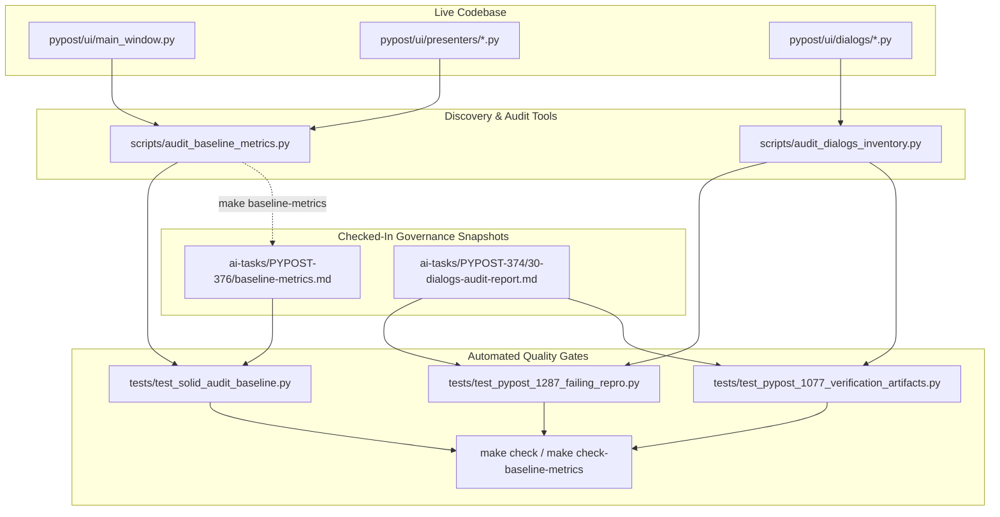

# PYPOST-1361: Refresh stale dialog audit and SOLID metric snapshots

## Research

### Background & Root Cause Analysis
During previous feature development in `pypost/ui/dialogs/mcp_servers_dialog.py` and surrounding presenter components, the physical line counts (LOC) of several modules evolved while remaining strictly within all established architectural caps:
1. **SOLID Baseline Metrics Drift**:
   - `scripts/audit_baseline_metrics.py` measures physical LOC across core and UI modules, comparing them against hard caps (`check_caps()`) and formatting a Markdown report (`format_markdown(measure_all())`).
   - `make check-baseline-metrics` runs `scripts/audit_baseline_metrics.py --check`, verifying that all measured modules stay under their configured caps. Currently, all modules pass this check.
   - However, `tests/test_solid_audit_baseline.py::TestSolidAuditBaseline::test_markdown_snapshot_matches_current_metrics` compares the checked-in Markdown snapshot at `ai-tasks/PYPOST-376/baseline-metrics.md` against live measurements. Because modules such as `main_window.py` (459 -> 462 LOC), `MainWindow` class (411 -> 414 LOC), `mcp_server_controller.py` (722 -> 784 LOC), `collections_presenter.py` (527 -> 534 LOC), `env_presenter.py` (438 -> 460 LOC), and `mcp_controls_presenter.py` (370 -> 384 LOC) changed without regenerating the baseline document, `test_markdown_snapshot_matches_current_metrics` fails due to snapshot divergence.
   - All modules remain strictly within their existing caps:
     - `pypost/ui/mcp_server_controller.py`: 784 <= cap 795
     - `pypost/ui/presenters/collections_presenter.py`: 534 <= cap 535
     - `pypost/ui/presenters/env_presenter.py`: 460 <= cap 482
     - `pypost/ui/presenters/mcp_controls_presenter.py`: 384 <= cap 407
     - `pypost/ui/main_window.py`: 462 <= cap 477
     - `MainWindow` class: 414 <= cap 426
     NO caps need to be altered or loosened.

2. **Dialog Audit Inventory Drift**:
   - `pypost/ui/dialogs/` contains nine dialog modules discovered by `scripts/audit_dialogs_inventory.py::discover_dialog_modules()`:
     - `about_dialog.py`: 43 LOC
     - `env_dialog.py`: 112 LOC
     - `hotkeys_dialog.py`: 69 LOC
     - `library_dialogs.py`: 703 LOC
     - `mcp_activity_dialog.py`: 117 LOC
     - `mcp_servers_dialog.py`: 1,219 LOC (previously recorded as 1,031 LOC)
     - `mcp_tools_overview_dialog.py`: 74 LOC
     - `save_dialog.py`: 93 LOC
     - `settings_dialog.py`: 263 LOC
     - Total discovered LOC: 2,693 LOC across 9 modules.
   - The documentation in `ai-tasks/PYPOST-374/30-dialogs-audit-report.md` retained stale figures from PYPOST-1287:
     - Header Scope: states `2,505 LOC total`
     - Inventory table: lists `mcp_servers_dialog.py` as `1,031` LOC
     - Table Total line: states `2,505 LOC`
   - Consequently:
     - `tests/test_pypost_1077_verification_artifacts.py::test_dialog_audit_report_has_full_discovery_and_coherent_aggregates` fails on 4 mismatch assertions (`mcp_servers_dialog.py` LOC, inventory row sum, scope total LOC, and Total line LOC).
     - `tests/test_pypost_1287_failing_repro.py::test_live_report_inventory_loc_matches_discovery` fails asserting recorded dict == discovered dict (`mcp_servers_dialog.py`: 1031 != 1219).

3. **Tooling & Standards**:
   - In accordance with the repository's Make-only standard, all generation and verification workflows are accessible via Make targets:
     - `make baseline-metrics`: updates `ai-tasks/PYPOST-376/baseline-metrics.md`.
     - `make check-baseline-metrics`: validates that module sizes are within caps.
     - `make test WORKERS=1 PYTEST_ARGS='...'`: executes targeted verification test suites.
     - `make check`: runs the full gate (`lint`, `test`, `verify-ai-tasks`).

## Implementation Plan

### High-Level Execution Strategy
1. **Step 3: Failing Repro Test**:
   - Confirm and document the 3 existing red tests executing through Make:
     - `tests/test_solid_audit_baseline.py::TestSolidAuditBaseline::test_markdown_snapshot_matches_current_metrics`
     - `tests/test_pypost_1077_verification_artifacts.py::test_dialog_audit_report_has_full_discovery_and_coherent_aggregates`
     - `tests/test_pypost_1287_failing_repro.py::test_live_report_inventory_loc_matches_discovery`
   - These 3 automated tests already constitute the comprehensive red regression suite capturing snapshot and inventory drift without requiring new production code or external network mocks.

2. **Step 4: Implementation & Snapshot Refresh**:
   - **Regenerate SOLID Baseline Snapshot**:
     - Run `make baseline-metrics` to update `ai-tasks/PYPOST-376/baseline-metrics.md`.
     - Verify that module caps remain strictly untouched.
   - **Synchronize Dialog Audit Report**:
     - Update `ai-tasks/PYPOST-374/30-dialogs-audit-report.md`:
       - Update **Inventory refreshed:** date and task ID (e.g. `2026-10-13 (PYPOST-1361)`).
       - Update **Scope:** line to `Scope: pypost/ui/dialogs/ (nine dialog modules, 2,693 LOC total)`.
       - Update `mcp_servers_dialog.py` inventory row LOC from `1,031` to `1,219`.
       - Update **Total:** line to `**Total:** 2,693 LOC (vs PYPOST-40 grouped ~400 LOC).`.
       - Ensure all semantic phrases, table formatting, and section headers remain intact.
   - **Verification**:
     - Run `make check-baseline-metrics`.
     - Run `make test WORKERS=1 PYTEST_ARGS='tests/test_solid_audit_baseline.py tests/test_pypost_1077_verification_artifacts.py tests/test_pypost_1287_failing_repro.py'` to confirm all 3 test suites pass.
     - Run `make check` to verify linting, testing, and AI task artifact integrity.

3. **Step 5: Code Cleanup**:
   - Review file diffs to guarantee no stray files, formatting drift, or accidental edits.
   - Confirm adherence to docstrings and PEP 8 guidelines.

4. **Step 6: Observability**:
   - Document verification telemetry, exit codes, and output patterns of `make check-baseline-metrics` and pytest regression suites.

5. **Step 7: Technical Debt Analysis**:
   - Assess technical debt regarding manual Markdown audit reports vs automated discovery generators.

6. **Step 8: Dev Docs**:
   - Document maintenance procedures for future developers when modifying dialog modules or presenter files.

---

### Mandatory — Failing Repro (next Step 3)
The three failing tests are already integrated in the repository's test suite and precisely assert the desired synchronization contract:
- **Test 1**: `tests/test_solid_audit_baseline.py::TestSolidAuditBaseline::test_markdown_snapshot_matches_current_metrics`
  - *Asserts*: `ai-tasks/PYPOST-376/baseline-metrics.md` exactly matches `scripts/audit_baseline_metrics.py --markdown` output.
  - *Current Red Failure*: Assertion mismatch on file and class LOCs for `MainWindow`, `mcp_server_controller.py`, `collections_presenter.py`, `env_presenter.py`, and `mcp_controls_presenter.py`.
- **Test 2**: `tests/test_pypost_1077_verification_artifacts.py::test_dialog_audit_report_has_full_discovery_and_coherent_aggregates`
  - *Asserts*: `ai-tasks/PYPOST-374/30-dialogs-audit-report.md` has complete discovery coverage, individual row LOC equality, aggregate row sum equality (2,693 LOC), and scope statement equality.
  - *Current Red Failure*: `mcp_servers_dialog.py: recorded LOC 1031 != discovered LOC 1219`, `inventory row sum: 2505 != discovered 2693`, `scope total LOC: declared 2505 != discovered 2693`, `Total line LOC: declared 2505 != discovered 2693`.
- **Test 3**: `tests/test_pypost_1287_failing_repro.py::test_live_report_inventory_loc_matches_discovery`
  - *Asserts*: Live report inventory dictionary exactly equals real discovery dictionary (`discover_dialog_modules()`).
  - *Current Red Failure*: `{'mcp_servers_dialog.py': 1031} != {'mcp_servers_dialog.py': 1219}`.

*Sequencing*:
- In Step 3, run the targeted test invocation via Make (`make test WORKERS=1 PYTEST_ARGS='tests/test_solid_audit_baseline.py tests/test_pypost_1077_verification_artifacts.py tests/test_pypost_1287_failing_repro.py'`) to establish the pre-fix red baseline.
- In Step 4, apply snapshot generation (`make baseline-metrics`) and report synchronization, transitioning all tests from RED to GREEN.

## Architecture

### System Component Overview & Interactions
The governance snapshot and architectural verification system consists of discovery scripts, snapshot artifacts, and regression test suites:

### Module Responsibilities & Interfaces

| Component | Path / Location | Responsibility | Interfaces / Contracts |
| --- | --- | --- | --- |
| **Baseline Metrics Auditor** | `scripts/audit_baseline_metrics.py` | Measures LOC and enforces architectural size caps on critical components. | CLI flags `--check` and `--markdown`; exports `measure_all()`, `format_markdown()`, `check_caps()`. |
| **Dialogs Inventory Auditor** | `scripts/audit_dialogs_inventory.py` | AST/file scanner discovering dialog modules and their lines of code. | Python API: `discover_dialog_modules()`, `check_audit_report_covers()`. |
| **SOLID Baseline Snapshot** | `ai-tasks/PYPOST-376/baseline-metrics.md` | Persistent snapshot of module and class LOCs and caps. | Read by `test_solid_audit_baseline.py`; generated via `make baseline-metrics`. |
| **Dialog Audit Report** | `ai-tasks/PYPOST-374/30-dialogs-audit-report.md` | Architectural SOLID evaluation and inventory report for dialogs. | Markdown sections parsed and verified by `test_pypost_1077_verification_artifacts.py` and `test_pypost_1287_failing_repro.py`. |
| **Makefile Integration** | `Makefile` | Repository entry point for building, measuring, and testing. | Targets: `baseline-metrics`, `check-baseline-metrics`, `test`, `check`. |

### Architectural Patterns & Policies
1. **Living Documentation & Architectural Governance**:
   - Governance snapshots are committed to version control to make architectural degradation visible in PR diffs.
   - Discrepancies between living documentation and actual code are treated as test failures to prevent documentation rot.
2. **Strict Inviolable Thresholds (Caps)**:
   - Baseline measurements track current sizes, while caps define the maximum permitted size.
   - Updating baselines never raises caps. Caps are only modified via deliberate architectural approvals.
3. **Make-Only Invocation Interface**:
   - All toolchains are abstracted behind GNU Make to ensure consistent execution environments across local development and CI pipelines.

## Q&A

- **Q: Are any architectural size caps being modified or increased in this task?**
  **A**: No. All measured modules remain strictly within their established caps (e.g., `mcp_server_controller.py` at 784 vs cap 795, `main_window.py` at 462 vs cap 477, `MainWindow` at 414 vs cap 426). No caps are changed.

- **Q: Does updating `30-dialogs-audit-report.md` weaken any verification checks?**
  **A**: No. The verification contracts in `test_pypost_1077_verification_artifacts.py` and `test_pypost_1287_failing_repro.py` dynamically verify that the documented numbers match live discovery. Updating the report to match current discovery restores aggregate coherence (2,693 LOC across 9 dialogs) while leaving all assertions fully intact.

- **Q: Why are there 3 red tests in the repro rather than just 1?**
  **A**: Two tests (`test_pypost_1077_verification_artifacts.py` and `test_pypost_1287_failing_repro.py`) validate the dialog audit documentation against discovery from different angles (one tests the report contract directly, the other tests live dictionary equality), while the third (`test_solid_audit_baseline.py`) guards the SOLID baseline metrics markdown snapshot. All three drifted due to recent feature additions and need synchronization.
