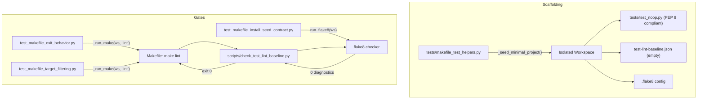

# PYPOST-1363: Repair flake8 default reporter discovery in isolated Make fixtures

## Research

### Background and Root Cause Analysis
During repository quality gate verification (`make check`), two integration test cases fail:
- `tests/test_makefile_exit_behavior.py`:
  `TestExitBehavior::test_lint_succeeds_from_bare_venv_via_venv_test`
- `tests/test_makefile_target_filtering.py`:
  `TestTargetFiltering::test_lint_succeeds_after_install`

Both tests instantiate isolated test environments via the `make_workspace` fixture defined in
`tests/makefile_test_helpers.py`. The fixture invokes `_seed_minimal_project(workspace)` to create
a minimal project containing `tests/test_noop.py`:

```python
(tests_dir / "test_noop.py").write_text(
    "import pytest\n\npytestmark = pytest.mark.timeout(10)\n\n"
    "def test_noop() -> None:\n    assert True\n",
    encoding="utf-8",
)
```

In Python formatting under PEP 8 (pycodestyle / flake8 rule E302), top-level functions and classes
must be preceded by two blank lines. In `_seed_minimal_project`, the string literal separates the
module-level assignment `pytestmark = pytest.mark.timeout(10)` and `def test_noop() -> None:` with
only `\n\n` (a single blank line).

When `make lint` executes in the isolated workspace, it delegates to
`scripts/check_test_lint_baseline.py`. This script executes `flake8` against `tests/` using the
flags `--require-plugins=flake8-print` and formatting diagnostics as tab-separated fields. Flake8
reports:
```
tests/test_noop.py:5:1: E302 expected 2 blank lines, found 1
```

In the seeded workspace, `test-lint-baseline.json` is generated with an empty entries list:
`{"version": 1, "entries": []}`. Because this E302 finding is unbaselined,
`scripts/check_test_lint_baseline.py` exits with status 1, causing `make lint` to fail with a
non-zero exit code. Consequently, tests asserting `make lint` returns 0 fail.

### Comparison with Existing Clean Seed Stubs
In `tests/test_makefile_test_lint_gate.py`, the fixture `lint_workspace` writes `test_clean.py`:
```python
(tests / "test_clean.py").write_text(
    "import pytest\n\npytestmark = pytest.mark.timeout(10)\n\n\n"
    "def test_clean() -> None:\n    assert True\n", encoding="utf-8",
)
```
Here, `\n\n\n` produces two blank lines between `pytestmark` and `def test_clean()`. Flake8 detects
0 violations, and `make lint` passes cleanly.

### Flake8 Default Reporter Discovery Context
The Jira ticket title references flake8 default reporter discovery. In flake8 execution within
isolated Make fixtures, `check_test_lint_baseline.py` specifies a custom format string
(`--format=%(path)s\t%(row)d\t%(col)d\t%(code)s\t%(text)s`). The failure mode manifests as an
unbaselined formatting finding that triggers gate rejection. Ensuring PEP 8 compliance in seeded
files allows the reporter to return cleanly with zero diagnostics.

## Implementation Plan

### High-Level Sequence
1. **Step 3: Failing Reproduction (Automated Red Tests)**
   - Utilize existing failing integration tests:
     - `tests/test_makefile_exit_behavior.py`:
       `TestExitBehavior::test_lint_succeeds_from_bare_venv_via_venv_test`
     - `tests/test_makefile_target_filtering.py`:
       `TestTargetFiltering::test_lint_succeeds_after_install`
   - Author an explicit, fast unit contract test in
     `tests/test_makefile_install_seed_contract.py`:
     `test_seed_minimal_project_conforms_to_flake8(tmp_path: Path)`
     This test calls `_seed_minimal_project(tmp_path)` and executes
     `gate.run_flake8(tmp_path)`, asserting that no flake8 findings are returned.
   - Run the contract test against unpatched code to observe immediate red failure (E302).
2. **Step 4: Implementation and Verification (Green Tests)**
   - Update `_seed_minimal_project` in `tests/makefile_test_helpers.py` to use `\n\n\n`
     between module-level assignments and `def test_noop()`.
   - Re-run the unit contract test: verifies zero flake8 findings (turns GREEN).
   - Re-run the isolated Make integration tests: both exit cleanly with return code 0 (GREEN).
   - Run full repository validation (`make check`) to ensure all quality gates pass.
3. **Steps 5–8: Workflow Completion**
   - Perform code cleanup and standards review (Step 5).
   - Document observability impact (Step 6).
   - Analyze technical debt (Step 7).
   - Update developer documentation if necessary (Step 8).

### Mandatory — Failing Repro (next Step 3)
- **Desired Behavior**:
  - `_seed_minimal_project(workspace)` must generate a PEP 8-compliant `tests/test_noop.py` stub
    that produces zero flake8 diagnostics.
  - Isolated Make fixtures running `make lint` with an empty baseline must return exit code 0.
- **Location of Red Tests**:
  - Unit contract test: `tests/test_makefile_install_seed_contract.py`
    (`test_seed_minimal_project_conforms_to_flake8`).
  - Existing integration tests:
    - `tests/test_makefile_exit_behavior.py`:
      `TestExitBehavior::test_lint_succeeds_from_bare_venv_via_venv_test`
    - `tests/test_makefile_target_filtering.py`:
      `TestTargetFiltering::test_lint_succeeds_after_install`
- **Forcing Failure Without External Dependencies**:
  The unit contract test operates on local files generated in `tmp_path` using Python's installed
  flake8 tool (`scripts.check_test_lint_baseline.run_flake8`). It requires no network access or
  live external services. On unpatched code, E302 triggers a deterministic failure.
- **Sequencing**:
  1. Author unit contract test asserting zero findings from `_seed_minimal_project`.
  2. Verify red failure in Step 3.
  3. Apply 2-blank-line fix in Step 4.
  4. Verify all contract and integration tests turn green.

## Architecture

### System Module Diagram



### Module Responsibilities

1. **`tests/makefile_test_helpers.py`**:
   - **Responsibility**: Provides shared test fixtures and workspace seeding routines for Make
     integration suites.
   - **Changes**: Fix `_seed_minimal_project` to write `tests/test_noop.py` with 2 blank lines
     (`\n\n\n`) between `pytestmark` and `def test_noop() -> None:`.

2. **`tests/test_makefile_install_seed_contract.py`**:
   - **Responsibility**: Hosts contract verification tests ensuring workspace seeds conform to
     packaging, dependency, and lint contracts.
   - **Changes**: Add `test_seed_minimal_project_conforms_to_flake8` to assert zero flake8 findings
     in projects seeded by `_seed_minimal_project`.

3. **`scripts/check_test_lint_baseline.py`**:
   - **Responsibility**: Gate enforcement script executed during `make lint`. Compares active
     flake8 findings against frozen occurrence baseline. Unchanged in this task; maintained as
     fail-closed quality gate.

4. **`tests/test_makefile_exit_behavior.py` & `tests/test_makefile_target_filtering.py`**:
   - **Responsibility**: Verify Makefile target execution, exit behavior, and target filtering in
     clean isolated workspaces. Unchanged; their assertions will now pass cleanly.

### Module Interaction Scheme
1. **Fixture Seeding**: When an integration test requests `make_workspace`,
   `_seed_minimal_project` creates `tests/test_noop.py`, `pypost/__init__.py`,
   `test-lint-baseline.json` (empty entries), and copies `.flake8` and checker scripts.
2. **Make Execution**: The test executes `_run_make(workspace, "lint")`.
3. **Lint Gate Evaluation**: `make lint` invokes `scripts/check_test_lint_baseline.py`.
4. **Flake8 Diagnostic Run**: Flake8 analyzes `tests/test_noop.py`. With 2 blank lines present,
   no E302 diagnostic is emitted.
5. **Baseline Comparison**: The checker compares 0 active findings against 0 baseline entries,
   outputs "Test lint OK (0 accepted legacy occurrences).", and exits with status 0.
6. **Assertion Pass**: `result.returncode == 0` succeeds in the test suite.

### Selected Architectural Patterns and Justification

- **Contract Testing Pattern**:
  Validating seed fixture compliance via an explicit contract test catches regressions early and
  isolates generator logic from complex, slower end-to-end Make subprocess executions.
- **Fail-Closed Baseline Policy**:
  The quality gate requires zero unbaselined violations. Rather than suppressing lint rules or
  pre-populating the baseline with known defects, seeded test stubs are corrected to satisfy PEP 8.
- **Fixture Scaffolding Encapsulation**:
  Minimal project scaffolding remains centralized in `tests/makefile_test_helpers.py`, ensuring all
  dependent integration tests benefit from uniform, compliant fixture generation.

### Definition of Main Interfaces and APIs

- **`tests/makefile_test_helpers._seed_minimal_project(workspace: Path) -> None`**:
  - Parameters: `workspace` (directory path to seed).
  - Preconditions: `workspace` exists and is writable.
  - Postconditions: Creates `workspace / "tests" / "test_noop.py"` conforming to PEP 8,
    `workspace / "pypost" / "__init__.py"`, `workspace / "test-lint-baseline.json"`, and
    configuration files.
- **`tests/test_makefile_install_seed_contract.test_seed_minimal_project_conforms_to_flake8`**:
  - Parameters: Standard pytest `tmp_path` fixture.
  - Signature: `def test_seed_minimal_project_conforms_to_flake8(tmp_path: Path) -> None`
  - Behavior: Calls `_seed_minimal_project(tmp_path)`, executes `gate.run_flake8(tmp_path)`,
    and asserts `assert not findings`.

## Q&A

- **Q: Why not suppress rule E302 in the workspace `.flake8` configuration?**
  **A**: Suppressing PEP 8 rules weakens code quality guarantees across the test suite. Seeded
  test files should exemplify compliant code rather than relaxing lint rules.

- **Q: Why not populate `test-lint-baseline.json` with the E302 finding?**
  **A**: The baseline is intended for accepted legacy debt in real codebases, not freshly
  generated test fixtures. Minimal fixtures should start completely clean.

- **Q: Does this architectural change affect production code or distribution wheels?**
  **A**: No. All changes are strictly limited to test helpers and contract test files under
  `tests/`. Production runtime behavior is unaffected.
