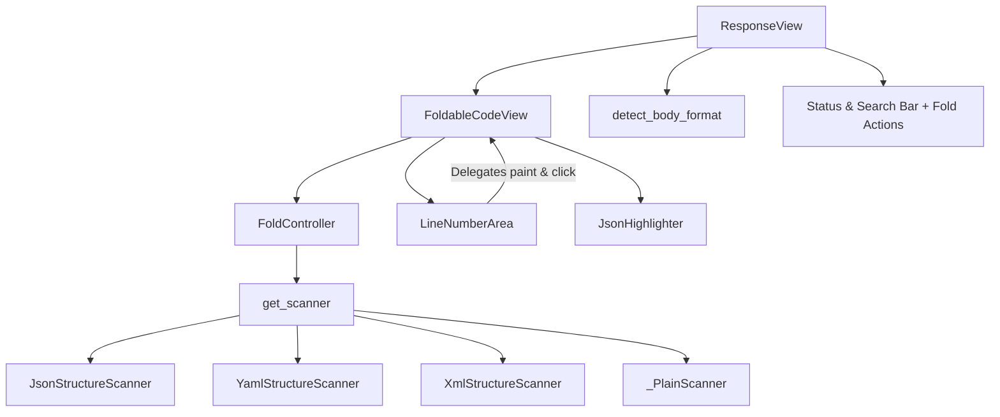

# PYPOST-1365: JSON/YAML/XML code folding in ResponseView

## Research

### Current State and Component Inventory

1. **`ResponseView` (`pypost/ui/widgets/response_view.py`)**:
   - Currently inherits from `QWidget` and hosts a status bar, search controls (search input,
     previous, next, match-case checkbox, status label), and a `body_view` widget.
   - `body_view` is currently instantiated as `QTextEdit` (`self.body_view = QTextEdit()`), set to
     `setReadOnly(True)`, and assigned object name `RESPONSE_BODY`.
   - A `JsonHighlighter` is attached directly to `self.body_view.document()`.
   - In `display_response(self, response: ResponseData)`:
     - Formats status label, time label, size label.
     - Extracts `body_str`. If `len(body_str) > LARGE_DOC_CHAR_THRESHOLD` (100 KB), skips pretty
       printing.
     - Otherwise attempts `json.loads(body_str)` and pretty-prints JSON if valid via
       `json.dumps(parsed, indent=self.indent_size)`.
     - Calls `self.body_view.setText(...)`.
   - Search functionality:
     - `self.body_view.find(text, flags)` handles Next/Previous search navigation.
     - `_count_matches()` and `_current_match_index()` use `doc = self.body_view.document()` and
       `doc.find(text, cursor, flags)`.
     - `_on_search_text_changed()` calls `self.body_view.moveCursor(QTextCursor.Start)` and
       `self.body_view.find(...)`.
   - Context menu:
     - Includes "Set Variable", "Copy" (`self.body_view.copy`), and "Select All"
       (`self.body_view.selectAll`).
   - Line numbers & folding:
     - Currently completely absent in `ResponseView`.

1. **Code Folding Architecture in `pypost/ui/widgets/fold/` and `CodeEditor`**:
   - `FoldController` (`pypost/ui/widgets/fold/fold_controller.py`):
     - Expects a `QPlainTextEdit` host editor.
     - Supports `BodyFormat` enum: `JSON`, `YAML`, `XML`, `PLAIN`.
     - Holds `_regions: list[FoldRegion]`, `_collapsed_ids: set[str]`, and `_header_by_block: dict`.
     - Manages a debounced scan timer (`_scan_timer`, 200 ms) triggered on
       `editor.document().contentsChanged`.
     - Provides `toggle(region_id: str)`, `expand_all()`, `fold_header_at_block(block_number)`,
       `is_collapsed(region_id)`, and `apply_visibility()`.
     - Block hiding mechanism: manipulates `QTextBlock.setVisible(False/True)` on the document
       blocks
       and calls `editor.viewport().update()`.
   - `StructureScanner` implementations:
     - `JsonStructureScanner`: Validates via `json.loads` and extracts object/array bounds.
     - `YamlStructureScanner`: Uses `yaml.compose_all` with `yaml.SafeLoader` to detect
       mappings/sequences.
     - `XmlStructureScanner`: Parses tag boundaries and nested elements.
     - `_PlainScanner`: Returns empty regions `[]`.
     - `get_scanner(body_format)` registry returns the appropriate scanner.
   - `LineNumberArea` (`pypost/ui/widgets/line_number_area.py`):
     - Gutter widget inheriting from `QWidget`, delegating painting and mouse events to the editor:
       - `editor.line_number_area_width()`
       - `editor.line_number_area_paint_event(event)`
       - `editor.line_number_area_mouse_press(event)`
   - `CodeEditor` (`pypost/ui/widgets/code_editor.py`):
     - Inherits from `VariableAwarePlainTextEdit` (which inherits `QPlainTextEdit`).
     - Contains extensive editable logic: auto-complete popup, variable references, key event
       handling for brackets and indents, async JSON paste formatting worker, validation controller.
     - Gutter interaction in `CodeEditor`:
       - `line_number_area_mouse_press`: single left-click within `_CHEVRON_WIDTH` toggles the fold
         header at `block_number`.

1. **Analysis: Reusing `CodeEditor` vs. Dedicated / Shared Folding Base**:
   - `CodeEditor` has heavy editable baggage: variable autocomplete popups, bracket indents,
     validation controller error banners, async paste formatting workers, variable reference
     resolution.
   - `ResponseView` requires a strictly read-only inspection viewer.
   - However, `FoldController` operates generically on any `QPlainTextEdit` host editor!
   - We need gutter line numbering, fold indicator painting, chevron click and double-click folding,
     and "Fold All" / "Unfold All" methods.
   - Extracting or introducing `FoldingPlainTextEdit` (or `FoldablePlainTextEdit` /
     `FoldableCodeView`)
     derived from `QPlainTextEdit` provides a clean, decoupled design:
     - Reuses `FoldController` and `LineNumberArea`.
     - Read-only or editable as configured.
     - Does not drag autocomplete, paste formatting, or validation popups into `ResponseView`.
     - `ResponseView.body_view` becomes an instance of this foldable widget.
     - Crucially, `QPlainTextEdit` supports all methods used in `ResponseView` and its existing
       tests:
       `toPlainText()`, `setPlainText()`, `find()`, `document()`, `textCursor()`, `setTextCursor()`,
       `moveCursor()`, `copy()`, `selectAll()`, `clear()`, `customContextMenuRequested`, etc.
       Note: `QPlainTextEdit` also has `setPlainText()`, and `setText()` can be provided as an alias
       or compatibility helper for seamless backward compatibility.

1. **Format Detection Heuristics**:
   - `Content-Type` header inspection:
     - JSON: `application/json`, `application/*+json`, `text/json`.
     - YAML: `application/x-yaml`, `text/yaml`, `application/yaml`, `text/x-yaml`.
     - XML: `application/xml`, `text/xml`, `application/*+xml`.
   - Body payload inspection (fallback when header is missing, generic `text/plain`, or ambiguous):
     - JSON: trimmed string starts with `{` and ends with `}`, or starts with `[` and ends with `]`,
       verifiable via `json.loads` or scanner pass.
     - XML: trimmed string starts with `<` (and not `<!DOCTYPE html` or `<html>` if HTML is treated
       as plain/unsupported, or XML scanner validates structure).
     - YAML: structure containing key-value mappings or sequence dashes parseable by
       `yaml.compose_all`.
     - Plain: all others fallback to `BodyFormat.PLAIN` (no folding).

1. **Interoperation with Existing Features**:
   - **Search (Ctrl+F)**:
     - When a block is folded (`setVisible(False)`), `QTextDocument.find()` will still locate
       occurrences
              in the text. However, Qt may not visibly scroll or highlight a collapsed block
       properly unless
       the block is unfolded or cursor visibility is ensured.
     - Furthermore, `QPlainTextEdit.find()` moves the cursor to the match. If the matched block is
              inside a collapsed fold region, expanding the enclosing region ensures the user sees
       the match.
   - **Context Menu & Selection**:
     - Right-click menu retains "Copy", "Select All", "Set Variable".
     - Add "Fold All" and "Unfold All" actions to the context menu and/or view controls.
   - **Gutter Indicators**:
     - Visual chevrons (expanded `▼`, collapsed `▶`) in the gutter alongside line numbers.
     - Left-click on chevron toggles the block.
     - Double-click on the gutter or line toggles the block.

---

## Implementation Plan

### High-Level Milestones

1. **Format Detector Module**:
   - Create `detect_body_format(headers: dict[str, str] | None, body: str) -> BodyFormat` in
     `pypost/ui/widgets/fold/format_detector.py`.
   - Parse `Content-Type` header with fallback to payload heuristic parsing.

1. **Foldable Text Widget (`FoldableCodeView`)**:
   - Implement `FoldableCodeView` in `pypost/ui/widgets/foldable_code_view.py` (or shared base)
     subclassing `QPlainTextEdit`.
   - Integrate `FoldController` and `LineNumberArea`.
   - Implement line number and chevron painting in `line_number_area_paint_event`.
   - Support chevron click and double-click to toggle fold.
   - Implement `fold_all()` and `unfold_all()` methods on `FoldController` and delegate in widget.
   - Provide `setText()` compatibility method delegating to `setPlainText()`.
   - Ensure `setReadOnly(True)` works cleanly.

1. **`FoldController` Enhancements**:
   - Add `collapse_all()` / `fold_all()` method to `FoldController` (collapsing all discoverable
     regions).
   - Ensure `expand_all()` works cleanly.
   - Add helper to auto-unfold enclosing regions when navigating to a block/cursor (for search
     matches).

1. **Integration into `ResponseView`**:
   - Replace `self.body_view = QTextEdit()` with `self.body_view = FoldableCodeView()`.
   - In `display_response()`:
     - Detect format using `detect_body_format(response.headers, body_str)`.
     - Configure `self.body_view.set_body_format(detected_format)`.
     - Update syntax highlighter according to format (attach `JsonHighlighter` for JSON, plain for
       others, extensible for future highlighters).
     - Populate text and trigger scan.
   - Add "Fold All" and "Unfold All" buttons in `status_layout` (or context menu actions).
   - Context menu additions: "Fold All" and "Unfold All".

1. **Search Coordination**:
   - When `_find_next()` or `_find_previous()` selects text inside a collapsed region, ensure the
     containing fold region is unfolded so the match is visibly highlighted to the user.

---

### Mandatory — Failing Repro (next Step 3)

- **What it asserts**:
  1. `ResponseView.body_view` is an instance providing code folding capabilities with a gutter and
     `fold_controller()`.
  1. Displaying a structured JSON response (`ResponseData` with JSON content and headers) detects
     `BodyFormat.JSON` and populates fold regions in `body_view.fold_controller().regions()`.
  1. Gutter click or `fold_all()` / `unfold_all()` collapses and expands blocks in `ResponseView`.
  1. Displaying a structured YAML response detects `BodyFormat.YAML` and produces fold regions.
  1. Displaying a structured XML response detects `BodyFormat.XML` and produces fold regions.
  1. Displaying a plain text response detects `BodyFormat.PLAIN` and produces zero fold regions.
  1. Searching (Ctrl+F / `_find_next`) within a folded region locates text and reveals the match.
  1. Context menu and button actions provide "Fold All" and "Unfold All".
- **Where it lives**:
  - `tests/test_response_view_folding.py`
- **How to force the failure**:
  - Currently `ResponseView.body_view` is a standard `QTextEdit` with no `fold_controller()`, no
    format detection, no gutter area, and no fold actions. Running this test against the current
        codebase fails immediately with `AttributeError` (e.g. `hasattr(view.body_view,
    'fold_controller')`
    is False) and absence of folding behavior.
- **Sequencing**:
  - Step 2: Architecture design (this artifact).
  - Step 3: Write red test `tests/test_response_view_folding.py` asserting folding presence and
    behavior in `ResponseView`. Run `make test` to verify expected failure.
  - Step 4: Implement format detector, `FoldableCodeView`, and `ResponseView` integration until
    green.

---

## Architecture

### Module Decomposition

```
pypost/ui/widgets/
├── fold/
│   ├── format_detector.py      [NEW] Header & payload inspection for BodyFormat
│   ├── fold_controller.py      [ENHANCED] Add fold_all(), ensure search region disclosure
│   ├── fold_region.py          [EXISTING] BodyFormat enum, FoldRegion dataclass
│   ├── structure_scanner.py    [EXISTING] Scanner protocol and registry
│   ├── json_structure_scanner.py [EXISTING] JSON AST scanner
│   ├── yaml_structure_scanner.py [EXISTING] YAML scanner
│   └── xml_structure_scanner.py  [EXISTING] XML scanner
├── foldable_code_view.py       [NEW] Read-only capable QPlainTextEdit with gutter & folding
├── line_number_area.py         [EXISTING] Shared gutter widget for line numbers and chevrons
├── json_highlighter.py         [EXISTING] Syntax highlighter for JSON
└── response_view.py            [MODIFIED] Uses FoldableCodeView & folding
```

### Component Diagram



### Module Responsibilities & Interfaces

#### 1. Format Detection (`pypost/ui/widgets/fold/format_detector.py`)

- **Responsibility**: Inspects HTTP response headers (specifically `Content-Type`) and body text
  to classify payload format as JSON, YAML, XML, or PLAIN.
- **Signature**:
  ```python
  def detect_body_format(
      headers: dict[str, str] | None,
      body: str,
  ) -> BodyFormat:
      """Determines the BodyFormat from Content-Type or payload heuristics."""
  ```
- **Rules**:
  - Checks `Content-Type` case-insensitively (e.g. `application/json`, `application/problem+json`,
    `text/yaml`, `application/xml`, etc.).
  - If header is absent or generic (`text/plain`, `application/octet-stream`), applies fast syntax
    sniffing:
    - If stripped body starts with `{` or `[`: verifies if valid JSON.
    - If stripped body starts with `<`: verifies XML element syntax.
    - If body matches YAML key-value pattern: verifies YAML structure.
    - Otherwise defaults to `BodyFormat.PLAIN`.

#### 2. Foldable Code View (`pypost/ui/widgets/foldable_code_view.py`)

- **Responsibility**: Subclasses `QPlainTextEdit` to provide gutter line numbers, chevron folding
  indicators, click and double-click folding, and document visibility management.
- **Public API**:
  ```python
  class FoldableCodeView(QPlainTextEdit):
      def __init__(self, parent=None, indent_size: int = 2):
          ...
      def fold_controller(self) -> FoldController:
          ...
      def set_body_format(self, body_format: BodyFormat) -> None:
          ...
      def fold_all(self) -> None:
          ...
      def unfold_all(self) -> None:
          ...
      def setText(self, text: str) -> None:
          """Compatibility alias for setPlainText()."""
          self.setPlainText(text)
      def reveal_block(self, block_number: int) -> None:
          """Expands any collapsed fold regions that enclose the given block."""
  ```
- **Gutter Interaction**:
  - Single click on chevron area (`x <= _CHEVRON_WIDTH`) toggles the fold block.
  - Double-click on gutter line number area toggles the fold block.
  - Painting renders line numbers and `▼` / `▶` indicators.

#### 3. Enhancements to `FoldController` (`pypost/ui/widgets/fold/fold_controller.py`)

- **New Methods**:
  - `collapse_all()` (or `fold_all()`): Iterates over all discovered `_regions` and marks all
    region IDs collapsed, then calls `apply_visibility()`.
  - `reveal_block(block_number: int)`: Checks all collapsed regions. If `start <= block_number <=
    end`,
    removes those region IDs from `_collapsed_ids` and applies visibility so the target block
    is visible.

#### 4. `ResponseView` Integration (`pypost/ui/widgets/response_view.py`)

- **Changes**:
  - Replace `self.body_view = QTextEdit()` with `self.body_view = FoldableCodeView()`.
  - Add "Fold All" and "Unfold All" buttons into `self.status_layout` alongside search controls.
  - In `show_context_menu()`:
    - Add "Fold All" and "Unfold All" actions if `self.body_view.fold_controller().regions()` is
      non-empty.
  - In `display_response(self, response: ResponseData)`:
    - Call `format = detect_body_format(response.headers, body_str)`.
    - Call `self.body_view.set_body_format(format)`.
    - If format is JSON, attach/activate `JsonHighlighter`. If not JSON, detach highlighter
      (or deactivate) so non-JSON syntax is not miscolored.
  - In `_find_next()` and `_find_previous()`:
    - After match selection, call `self.body_view.reveal_block(matched_block)` so that matches
      inside folded blocks are immediately visible to the user.

### Architectural Patterns

- **Separation of Concerns**: Parsing/scanning structure (`StructureScanner`), managing fold state
  (`FoldController`), rendering gutter indicators (`LineNumberArea`), and view presentation
  (`FoldableCodeView`) remain decoupled.
- **Composition over Inheritance**: `FoldableCodeView` composes `FoldController` and
  `LineNumberArea`,
  and `ResponseView` composes `FoldableCodeView`.
- **Strategy Pattern**: `StructureScanner` instances are selected via `get_scanner(body_format)`
  based on the detected format strategy.
- **Graceful Fallback**: Malformed or plain payloads seamlessly fall back to `BodyFormat.PLAIN` with
  zero disruption to text presentation, search, or copy.

---

## Q&A

**Q: Why extract `FoldableCodeView` instead of using `CodeEditor` directly?**
**A:** `CodeEditor` contains extensive editable functionality: autocomplete popups, bracket
matching,
indent manipulation, paste workers, and live schema validation with error banners. Using
`CodeEditor`
in `ResponseView` would drag in unnecessary editable complexity and potential bugs.
`FoldableCodeView`
encapsulates only what is needed: read-only text view, gutter line numbering, and code folding.

**Q: Will existing `ResponseView` tests break with `QPlainTextEdit` replacing `QTextEdit`?**
**A:** No. `QPlainTextEdit` supports `toPlainText()`, `setPlainText()`, `find()`, `document()`,
`textCursor()`, `setTextCursor()`, `copy()`, and `selectAll()`. We also provide `setText()` as a
method on `FoldableCodeView` matching `QTextEdit.setText()`, ensuring 100% API compatibility with
existing caller and test code.

**Q: How does search handle matches inside folded regions?**
**A:** When search locates a match, `reveal_block()` expands the enclosing collapsed region so the
matched text is visible and highlighted.
