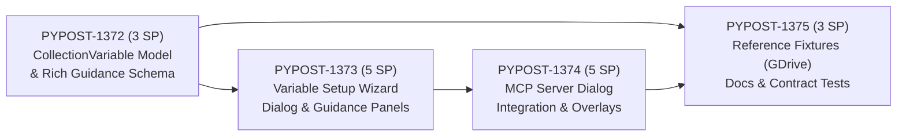
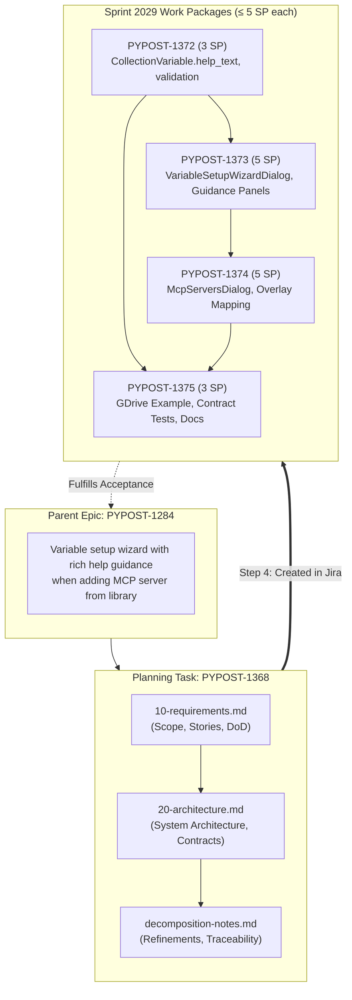
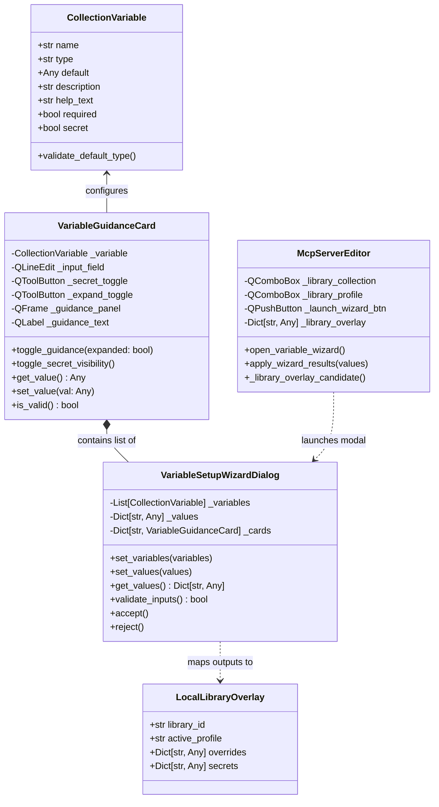

# PYPOST-1368: Decompose epic PYPOST-1284 into child tasks

Step 2 artifact for PYPOST-1368. Turns approved requirements in
[`10-requirements.md`](10-requirements.md) and decomposition notes in
[`../PYPOST-1284/decomposition-notes.md`](../PYPOST-1284/decomposition-notes.md)
into a comprehensive architectural design. This covers both the **decomposition workflow**
(mapping, contracts, sizing, and sequence for delivering child tasks WIZARD-1 through WIZARD-4
under [PYPOST-1284](https://pypost.atlassian.net/browse/PYPOST-1284)) and the
**component architecture of the target feature** (the Variable Setup Wizard and rich guidance subsystem).

---

## Research

### R-1 Jira Facts and Decomposition Scope

- **Parent Epic:** [PYPOST-1284](https://pypost.atlassian.net/browse/PYPOST-1284) — "Add variable setup wizard with rich help guidance when adding MCP server from library".
- **Planning Task:** [PYPOST-1368](https://pypost.atlassian.net/browse/PYPOST-1368) — "Decompose epic PYPOST-1284 into child tasks".
- **Sprint Target:** Sprint 2029 ("MCP Variable Setup Wizard", active sprint).
- **Project Structure:** Next-gen project schema (`simplified: true`). Issues link to parent epics via `parent = "PYPOST-1284"` (or `jira_link_issue_parent`), not legacy Epic Link fields.
- **Story Points Standard:** Fibonacci scale (1, 2, 3, 5, 8, 13). All child implementation stories must be strictly sized ≤ 5 SP to prevent blocked sprint queues and ensure each task fits cleanly into an independent Top-Down cycle (Steps 1–8).
- **Quality Gates:** Tooling standard requires all actions to run via `make` targets (`make check`, `make lint`, `make test`, `make verify-ai-tasks`).

### R-2 Current MCP Server Dialog & Variable Configuration Analysis

Inspection of [`pypost/ui/dialogs/mcp_servers_dialog.py`](file:///home/src/pypost/ui/dialogs/mcp_servers_dialog.py) reveals how library collection variables are currently handled:
1. **Form Layout (`_library_variables`):** In `_McpServerEditor`, `_library_variables` is a raw `QFormLayout` directly embedded into the main dialog form.
2. **Dynamic Population (`_populate_library_environment`):**
   - When a library collection is selected, `_populate_library_environment` iterates over raw dictionaries in `selection.get("manifest_variables", [])`.
   - Creates a basic `QLineEdit` for each variable.
   - For `secret: true`, sets `QLineEdit.EchoMode.Password`, but provides no toggle button to reveal or mask values.
   - Labels show only name and fallback default/profile value: `f"{name} (default/profile: {label_value})"`.
   - Short descriptions are relegated to widget tooltips (`field.setToolTip(str(raw["description"]))`), which are invisible on focus and provide zero room for multi-step guidance.
3. **No Dedicated Guidance Surface:** There is no expandable panel, formatted markdown viewer, or visual container for step-by-step instructions (e.g. how to obtain OAuth tokens from Google Cloud Console).
4. **Draft Overlays & Validation:**
   - Values are extracted into an overlay candidate dictionary in `_library_overlay_candidate(selection)`.
   - Validation occurs synchronously during `_accept_if_complete()`, where parse errors raise generic dialog errors rather than highlighting specific failing inputs.

### R-3 Existing Data Models and Variable Resolution

1. **`CollectionVariable` ([`pypost/models/collection_variable.py`](file:///home/src/pypost/models/collection_variable.py)):**
   - Fields: `name: str`, `type: str = "string"`, `default: Optional[Any]`, `description: str = ""`, `required: bool = False`, `secret: bool = False`.
   - Supported types: `string`, `integer`, `number`, `boolean`, `array`, `object`.
   - Validation: `model_post_init` validates non-empty name, allowed types, and default type compatibility.
   - **Gap:** Lacks `help_text` (markdown / rich instructions) and optional guidance attributes (such as documentation URLs or structured setup steps).
2. **Library Manifest & Overlay Models ([`pypost/models/library_manifest.py`](file:///home/src/pypost/models/library_manifest.py)):**
   - `LocalLibraryOverlay`: Stores `library_id`, `active_profile`, `secrets: Dict[str, Any]`, and `overrides: Dict[str, Any]`.
   - `LibraryManifest`: Manages `variables: List[CollectionVariable]` and `presets: Dict[str, Dict[str, Any]]`.
3. **Variable Resolution Engine ([`pypost/core/variable_resolver.py`](file:///home/src/pypost/core/variable_resolver.py)):**
   - Three-tier hierarchy: Defaults -> Preset Profiles -> Local Overlays.
   - Provenance tracking (`VariableProvenance`: `DEFAULT`, `PRESET_PROFILE`, `LOCAL_OVERLAY_OVERRIDE`, `LOCAL_OVERLAY_SECRET`).

### R-4 Guidance UX Patterns in PyPost

1. **Library Manager Panel ([`pypost/ui/widgets/library_manager_panel.py`](file:///home/src/pypost/ui/widgets/library_manager_panel.py)):**
   - Uses `guidance_label = QLabel(self)` with `setWordWrap(True)` and contextual help strings explaining status diagnostics.
2. **Expandable / Accordion UI Guidance Pattern:**
   - For variable configuration, an expandable card or collapsible container (`QToolButton` toggle or disclosure triangle + `QFrame` container) allows compact display while enabling users to expand rich step-by-step guidance on demand.
   - Text rendering using Qt rich-text/HTML subset or formatted markdown labels (`setTextFormat(Qt.TextFormat.RichText)`) enables clean bullet points, bold instructions, code blocks for CLI commands, and clickable documentation URLs (`setOpenExternalLinks(True)`).
3. **Secret Input Pattern:**
   - Password echo mode with an eye toggle button (`QAction` or trailing `QToolButton` toggling between `QLineEdit.EchoMode.Password` and `QLineEdit.EchoMode.Normal`).

---

## Implementation Plan

### High-Level Approach (This Decomposition Task)

1. **Architecture Formulation (This Step):**
   - Establish the end-to-end component architecture for the target wizard feature.
   - Formalize the 4-child decomposition pipeline (WIZARD-1 through WIZARD-4) with clear interfaces, contracts, sizing (all ≤ 5 SP), and dependencies.
   - Ensure explicit N/A declaration for failing repro tests in this planning task while defining repro strategies for child cycles.
2. **Child Ticket Creation & Sprint Assignment (Step 4):**
   - Create 4 child Stories in Jira linked to parent epic `PYPOST-1284`.
   - Assign all child issues to active sprint `2029`.
   - Record created keys and update traceability in roadmap and decomposition notes.
3. **Execution by Downstream Cycles:**
   - Each child story undergoes its own autonomous Top-Down workflow (Steps 1–8) in Python.

### Child Delivery Sequence



| Order | Story Key | Provisional ID | Scope & Outcome | Estimated SP |
| :--- | :--- | :--- | :--- | :---: |
| 1 | [PYPOST-1372](https://pypost.atlassian.net/browse/PYPOST-1372) | **WIZARD-1** | Extend `CollectionVariable` with `help_text`, validation, serialization, and backward compatibility. | 3 |
| 2 | [PYPOST-1373](https://pypost.atlassian.net/browse/PYPOST-1373) | **WIZARD-2** | Build standalone `VariableSetupWizardDialog`, expandable guidance cards, secret masking toggles, and validation. | 5 |
| 3 | [PYPOST-1374](https://pypost.atlassian.net/browse/PYPOST-1374) | **WIZARD-3** | Wire wizard into `McpServersDialog` / `_McpServerEditor`, overlay population, and server save pipeline. | 5 |
| 4 | [PYPOST-1375](https://pypost.atlassian.net/browse/PYPOST-1375) | **WIZARD-4** | Enrich `examples/collections/google_drive.json`, add end-to-end contract tests, and dev docs. | 3 |

### Mandatory — Failing Repro (next Step 3)

**N/A — no behavioral change.**

*Reason:* PYPOST-1368 is strictly a planning and decomposition task producing Markdown architecture artifacts and creating Jira tickets under PYPOST-1284. It does not introduce runtime code or behavioral modifications.

Automated failing tests belong in the respective child implementation cycles:
- **PYPOST-1372 (WIZARD-1) Step 3:** Red unit tests in `tests/test_collection_variable.py` asserting that `CollectionVariable` accepts and parses `help_text` (and rejects invalid guidance attributes), while verifying backward compatibility with legacy payloads lacking the field.
- **PYPOST-1373 (WIZARD-2) Step 3:** Red UI tests in `tests/test_variable_setup_wizard_dialog.py` verifying that wizard modal displays expandable guidance panels, toggles password echo mode, and validates required inputs.
- **PYPOST-1374 (WIZARD-3) Step 3:** Red integration tests in `tests/test_mcp_servers_dialog.py` asserting that clicking the wizard action opens the setup dialog, pre-populates existing profile overlays, and updates draft configurations upon acceptance.
- **PYPOST-1375 (WIZARD-4) Step 3:** Red contract test asserting that reference collection `examples/collections/google_drive.json` loads rich help guidance that validates through the wizard contract.

---

## Architecture

### 1. Decomposition System Architecture



### 2. Component Architecture of the Target Feature (PYPOST-1284)

The target feature introduces a layered architecture consisting of Data Models, UI Components, Editor Integration, and Persistence Overlays.



### 3. Layer Responsibilities & Contracts

#### Layer 1: Data Model & Schema (WIZARD-1)
- **Module:** [`pypost/models/collection_variable.py`](file:///home/src/pypost/models/collection_variable.py) and [`pypost/models/library_manifest.py`](file:///home/src/pypost/models/library_manifest.py).
- **Responsibilities:**
  - Add `help_text: str = ""` to `CollectionVariable`.
  - Support rich formatting (Markdown / HTML) within `help_text` for step-by-step credential instructions.
  - Maintain strict backward compatibility: collections or manifest JSONs omitting `help_text` default to an empty string.
  - Ensure serialization and deserialization round-trip correctly without data loss.
- **Contract / Interface:**
  ```python
  class CollectionVariable(BaseModel):
      name: str
      type: str = "string"
      default: Optional[Any] = Field(default=None, alias="default_value")
      description: str = ""
      help_text: str = ""  # New field for rich step-by-step guidance
      required: bool = False
      secret: bool = False
  ```

#### Layer 2: UI Wizard & Guidance Component (WIZARD-2)
- **Module:** `pypost/ui/dialogs/variable_setup_wizard_dialog.py` (new) and guidance widgets.
- **Responsibilities:**
  - Implement `VariableSetupWizardDialog(QDialog)` modal dialog.
  - Implement `VariableGuidanceCard(QFrame)` representing an individual variable row:
    - Label with name, requirement badge (`* Required`), and type indication.
    - Input control (`QLineEdit` or type-appropriate input).
    - Secret eye toggle button for password masking / unmasking.
    - Expandable / collapsible help guidance panel (`QToolButton` + animated/collapsible frame) showing `help_text` with rich text rendering (`Qt.TextFormat.RichText`) and clickable links (`openExternalLinks=True`).
  - Validation engine giving real-time visual feedback for missing required fields or invalid types.
- **Contract / Interface:**
  ```python
  class VariableSetupWizardDialog(QDialog):
      def __init__(
          self,
          variables: list[CollectionVariable],
          initial_values: dict[str, Any] | None = None,
          parent: QWidget | None = None,
      ) -> None: ...

      def get_values(self) -> dict[str, Any]:
          """Return mapped variable values separated into overrides and secrets."""
          ...

      def validate_all(self) -> bool:
          """Verify all required variables are populated with valid types."""
          ...
  ```

#### Layer 3: MCP Server Configuration Dialog Integration (WIZARD-3)
- **Module:** [`pypost/ui/dialogs/mcp_servers_dialog.py`](file:///home/src/pypost/ui/dialogs/mcp_servers_dialog.py) (`_McpServerEditor`).
- **Responsibilities:**
  - Introduce a prominent action button: `"Configure Variables in Wizard..."` alongside or enhancing the current `_library_variables` form.
  - When invoked, instantiate `VariableSetupWizardDialog`, passing current manifest variables and draft overlay values.
  - On dialog acceptance (`QDialog.DialogCode.Accepted`), extract results and update `_library_overlay["overrides"]` and `_library_overlay["secrets"]`.
  - Refresh inline form inputs and validate before allowing server configuration save.
- **Workflow Sequence:**
  ```mermaid
  sequenceDiagram
      actor User
      participant Editor as _McpServerEditor
      participant Wizard as VariableSetupWizardDialog
      participant Card as VariableGuidanceCard
      participant Overlay as LocalLibraryOverlay

      User->>Editor: Selects Library Collection
      Editor->>Editor: Pre-populates default/profile variables
      User->>Editor: Clicks "Configure Variables in Wizard"
      Editor->>Wizard: exec_(variables, draft_overlay)
      Wizard->>Card: Renders variable fields & collapsed help
      User->>Card: Expands help guidance
      Card-->>User: Displays step-by-step instructions & links
      User->>Card: Inputs secret token (masked) & toggles view
      User->>Wizard: Clicks "Apply / Done"
      Wizard->>Wizard: Validates required inputs
      Wizard-->>Editor: Returns updated values
      Editor->>Overlay: Updates overrides and secrets
      Editor->>User: Displays ready-to-save server status
  ```

#### Layer 4: Reference Fixtures, Docs & Contract Testing (WIZARD-4)
- **Module:** [`examples/collections/google_drive.json`](file:///home/src/examples/collections/google_drive.json), `doc/dev/variable_setup_wizard.md` (or relevant dev docs), and integration tests.
- **Responsibilities:**
  - Update `google_drive.json` collection variables (such as `google_drive_access_token`) with real-world step-by-step guidance on obtaining credentials from Google Cloud Console (APIs & Services -> OAuth Consent -> Credentials -> Scopes).
  - Add contract tests verifying that collection files with `help_text` parse through the model and load into the wizard without schema degradation.
  - Provide developer documentation for collection authors on authoring guidance.

---

## Architectural Patterns & Justifications

| Pattern | Application | Justification |
| :--- | :--- | :--- |
| **Model-View-Presenter / QDialog Modal** | `VariableSetupWizardDialog` & `_McpServerEditor` | Encapsulates complex wizard UI interactions into a dedicated modal, preventing `mcp_servers_dialog.py` (already > 1,200 LOC) from ballooning with guidance rendering logic. |
| **Composite Component Pattern** | `VariableGuidanceCard` | Encapsulates input, secret visibility toggling, requirement validation, and expandable guidance rendering into an autonomous, testable widget. |
| **Additive Schema Evolution** | Pydantic `CollectionVariable.help_text` | Defaults to empty string, ensuring zero regressions for hundreds of existing collection files and test fixtures. |
| **Separation of Overrides & Secrets** | `LocalLibraryOverlay` integration | Retains security isolation where secret credentials are kept in the overlay's secrets partition while public configuration overrides remain distinct. |

---

## Child Issue Field Contract (Created in Step 4)

The child issues created in Step 4 via Jira MCP tools conform to the following contract and live Jira keys:

| Field | Value |
| :--- | :--- |
| **Project** | `PYPOST` |
| **Issue Type** | `Story` |
| **Parent** | `PYPOST-1284` |
| **Sprint** | `2029` (MCP Variable Setup Wizard) |
| **Priority** | `Medium` |
| **Labels** | `mcp`, `library`, `wizard` |
| **Max Story Points** | ≤ 5 SP (W1: 3, W2: 5, W3: 5, W4: 3) |

### Live Jira Ticket Mapping

- **[PYPOST-1372](https://pypost.atlassian.net/browse/PYPOST-1372)** (provisional `WIZARD-1`, 3 SP): `[PYPOST-1284] Extend CollectionVariable schema with help_text guidance attribute`
- **[PYPOST-1373](https://pypost.atlassian.net/browse/PYPOST-1373)** (provisional `WIZARD-2`, 5 SP): `[PYPOST-1284] Implement VariableSetupWizardDialog and expandable VariableGuidanceCard component`
- **[PYPOST-1374](https://pypost.atlassian.net/browse/PYPOST-1374)** (provisional `WIZARD-3`, 5 SP): `[PYPOST-1284] Integrate variable setup wizard launch and overlay persistence in MCP server editor`
- **[PYPOST-1375](https://pypost.atlassian.net/browse/PYPOST-1375)** (provisional `WIZARD-4`, 3 SP): `[PYPOST-1284] Add reference collection with OAuth setup guidance and contract test suite`

---

## Q&A

| Question | Answer |
| :--- | :--- |
| **Why not implement the wizard directly in this ticket?** | PYPOST-1368 is explicitly scoped as an epic decomposition task. Decomposing PYPOST-1284 into 4 focused stories ensures each work package is sized ≤ 5 SP and undergoes an independent Top-Down cycle. |
| **Why is Step 3 failing repro N/A?** | There is no behavioral runtime code introduced in PYPOST-1368. Failing repro tests belong in child stories WIZARD-1 through WIZARD-4. |
| **Will existing collections break without `help_text`?** | No. `help_text` defaults to an empty string (`help_text: str = ""`) in `CollectionVariable`, guaranteeing complete backward compatibility. |
| **How are secrets handled in the wizard?** | `QLineEdit.EchoMode.Password` with an eye toggle button (`QToolButton`) allows users to verify their inputs while preventing accidental shoulder-surfing. |
| **Can users still edit variables inline in the editor?** | Yes, the editor can retain basic inline fields or launch the wizard for a richer guided experience, ensuring seamless backwards compatibility. |
