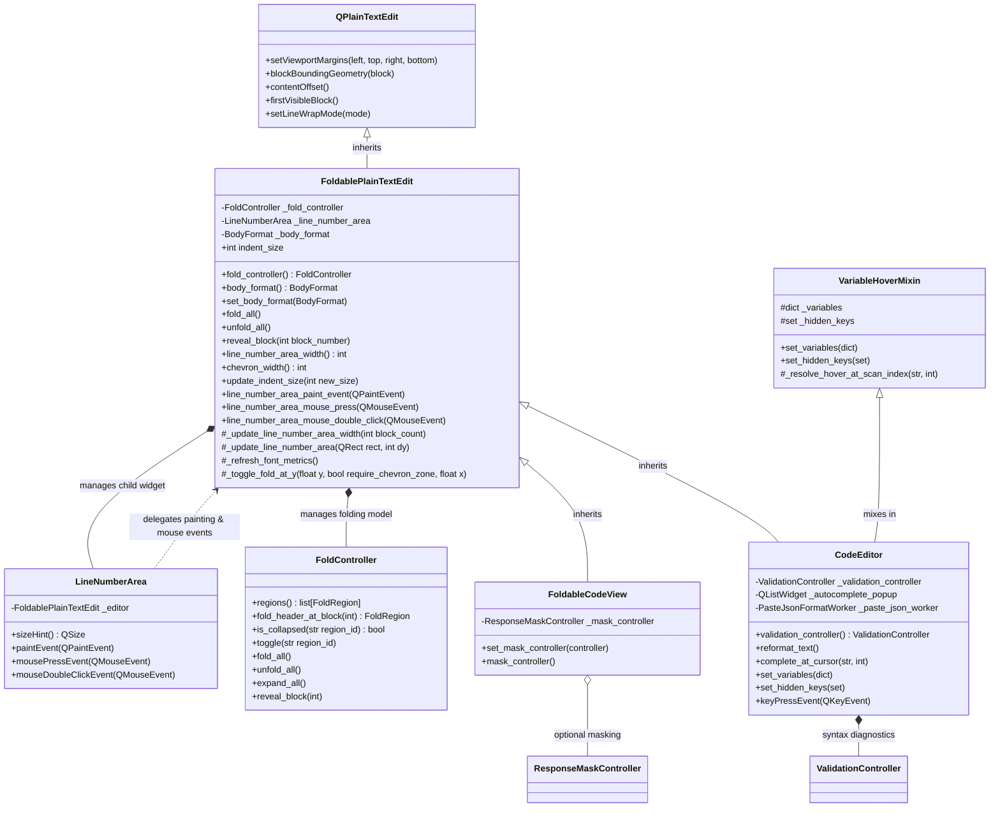

# PYPOST-1369: Unify foldable code editor and viewer gutter presentation logic

## Research

### Existing Codebase Analysis

PyPost currently has two major code display/editing widgets built on top of PySide6's `QPlainTextEdit`:

1. **[`CodeEditor`](file:///home/src/pypost/ui/widgets/code_editor.py#L51-L501)**:
   - Primary interactive text editing widget used in `RequestWidget`'s body tab ([`request_editor.py`](file:///home/src/pypost/ui/widgets/request_editor.py#L149)).
   - Subclasses `VariableAwarePlainTextEdit` (which pairs `VariableHoverMixin` with `QPlainTextEdit` in [`variable_aware_widgets.py`](file:///home/src/pypost/ui/widgets/variable_aware_widgets.py#L38-L76)).
   - Directly instantiates and manages [`LineNumberArea`](file:///home/src/pypost/ui/widgets/line_number_area.py#L8-L34) as a child gutter widget.
   - Instantiates [`FoldController`](file:///home/src/pypost/ui/widgets/fold/fold_controller.py#L1-L150) (defaulting to `BodyFormat.JSON`).
   - Instantiates [`ValidationController`](file:///home/src/pypost/ui/widgets/validate/validation_controller.py) for JSON/YAML/XML syntax diagnostics and error banners.
   - Manages variable autocomplete popups, async JSON paste formatting worker ([`paste_json_worker.py`](file:///home/src/pypost/ui/widgets/paste_json_worker.py)), auto-indentation, and bracket pairing.

2. **[`FoldableCodeView`](file:///home/src/pypost/ui/widgets/foldable_code_view.py#L26-L223)**:
   - Specialized read-only structured code viewing widget.
   - Subclasses `QPlainTextEdit` directly.
   - Directly instantiates and manages [`LineNumberArea`](file:///home/src/pypost/ui/widgets/line_number_area.py#L8-L34) as a child gutter widget.
   - Instantiates [`FoldController`](file:///home/src/pypost/ui/widgets/fold/fold_controller.py#L1-L150) (defaulting to `BodyFormat.PLAIN`).
   - Supports sensitive data masking via [`ResponseMaskController`](file:///home/src/pypost/ui/widgets/response_mask_controller.py).
   - Embedded across response viewing surfaces:
     - [`ResponseView`](file:///home/src/pypost/ui/widgets/response_view.py#L114) (`body_view: FoldableCodeView`)
     - WebSocket [`StreamDetailPane`](file:///home/src/pypost/ui/widgets/websocket/stream_view.py#L408) (`_editor: FoldableCodeView`)
     - MCP [`McpResultView`](file:///home/src/pypost/ui/widgets/mcp_client/mcp_result_view.py#L68) (`_body: FoldableCodeView`)

3. **[`LineNumberArea`](file:///home/src/pypost/ui/widgets/line_number_area.py#L8-L34)**:
   - Separate `QWidget` subclass positioned inside the host editor's left viewport margin.
   - Acts as an event-forwarding bridge to the host editor:
     - `sizeHint()` forwards to `self._editor.line_number_area_width()`.
     - `paintEvent(event)` forwards to `self._editor.line_number_area_paint_event(event)`.
     - `mousePressEvent(event)` forwards to `self._editor.line_number_area_mouse_press(event)`.
     - `mouseDoubleClickEvent(event)` dynamically queries and invokes `self._editor.line_number_area_mouse_double_click(event)` via `getattr`.

### Code Duplication Breakdown

A line-by-line comparison between [`code_editor.py`](file:///home/src/pypost/ui/widgets/code_editor.py) and [`foldable_code_view.py`](file:///home/src/pypost/ui/widgets/foldable_code_view.py) reveals significant duplication:

| Feature / Logic | `FoldableCodeView` | `CodeEditor` | Duplication Status |
| --- | --- | --- | --- |
| **Gutter Width Calculation** | `line_number_area_width()` calculates max digits from `blockCount()` + `_CHEVRON_WIDTH (14)` + `_CHEVRON_PADDING (2)` + margin (3). | Identical formula and constants (`_CHEVRON_WIDTH = 14`, `_CHEVRON_PADDING = 2`). | **100% duplicate** |
| **Chevron Width Getter** | `chevron_width() -> 14` | `chevron_width() -> 14` | **100% duplicate** |
| **Margin & Geometry Sync** | `_update_line_number_area_width()` sets viewport margins (`width, 0, 0, 0`) and `_line_number_area.setGeometry()`. | Identical logic and signal connection to `blockCountChanged`. | **100% duplicate** |
| **Viewport Scroll & Update** | `_update_line_number_area(rect, dy)` delegates scrolling (`scroll(0, dy)`) or repaint (`update(...)`). | Identical logic and signal connection to `updateRequest`. | **100% duplicate** |
| **Font Metric & Tab Stop Sync** | `changeEvent(FontChange)`, `_refresh_font_metrics()`, and `update_indent_size()` recalculate `tabStopDistance` and gutter width. | Identical logic and calculation. | **100% duplicate** |
| **Gutter Paint Event** | `line_number_area_paint_event(event)` loops over visible blocks, checks fold headers, draws chevron symbol (`▼`/`▶`), and right-aligns line number text. | Identical logic, loop bounds, coordinate translations (`contentOffset()`), and pen styling (~50 lines). | **100% duplicate** |
| **Gutter Single-Click** | `line_number_area_mouse_press(event)` determines block under cursor; if inside chevron zone (`x <= _CHEVRON_WIDTH`), toggles fold region. | Identical coordinate lookup and toggle logic. | **100% duplicate** |
| **Gutter Double-Click** | `line_number_area_mouse_double_click(event)` toggles fold region when double-clicking anywhere on the fold line in the gutter (`_toggle_fold_at_y(..., require_chevron_zone=False)`). | **Missing** from `CodeEditor` (double-clicking the gutter does nothing). | **Behavioral discrepancy** |
| **Convenience Methods** | Provides `fold_all()`, `unfold_all()`, `reveal_block()`, and `setText()` wrapper. | Missing; callers must interact directly with `fold_controller()`. | **Inconsistent API surface** |
| **`setPlainText` Handling** | Calls `self._fold_controller.expand_all()` before `super().setPlainText()`. | Calls `self._fold_controller.expand_all()` before `super().setPlainText()` (and then clears validation). | **Duplicated folding hook** |

### PySide6 & QPlainTextEdit Architectural Specifics

1. **C++ Instance Layout Constraints (No Diamond Inheritance on C++ Wrappers)**:
   In PySide6, multiple inheritance between two classes that both inherit from `QObject` or `QWidget` is strictly forbidden by Qt's object model and raises a runtime `TypeError` (`multiple bases have instance lay-out conflict` or `Cannot create a consistent method resolution order (MRO)`).
   - Therefore, `FoldablePlainTextEdit` must be a direct subclass of `QPlainTextEdit`.
   - `FoldableCodeView` can directly subclass `FoldablePlainTextEdit`.
   - `CodeEditor` cannot simultaneously subclass `FoldablePlainTextEdit` and another `QPlainTextEdit` subclass.
   - However, `VariableHoverMixin` is a pure Python mixin (inheriting from `typing.Generic[TWidget]`, NOT from `QObject`).
   - Thus, `class CodeEditor(FoldablePlainTextEdit, VariableHoverMixin):` is 100% valid, conforms to Python MRO, and preserves all variable hover capabilities cleanly.

2. **Gutter Positioning & Coordinate Mapping**:
   In `QPlainTextEdit`, a custom gutter widget is created as a child of the `QPlainTextEdit`. The editor reserves space on the left by calling `self.setViewportMargins(gutter_width, 0, 0, 0)`.
   - Gutter paint events receive rectangles in gutter local coordinates `(0, 0, gutter_width, viewport_height)`.
   - Document blocks live in document coordinates. Mapping block positions to gutter Y coordinates requires:
     ```python
     top = round(self.blockBoundingGeometry(block).translated(self.contentOffset()).top())
     bottom = top + round(self.blockBoundingRect(block).height())
     ```
   - Folded blocks have `block.isVisible() == False` and must be skipped during painting and click hit-testing.
   - When scrolling vertically, `dy` in `updateRequest` provides the exact pixel delta to pass to `_line_number_area.scroll(0, dy)`.

---

## Implementation Plan

### High-Level Execution Phases

1. **Step 3: Automated Failing Repro Test**:
   - Write automated unit tests verifying the unified contract and class hierarchy *before* refactoring production code.
   - Test asserts:
     - `FoldablePlainTextEdit` exists as a base class of both `FoldableCodeView` and `CodeEditor`.
     - Common gutter interface methods (`line_number_area_width`, `chevron_width`, `line_number_area_paint_event`, `line_number_area_mouse_press`, `line_number_area_mouse_double_click`, `fold_all`, `unfold_all`, `reveal_block`) exist on both classes.
     - Double-clicking a fold header in the gutter of `CodeEditor` toggles fold state (currently failing on `CodeEditor`).
   - Test runs and fails (RED).

2. **Step 4: Development**:
   - Create [`pypost/ui/widgets/foldable_plain_text_edit.py`](file:///home/src/pypost/ui/widgets/foldable_plain_text_edit.py) housing `FoldablePlainTextEdit(QPlainTextEdit)`.
   - Move shared gutter geometry, margin management, paint event logic, mouse click & double-click dispatch, font change listeners, and `FoldController` delegation into `FoldablePlainTextEdit`.
   - Refactor [`FoldableCodeView`](file:///home/src/pypost/ui/widgets/foldable_code_view.py) to subclass `FoldablePlainTextEdit`, retaining only viewer-specific logic (`ResponseMaskController` management and defaulting `body_format` to `BodyFormat.PLAIN`).
   - Refactor [`CodeEditor`](file:///home/src/pypost/ui/widgets/code_editor.py) to subclass `FoldablePlainTextEdit, VariableHoverMixin`, removing all redundant gutter painting/margin methods while retaining editor-specific features (`ValidationController`, autocomplete popup, async paste worker, indentation key handling).
   - Update [`LineNumberArea`](file:///home/src/pypost/ui/widgets/line_number_area.py) to annotate host editor as `FoldablePlainTextEdit`.
   - Run `make test` and `make check` to ensure all tests pass (GREEN).

3. **Steps 5–8: Cleanup, Observability, Tech Debt & Documentation**:
   - Ensure clean flake8/mypy conformance.
   - Preserve debug logging on gutter fold toggles.
   - Record technical debt reduction metrics in `40-code-cleanup.md` and `60-tech-debt.md`.
   - Document the shared base class in developer documentation (`doc/dev/`).

---

### Mandatory — Failing Repro (next Step 3)

- **Test Path**: [`tests/test_foldable_plain_text_edit.py`](file:///home/src/tests/test_foldable_plain_text_edit.py)
- **Desired Behavior Asserted**:
  1. **Class Hierarchy**:
     ```python
     assert issubclass(FoldableCodeView, FoldablePlainTextEdit)
     assert issubclass(CodeEditor, FoldablePlainTextEdit)
     ```
  2. **Unified Gutter & Folding Contract**:
     Both `FoldableCodeView` and `CodeEditor` instances expose:
     - `line_number_area_width() -> int`
     - `chevron_width() -> int`
     - `line_number_area_paint_event(event: QPaintEvent) -> None`
     - `line_number_area_mouse_press(event: QMouseEvent) -> None`
     - `line_number_area_mouse_double_click(event: QMouseEvent) -> None`
     - `fold_all() -> None`
     - `unfold_all() -> None`
     - `reveal_block(block_number: int) -> None`
  3. **Behavioral Uniformity (Gutter Double-Click Toggle)**:
     - Load nested JSON into `CodeEditor`.
     - Trigger double-click on fold header line in `CodeEditor._line_number_area`.
     - Assert that the fold region collapses.
     - In current `master`, `CodeEditor` does not implement `line_number_area_mouse_double_click`, causing this assertion to fail.
  4. **Base Class Direct Unit Tests**:
     - Instantiate standalone `FoldablePlainTextEdit`.
     - Verify gutter width responds dynamically to line count (e.g. 1 line vs 10 lines vs 100 lines).
     - Verify fold controller and gutter painting operate correctly on the base class directly.
- **Forced Failure Mechanism**:
  - `FoldablePlainTextEdit` does not exist yet (import error).
  - `CodeEditor` does not implement `line_number_area_mouse_double_click` (behavioral failure).
  - No external services or network dependencies required; pure Qt widget unit test executed via `pytest`.
- **Sequencing**:
  - Step 3: Author `tests/test_foldable_plain_text_edit.py` -> verify test fails with expected failure signature (RED).
  - Step 4: Implement `FoldablePlainTextEdit` and refactor widgets -> verify test passes (GREEN) and existing suites remain green.

---

## Architecture

### System Architecture Diagram



---

### Module Breakdown & Responsibilities

| Module Path | Primary Responsibility | Key Classes / Interfaces |
| --- | --- | --- |
| **`pypost/ui/widgets/foldable_plain_text_edit.py`** *(New)* | Common base class for plain text editors requiring line numbering, fold chevrons, and folding controller integration. Consolidates all gutter geometry, painting, and mouse event routing. | [`FoldablePlainTextEdit`](file:///home/src/pypost/ui/widgets/foldable_plain_text_edit.py) |
| **`pypost/ui/widgets/foldable_code_view.py`** *(Refactored)* | Read-only code viewer component for API responses, streams, and MCP results. Subclasses `FoldablePlainTextEdit` and integrates optional response masking. | [`FoldableCodeView`](file:///home/src/pypost/ui/widgets/foldable_code_view.py) |
| **`pypost/ui/widgets/code_editor.py`** *(Refactored)* | Interactive request body editor. Subclasses `FoldablePlainTextEdit` and mixes in `VariableHoverMixin`. Manages syntax validation, variable completion popup, and formatting. | [`CodeEditor`](file:///home/src/pypost/ui/widgets/code_editor.py) |
| **`pypost/ui/widgets/line_number_area.py`** *(Updated)* | Gutter overlay widget. Hosted by `FoldablePlainTextEdit` and forwards paint and mouse events to the host editor. | [`LineNumberArea`](file:///home/src/pypost/ui/widgets/line_number_area.py) |
| **`pypost/ui/widgets/fold/fold_controller.py`** *(Unchanged)* | Manages document folding regions, collapsed states, and block visibility toggling. | [`FoldController`](file:///home/src/pypost/ui/widgets/fold/fold_controller.py) |
| **`pypost/ui/widgets/validate/validation_controller.py`** *(Unchanged)* | Manages syntax validation errors and banner placement for interactive editors. | `ValidationController` |

---

### Component Interaction Scheme

1. **Gutter Layout & Sizing Lifecycle**:
   - `FoldablePlainTextEdit` connects `blockCountChanged` to `_update_line_number_area_width()`.
   - When line count changes (e.g. crossing digit count boundary 9 -> 10), `line_number_area_width()` calculates new gutter width.
   - `setViewportMargins(width, 0, 0, 0)` reserves canvas area.
   - `_line_number_area.setGeometry(...)` aligns the gutter with the viewport's contents rectangle.
   - In `CodeEditor`, overridden `resizeEvent` calls `super().resizeEvent(event)` and then repositions `_validation_controller.layout_error_banner()`.

2. **Gutter Painting Flow**:
   - Qt triggers `paintEvent` on `LineNumberArea`.
   - `LineNumberArea.paintEvent` calls `host_editor.line_number_area_paint_event(event)`.
   - `FoldablePlainTextEdit.line_number_area_paint_event`:
     1. Clears background using editor palette background role.
     2. Iterates visible blocks starting from `self.firstVisibleBlock()`.
     3. Checks if block is a fold header via `_fold_controller.fold_header_at_block(block_number)`.
     4. If fold header, renders chevron `▼` (expanded) or `▶` (collapsed) in chevron bounding box `(0, top, _CHEVRON_WIDTH, line_height)`.
     5. Renders right-aligned 1-based line number string in remaining gutter width.
     6. Stops when block coordinate exceeds paint event bounding rectangle.

3. **Gutter Mouse Click & Fold Toggling Flow**:
   - Single-click in gutter (`LineNumberArea.mousePressEvent`):
     - Forwards to `FoldablePlainTextEdit.line_number_area_mouse_press(event)`.
     - Resolves block under cursor Y coordinate.
     - If `event.position().x() <= _CHEVRON_WIDTH`, calls `_fold_controller.toggle(region.region_id)` and requests gutter repaint.
   - Double-click in gutter (`LineNumberArea.mouseDoubleClickEvent`):
     - Forwards to `FoldablePlainTextEdit.line_number_area_mouse_double_click(event)`.
     - Resolves block under cursor Y coordinate.
     - Double-click anywhere on the fold header line (not restricted to chevron box) calls `_fold_controller.toggle(region.region_id)` and requests repaint.

4. **Document Replacement Flow**:
   - Calling `editor.setPlainText(text)` on `FoldablePlainTextEdit`:
     1. Expands all existing folded regions via `_fold_controller.expand_all()`.
     2. Calls `super().setPlainText(text)`.
   - In `CodeEditor`:
     - Overrides `setPlainText(text)` to call `super().setPlainText(text)` and then `_validation_controller.clear()`.

---

## Q&A

- **Q1: Why choose base class inheritance (`FoldablePlainTextEdit`) over a gutter mixin?**
  - **A**: `QPlainTextEdit` gutter management tightly couples viewport margins (`setViewportMargins`), block iteration (`firstVisibleBlock()`, `blockBoundingGeometry()`, `contentOffset()`), signal connections (`blockCountChanged`, `updateRequest`), and child widget lifecycle (`LineNumberArea`). A base class provides a clean, single inheritance path deriving from `QPlainTextEdit` that encapsulates this state and behavior naturally without requiring host classes to manually wire up multiple mixin callbacks.

- **Q2: Does changing `CodeEditor`'s base class break variable hover tooltips or autocomplete?**
  - **A**: No. `VariableHoverMixin` is a pure Python class (`Generic[TWidget]`). In the new hierarchy, `CodeEditor(FoldablePlainTextEdit, VariableHoverMixin)` preserves all variable hover attributes, methods (`set_variables`, `set_hidden_keys`, `_resolve_hover_at_scan_index`), and MRO resolution. Variable autocomplete popup management is editor-specific and remains entirely within `CodeEditor`.

- **Q3: Does this refactoring change any public APIs or signals?**
  - **A**: No. All existing public methods on `FoldableCodeView` (`set_body_format`, `body_format`, `fold_controller`, `set_mask_controller`, `mask_controller`, `fold_all`, `unfold_all`, `reveal_block`) and `CodeEditor` (`set_body_format`, `fold_controller`, `validation_controller`, `reformat_text`, `set_variables`, `set_hidden_keys`) remain fully intact and backward-compatible. In fact, `CodeEditor` gains `fold_all()`, `unfold_all()`, and `reveal_block()` as unified convenience methods.

- **Q4: How does this fix the double-click fold behavior inconsistency?**
  - **A**: Previously, only `FoldableCodeView` implemented `line_number_area_mouse_double_click(event)`. Because `LineNumberArea.mouseDoubleClickEvent` used `getattr(self._editor, "line_number_area_mouse_double_click", None)`, double-clicking on `CodeEditor`'s gutter silently did nothing. By implementing `line_number_area_mouse_double_click` in `FoldablePlainTextEdit`, both `FoldableCodeView` and `CodeEditor` now support double-click fold toggling out of the box.

- **Q5: Are there any performance implications during scrolling or typing?**
  - **A**: None. The logic executed during paint events and scrolling is identical to the current implementation. Unifying the logic in a common base class eliminates code duplication without adding indirection overhead or runtime performance penalties.
