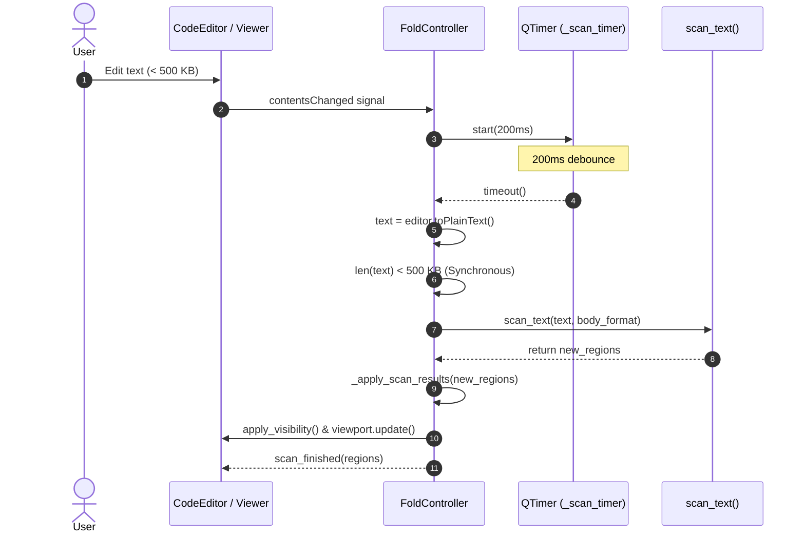
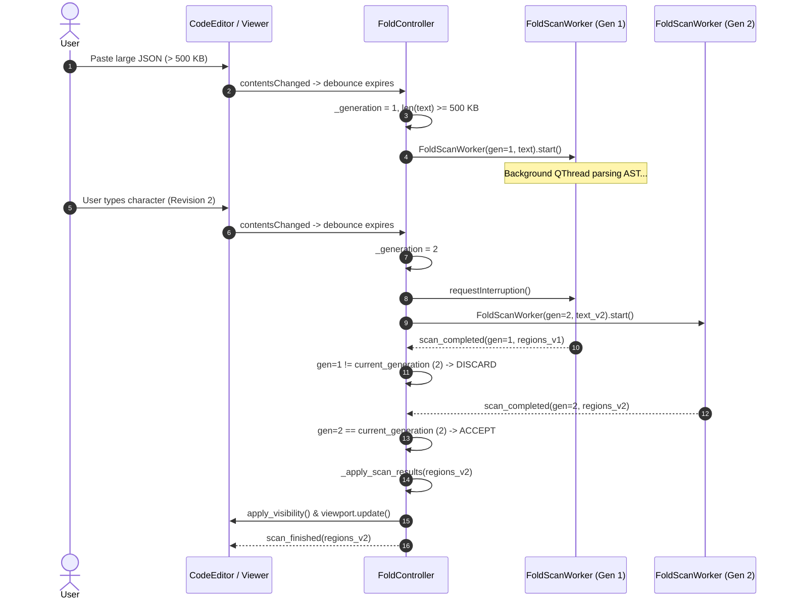
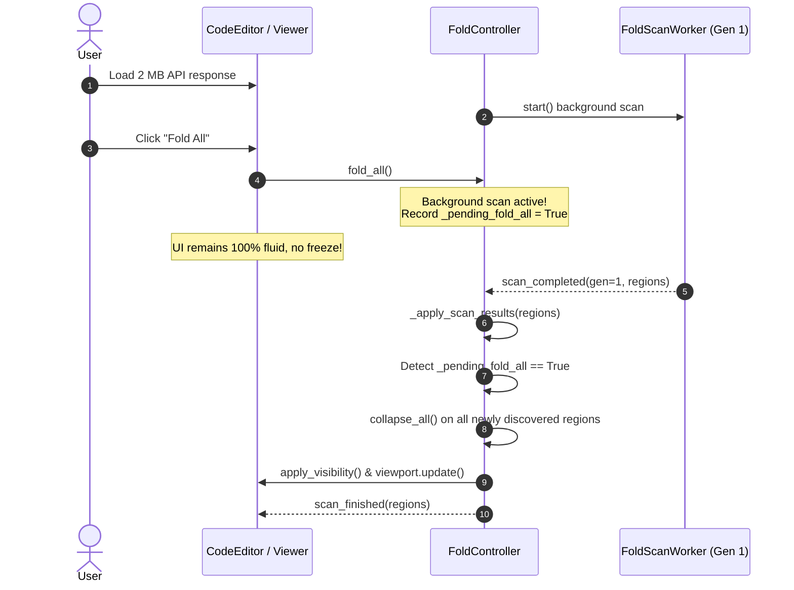

# PYPOST-1370: Background folding scanner for large documents

## Research

### Existing Codebase Analysis

PyPost provides hierarchical code folding in code editors and viewers across the application:
- [`CodeEditor`](file:///home/src/pypost/ui/widgets/code_editor.py) (used in Request Body editing)
- [`FoldableCodeView`](file:///home/src/pypost/ui/widgets/foldable_code_view.py) (used in [`ResponseView`](file:///home/src/pypost/ui/widgets/response_view.py), WebSocket [`StreamDetailPane`](file:///home/src/pypost/ui/widgets/websocket/stream_view.py), and [`McpResultView`](file:///home/src/pypost/ui/widgets/mcp_client/mcp_result_view.py))
- [`FoldablePlainTextEdit`](file:///home/src/pypost/ui/widgets/foldable_plain_text_edit.py) (the shared base widget unifying gutter presentation and fold event delegation, introduced in PYPOST-1369)

#### Current Folding Architecture in `pypost/ui/widgets/fold/`

The folding subsystem currently consists of:
1. **[`FoldController`](file:///home/src/pypost/ui/widgets/fold/fold_controller.py)**:
   - Attached to a `QPlainTextEdit` host widget.
   - Listens to `editor.document().contentsChanged` and schedules a scan via `QTimer` with `_DEBOUNCE_MS = 200`.
   - On timer expiration, invokes `_run_scan()` synchronously on the UI thread:
     ```python
     def _run_scan(self) -> None:
         scanner = get_scanner(self._body_format)
         new_regions = scanner.scan(self._editor.document())
         ...
     ```
   - Maintains `_regions: list[FoldRegion]`, `_collapsed_ids: set[str]`, and `_header_by_block: dict[int, FoldRegion]`.
   - Applies block visibility updates (`block.setVisible(False)`) and triggers viewport repainting.
   - Preserves collapsed state across scans via `_region_unchanged()`.
   - Provides fold operations: `toggle()`, `collapse_all()` / `fold_all()`, `expand_all()` / `unfold_all()`, `reveal_block()`, and `ensure_scanned()`.

2. **Format Scanners**:
   - [`StructureScanner`](file:///home/src/pypost/ui/widgets/fold/structure_scanner.py): A `typing.Protocol` declaring `scan(self, document: QTextDocument) -> list[FoldRegion]`.
   - Registry `_SCANNERS` mapping `BodyFormat` enum members (`JSON`, `YAML`, `XML`) to scanner instances:
     - [`JsonStructureScanner`](file:///home/src/pypost/ui/widgets/fold/json_structure_scanner.py): Parses JSON with `json.loads` for validation and custom character scanner `_scan_regions(text)` tracking brace/bracket nesting and path hierarchies.
     - [`YamlStructureScanner`](file:///home/src/pypost/ui/widgets/fold/yaml_structure_scanner.py): Parses YAML using `yaml.compose_all(stream, Loader=yaml.SafeLoader)` and extracts AST node line boundaries.
     - [`XmlStructureScanner`](file:///home/src/pypost/ui/widgets/fold/xml_structure_scanner.py): Parses XML tags, attributes, CDATA, comments, and nesting depth.
     - `_PlainScanner`: Returns an empty list of fold regions for plain text.

#### Existing Background Worker Pattern in PyPost

In [`pypost/ui/widgets/paste_json_worker.py`](file:///home/src/pypost/ui/widgets/paste_json_worker.py), PyPost established a proven concurrency pattern for offloading CPU-intensive text transformations from the UI thread:
- **Subclassing `QThread`**: `PasteJsonFormatWorker(QThread)` encapsulates the long-running computation.
- **Generation Counters**: A monotonic integer `generation_id` tracks user revisions. Obsolete results from superseded operations are discarded upon arrival if `generation != self._current_generation`.
- **Qt Signals across Thread Boundaries**: `finished_with_result = Signal(int, object)` emits completed data back to the UI thread slot. PySide6 automatically uses queued connections (`Qt.QueuedConnection`) when emitting signals across thread boundaries.
- **Lifecycle & Memory Management**: `worker.finished.connect(worker.deleteLater)` guarantees worker threads are cleaned up by Qt's event loop upon completion.
- **Interruption Requests**: Calls `worker.requestInterruption()` before spawning a new worker to cooperatively cancel stale threads.

### Thread Safety Analysis & Qt Constraints

1. **`QTextDocument` is NOT Thread-Safe Across Threads**:
   - Qt's `QTextDocument` and `QTextBlock` classes are reentrant but strictly NOT thread-safe for concurrent read/write across multiple threads.
   - If a background thread were to access `self._editor.document()` while the user types, selects text, or scrolls on the main UI thread, race conditions, memory corruption, and segmentation faults would occur.
   - **Crucial Architectural Rule**: The background worker must NEVER receive or access `QTextDocument` or any `QWidget`/`QObject` UI handle. Instead, `FoldController` on the UI thread extracts a clean snapshot of text as an immutable Python `str` (`editor.toPlainText()`) and passes the string along with the `BodyFormat` enum to the worker.

2. **Scanner Text-Based Extraction**:
   - Inspection of all three scanners ([`json_structure_scanner.py`](file:///home/src/pypost/ui/widgets/fold/json_structure_scanner.py#L24), [`yaml_structure_scanner.py`](file:///home/src/pypost/ui/widgets/fold/yaml_structure_scanner.py#L50), [`xml_structure_scanner.py`](file:///home/src/pypost/ui/widgets/fold/xml_structure_scanner.py#L90)) reveals that every scanner immediately extracts `text = document.toPlainText()` and operates exclusively on `str`!
   - Therefore, decoupling AST parsing from `QTextDocument` into a pure-text scanning function `scan_text(text: str, body_format: BodyFormat) -> list[FoldRegion]` is completely natural, 100% backward-compatible, and inherently thread-safe.

3. **Size Threshold Evaluation**:
   - Requirement FR-1 specifies a threshold of 500 KB:
     `THRESHOLD_BYTES = 500 * 1024` (512,000 bytes/characters).
   - Measuring document size: For fast evaluation on the UI thread, `len(text)` (or UTF-8 encoded length `len(text.encode("utf-8"))`) is evaluated.
   - Small documents (`< 500 KB`): Run synchronously on the UI thread with zero thread dispatch latency.
   - Large documents (`>= 500 KB`): Offloaded to `FoldScanWorker` in the background.

---

## Architecture

### System Module Diagram

```mermaid
graph TD
    subgraph UI Thread (Main Event Loop)
        Editor["FoldablePlainTextEdit / CodeEditor / FoldableCodeView"]
        Doc["QTextDocument"]
        FC["FoldController (QObject)"]
        Timer["QTimer (Debounce 200ms)"]
        Gutter["LineNumberArea (Gutter Chevrons)"]
    end

    subgraph Background Execution
        Worker["FoldScanWorker (QThread)"]
        TextScanner["scan_text(text, body_format)"]
        JSONParser["JsonStructureScanner"]
        YAMLParser["YamlStructureScanner"]
        XMLParser["XmlStructureScanner"]
    end

    Doc -->|"contentsChanged"| FC
    FC -->|"start / restart"| Timer
    Timer -->|"timeout"| FC
    
    FC -->|"Doc size < 500 KB<br/>(Synchronous)"| TextScanner
    FC -->|"Doc size >= 500 KB<br/>(Asynchronous)"| Worker
    
    Worker -->|"runs on worker thread"| TextScanner
    TextScanner --> JSONParser
    TextScanner --> YAMLParser
    TextScanner --> XMLParser
    
    Worker -.->|"scan_completed(generation, regions)<br/>Qt.QueuedConnection"| FC
    FC -->|"_apply_scan_results"| Gutter
    FC -->|"apply_visibility"| Doc
```

### Module Breakdown and Responsibilities

#### 1. `pypost/ui/widgets/fold/fold_worker.py` (New Module)
- **Class**: `FoldScanWorker(QThread)`
- **Responsibilities**:
  - Encapsulates background AST parsing and fold region extraction off the main UI thread.
  - Holds an immutable text string snapshot `text: str`, `body_format: BodyFormat`, and `generation: int`.
  - Defines Qt signals:
    - `scan_completed = Signal(int, list)`: Emits `(generation, regions: list[FoldRegion])` upon successful scan completion.
    - `scan_failed = Signal(int, str)`: Emits `(generation, error_message)` if an unexpected parsing exception occurs.
  - Implements `run()`:
    - Periodically checks `self.isInterruptionRequested()` to abort computation cooperatively if a newer revision has already superseded this task.
    - Calls `scan_text(self._text, self._body_format)`.
    - If interrupted before emission, silently exits without emitting.
    - If finished, emits `scan_completed`.
    - Exception handling: catches parser errors, logs diagnostics, and emits an empty region list safely.

#### 2. `pypost/ui/widgets/fold/structure_scanner.py` (Refactored Module)
- **Functions & Protocols**:
  - Adds pure function `scan_text(text: str, body_format: BodyFormat) -> list[FoldRegion]`:
    - Direct entry point taking raw string and format.
    - Callable by both synchronous scans and background worker threads.
    - Checks format registry and delegates to scanner implementation.
  - Updates `StructureScanner` protocol to support `scan_text(text: str) -> list[FoldRegion]` while preserving `scan(document: QTextDocument) -> list[FoldRegion]` for 100% backward compatibility.
  - All format scanners (`JsonStructureScanner`, `YamlStructureScanner`, `XmlStructureScanner`) implement `scan_text(text: str)`.

#### 3. `pypost/ui/widgets/fold/fold_controller.py` (Enhanced Module)
- **Class**: `FoldController(QObject)` (inherits from `QObject` to support custom signals, thread-safe slots, and clean Qt object hierarchy parented to `editor`).
- **New Signals**:
  - `scan_finished = Signal(list)`: Emitted when a scan (synchronous or background) completes and regions are applied to the controller. Enables asynchronous assertions in tests and future progress indicators.
- **Threshold & Concurrency Constants**:
  - `LARGE_DOCUMENT_THRESHOLD_BYTES = 500 * 1024` (500 KB).
  - `_DEBOUNCE_MS = 200`.
- **State Additions**:
  - `_generation: int = 0`: Monotonically increasing revision counter.
  - `_active_worker: FoldScanWorker | None = None`: Reference to in-flight worker thread.
  - `_pending_fold_all: bool = False`: Flag recording bulk collapse intent if user clicks "Fold All" while a background scan is active.
  - `_pending_unfold_all: bool = False`: Flag recording bulk expand intent.
- **Methods & Workflow**:
  - `_run_scan()`:
    - Increments `_generation += 1`.
    - Retrieves `text = self._editor.toPlainText()`.
    - Evaluates payload size against `LARGE_DOCUMENT_THRESHOLD_BYTES`.
    - **Synchronous Path (`< 500 KB`)**:
      - Cancels any running worker (`if self._active_worker: self._active_worker.requestInterruption()`).
      - Calls `new_regions = scan_text(text, self._body_format)`.
      - Calls `self._apply_scan_results(new_regions)`.
    - **Asynchronous Path (`>= 500 KB`)**:
      - If `self._active_worker and self._active_worker.isRunning()`:
        - Calls `self._active_worker.requestInterruption()`.
      - Instantiates `worker = FoldScanWorker(self._generation, text, self._body_format)`.
      - Connects `worker.scan_completed.connect(self._on_background_scan_completed)`.
      - Connects `worker.finished.connect(worker.deleteLater)`.
      - Assigns `self._active_worker = worker`.
      - Starts worker: `worker.start()`.
  - `_on_background_scan_completed(generation: int, regions: list[FoldRegion])`:
    - Checks `if generation != self._generation:` -> Discards obsolete results.
    - Calls `self._apply_scan_results(regions)`.
    - Handles pending bulk actions:
      ```python
      if self._pending_fold_all:
          self._pending_fold_all = False
          self.collapse_all()
      elif self._pending_unfold_all:
          self._pending_unfold_all = False
          self.expand_all()
      ```
    - Clears `self._active_worker = None`.
  - `_apply_scan_results(new_regions: list[FoldRegion])`:
    - Reconciles existing collapsed IDs with new regions using `_region_unchanged`.
    - Updates `self._regions` and `self._header_by_block`.
    - Calls `self.apply_visibility()`.
    - Redraws viewport via `self._editor.viewport().update()`.
    - Emits `self.scan_finished.emit(self._regions)`.
  - `collapse_all()` / `fold_all()`:
    - If a background scan is running or scheduled:
      - Sets `self._pending_fold_all = True`.
      - If `_scan_timer.isActive()`, triggers scan dispatch immediately.
    - Otherwise, performs immediate collapse of existing regions.
  - `expand_all()` / `unfold_all()`:
    - Cancels `_pending_fold_all = False`.
    - Immediately expands all blocks.
  - `ensure_scanned()`:
    - If timer is active, stops timer and runs scan dispatch.
    - If payload is `< 500 KB`, scan finishes immediately.
    - If payload is `>= 500 KB` and worker is running, caller can wait for `scan_finished` signal if synchronous completion is desired (e.g. in tests using `QSignalSpy` or helper).

---

### Concurrency Sequence Diagrams

#### Scenario 1: Fast Synchronous Scan (< 500 KB)



#### Scenario 2: Asynchronous Background Scan (>= 500 KB) & Rapid Edit Cancellation



#### Scenario 3: Bulk "Fold All" During In-Flight Background Scan



---

## Implementation Plan

### High-Level Execution Phases

1. **Step 3: Automated Failing Repro Test**:
   - Write automated test suite in [`tests/test_background_fold_scanner.py`](file:///home/src/tests/test_background_fold_scanner.py).
   - Test verifies threshold dispatch, non-blocking execution, background worker thread identity, generation counter cancellation, structural equivalence, and bulk fold coordination.
   - Run tests against existing codebase and confirm forced failure (RED).

2. **Step 4: Development**:
   - Create [`pypost/ui/widgets/fold/fold_worker.py`](file:///home/src/pypost/ui/widgets/fold/fold_worker.py) with `FoldScanWorker(QThread)`.
   - Update [`pypost/ui/widgets/fold/structure_scanner.py`](file:///home/src/pypost/ui/widgets/fold/structure_scanner.py) with `scan_text(text: str, body_format: BodyFormat) -> list[FoldRegion]`.
   - Update [`pypost/ui/widgets/fold/fold_controller.py`](file:///home/src/pypost/ui/widgets/fold/fold_controller.py) to subclass `QObject`, manage generation counters, evaluate 500 KB threshold, manage background workers, and handle pending fold actions.
   - Export new components in [`pypost/ui/widgets/fold/__init__.py`](file:///home/src/pypost/ui/widgets/fold/__init__.py).
   - Run unit and integration tests until all tests pass (GREEN).

3. **Steps 5–8: Cleanup, Observability, Tech Debt & Documentation**:
   - Static analysis and type checking (`make check`, `make lint`, `make typecheck`).
   - Structured logging of background scan lifecycle (timing, payload size, generation, cancelled/stale scans).
   - Document background scanner architecture in `doc/dev/` developer documentation.

---

### Mandatory — Failing Repro (next Step 3)

#### Target Test Path
- **File**: [`tests/test_background_fold_scanner.py`](file:///home/src/tests/test_background_fold_scanner.py)

#### Desired Assertions & Test Scenarios

1. **Threshold-Based Dispatch (`test_document_size_threshold_dispatch`)**:
   - Given a `FoldController` on a `QPlainTextEdit`:
     - Load a payload `< 500 KB` (e.g., 20 KB structured JSON). Trigger scan. Assert that no background worker is spawned (`fc._active_worker is None`) and regions are populated synchronously.
     - Load a payload `>= 500 KB` (e.g., 550 KB generated JSON). Trigger scan. Assert that `fc._active_worker` is instantiated as a `FoldScanWorker`, is running in a separate thread, and returns immediately without blocking.

2. **Separate Background Thread Execution (`test_background_worker_thread_isolation`)**:
   - Assert that the code executing inside `FoldScanWorker.run()` runs on a thread distinct from `QApplication.instance().thread()`.
   - Assert that completed regions are safely delivered back to the main UI thread via Qt signal/slot.

3. **Stale Scan Invalidation & Generation Counters (`test_stale_scan_cancellation_on_rapid_edits`)**:
   - Emit a large payload with generation 1.
   - Immediately before generation 1 finishes, emit a second large payload with generation 2.
   - Assert that generation 1 is requested to interrupt (`isInterruptionRequested() == True`).
   - When generation 1 completes, assert that its results are discarded and only generation 2's regions are applied to `FoldController.regions()`.

4. **Structural Equivalence Across Formats (`test_background_scan_equivalence_json_yaml_xml`)**:
   - Verify for large JSON, YAML, and XML documents that `scan_text(text, format)` produces identical `FoldRegion` structures (same `region_id`, `start_block`, `end_block`, `header_block`, `kind`) as synchronous parsing.

5. **Fold State Preservation Across Background Updates (`test_fold_state_preserved_after_background_scan`)**:
   - Collapse a specific region in a large document.
   - Trigger a background scan with updated content that keeps the collapsed region's boundaries intact.
   - Assert that upon scan completion, the region remains collapsed in `fc.is_collapsed(region_id)`.

6. **Pending Bulk Actions During In-Flight Scan (`test_bulk_fold_queued_during_background_scan`)**:
   - Trigger a background scan on a large payload.
   - While the worker is running, call `fc.fold_all()`.
   - Wait for `fc.scan_finished`.
   - Assert that all newly discovered regions are collapsed without requiring a second manual action and without UI thread blocking.

#### Forced Failure Mechanism
Before implementing Step 4:
- `FoldController` does not subclass `QObject`, has no `_active_worker`, has no `LARGE_DOCUMENT_THRESHOLD_BYTES`, always parses synchronously on the UI thread, and lacks the `scan_finished` signal.
- Running `pytest tests/test_background_fold_scanner.py` will fail immediately with `AttributeError` (e.g. missing attributes or missing background dispatch assertions), confirming a forced failure (RED).

#### Dependency Isolation
- No external network, live API, or filesystem dependencies.
- Uses programmatic in-memory payload generators to construct valid JSON, YAML, and XML documents exceeding 500 KB.
- Utilizes PySide6 `QTest` / `QSignalSpy` with standard `@pytest.mark.timeout(30)` timeout guards.

#### Sequencing
1. **Step 2 (Now)**: Architecture and interface design documented in `20-architecture.md` and roadmap updated.
2. **Step 3**: Create `tests/test_background_fold_scanner.py` and verify red execution.
3. **Step 4**: Implement `FoldScanWorker`, `scan_text` registry, threshold dispatch, and signal handling until green.

---

## Q&A

- **Q1: Why pass a raw `str` to the background worker rather than `QTextDocument`?**
  - **A**: `QTextDocument` is not thread-safe. Accessing a `QTextDocument` or its blocks from a background worker while the main UI thread handles user keystrokes, cursor navigation, or scrolling causes race conditions and memory faults. Passing an immutable Python `str` snapshot eliminates all shared mutable state between threads.

- **Q2: Why use `QThread` rather than `concurrent.futures.ThreadPoolExecutor`?**
  - **A**: PySide6's `QThread` integrates seamlessly with Qt's event loop and Meta-Object system:
    - Signals emitted from a `QThread` to a `QObject` on the main thread automatically use `Qt.QueuedConnection`, marshalling arguments safely across thread boundaries without manual locking.
    - Cooperative cancellation via `requestInterruption()` and `isInterruptionRequested()` is built-in.
    - Qt handles worker thread destruction cleanly with `worker.finished.connect(worker.deleteLater)`.
    - This pattern is already established and proven in [`paste_json_worker.py`](file:///home/src/pypost/ui/widgets/paste_json_worker.py).

- **Q3: What exact threshold is used, and how is size calculated?**
  - **A**: The threshold is 500 KB, defined as `LARGE_DOCUMENT_THRESHOLD_BYTES = 500 * 1024` (512,000 bytes/characters). On the UI thread, `len(text)` is checked before dispatch. If `len(text) < 500 * 1024`, the scan runs synchronously; otherwise, it is dispatched to `FoldScanWorker`.

- **Q4: How does this interact with fast typing in the editor?**
  - **A**: Keystrokes are first debounced by `_scan_timer` (200 ms). When the timer fires, `_generation` is incremented. If a background worker is already running from a prior edit, `requestInterruption()` is called on the active worker and a new worker is launched for the current document. If the old worker finishes before noticing interruption, `FoldController` checks the generation ID and discards the stale results immediately.

- **Q5: What happens to collapsed regions when background scan results arrive?**
  - **A**: Existing collapsed region IDs are reconciled using `_region_unchanged`: if a region's ID and line boundaries match an existing collapsed region, its collapsed state is preserved. If lines or structure changed, stale IDs are discarded. Finally, `apply_visibility()` applies block visibility on the UI thread without cursor jumps or flickering.
