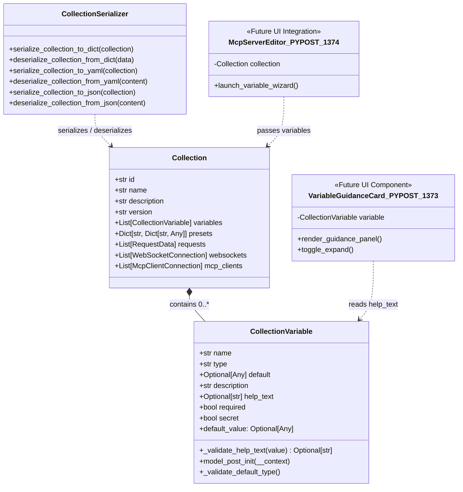

# PYPOST-1372: Extend CollectionVariable schema with help_text guidance attribute

Step 2 artifact for [PYPOST-1372](https://pypost.atlassian.net/browse/PYPOST-1372) (WIZARD-1 under parent epic [PYPOST-1284](https://pypost.atlassian.net/browse/PYPOST-1284)). Defines the high-level architecture and implementation plan for extending the `CollectionVariable` model with an optional `help_text` guidance attribute, input validation, whitespace normalization, and backward-compatible serialization.

---

## Research

### R-1 Existing Data Model (`pypost/models/collection_variable.py`)

Inspection of `pypost/models/collection_variable.py` shows the current definition:

```python
class CollectionVariable(BaseModel):
    """Metadata schema for one variable defined in a self-contained collection."""

    model_config = ConfigDict(populate_by_name=True)

    name: str
    type: str = "string"
    default: Optional[Any] = Field(default=None, alias="default_value")
    description: str = ""
    required: bool = False
    secret: bool = False
```

Key characteristics:
1. **Pydantic V2 BaseModel**: Inherits from `pydantic.BaseModel` and uses `ConfigDict(populate_by_name=True)` to allow both field names and aliases (such as `default` and `default_value`) during instantiation and serialization.
2. **Current Fields**:
   - `name`: Identifier string, validated in `model_post_init` to be non-empty and non-whitespace.
   - `type`: Whitelisted type (`"string"`, `"integer"`, `"number"`, `"boolean"`, `"array"`, `"object"`).
   - `default`: Optional default value validated against `type` via `_validate_default_type()`.
   - `description`: Short description string (defaults to `""`), primarily used for tooltips and compact listings.
   - `required`: Boolean flag indicating whether the variable must be set.
   - `secret`: Boolean flag indicating whether values should be masked as sensitive credentials.
3. **Absence of Guidance Attribute**: Lacks a structured attribute to hold multi-paragraph setup guidance, acquisition instructions, markdown bullet points, code snippets, or reference URLs needed by complex integrations (such as Google Cloud OAuth, GitHub PATs, or Jira API tokens).

### R-2 Validation Lifecycle & Strict Type Enforcement

1. **Pydantic V2 Coercion vs Strict Validation**:
   - By default in Pydantic V2, standard type annotations without strict mode may coerce non-string scalar types (e.g. integers or floats) into strings.
   - Requirement **FR-2** explicitly requires: *"If provided, `help_text` must be a valid string. Non-string inputs (e.g., integers, lists, dicts) must raise a `ValidationError` / `ValueError`."*
   - Therefore, `help_text` must be validated to strictly accept `str` or `None`. A `@field_validator("help_text", mode="before")` ensures that inputs such as `123`, `[1, 2]`, or `{"a": 1}` are rejected immediately before coercion, raising `ValueError` (which Pydantic encapsulates as `ValidationError`).
2. **Whitespace Normalization (FR-3)**:
   - When a string is passed, leading and trailing whitespace should be stripped.
   - A whitespace-only string (e.g. `"   "`) or empty string (`""`) contains no actionable guidance and should normalize cleanly to `None`, ensuring clean state representation without extraneous empty strings in persistent schemas.
   - Multiline markdown content with internal indentation (code blocks, lists) must have internal line indentation preserved while outer boundary whitespace is trimmed.

### R-3 Serialization & Round-Trip Compatibility

1. **Model Dumps (`model_dump`, `model_dump_json`)**:
   - In Pydantic V2, `model_dump()` produces a Python dictionary representing model fields.
   - With `help_text: Optional[str] = Field(default=None, ...)`, serializing an instance where `help_text="Instructions..."` preserves `help_text: "Instructions..."`.
   - When omitted, `help_text` defaults to `None`.
2. **Collection Serializer Integration (`pypost/core/collection_serializer.py`)**:
   - `Collection` in `pypost/models/models.py` defines `variables: List[CollectionVariable] = Field(default_factory=list)`.
   - `serialize_collection_to_dict` invokes `collection.model_dump(mode="json")`.
   - `serialize_collection_to_yaml` and `serialize_collection_to_json` serialize the dumped dictionary to YAML and JSON, respectively.
   - `deserialize_collection_from_yaml` and `deserialize_collection_from_json` parse file content into dictionaries and initialize `Collection(**data)`.
   - Because `help_text` defaults to `None`, legacy collections (which lack `help_text` in their variable dictionaries) deserialize seamlessly with `help_text=None`.

### R-4 Downstream Consumer Analysis

1. **WIZARD-2 / PYPOST-1373 (`VariableSetupWizardDialog` & `VariableGuidanceCard`)**:
   - The wizard dialog presents each variable as an interactive guidance card.
   - The card inspects `variable.help_text`: if populated, it renders an expandable guidance panel displaying rich text/markdown instructions with clickable external links (`openExternalLinks=True`). If `None`, the guidance panel is omitted or collapsed.
2. **WIZARD-3 / PYPOST-1374 (`McpServersDialog` & `_McpServerEditor`)**:
   - The MCP server configuration dialog passes manifest variables to the wizard. Having `help_text` on `CollectionVariable` enables the wizard to access variable-specific help text directly without sidecar lookup tables.
3. **WIZARD-4 / PYPOST-1375 (`examples/collections/google_drive.json`)**:
   - Reference fixture files will be enriched with `help_text` providing real-world OAuth token acquisition instructions.

---

## Implementation Plan

### High-Level Approach

1. **Step 2 (Architecture Design — This Step)**:
   - Formalize the schema extension, field signature, validation hooks, serialization semantics, and backward compatibility guarantees in `20-architecture.md`.
   - Update `00-roadmap.md` with Step 2 sub-items and Step 3 red repro test target.
2. **Step 3 (Failing Repro Test)**:
   - Create automated red test in `tests/test_collection_variable_guidance_repro.py`.
   - Assert all desired behaviors (attribute retention, serialization, strict type validation, default None assignment, whitespace stripping, YAML/JSON round-trip).
   - Verify the test fails cleanly against the unmodified codebase.
3. **Step 4 (Implementation & Green Gate)**:
   - Extend `CollectionVariable` in `pypost/models/collection_variable.py` with `help_text: Optional[str] = Field(default=None, description=...)`.
   - Add field validator `@field_validator("help_text", mode="before")` enforcing strict string validation (rejecting non-strings unless None) and boundary whitespace trimming (normalizing empty/whitespace-only strings to `None`).
   - Run tests until green.
   - Verify existing collection serialization tests in `tests/test_collection_serializer.py` continue to pass.
4. **Step 5 (Code Cleanup)**:
   - Run `make lint` and `make check-test-lint-baseline.py` to ensure zero style regressions.
   - Document cleanup in `ai-tasks/PYPOST-1372/40-code-cleanup.md`.
5. **Step 6 (Observability)**:
   - Verify logging and telemetry impact in `ai-tasks/PYPOST-1372/50-observability.md`.
6. **Step 7 (Technical Debt Analysis)**:
   - Document any deferred items or technical debt considerations in `ai-tasks/PYPOST-1372/60-tech-debt.md`.
7. **Step 8 (Dev Docs)**:
   - Update developer documentation under `doc/dev/` covering `CollectionVariable` schema extension.

### Mandatory — Failing Repro (next Step 3)

- **Test Path**: `tests/test_collection_variable_guidance_repro.py`
- **Timeout Marker**: `pytestmark = pytest.mark.timeout(30)` per project Python testing standards.
- **Assertions Planned**:
  1. **Attribute Retention**: Instantiating `CollectionVariable(name="token", help_text="Detailed instructions...")` retains `var.help_text == "Detailed instructions..."`.
  2. **Default Handling**: Instantiating `CollectionVariable(name="token")` without `help_text` or with `help_text=None` results in `var.help_text is None`.
  3. **Strict Type Validation**: Passing non-string types such as `help_text=12345`, `help_text=["step 1"]`, or `help_text={"instructions": "text"}` raises `ValidationError`.
  4. **Whitespace Normalization**:
     - Boundary whitespace is trimmed: `help_text="  Step 1: Open Console  \n"` -> `"Step 1: Open Console"`.
     - Whitespace-only string `help_text="   "` normalizes to `None`.
     - Empty string `help_text=""` normalizes to `None`.
  5. **Model Serialization**: `var.model_dump()["help_text"]` and `json.loads(var.model_dump_json())["help_text"]` match `var.help_text`.
  6. **YAML / JSON Round-Trip**: Serializing a `Collection` containing variables with `help_text` to YAML/JSON via `pypost.core.collection_serializer` and deserializing restores `help_text` faithfully.
  7. **Backward Compatibility**: Deserializing a legacy collection dict/JSON lacking `help_text` succeeds and sets `help_text=None`.
- **Failure Forcing on Current Codebase**:
  - On the current codebase, `CollectionVariable` has no `help_text` attribute; passing `help_text="Detailed instructions..."` raises unexpected keyword argument error in strict mode or ignores the field without populating `var.help_text`.
  - The red test will fail cleanly with `AttributeError` or `ValidationError`, proving that the test suite detects the absence of the feature before implementation.
- **Sequencing**:
  `Research (Step 2) -> Red Repro Test (Step 3) -> Schema Implementation (Step 4) -> Green Gate`.

---

## Architecture

### 1. Component Schema Diagram



### 2. Schema Specification & Field Definition

In `pypost/models/collection_variable.py`:

```python
from typing import Any, Optional
from pydantic import BaseModel, ConfigDict, Field, field_validator

class CollectionVariable(BaseModel):
    """Metadata schema for one variable defined in a self-contained collection."""

    model_config = ConfigDict(populate_by_name=True)

    name: str
    type: str = "string"
    default: Optional[Any] = Field(default=None, alias="default_value")
    description: str = ""
    help_text: Optional[str] = Field(
        default=None,
        description="Detailed guidance and instructions for configuring the variable.",
    )
    required: bool = False
    secret: bool = False

    @field_validator("help_text", mode="before")
    @classmethod
    def _validate_help_text(cls, value: Any) -> Optional[str]:
        """Validate and normalize help_text guidance attribute.

        Rejects non-string types (unless None) to enforce type safety.
        Strips leading/trailing boundary whitespace and normalizes empty
        or whitespace-only strings to None.
        """
        if value is None:
            return None
        if not isinstance(value, str):
            raise ValueError(
                f"help_text must be a string or None, got {type(value).__name__}"
            )
        trimmed = value.strip()
        return trimmed if trimmed else None
```

### 3. Field Attributes Rationale

| Attribute | Specification | Rationale |
| :--- | :--- | :--- |
| **Type** | `Optional[str]` | Allows guidance to be absent (`None`) when a variable needs no special explanation beyond its `description`. |
| **Default** | `default=None` | Ensures 100% backward compatibility. When omitted in legacy collections, JSON, or YAML, `help_text` safely resolves to `None`. |
| **Description** | `"Detailed guidance and instructions for configuring the variable."` | Self-documenting schema metadata for API introspection and OpenAPI/JSON-Schema exporters. |
| **Validator Mode** | `mode="before"` | Prevents Pydantic V2 default type coercion (such as coercing integers or objects into strings) and normalizes whitespace before assignment. |

### 4. Backward Compatibility Assurance

1. **Existing Collection Files**:
   - All existing collection definitions in the repository (`examples/collections/*.json`, test collections) do not define `help_text`.
   - When parsed through `deserialize_collection_from_json` or `deserialize_collection_from_yaml`, Pydantic instantiates `CollectionVariable` with `help_text=None`.
   - No `ValidationError` or schema mismatch occurs.
2. **Existing Test Suites**:
   - `tests/test_collection_serializer.py` exercises YAML and JSON serialization, dictionary conversion, and variable property aliases.
   - All existing assertions remain valid because existing tests do not expect `help_text` to be mandatory or present.
3. **Additive Change**:
   - Adding an optional field with a default of `None` is an additive schema evolution, fully adhering to semantic versioning guidelines.

### 5. Integration with Serializer and Downstream Consumers

```mermaid
flowchart LR
    subgraph Data_Model["Layer 1: PYPOST-1372 (This Task)"]
        CV["CollectionVariable<br/>+help_text: Optional[str]"]
        CS["collection_serializer.py<br/>(YAML / JSON round-trip)"]
        CV <--> CS
    end

    subgraph UI_Wizard["Layer 2: PYPOST-1373"]
        Wiz["VariableSetupWizardDialog"]
        Card["VariableGuidanceCard<br/>(Renders help_text markdown)"]
        Wiz *-- Card
    end

    subgraph Editor_Integration["Layer 3: PYPOST-1374"]
        Dialog["McpServersDialog<br/>_McpServerEditor"]
        Dialog --> Wiz
    end

    subgraph Reference_Fixtures["Layer 4: PYPOST-1375"]
        GDrive["examples/collections/google_drive.json<br/>(OAuth help_text guidance)"]
    end

    CS --> Card
    Dialog --> CV
    GDrive --> CV
```

1. **Serialization Layer (`pypost/core/collection_serializer.py`)**:
   - When a collection containing variables with `help_text` is saved via `write_collection_file`, `serialize_collection_to_dict` outputs `help_text`.
   - When loaded via `read_collection_file`, `help_text` is restored without loss of formatting.
2. **Wizard Guidance Cards (`PYPOST-1373`)**:
   - The UI widget `VariableGuidanceCard` checks:
     ```python
     if variable.help_text:
         self.guidance_label.setText(variable.help_text)
         self.guidance_frame.show()
     else:
         self.guidance_frame.hide()
     ```
   - This keeps the UI compact when no guidance is needed, and renders expandable guidance when `help_text` is present.
3. **MCP Server Dialog (`PYPOST-1374`)**:
   - Passes library collection variables into the wizard dialog, allowing users to read the guidance directly while entering their credentials.

---

## Q&A

### Q-1: Why use `Optional[str] = None` instead of `str = ""`?
**A:** `None` explicitly signals the absence of guidance, allowing downstream UI components (like `VariableGuidanceCard` in PYPOST-1373) to perform clean conditional checks (`if variable.help_text: ...`) without ambiguous empty-string checks. Furthermore, normalizing whitespace-only inputs to `None` avoids persisting useless whitespace strings in collection files.

### Q-2: Why is `@field_validator("help_text", mode="before")` necessary?
**A:** Pydantic V2 defaults to lax type coercion for strings; passing an integer like `help_text=123` would be coerced to `"123"` instead of raising a validation error. Running the validator in `mode="before"` catches non-string types early and raises `ValueError`, strictly enforcing requirement **FR-2**.

### Q-3: How does this change affect existing collection exports?
**A:** Because `help_text` defaults to `None`, legacy collections serialize `help_text: null` (or exclude it depending on export flags). Deserialization handles both the presence of `null`/omission identically, guaranteeing zero breaking changes for existing users.

### Q-4: Does this task touch UI code or example JSON files?
**A:** No. Architectural boundaries established in epic decomposition [PYPOST-1368](https://pypost.atlassian.net/browse/PYPOST-1368) strictly decouple the data model (PYPOST-1372) from UI components (PYPOST-1373), editor integration (PYPOST-1374), and example collection updates (PYPOST-1375).
