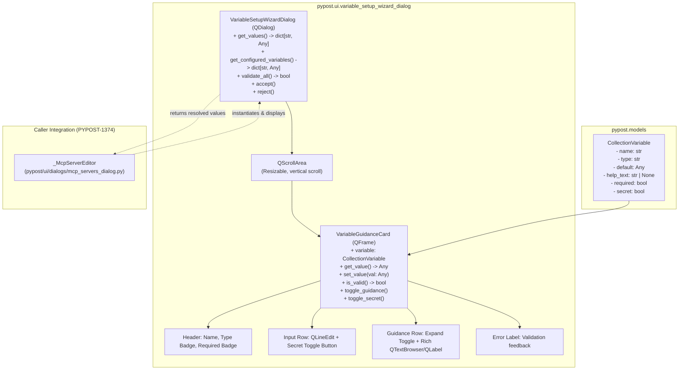
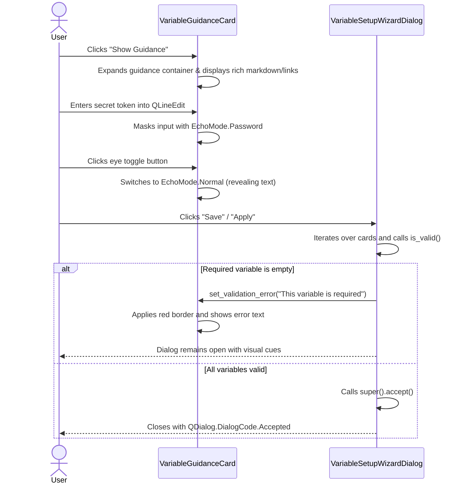

# PYPOST-1373: Implement VariableSetupWizardDialog and expandable VariableGuidanceCard component

## Research

### 1. Context & Prior Art
In [PYPOST-1284](https://pypost.atlassian.net/browse/PYPOST-1284) (epic) and [PYPOST-1368](https://pypost.atlassian.net/browse/PYPOST-1368) (decomposition), the variable setup experience for MCP collection servers was identified as a major friction point. In [PYPOST-1372](https://pypost.atlassian.net/browse/PYPOST-1372) (WIZARD-1), `CollectionVariable` was enhanced with `help_text: Optional[str] = None` supporting rich Markdown/HTML guidance.

Currently in [`pypost/ui/dialogs/mcp_servers_dialog.py`](file:///home/src/pypost/ui/dialogs/mcp_servers_dialog.py):
- `_McpServerEditor` dynamically builds variable rows inside a `QFormLayout` (`_library_variables`).
- Variables are rendered as plain `QLineEdit` widgets without rich description display, secret visibility toggles, or expandable panels. Descriptions are merely set as tooltips (`setToolTip(description)`), making long setup instructions invisible or unwieldy.
- Downstream integration in [PYPOST-1374](https://pypost.atlassian.net/browse/PYPOST-1374) (WIZARD-3) will connect the wizard modal created in this story to the MCP server configuration workflow.

### 2. Qt / PySide6 Architectural Patterns in PyPost

1. **Dialog Patterns (`QDialog`)**:
   - PyPost dialogs (e.g., [`mcp_servers_dialog.py`](file:///home/src/pypost/ui/dialogs/mcp_servers_dialog.py), [`library_dialogs.py`](file:///home/src/pypost/ui/dialogs/library_dialogs.py), [`settings_dialog.py`](file:///home/src/pypost/ui/dialogs/settings_dialog.py)) extend `QDialog`.
   - Modals use `QVBoxLayout` with a header section, scrollable content area, and standard action buttons (`QDialogButtonBox` or custom `QPushButton` row: Cancel & Save/Finish).
   - Dialog lifecycle follows standard Qt dialog code: `accept()` (`QDialog.DialogCode.Accepted`) and `reject()` (`QDialog.DialogCode.Rejected`).
   - Widget identities are registered using `set_widget_id(widget, ID_STRING)` from [`pypost.ui.widget_ids`](file:///home/src/pypost/ui/widget_ids.py).

2. **Card & Form Patterns (`QFrame`, `QScrollArea`, `QVBoxLayout`)**:
   - For collections with numerous variables, cards must be hosted inside a `QScrollArea` with `setWidgetResizable(True)`.
   - Each variable is encapsulated in a dedicated card widget (`VariableGuidanceCard`), extending `QFrame` (styled with subtle border or background, e.g. `#1e1e1e` / `#2d2d2d` dark-theme friendly palette).
   - Layout inside each card:
     - Top row: Variable name (bold `QLabel`), type badge (e.g. `[string]`, `[integer]`, `[boolean]`), required indicator (`* Required` in warning/accent color).
     - Middle row: Input control (`QLineEdit` or type-appropriate input) + secret eye toggle (`QToolButton` or `QPushButton`).
     - Guidance toggle row: If `help_text` is non-empty, a toggle button (`QToolButton` with chevron or "Show Guidance" / "Hide Guidance") allows expanding/collapsing instructions.
     - Guidance container: A collapsible `QFrame` containing a rich text `QLabel` or `QTextBrowser` (`setTextFormat(Qt.TextFormat.RichText)`, `setWordWrap(True)`, `setOpenExternalLinks(True)`).
     - Inline validation feedback: A status label for displaying validation errors (e.g. "This variable is required") and dynamic styling (red border when invalid).

3. **Secret Input Masking**:
   - `QLineEdit.EchoMode.Password` masks characters by default when `CollectionVariable.secret is True`.
   - Secret toggle button switches between `QLineEdit.EchoMode.Password` and `QLineEdit.EchoMode.Normal`.
   - Button text/icon: Eye symbol / text ("Show" / "Hide") updating dynamically with state.

4. **Headless / Offscreen Qt CI Execution**:
   - Repository runs tests under `pytest` with `pytest-qt` or standard `qapp` fixture (`@pytest.mark.usefixtures("qapp")`).
   - Headless execution in Linux CI runs with `QT_QPA_PLATFORM=offscreen`.
   - No blocking event loops: tests instantiate dialogs and interact via public methods or `qtbot` / direct signal emission without calling modal blocking `exec_()`.

---

## Implementation Plan

### High-Level Approach

1. **Step 3 — Failing Repro Test**:
   - Create automated red test in [`tests/test_variable_setup_wizard_repro.py`](file:///home/src/tests/test_variable_setup_wizard_repro.py).
   - The test imports `VariableGuidanceCard` and `VariableSetupWizardDialog` from `pypost.ui.variable_setup_wizard_dialog`.
   - Asserts:
     - Card rendering: name, type badge, required indicator, pre-populated defaults.
     - Secret masking: defaults to `Password` echo mode for secret variables; toggling unmasks to `Normal`.
     - Guidance expansion: collapsible container hidden by default; toggling reveals rich formatted guidance with link navigation enabled.
     - Guidance absence: when `help_text` is None or empty, guidance toggle button and panel are hidden/omitted.
     - Wizard dialog validation: empty required fields prevent dialog acceptance and display visual error feedback.
     - Wizard dialog success: valid inputs allow acceptance, and `get_configured_variables()` / `get_values()` returns the resolved mapping (including distinguishing overrides vs secrets if required).

2. **Step 4 — Core Implementation**:
   - Create [`pypost/ui/variable_setup_wizard_dialog.py`](file:///home/src/pypost/ui/variable_setup_wizard_dialog.py) implementing:
     - `VariableGuidanceCard(QFrame)`
     - `VariableSetupWizardDialog(QDialog)`
   - Define stable widget identifiers in [`pypost/ui/widget_ids.py`](file:///home/src/pypost/ui/widget_ids.py):
     - `VARIABLE_SETUP_WIZARD_DIALOG`
     - `VARIABLE_GUIDANCE_CARD`
     - `VARIABLE_GUIDANCE_EXPAND_BUTTON`
     - `VARIABLE_GUIDANCE_SECRET_TOGGLE`
     - `VARIABLE_SETUP_APPLY_BUTTON`
     - `VARIABLE_SETUP_CANCEL_BUTTON`
   - Wire input validation logic checking non-empty values for required variables and type conversions (e.g. integer, boolean).

3. **Step 5 — Quality Gate Validation**:
   - Verify code formatting with `make lint`.
   - Run test suite with `make test`.
   - Verify artifact integrity with `make verify-ai-tasks`.

### Mandatory — Failing Repro (next Step 3)

- **Test file**: [`tests/test_variable_setup_wizard_repro.py`](file:///home/src/tests/test_variable_setup_wizard_repro.py)
- **Fixture**: `@pytest.mark.usefixtures("qapp")` with `pytestmark = pytest.mark.timeout(30)`.
- **Assertions**:
  1. `VariableGuidanceCard`:
     - Renders correct variable label and required badge when `required=True`.
     - Initializes with pre-populated values from `initial_values` or `variable.default`.
     - Sets `EchoMode.Password` when `variable.secret=True`. Clicking `secret_toggle` toggles echo mode to `Normal` and back.
     - Collapses guidance container initially; clicking `guidance_toggle` shows guidance text and toggles button label/state.
     - Omit/hide guidance toggle when `variable.help_text` is None or empty.
     - `is_valid()` returns False when a required variable has empty text; True when populated.
  2. `VariableSetupWizardDialog`:
     - Accepts list of `CollectionVariable` objects and optional `initial_values: dict[str, Any]`.
     - `validate_all()` returns False when any required card is invalid; applies visual feedback.
     - Invoking `accept()` when invalid does not accept the dialog.
     - Populating all required fields enables valid state, allowing `accept()`.
     - `get_values()` returns `{var_name: value}` dictionary with user input.
- **Sequencing**:
  - Step 3: Implement failing test in `tests/test_variable_setup_wizard_repro.py`. Fails with `ImportError` (module does not exist yet).
  - Step 4: Implement `VariableGuidanceCard` and `VariableSetupWizardDialog` in `pypost/ui/variable_setup_wizard_dialog.py` until all tests pass green.

---

## Architecture

### 1. Component Structure



### 2. Module & File Organization

- **Target Module**: [`pypost/ui/variable_setup_wizard_dialog.py`](file:///home/src/pypost/ui/variable_setup_wizard_dialog.py)
  - Co-locates `VariableGuidanceCard` and `VariableSetupWizardDialog` to keep the card coupled with the wizard modal while enabling modular reuse.
- **Widget Identifiers**: [`pypost/ui/widget_ids.py`](file:///home/src/pypost/ui/widget_ids.py)
  - Adds stable test automation constants for all critical components:
    - `VARIABLE_SETUP_WIZARD_DIALOG = "pypost_variable_setup_wizard_dialog"`
    - `VARIABLE_GUIDANCE_CARD = "pypost_variable_guidance_card"`
    - `VARIABLE_GUIDANCE_EXPAND_BUTTON = "pypost_variable_guidance_expand_button"`
    - `VARIABLE_GUIDANCE_SECRET_TOGGLE = "pypost_variable_guidance_secret_toggle"`
    - `VARIABLE_SETUP_APPLY_BUTTON = "pypost_variable_setup_apply_button"`
    - `VARIABLE_SETUP_CANCEL_BUTTON = "pypost_variable_setup_cancel_button"`

### 3. Class Designs & Public API Contracts

#### A. `VariableGuidanceCard(QFrame)`
```python
class VariableGuidanceCard(QFrame):
    """Card widget rendering input, guidance, and validation for a single CollectionVariable."""

    def __init__(
        self,
        variable: CollectionVariable,
        initial_value: Any = None,
        parent: Optional[QWidget] = None,
    ) -> None:
        """Initialize the guidance card.
        
        Args:
            variable: The collection variable definition.
            initial_value: Optional initial value override.
            parent: Optional parent widget.
        """
        ...

    @property
    def variable(self) -> CollectionVariable:
        """Return the associated CollectionVariable model."""
        ...

    def get_value(self) -> Any:
        """Extract and cast/normalize the current input value."""
        ...

    def set_value(self, value: Any) -> None:
        """Set the input value."""
        ...

    def is_valid(self) -> bool:
        """Check whether the card satisfies validation requirements.
        
        For required variables, checks that non-empty text is present.
        For typed variables (integer, boolean), checks format validity.
        """
        ...

    def set_validation_error(self, message: Optional[str] = None) -> None:
        """Update inline error message and visual cue (e.g. red border)."""
        ...

    def toggle_guidance(self, expanded: Optional[bool] = None) -> None:
        """Expand or collapse the guidance instructions panel."""
        ...

    def toggle_secret_visibility(self) -> None:
        """Toggle QLineEdit.EchoMode between Password and Normal for secrets."""
        ...
```

#### B. `VariableSetupWizardDialog(QDialog)`
```python
class VariableSetupWizardDialog(QDialog):
    """Modal dialog guiding users through configuring collection variables."""

    def __init__(
        self,
        variables: list[CollectionVariable],
        initial_values: Optional[dict[str, Any]] = None,
        parent: Optional[QWidget] = None,
    ) -> None:
        """Initialize the wizard dialog.
        
        Args:
            variables: List of CollectionVariable models to configure.
            initial_values: Optional dictionary mapping variable names to initial values.
            parent: Optional parent widget.
        """
        ...

    def get_values(self) -> dict[str, Any]:
        """Return a mapping of variable name to user-entered value."""
        ...

    def get_configured_variables(self) -> dict[str, dict[str, Any]]:
        """Return variables partitioned into 'overrides' and 'secrets' for overlay mapping."""
        ...

    def validate_all(self) -> bool:
        """Validate all cards. Updates visual error indicators if invalid.
        
        Returns:
            True if all required/typed fields are valid, False otherwise.
        """
        ...

    def accept(self) -> None:
        """Validate before accepting. Blocks acceptance if validation fails."""
        ...
```

### 4. Signal/Slot and User Interactions



### 5. Error Handling and Inline Validation Feedback

- **Dynamic Validation**:
  - `QLineEdit.textChanged` clears any existing error feedback when the user begins typing.
  - When validation fails on submit, `VariableGuidanceCard` updates:
    - `error_label.setText(message)` (rendered in `#e74c3c` / red alert color).
    - `input_field.setStyleSheet("QLineEdit { border: 1px solid #e74c3c; }")`.
  - When validation passes:
    - `error_label.setText("")`.
    - `input_field.setStyleSheet("")`.

### 6. Rich Guidance Rendering

- Guidance instructions are rendered via a `QLabel` with `setTextFormat(Qt.TextFormat.RichText)` and `setWordWrap(True)`.
- Links within `help_text` have `setOpenExternalLinks(True)` so that external URLs (e.g. Google Cloud Console or GitHub Token creation) open directly in the user's default browser.
- Code snippets (e.g., `<pre><code>...</code></pre>` or Markdown code blocks converted to HTML) are cleanly displayed with monospace styling.

---

## Q&A

| Question | Answer |
| :--- | :--- |
| **Why combine `VariableGuidanceCard` and `VariableSetupWizardDialog` in one module?** | They form a single cohesive UI subsystem (`pypost/ui/variable_setup_wizard_dialog.py`). Keeping them in one file avoids unnecessary file proliferation while keeping both easily importable. If other surfaces need `VariableGuidanceCard` in the future, it can be exported or moved to `pypost/ui/widgets/`. |
| **How does the wizard handle collections with zero variables?** | If `variables` is empty, the dialog displays an informational notice ("No variables required for this collection.") and allows immediate acceptance. |
| **How are secrets separated from regular overrides?** | The dialog provides `get_configured_variables()` which returns `{"overrides": {...}, "secrets": {...}}` partitioned according to `CollectionVariable.secret`. It also provides `get_values()` returning the flat `{name: value}` dictionary for simple callers. |
| **How do tests run headlessly in CI without hanging on modal dialogs?** | Tests do not call `dialog.exec_()`. Instead, tests instantiate `VariableSetupWizardDialog`, interact directly with its widgets and helper methods (`dialog.accept()`, `dialog.validate_all()`, `card.toggle_guidance()`), or use `qtbot` for simulation without blocking the process. |
