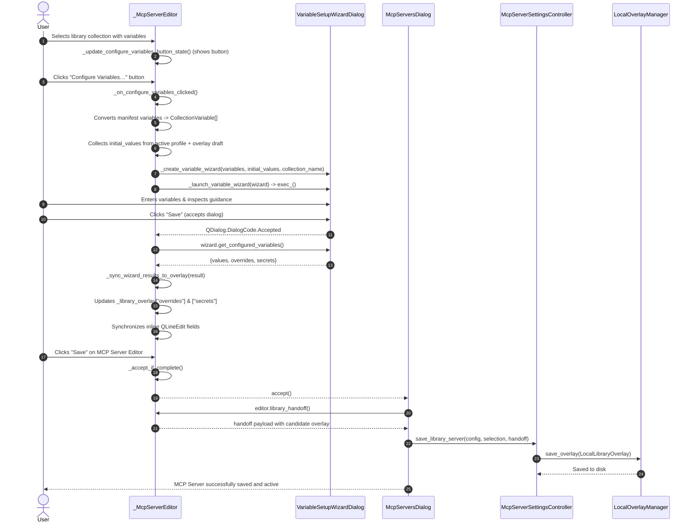

# PYPOST-1374: Integrate variable setup wizard launch and overlay persistence in MCP server editor

Step 2 artifact for PYPOST-1374 (Layer 3 / WIZARD-3 of parent epic [PYPOST-1284](https://pypost.atlassian.net/browse/PYPOST-1284)). Builds upon approved requirements in [`10-requirements.md`](10-requirements.md) and parent architecture in [`../PYPOST-1368/20-architecture.md`](../PYPOST-1368/20-architecture.md).

---

## Research

### R-1 Inspection of `_McpServerEditor` in `pypost/ui/dialogs/mcp_servers_dialog.py`

Deep inspection of `_McpServerEditor` reveals the current environment and variable lifecycle for library-backed MCP servers:

1. **Form Layout Structure (`_library_variables`):**
   - In `_McpServerEditor.__init__`, `self._library_variables = QFormLayout()` is created and added to the dialog's main layout via:
     ```python
     self._layout.addRow("Library Profile", self._library_profile)
     self._layout.addRow("Library Variables", self._library_variables)
     ```
   - Inline fields are tracked across three internal registries:
     - `_library_variable_fields: dict[str, QLineEdit]`
     - `_library_variable_types: dict[str, str]`
     - `_library_secret_names: set[str]`
   - Rows are dynamically constructed in `_populate_library_environment(selection, preserve_values=False)`.

2. **Overlay State (`_library_overlay`):**
   - The editor maintains an in-memory dictionary `self._library_overlay: dict[str, Any]` representing the draft overlay.
   - Initialized from `selection.get("overlay", {})` when selecting a collection.
   - Contains:
     - `library_id: str`
     - `active_profile: Optional[str]`
     - `overrides: dict[str, Any]`
     - `secrets: dict[str, Any]`

3. **Overlay Candidate Packaging (`_library_overlay_candidate`):**
   - When preparing for save or handoff, `_library_overlay_candidate(selection)` reads the values currently in the inline `QLineEdit` fields:
     ```python
     for name, field in self._library_variable_fields.items():
         text = field.text()
         if not text and name not in self._library_overlay.get("secrets", {}):
             continue
         value = self._variable_value(text, self._library_variable_types[name])
         if name in self._library_secret_names:
             secrets[name] = value
         elif not isinstance(profile, dict) or value != profile.get(name):
             overrides[name] = value
     ```
   - Performs runtime validation through `LibraryRuntimeResolver().prepare_environment(...)`.
   - Returns a valid candidate dictionary ready for validation against `LocalLibraryOverlay`.

4. **Source & Collection Lifecycle Signals:**
   - `_on_collection_source_changed()`: Toggles visibility between workspace collections, built-in collections, and library collections. Toggles `_library_variables_widget_visible(is_local and is_library)`.
   - `_on_library_collection_changed()`: Reads current selection via `self.library_selection()` and calls `_populate_library_environment(selection or {})`.
   - `_on_library_profile_changed()`: Updates `_library_overlay["active_profile"]` and repopulates inline variables, preserving already typed values via `preserve_values=True`.

5. **Handoff & Persistence Pipeline (`library_handoff()`):**
   - `library_handoff()` merges `self._library_overlay_candidate(selection)` into `result["overlay"]`.
   - In `McpServersDialog._save_configuration(dialog, config)`:
     ```python
     selection = dialog.library_selection()
     if selection is not None and self._save_library is not None:
         self._save_library(config, selection, dialog.library_handoff())
         return
     self._save(config)
     ```
   - `_save_library` routes to `McpServerSettingsController.save_library_server(...)`, which validates and persists `overlay = LocalLibraryOverlay.model_validate(candidate_overlay)` via `LocalOverlayManager.save_overlay(overlay)` to disk at `~/.pypost/overlays/{library_id}.json`.

### R-2 Manifest Variables Data Structure

Manifest variables in `selection.get("manifest_variables", [])` originate from `pypost-library.json` / collection metadata. They are represented as a list of dictionaries with the following schema:
- `name: str` — Variable name (e.g., `google_drive_access_token`).
- `type: str` — Variable type (`string`, `integer`, `number`, `boolean`, `array`, `object`). Defaults to `"string"`.
- `default: Optional[Any]` or `default_value: Optional[Any]` — Default fallback value.
- `description: str` — Short single-line explanation.
- `help_text: Optional[str]` — Multi-line Markdown / HTML instructions for credential acquisition (introduced in PYPOST-1372).
- `required: bool` — Mandatory flag.
- `secret: bool` — Masking flag.

This matches the schema expected by `CollectionVariable.model_validate(raw)`.

### R-3 Variable Setup Wizard Contracts (from PYPOST-1373)

The wizard dialog implemented in PYPOST-1373 (`pypost.ui.variable_setup_wizard_dialog.VariableSetupWizardDialog`) provides:
- Constructor:
  ```python
  VariableSetupWizardDialog(
      variables: list[CollectionVariable],
      initial_values: Optional[dict[str, Any]] = None,
      collection_name: str = "",
      parent: Optional[QWidget] = None,
  )
  ```
- Acceptance & Output methods:
  - `get_values() -> dict[str, Any]`: Returns raw mapping of variable names to user values.
  - `get_configured_variables() -> dict[str, dict[str, Any]]`: Returns:
    ```python
    {
        "values": {name: value, ...},
        "overrides": {name: value, ...},
        "secrets": {name: value, ...},
    }
    ```
  - `validate_all() -> bool`: Verifies required variables are non-empty.
  - `accept()`: Re-checks validation before exiting with `QDialog.DialogCode.Accepted`.
  - `reject()`: Discards inputs with `QDialog.DialogCode.Rejected`.

---

## Implementation Plan

### High-Level Approach

1. **Step 3 — Automated Failing Repro Test (`tests/test_mcp_servers_dialog_variable_wizard_repro.py`):**
   - Author a standalone, comprehensive red test module asserting all missing contracts:
     - Existence and automation identity `MCP_SERVER_CONFIGURE_VARIABLES_BUTTON`.
     - Visibility and enablement dynamic states (hidden/disabled when non-library or no variables; visible/enabled when library collection defines variables).
     - Launching wizard pre-populated with draft overlay overrides, secrets, and profile values.
     - Wizard acceptance synchronizing values into `_library_overlay` and inline `QLineEdit` inputs.
     - Wizard cancellation preserving existing draft state without modification.
     - End-to-end save persistence writing overlay candidate to `LocalLibraryOverlay`.
2. **Step 4 — Implementation Iterations:**
   - **Iteration 1: Widget ID Registration & Editor Action Button:**
     - Add `MCP_SERVER_CONFIGURE_VARIABLES_BUTTON = "pypost_mcp_server_configure_variables_button"` to `pypost/ui/widget_ids.py` and register it in `KEY_WIDGET_IDS`.
     - Add `self._configure_variables_btn = QPushButton("Configure Variables…")` with `set_widget_id(...)` in `_McpServerEditor.__init__`.
     - Connect clicked signal to `self._on_configure_variables_clicked`.
     - Embed the button into the editor layout.
   - **Iteration 2: Button State & Visibility Management:**
     - Implement `_update_configure_variables_button_state()`:
       - Checks whether server is `local`, collection source is `library`, and selected collection defines variables (`manifest_variables`).
       - Updates visibility and enablement of `_configure_variables_btn`.
     - Call `_update_configure_variables_button_state()` from `_on_collection_source_changed()`, `_on_library_collection_changed()`, and after `_replace_library_selections()`.
   - **Iteration 3: Wizard Invocation, Pre-population & Seam Extraction:**
     - Implement `_create_variable_wizard(...)` and `_launch_variable_wizard(wizard)`:
       - Converts raw manifest dictionaries to `CollectionVariable` models safely.
       - Builds `initial_values` mapping from the union of profile values, inline fields, and `_library_overlay` (`overrides` and `secrets`).
       - Supports headless execution without hanging on modal `exec_()`.
     - Implement `_on_configure_variables_clicked()` to trigger the wizard dialog.
   - **Iteration 4: Result Synchronization & Persistence Integration:**
     - Implement `_sync_wizard_results_to_overlay(result)`:
       - Updates `self._library_overlay["secrets"]` and `self._library_overlay["overrides"]`.
       - Updates inline `_library_variable_fields` text and triggers reactive UI updates.
     - Verify that `_accept_if_complete()` packages the updated overlay candidate and routes to `save_library_server` persistence without schema degradation.
   - **Iteration 5: Regression & Coverage Verification:**
     - Run `make test` across entire MCP dialog suite.
     - Verify zero regressions in workspace collection MCP servers and proxy configurations.

### Mandatory — Failing Repro (next Step 3)

- **Test Module Path:** `tests/test_mcp_servers_dialog_variable_wizard_repro.py`
- **Scope & Assertions:**
  1. `test_configure_variables_button_exists_and_has_stable_id()`:
     - Asserts `editor._configure_variables_btn` exists and has `objectName == MCP_SERVER_CONFIGURE_VARIABLES_BUTTON`.
  2. `test_configure_variables_button_visibility_and_enablement()`:
     - Asserts button is hidden when `_collection_source` is `workspace` or `builtin`.
     - Asserts button is visible/enabled when `_collection_source` is `library` and manifest defines variables.
     - Asserts button is hidden/disabled when selected library collection defines an empty variable list (`manifest_variables: []`).
  3. `test_wizard_launch_prepopulates_draft_values()`:
     - Mocks `_launch_variable_wizard` to capture instantiated wizard dialog.
     - Asserts wizard is populated with `CollectionVariable` objects matching manifest.
     - Asserts `initial_values` contain active overlay overrides and secrets.
  4. `test_wizard_acceptance_updates_overlay_and_inline_fields()`:
     - Simulates wizard acceptance returning updated overrides and secrets.
     - Asserts `_library_overlay["overrides"]` and `_library_overlay["secrets"]` update accordingly.
     - Asserts inline `QLineEdit` fields are populated with the new values.
  5. `test_wizard_cancellation_preserves_draft_state()`:
     - Simulates wizard rejection (`QDialog.DialogCode.Rejected`).
     - Asserts existing values in `_library_overlay` and inline fields are not overwritten.
  6. `test_save_persists_overlay_to_local_library_overlay()`:
     - Completes save flow via `McpServersDialog._save_configuration(...)`.
     - Asserts `LocalOverlayManager.get_overlay(library_id)` contains the exact configured overrides and secrets.
- **Forcing Failure (Red Phase):**
  - Run `make test` on `tests/test_mcp_servers_dialog_variable_wizard_repro.py`.
  - The tests will immediately fail (Red) because `_configure_variables_btn`, `MCP_SERVER_CONFIGURE_VARIABLES_BUTTON`, and `_on_configure_variables_clicked` do not yet exist on `_McpServerEditor`.
- **Sequencing:**
  - Complete Step 2 architecture review -> Write failing repro in Step 3 -> Confirm Red status -> Implement iterations in Step 4 until Green -> Run full quality gates.

---

## Architecture

### 1. Component Structure & Data Flow

```mermaid
flowchart TD
    subgraph UI_Layer["UI Layer (pypost.ui.dialogs.mcp_servers_dialog)"]
        Dialog["McpServersDialog"]
        Editor["_McpServerEditor"]
        ConfigBtn["QPushButton (MCP_SERVER_CONFIGURE_VARIABLES_BUTTON)"]
        FormFields["_library_variable_fields (dict[str, QLineEdit])"]
    end

    subgraph Wizard_Layer["Wizard Subsystem (pypost.ui.widgets.wizard)"]
        Wizard["VariableSetupWizardDialog"]
        Card["VariableGuidanceCard"]
    end

    subgraph Models_Layer["Data Models (pypost.models)"]
        VarModel["CollectionVariable (help_text, secret, required)"]
        OverlayModel["LocalLibraryOverlay (overrides, secrets)"]
    end

    subgraph Core_Layer["Core & Persistence (pypost.core)"]
        Controller["McpServerSettingsController"]
        OverlayMgr["LocalOverlayManager"]
        Disk["~/.pypost/overlays/{library_id}.json"]
    end

    Dialog -->|manages| Editor
    Editor -->|contains| ConfigBtn
    Editor -->|contains| FormFields
    ConfigBtn -->|clicked| Editor

    Editor -->|_create_variable_wizard| Wizard
    Wizard -->|renders list of| Card
    Card -->|configures| VarModel

    Wizard -->|accept() returns configured values| Editor
    Editor -->|_sync_wizard_results_to_overlay| Editor
    Editor -->|syncs values to| FormFields

    Editor -->|library_handoff() returns overlay candidate| Dialog
    Dialog -->|_save_library| Controller
    Controller -->|model_validate| OverlayModel
    Controller -->|save_overlay| OverlayMgr
    OverlayMgr -->|persists| Disk
```

### 2. Sequence Diagram: Wizard Launch, Acceptance, and Persistence



### 3. Detailed Method Designs in `_McpServerEditor`

#### A. Button Initialization & Layout Integration

In `_McpServerEditor.__init__`:
```python
self._configure_variables_btn = QPushButton("Configure Variables…")
self._configure_variables_btn.setAutoDefault(False)
set_widget_id(
    self._configure_variables_btn,
    MCP_SERVER_CONFIGURE_VARIABLES_BUTTON,
)
self._configure_variables_btn.clicked.connect(self._on_configure_variables_clicked)
# Placed above or beside library variables form layout
self._layout.addRow("", self._configure_variables_btn)
```

#### B. `_update_configure_variables_button_state()`

Manages the button's visibility and enablement whenever the collection source or selected collection changes:
```python
def _update_configure_variables_button_state(self) -> None:
    """Update visibility and enabled state of the Configure Variables action button."""
    is_local = self._server_type.currentData() == "local"
    is_library = self._collection_source.currentData() == "library"
    selection = self.library_selection() if is_library else None
    raw_variables = selection.get("manifest_variables", []) if selection else []
    has_variables = bool(raw_variables)

    # Button is visible and enabled only when editing a library collection with declared variables
    should_show = is_local and is_library and has_variables
    self._configure_variables_btn.setVisible(should_show)
    self._configure_variables_btn.setEnabled(should_show)

    btn_label = self._layout.labelForField(self._configure_variables_btn)
    if btn_label is not None:
        btn_label.setVisible(should_show)
```

#### C. `_on_configure_variables_clicked()`

Handles user interaction, prepares wizard inputs, executes dialog, and delegates synchronization:
```python
def _on_configure_variables_clicked(self) -> None:
    """Open the VariableSetupWizardDialog pre-populated with current overlay state."""
    selection = self.library_selection()
    if not selection:
        return

    raw_variables = selection.get("manifest_variables", [])
    if not raw_variables:
        return

    # 1. Parse manifest variables into CollectionVariable models
    variables: list[CollectionVariable] = []
    for raw in raw_variables:
        if isinstance(raw, CollectionVariable):
            variables.append(raw)
        elif isinstance(raw, dict):
            # Sanitize and handle alias default_value / default
            data = {
                k: v for k, v in raw.items()
                if k in CollectionVariable.model_fields
            }
            if "default" not in data and "default_value" in raw:
                data["default"] = raw["default_value"]
            variables.append(CollectionVariable.model_validate(data))

    # 2. Extract initial values from profile, inline fields, and active overlay
    initial_values: dict[str, Any] = {}
    profiles = selection.get("manifest_profiles", {})
    active_profile = self._library_profile.currentData()
    profile_values = (
        profiles.get(active_profile, {})
        if isinstance(profiles, dict) and active_profile else {}
    )
    overrides = self._library_overlay.get("overrides", {})
    secrets = self._library_overlay.get("secrets", {})

    for var in variables:
        val = profile_values.get(var.name, var.default)
        if var.name in overrides:
            val = overrides[var.name]
        if var.name in secrets:
            val = secrets[var.name]
        # Prefer uncommitted text entered into the inline editor if present
        if var.name in self._library_variable_fields:
            text = self._library_variable_fields[var.name].text()
            if text:
                val = text
        if val is not None:
            initial_values[var.name] = val

    collection_name = str(
        selection.get("name") or selection.get("path") or "Library Collection"
    )

    # 3. Create and launch wizard dialog
    wizard = self._create_variable_wizard(
        variables=variables,
        initial_values=initial_values,
        collection_name=collection_name,
    )
    result_code = self._launch_variable_wizard(wizard)

    # 4. On accept, synchronize configured variables
    if result_code == QDialog.DialogCode.Accepted:
        result = wizard.get_configured_variables()
        self._sync_wizard_results_to_overlay(result)
```

#### D. `_create_variable_wizard()` & `_launch_variable_wizard()` (Headless Test Seams)

Enables headless testing without blocking on modal event loops:
```python
def _create_variable_wizard(
    self,
    variables: list[CollectionVariable],
    initial_values: dict[str, Any],
    collection_name: str,
) -> VariableSetupWizardDialog:
    """Instantiate VariableSetupWizardDialog (can be patched or intercepted in tests)."""
    return VariableSetupWizardDialog(
        variables=variables,
        initial_values=initial_values,
        collection_name=collection_name,
        parent=self,
    )

def _launch_variable_wizard(self, wizard: VariableSetupWizardDialog) -> int:
    """Execute wizard dialog modally (can be mocked in unit tests)."""
    return wizard.exec()
```

#### E. `_sync_wizard_results_to_overlay(result)`

Synchronizes wizard configuration into the editor's internal overlay state and updates inline form fields:
```python
def _sync_wizard_results_to_overlay(self, result: dict[str, dict[str, Any]]) -> None:
    """Synchronize accepted wizard variables into draft overlay and inline editor fields."""
    values = result.get("values", {})
    overrides = result.get("overrides", {})
    secrets = result.get("secrets", {})

    # Ensure overlay partitions exist
    if "overrides" not in self._library_overlay:
        self._library_overlay["overrides"] = {}
    if "secrets" not in self._library_overlay:
        self._library_overlay["secrets"] = {}

    self._library_overlay["overrides"].update(overrides)
    self._library_overlay["secrets"].update(secrets)

    # Update inline field widgets to maintain perfect UI consistency
    for name, value in values.items():
        if name in self._library_variable_fields:
            self._library_variable_fields[name].setText(
                "" if value is None else str(value)
            )
```

### 4. Widget ID Registration (`pypost/ui/widget_ids.py`)

In `pypost/ui/widget_ids.py`:
```python
MCP_SERVER_CONFIGURE_VARIABLES_BUTTON = "pypost_mcp_server_configure_variables_button"
```
And add `MCP_SERVER_CONFIGURE_VARIABLES_BUTTON` to the exported `KEY_WIDGET_IDS` tuple.

---

## Q&A

| Question | Answer |
| :--- | :--- |
| **Why keep both the inline form and the wizard dialog?** | Inline fields allow quick inspection of existing values, while the wizard provides focused step-by-step guidance (`help_text`), expandable instructions, and secret reveal toggles. Synchronizing them upon acceptance guarantees user flexibility without cluttering the main editor. |
| **What happens if a user cancels the wizard?** | `_on_configure_variables_clicked()` checks `result_code == QDialog.DialogCode.Accepted`. If the dialog is cancelled (`Rejected`), no changes are applied to `_library_overlay` or inline fields, preserving the existing draft state. |
| **How are secrets kept distinct from overrides?** | `VariableSetupWizardDialog.get_configured_variables()` partitions variables based on `CollectionVariable.secret`. Secret variables are placed into `secrets`, while non-secret variables are placed into `overrides`. `_sync_wizard_results_to_overlay` merges them into their respective partitions. |
| **How is headless test execution guaranteed?** | `_create_variable_wizard` and `_launch_variable_wizard` provide clean seams that can be mocked or patched in automated tests without needing `qapp.exec()` loops or modal dialog blocking. |
| **How is overlay persistence completed on save?** | `_accept_if_complete()` packages the overlay candidate via `_library_overlay_candidate(selection)`. `McpServersDialog._save_configuration(...)` hands off the configuration to `McpServerSettingsController.save_library_server(...)`, which validates and persists `LocalLibraryOverlay` to disk via `LocalOverlayManager`. |
