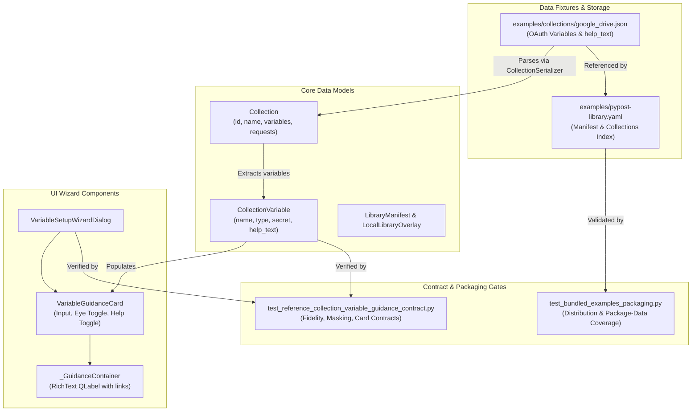
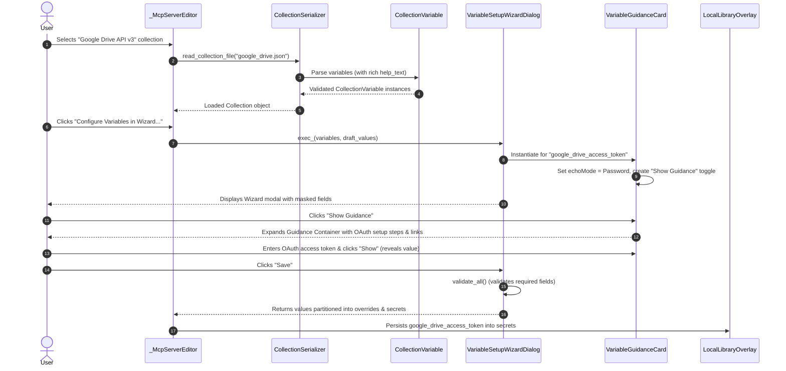

# PYPOST-1375: [PYPOST-1284] Add reference collection with OAuth setup guidance and contract test suite

## Research

### Current State of Reference Collections & Variables

1. **`examples/collections/google_drive.json`**:
   - Contains 9 variables: `google_drive_base_url`, `google_drive_upload_base_url`, `google_drive_access_token`, `google_drive_upload_session_url`, `google_drive_chunk_length`, `google_drive_chunk_start`, `google_drive_chunk_end`, `google_drive_file_size`, and `file_id`.
   - `google_drive_access_token` is flagged with `"required": true` and `"secret": true`. Its description is currently a bare one-liner: `"OAuth 2.0 Bearer access token for Google APIs"`.
   - None of the variables currently define `help_text`.
   - Users attempting to configure the Google Drive MCP server via the Variable Setup Wizard see no actionable instructions on how to acquire an OAuth 2.0 token (e.g. creating a Google Cloud project, enabling the Drive API, configuring the OAuth consent screen, creating desktop or web client credentials, defining scopes, or exchanging tokens).

2. **Model Validation (`CollectionVariable` in `pypost/models/collection_variable.py`)**:
   - Introduced in Layer 1 (PYPOST-1372).
   - Declares `help_text: Optional[str] = Field(default=None, ...)`.
   - Validates via `@field_validator("help_text", mode="before")`: ensures the value is a string or `None`, trims leading and trailing boundary whitespace, and normalizes empty strings to `None`.
   - Deserialization and round-trip serialization preserve `help_text`.

3. **UI Guidance Rendering (`VariableGuidanceCard` & `VariableSetupWizardDialog` in `pypost/ui/variable_setup_wizard_dialog.py`)**:
   - Introduced in Layer 2 (PYPOST-1373).
   - In `VariableGuidanceCard`:
     - If `variable.help_text` is non-empty, creates `guidance_toggle_button: QPushButton("Show Guidance")` and `guidance_container: _GuidanceContainer(QFrame)`.
     - Guidance container contains a `QLabel` with `setTextFormat(Qt.TextFormat.RichText)`, `setWordWrap(True)`, `setOpenExternalLinks(True)`, and `TextBrowserInteraction`.
     - Initially collapsed (`setVisible(False)`). Clicking the toggle alternates visibility and changes button text between "Show Guidance" and "Hide Guidance".
     - Secret fields (such as `google_drive_access_token`) initialize `QLineEdit` in `Password` echo mode and supply a "Show" / "Hide" toggle toolbutton.
   - In `VariableSetupWizardDialog`:
     - Iterates over collection variables, instantiates `VariableGuidanceCard` widgets inside a scroll area, handles validation on accept, and partitions inputs into `values`, `overrides`, and `secrets`.

4. **Packaging and Bundling Guarantees (`tests/test_bundled_examples_packaging.py`)**:
   - Tests `test_explicit_packages_cover_application_tree_and_examples`, `test_examples_mapping_has_regular_package_anchor`, `test_declared_data_covers_manifest_and_all_environments`, and `test_resource_guard_rejects_uncovered_files`.
   - Verifies that all examples in `pypost-library.yaml` and `examples/collections/*.json` are packaged properly via `pyproject.toml` data declarations (`package-data`).
   - Modifying `examples/collections/google_drive.json` to include valid JSON with `help_text` will not violate packaging patterns as long as the file remains valid JSON and located under `examples/collections/`.

5. **Existing Documentation & Author Guides**:
   - `doc/dev/google_drive_collection_example.md` documents requests and resumable upload architecture, but does not cover variable guidance or the wizard contract.
   - `doc/dev/predefined_collection_library.md` documents library format, but lacks explicit author guidance on structuring multi-step markdown instructions for variable guidance cards.

---

## Implementation Plan

### High-Level Approach

1. **Mandatory Failing Repro (Step 3)**:
   - Create `tests/test_reference_collection_variable_guidance_contract.py`.
   - Prior to modifying `examples/collections/google_drive.json`, assert that `google_drive.json` defines rich `help_text` on OAuth variables with specific actionable instructions (Google Cloud Console, OAuth consent screen, Drive scopes, etc.).
   - Assert that `CollectionVariable` preserves the `help_text` upon loading.
   - Assert that `VariableSetupWizardDialog` renders a card for `google_drive_access_token` with expandable guidance and password masking.
   - This test will fail immediately in Step 3 because `examples/collections/google_drive.json` currently lacks `help_text`.

2. **Reference Fixture Enhancement (Step 4)**:
   - Update `examples/collections/google_drive.json` to add comprehensive, production-grade `help_text` to `google_drive_access_token` and other relevant variables (e.g. `google_drive_base_url`, `google_drive_upload_session_url`).
   - Ensure the markdown is well-formatted, includes numbered steps, bullet points, scope declarations (`https://www.googleapis.com/auth/drive`, `https://www.googleapis.com/auth/drive.readonly`), and console links.
   - Maintain `"secret": true` on `google_drive_access_token`.

3. **Contract Test Suite Expansion (Step 4)**:
   - Complete contract test suite covering:
     - Model serialization/deserialization fidelity across all reference collections.
     - Wizard contract validation (card creation, guidance expansion toggle, secret masking, input validation).
     - Backward compatibility verification (collections without `help_text` continue to work cleanly).
     - Packaging verification ensuring `tests/test_bundled_examples_packaging.py` passes cleanly.

4. **Collection Author Guidance Documentation (Step 4 / Step 8)**:
   - Create developer documentation `doc/dev/collection_variable_guidance.md` explaining:
     - How to author `help_text` in collection manifests.
     - Recommended markdown formatting rules for `VariableGuidanceCard`.
     - Security principles: masking, zero secret leakage, and local overlay partitioning.
     - Verification procedures via automated contract tests.
   - Update `doc/dev/google_drive_collection_example.md` to reference OAuth setup guidance.

---

### Mandatory — Failing Repro (next Step 3)

- **Test File**: `tests/test_reference_collection_variable_guidance_contract.py`
- **Target Assertion (Red State)**:
  - Loads `examples/collections/google_drive.json`.
  - Finds variable `google_drive_access_token`.
  - Asserts that `var.help_text` is not `None` and not empty.
  - Asserts that `var.help_text` contains essential OAuth setup keywords:
    - `"Google Cloud Console"`
    - `"OAuth consent screen"`
    - `"https://www.googleapis.com/auth/drive"`
    - `"Credentials"`
  - Asserts that initializing `VariableGuidanceCard(var)` creates an expandable guidance container and secret masking toggle button.
- **Why It Fails**: In the repository's current state, `google_drive.json` defines `google_drive_access_token` without `help_text` (defaults to `None` in `CollectionVariable`), causing the contract assertions to fail cleanly with `AssertionError: Expected non-empty help_text for google_drive_access_token`.
- **Sequencing**:
  1. Write failing repro test in `tests/test_reference_collection_variable_guidance_contract.py` (Step 3).
  2. Execute test and observe failure.
  3. Enrich `examples/collections/google_drive.json` and add author docs (Step 4).
  4. Run test until green.

---

## Architecture

### 1. Component Structure

The following diagram illustrates how reference collections feed into core data models, UI components, and packaging contracts.



### 2. Interaction Sequence

Sequence showing collection loading, model validation, wizard instantiation, guidance interaction, and secret masking.



### 3. Architectural Patterns & Principles

1. **Contract Testing Pattern**:
   - Enforces behavioral and schema consistency across boundaries (JSON fixture ↔ Pydantic model ↔ Qt UI components) without requiring external network connectivity or live Google APIs.
   - Verifies that rich guidance remains complete, parsable, and compatible with UI rendering expectations.

2. **Separation of Concerns & Dual-Purpose Authoring**:
   - `help_text` in the collection manifest serves as both in-app documentation rendered directly in the desktop wizard and as a canonical reference specification for API integrators.
   - Separation of public configuration (`overrides`) and sensitive authentication (`secrets`) ensures zero secret leakage.

3. **Additive Schema Evolution & Backward Compatibility**:
   - Optional `help_text` field defaults to `None`, preserving compatibility with legacy collections.
   - `VariableGuidanceCard` gracefully handles variables with or without guidance (collapsing/omitting the guidance toggle when absent).

4. **Zero Secret Leakage**:
   - Reference collection fixtures contain instructional guidance only—never hardcoded actual API tokens.
   - UI masks secret inputs by default (`EchoMode.Password`) with opt-in visibility toggling.

---

## Detailed Specification of Changes

### 1. `examples/collections/google_drive.json`

Enhance `google_drive_access_token` variable with detailed, step-by-step guidance:
```json
{
  "name": "google_drive_access_token",
  "type": "string",
  "default": "",
  "description": "OAuth 2.0 Bearer access token for Google APIs",
  "help_text": "### Google Drive OAuth 2.0 Access Token Setup\n\nTo interact with Google Drive API v3, you must generate an OAuth 2.0 Bearer access token with appropriate permissions:\n\n1. **Open Google Cloud Console**:\n   Navigate to the [Google Cloud Console](https://console.cloud.google.com/) and create a new project (or select an existing one).\n2. **Enable Google Drive API**:\n   Go to **APIs & Services > Library**, search for **Google Drive API**, and click **Enable**.\n3. **Configure OAuth Consent Screen**:\n   Go to **APIs & Services > OAuth consent screen**, select **External** (or **Internal** for Workspace domains), and fill in required application details.\n4. **Add Scopes**:\n   Under **Scopes**, add the required scopes for your use case:\n   - Full access: `https://www.googleapis.com/auth/drive`\n   - Read-only access: `https://www.googleapis.com/auth/drive.readonly`\n   - File metadata / creation: `https://www.googleapis.com/auth/drive.file`\n5. **Create Credentials**:\n   Go to **APIs & Services > Credentials > Create Credentials > OAuth client ID**.\n   - Choose **Desktop App** or **Web application**.\n6. **Obtain Access Token**:\n   - Use Google OAuth 2.0 Playground (https://developers.google.com/oauthplayground) or your OAuth client flow to exchange authorization code for an access token.\n   - Paste the resulting bearer token here.\n\n*Note: Access tokens expire after 1 hour. Keep this token confidential.*",
  "required": true,
  "secret": true
}
```

Additional helpful guidance will also be attached to `google_drive_base_url` and `google_drive_upload_session_url` to guide endpoint usage.

### 2. Contract Test Suite (`tests/test_reference_collection_variable_guidance_contract.py`)

Test suite structure:
1. `test_google_drive_collection_has_rich_help_text`:
   - Checks presence and non-emptiness of `help_text` on `google_drive_access_token`.
   - Asserts inclusion of key operational instructions (Google Cloud Console, OAuth consent, Drive scopes, credentials).
2. `test_collection_variable_deserialization_fidelity`:
   - Loads `google_drive.json` via `read_collection_file`.
   - Asserts `CollectionVariable` models retain `help_text` verbatim without truncation or corruption.
   - Tests round-trip serialization (`model_dump()`) retains `help_text`.
3. `test_variable_guidance_card_initialization_from_reference_collection`:
   - Instantiates `VariableGuidanceCard` with the loaded `google_drive_access_token` variable.
   - Verifies `guidance_toggle_button` is present and labeled `"Show Guidance"`.
   - Verifies `guidance_container` is initially hidden.
   - Verifies toggling expansion changes visibility and updates button text.
   - Verifies `input_field` is masked in `Password` mode and secret toggle is present.
4. `test_variable_setup_wizard_loads_reference_collection`:
   - Instantiates `VariableSetupWizardDialog` with all variables from `google_drive.json`.
   - Verifies all 9 variables are instantiated as cards.
   - Verifies secret partitioning returns `google_drive_access_token` under `secrets` and non-secret variables under `overrides`.
5. `test_backward_compatibility_with_minimal_variables`:
   - Verifies that collections omitting `help_text` parse cleanly, initialize cards without guidance toggles, and behave predictably.

### 3. Collection Authoring Documentation (`doc/dev/collection_variable_guidance.md`)

Document structure:
1. **Overview & Purpose**: The role of variable guidance in onboarding users to MCP library collections.
2. **Authoring Guidelines**:
   - When to use `help_text` vs `description`.
   - Supported Markdown subsets (headings, bold, lists, external URLs).
   - Linking to provider consoles and documentation.
3. **Secret Security Principles**:
   - Setting `"secret": true` on sensitive credentials.
   - Preventing accidental hardcoded secrets in fixtures.
   - How PyPost partitions secrets into `LocalLibraryOverlay`.
4. **Contract Verification**:
   - Testing collection fixtures against `CollectionVariable` and `VariableSetupWizardDialog`.
   - Running packaging and schema tests.

---

## Q&A

- **Q: Does adding `help_text` to `google_drive.json` impact existing collections or break backwards compatibility?**  
  **A:** No. `help_text` is an optional field with `default=None`. All schemas, serializers, and loaders support both collections with and without `help_text`.
- **Q: Why create a dedicated contract test file instead of modifying `test_google_drive_collection_example.py`?**  
  **A:** `test_google_drive_collection_example.py` is dedicated to PYPOST-1268 (request definitions, parameters, and resumable upload contracts). Creating `test_reference_collection_variable_guidance_contract.py` cleanly separates the guidance card & wizard contract testing concerns (PYPOST-1375 / Layer 4) from the underlying HTTP collection specification.
- **Q: How does this satisfy the Layer 4 contract from PYPOST-1368?**  
  **A:** Layer 4 in `ai-tasks/PYPOST-1368/20-architecture.md` specifies: (1) enrich `google_drive.json` with real-world step-by-step guidance on obtaining credentials from Google Cloud Console, (2) add contract tests verifying parsing and wizard loading, and (3) author developer documentation for collection authors. This plan fully fulfills all Layer 4 requirements.
