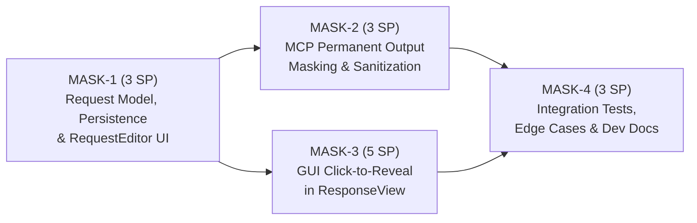
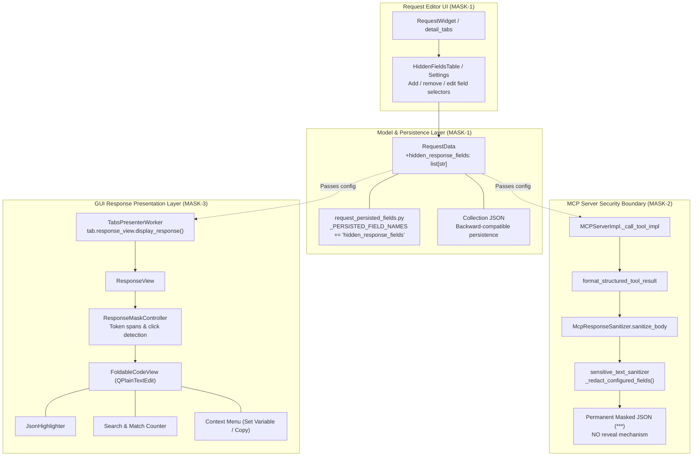

# PYPOST-1376: Decompose epic PYPOST-1312 into child tasks

Step 2 artifact for PYPOST-1376. Turns approved requirements in
[`10-requirements.md`](10-requirements.md) and decomposition notes in
[`../PYPOST-1312/decomposition-notes.md`](../PYPOST-1312/decomposition-notes.md)
into an architectural design. This covers both the **decomposition workflow**
(mapping, contracts, sizing, and sequence for delivering child tasks MASK-1 through MASK-4
under [PYPOST-1312](https://pypost.atlassian.net/browse/PYPOST-1312)) and the
**component architecture of the target feature** (request model extensions, permanent MCP output sanitization, and GUI click-to-reveal response masking).

---

## Research

### R-1 Jira Facts and Decomposition Context

- **Parent Epic:** [PYPOST-1312](https://pypost.atlassian.net/browse/PYPOST-1312) — "Hide selected response fields: click-to-reveal in UI, permanently masked in MCP output".
- **Planning Task:** [PYPOST-1376](https://pypost.atlassian.net/browse/PYPOST-1376) — "Decompose epic PYPOST-1312 into child tasks".
- **Sprint Target:** Sprint 2032 ("Hide Selected Response Fields", active sprint).
- **Project Structure:** Next-gen project schema (`simplified: true`). Issues link to parent epics via `parent = "PYPOST-1312"` (or `jira_link_issue_parent`), not legacy Epic Link fields.
- **Story Points Standard:** Fibonacci scale (1, 2, 3, 5, 8, 13). All child implementation stories must be strictly sized ≤ 5 SP to prevent blocked sprint queues and ensure each task fits cleanly into an independent Top-Down cycle (Steps 1–8).
- **Quality Gates:** Tooling standard requires all repository operations to run exclusively via `make` targets (`make check`, `make lint`, `make test`, `make verify-ai-tasks`).

### R-2 RequestData Model, Persistence & Tab Copy Isolation Policy

1. **`RequestData` ([`pypost/models/models.py`](file:///home/src/pypost/models/models.py)):**
   - In-memory request draft representing request settings, headers, params, body, post-script, and MCP exposure flags.
   - Designed to stay lean: editor fields and metadata only. HTTP response bodies, history entries, and runtime execution buffers live strictly in `ResponseView` and `HistoryManager`.
   - Adding `hidden_response_fields: list[str] = Field(default_factory=list)` adheres cleanly to the model's design: it is a lightweight list of field selectors/keys configured on the request.
   - Pydantic `default_factory=list` guarantees backward compatibility: older saved collections, test fixtures, or requests lacking `hidden_response_fields` load cleanly without schema migration errors.
2. **Tab Copy Isolation Policy ([`pypost/core/request_persisted_fields.py`](file:///home/src/pypost/core/request_persisted_fields.py), `doc/dev/request_data_copy_policy.md`):**
   - Tab isolation uses deep copies of `RequestData` via `copy_request_for_isolated_tab(data)` (`data.model_copy(deep=True)`).
   - `_PERSISTED_FIELD_NAMES` defines the canonical list of persisted fields compared in `persisted_fields_equal` and `request_draft_fields_equal` for dirty checking and tab baseline snapshots.
   - Adding `"hidden_response_fields"` to `_PERSISTED_FIELD_NAMES` ensures that configured hidden fields are preserved across tab duplication, restored from workspace state, and properly tracked for unsaved changes ("dirty" indicator).

### R-3 MCP Sanitization Pipeline & Security Boundary

1. **`McpResponseSanitizer` ([`pypost/core/mcp_response_sanitizer.py`](file:///home/src/pypost/core/mcp_response_sanitizer.py)):**
   - High-level sanitization interface used before returning upstream HTTP bodies and script logs to AI agents via MCP.
   - Currently delegates to `sensitive_text_sanitizer` with `env_vars` and `hidden_keys` (environment secret variables).
2. **`sensitive_text_sanitizer` ([`pypost/core/sensitive_text_sanitizer.py`](file:///home/src/pypost/core/sensitive_text_sanitizer.py)):**
   - Applies heuristic redaction: `_redact_hidden_values` (redacts env var values whose keys are in `hidden_keys`), `_redact_json_sensitive_fields` (redacts keys matching `_SENSITIVE_JSON_KEY` regex), `_BEARER_TOKEN`, `_QUERY_TOKEN`, and `sanitize_headers`.
   - Replaces secrets with `HIDDEN_PLACEHOLDER = "***"`.
3. **Execution Boundary in `MCPServerImpl` ([`pypost/core/mcp_server_impl.py`](file:///home/src/pypost/core/mcp_server_impl.py)):**
   - MCP tool calls execute requests via `_execute_request_sync` and serialize the result via `format_structured_tool_result(result, env_vars=env_vars, hidden_keys=hidden_keys)`.
   - The executed `RequestData` item is available in `_call_tool_impl`. Passing `hidden_response_fields=item.hidden_response_fields` directly into `format_structured_tool_result` enables permanent redaction of request-configured fields.
4. **Permanent Redaction Boundary:**
   - In MCP, masking is **irreversible**. The response returned to the agent has matching JSON values replaced by `***`.
   - No MCP tool parameter (e.g. `reveal_secrets: bool`) or secondary MCP tool (e.g. `reveal_response_field`) is exposed.
   - The underlying in-memory `ExecutionResult.response` and PyPost history store retain the raw HTTP response unmodified.

### R-4 GUI ResponseView, FoldableCodeView & JsonHighlighter Mechanics

1. **`ResponseView` ([`pypost/ui/widgets/response_view.py`](file:///home/src/pypost/ui/widgets/response_view.py)):**
   - Hosts status bar (status code, elapsed time, byte size), search bar (input, prev, next, match count, case sensitivity, fold/unfold buttons), and `body_view` (`FoldableCodeView`).
   - Receives responses in `display_response(response: ResponseData)`.
   - Formats JSON bodies via `json.dumps(parsed, indent=self.indent_size)` unless `len(body_str) > LARGE_DOC_CHAR_THRESHOLD` (100 KB), which triggers raw text fallback to prevent UI thread lockup.
2. **`FoldableCodeView` ([`pypost/ui/widgets/foldable_code_view.py`](file:///home/src/pypost/ui/widgets/foldable_code_view.py)):**
   - Inherits from `QPlainTextEdit` with line number area gutter, folding chevrons, and `FoldController`.
   - Provides `setPlainText()`, `find()`, `reveal_block()`.
3. **`JsonHighlighter` ([`pypost/ui/widgets/json_highlighter.py`](file:///home/src/pypost/ui/widgets/json_highlighter.py)):**
   - Inherits from `QSyntaxHighlighter` and tokenizes per `QTextBlock` using regex rules for strings, keys, numbers, booleans, null, and template placeholders.
   - Masked strings formatted as `"***"` naturally match the string literal regex `r'"[^"\\]*(\\.[^"\\]*)*"'`, ensuring no syntax highlighter crashes or syntax breakages occur.
4. **Click-to-Reveal Interaction Mechanics in `FoldableCodeView`:**
   - Because `FoldableCodeView` is a `QPlainTextEdit`, mouse events can query the character position at the click coordinates via `cursor = self.cursorForPosition(event.pos())`.
   - By maintaining a controller or token tracker (`ResponseMaskController`) that tracks the character ranges `[start, end]` of masked values, a left-click inside a masked range toggles between the masked placeholder (`"***"`) and the real value.
   - Text mutation uses `QTextCursor` (`setPosition`, `insertText`), which automatically triggers `JsonHighlighter` re-highlighting on the edited block.
   - Visual styling: Masked spans can be styled using `QTextCharFormat` (e.g., subtle gray background / pill badge or underline) and `Qt.CursorShape.PointingHandCursor` on mouse hover, providing immediate visual affordance that the field is interactive.

### R-5 Search, Folding, Streaming & Selection / Set Variable Coexistence

1. **Search & Match Counting:**
   - Search uses `doc.find(text, cursor, flags)`. When a field is masked, searching for the masked string or surrounding keys works normally. When revealed, searching for the revealed text finds the unmasked value.
   - Match counting (`_count_matches`, `_current_match_index`) and debounced search remain accurate without desynchronization.
2. **Code Folding Coexistence:**
   - `FoldController` maintains folding regions based on indentation and brace blocks. Toggling a scalar string value in place alters the line's character length but does not alter line count or indentation structure, leaving folding regions valid.
   - Calling `self.body_view.fold_controller().ensure_scanned()` after an unmasking operation ensures fold regions stay synchronized.
3. **Selection & "Set Variable" Context Menu:**
   - Right-clicking selected text opens `show_context_menu(pos)`. When text is selected (whether revealed or masked), the context menu offers "Set Variable", "Copy", and "Select All".
   - If the user selects a revealed value, "Set Variable" emits `variable_set_requested` with the actual secret, allowing quick extraction into environment variables.
4. **Streaming & Large Document Handling:**
   - In streaming responses (`append_body`), chunks arrive dynamically. Masking applies during final JSON formatting in `display_response`.
   - If body size exceeds `LARGE_DOC_CHAR_THRESHOLD` (100 KB), pretty-printing and heavy AST parsing are bypassed for performance; masked fields can either apply simple substring replacement or skip click-to-reveal tracking to protect GUI responsiveness.

### R-6 Selector Syntax Evaluation

Three selector syntaxes were analyzed for specifying hidden fields:
1. **Simple Key Name (e.g., `token`, `password`, `api_key`):**
   - Matches any JSON object key with this exact name at any depth in the JSON structure.
   - Primary requirement, covers >90% of user workflows (masking tokens, passwords, secrets, session IDs across single objects or lists of objects).
2. **Dot-Notation Path / JSONPath (e.g., `data.user.secret`, `items[*].token`, `$.auth.key`):**
   - Resolves targeted fields at specific paths without masking identical key names in unrelated sub-trees.
   - Supports dot-separated keys (`a.b.c`) and wildcard array indices (`items[*].secret`).
3. **Response Header Selector (e.g., `header:Authorization`, `headers:Set-Cookie`):**
   - Specifically targets HTTP response headers.
   - In GUI: GUI currently does not render response headers in `ResponseView`, so GUI header masking is deferred / not displayed.
   - In MCP: MCP server returns HTTP headers where sensitive headers (`Authorization`, `Set-Cookie`, `X-API-Key`) are already redacted by `sensitive_text_sanitizer.sanitize_headers`. Supporting `header:<name>` allows request-specific header redaction in MCP tool responses.

---

## Implementation Plan

### High-Level Approach (This Decomposition Task)

1. **Architecture Formulation (This Step):**
   - Design the complete end-to-end component architecture for response field hiding across models, MCP, GUI, and integration contracts.
   - Decompose parent epic [PYPOST-1312](https://pypost.atlassian.net/browse/PYPOST-1312) into four cohesive child stories (MASK-1 through MASK-4), each strictly sized ≤ 5 Story Points (Fibonacci scale).
   - Document Jira creation payload templates with summary, description, acceptance criteria, story points, parent epic linkage, and Sprint 2032 assignment.
   - Explicitly define the failing repro strategy (N/A for this planning task; red tests belong in child stories MASK-1..MASK-4).
2. **Child Ticket Creation & Sprint Assignment (Step 4):**
   - Create 4 child Stories in Jira linked to parent epic `PYPOST-1312`.
   - Assign all child issues to active sprint `2032` ("Hide Selected Response Fields").
   - Record created keys and update traceability in roadmap and decomposition notes.
3. **Execution by Downstream Cycles:**
   - Each child story executes its own autonomous Top-Down workflow (Steps 1–8) in Python.

### Child Delivery Sequence



| Order | Story Key | Provisional ID | Scope & Outcome | Estimated SP |
| :--- | :--- | :--- | :--- | :---: |
| 1 | `TBD` | **MASK-1** | Request model schema (`hidden_response_fields`), tab copy isolation, dirty checking, collection backward compatibility, and RequestEditor configuration UI table. | 3 |
| 2 | `TBD` | **MASK-2** | MCP output sanitization: recursive JSON body masking, MCP server tool output formatting, irreversible redaction boundary, and preserving stored response data. | 3 |
| 3 | `TBD` | **MASK-3** | GUI ResponseView interactive masking: click-to-reveal toggle, visual affordance, JsonHighlighter coexistence, search & match counter stability, code folding, and context menu actions. | 5 |
| 4 | `TBD` | **MASK-4** | End-to-end contract test suite (GUI + MCP on same request), edge-case matrix (nested keys, arrays, non-JSON, empty body), reference collection fixtures, and developer documentation. | 3 |

**Total Estimated Effort:** 14 SP across 4 child stories (3, 3, 5, 3 — all ≤ 5 SP).

---

### Mandatory — Failing Repro (next Step 3)

**N/A — no behavioral change.**

*Reason:* PYPOST-1376 is strictly an architectural planning and decomposition task producing Markdown specifications and creating Jira tickets under parent epic PYPOST-1312. It introduces no runtime Python code modifications or behavioral changes in PyPost.

Automated red failing tests belong in the respective child implementation cycles:
- **MASK-1 Step 3:** Red unit tests in `tests/test_request_data_hidden_fields.py` asserting that `RequestData` accepts and serializes `hidden_response_fields`, `copy_request_for_isolated_tab` deep-copies the list, `persisted_fields_equal` detects differences, and `RequestWidget` renders and updates the configured fields.
- **MASK-2 Step 3:** Red unit and integration tests in `tests/test_mcp_response_sanitizer_hidden_fields.py` asserting that `format_structured_tool_result` permanently masks configured fields in MCP JSON tool outputs with `***`, rejects attempts to reveal values, and leaves in-memory response data intact.
- **MASK-3 Step 3:** Red Qt GUI tests in `tests/test_response_view_masking.py` asserting that `ResponseView` renders configured fields masked, left-clicking a masked token toggles the real value, syntax highlighting remains intact, and search/fold operations operate without regression.
- **MASK-4 Step 3:** Red end-to-end integration test in `tests/test_response_field_masking_e2e.py` asserting that an executed request simultaneously renders masked with click-to-reveal in the GUI tab and permanently masked in MCP agent execution.

---

## Architecture

### 1. System Module Breakdown



### 2. Target Feature Component Interaction & Data Flows

#### Flow A: Request Execution in GUI (Reversible Click-to-Reveal)

```mermaid
sequenceDiagram
    actor User
    participant Editor as RequestWidget
    participant Service as RequestService
    participant Presenter as TabsPresenterWorker
    participant View as ResponseView
    participant MaskCtrl as ResponseMaskController
    participant CodeView as FoldableCodeView

    User->>Editor: Configures hidden_response_fields: ["token", "client_secret"]
    User->>Editor: Clicks Send
    Editor->>Service: execute_request(request_data)
    Service-->>Presenter: ExecutionResult(response_data)
    Presenter->>View: display_response(response, hidden_fields=request.hidden_response_fields)
    View->>MaskCtrl: analyze_and_mask(json_str, hidden_fields)
    MaskCtrl-->>View: masked_json_str, token_spans
    View->>CodeView: setPlainText(masked_json_str)
    Note over View,CodeView: Values rendered as "***" with visual highlight
    User->>CodeView: Left-clicks on masked token "***"
    CodeView->>MaskCtrl: on_click(char_pos)
    MaskCtrl->>CodeView: in-place replace "***" <-> "real_secret_value"
    Note over CodeView: JsonHighlighter re-highlights block; FoldController stays valid
```

#### Flow B: Request Execution via MCP Tool (Irreversible Permanent Redaction)

```mermaid
sequenceDiagram
    actor Agent as AI Coding Agent
    participant MCP as MCPServerImpl
    participant Service as RequestService
    participant Sanitizer as McpResponseSanitizer
    participant AgentOut as Agent Response Payload

    Agent->>MCP: tools/call (request_name, arguments)
    MCP->>Service: _execute_request_sync(item, arguments)
    Service-->>MCP: ExecutionResult(response)
    Note over MCP: item.hidden_response_fields configured
    MCP->>Sanitizer: format_structured_tool_result(result, hidden_response_fields=item.hidden_response_fields)
    Sanitizer->>Sanitizer: Recursive JSON traversal -> replace matching keys with "***"
    Sanitizer-->>MCP: JSON string with permanent "***"
    MCP-->>Agent: TextContent(type="text", text=sanitized_json)
    Note over Agent: Agent sees only "***"; ZERO reveal tools or parameters exist
```

---

### 3. Selector Syntax Specification

To provide both simplicity for everyday tasks and precision for complex payloads, the hidden field selector engine supports two primary syntax tiers:

| Selector Syntax | Pattern | Example | Matching Semantics |
| :--- | :--- | :--- | :--- |
| **Simple Key Name** | `<key>` | `token`, `password`, `secret` | Matches any JSON object key equal to `<key>` (case-sensitive by default, with optional case-insensitive fallback) at any level of nesting. |
| **Dot-Notation Path** | `<parent>.<child>` | `auth.token`, `data.user.credentials` | Traverses down the JSON object hierarchy matching specific path steps. |
| **Array Wildcard Path** | `<array>[*].<field>` | `users[*].email`, `items[*].secret` | Traverses through array elements matching `<field>` on every item object. |
| **Header Selector** | `header:<Name>` | `header:Authorization`, `header:Set-Cookie` | Targets response headers for MCP output sanitization (GUI header masking is deferred as GUI currently does not render response headers). |

#### Selector Matching Algorithm (Pseudo-Code)

```python
def should_mask_field(path: list[str], key: str, selectors: list[str]) -> bool:
    full_path_dot = ".".join(path + [key])
    for sel in selectors:
        if sel == key:
            return True
        if sel == full_path_dot:
            return True
        if match_wildcard_path(sel, path + [key]):
            return True
    return False
```

---

### 4. Security Boundary Specification

| Dimension | GUI ResponseView | MCP Server Output |
| :--- | :--- | :--- |
| **Consumer** | Human user sitting at desktop | External LLM / AI Coding Agent |
| **Risk Model** | Visual shoulder-surfing, screen-shares, casual observation | Agent prompt leakage, untrusted model context ingestion |
| **Masking State** | Reversible presentation state | Irreversible serialization transformation |
| **Reveal Mechanism** | Left-click on masked span toggles true value in-place | **None.** No parameter, tool, or flag allows revealing |
| **Highlighter Impact** | Values re-highlighted as JSON strings via `JsonHighlighter` | N/A (serialized plain JSON string) |
| **Underlying Data** | In-memory `ResponseData` remains completely unmodified | In-memory `ExecutionResult.response` remains completely unmodified |

---

### 5. Layer Responsibilities & Interface Definitions

#### Layer 1: Model & Persistence (`pypost/models/models.py`, `pypost/core/request_persisted_fields.py`)

```python
# pypost/models/models.py
class RequestData(BaseModel):
    id: str = Field(default_factory=lambda: str(uuid.uuid4()))
    name: str = "New Request"
    method: str = "GET"
    url: str = ""
    headers: Dict[str, str] = Field(default_factory=dict)
    params: Dict[str, str] = Field(default_factory=dict)
    body: str = ""
    body_type: str = "json"
    yaml_as_json: bool = False
    post_script: str = ""
    expose_as_mcp: bool = False
    mcp_description: str = ""
    mcp_params: Dict[str, McpToolParam] = Field(default_factory=dict)
    retry_policy: Optional[RetryPolicy] = None
    hidden_response_fields: list[str] = Field(default_factory=list)  # New field
```

```python
# pypost/core/request_persisted_fields.py
_PERSISTED_FIELD_NAMES = (
    "name",
    "url",
    "method",
    "headers",
    "params",
    "body",
    "body_type",
    "yaml_as_json",
    "post_script",
    "expose_as_mcp",
    "mcp_description",
    "mcp_params",
    "retry_policy",
    "hidden_response_fields",  # Added to copy and dirty comparison
)
```

#### Layer 2: MCP Response Sanitizer (`pypost/core/sensitive_text_sanitizer.py`, `pypost/core/mcp_server_impl.py`)

```python
# pypost/core/sensitive_text_sanitizer.py
def redact_json_response_fields(
    text: str,
    hidden_fields: Iterable[str],
    placeholder: str = HIDDEN_PLACEHOLDER,
) -> str:
    """Recursively redacts configured keys/selectors in JSON response text."""
    ...

# pypost/core/mcp_server_impl.py
def format_structured_tool_result(
    result: ExecutionResult,
    *,
    env_vars: dict[str, str] | None = None,
    hidden_keys: set[str] | None = None,
    hidden_response_fields: list[str] | None = None,
) -> str:
    ...
```

#### Layer 3: GUI ResponseView & Mask Controller (`pypost/ui/widgets/response_view.py`)

```python
# pypost/ui/widgets/response_mask_controller.py (new or embedded in response_view.py)
@dataclass
class MaskedTokenSpan:
    start_pos: int
    end_pos: int
    raw_value: str
    masked_value: str
    is_revealed: bool = False

class ResponseMaskController:
    """Tracks masked token character spans and coordinates click-to-reveal in FoldableCodeView."""

    def __init__(self, code_view: FoldableCodeView) -> None: ...
    def set_masked_spans(self, spans: list[MaskedTokenSpan]) -> None: ...
    def handle_click(self, char_pos: int) -> bool: ...
    def format_masked_json(self, raw_json: str, hidden_fields: list[str], indent: int = 2) -> tuple[str, list[MaskedTokenSpan]]: ...
```

---

## Child Issue Creation Payload Templates (for Step 4)

Below are the detailed payload templates ready for creation in Jira during Step 4:

### Story 1: MASK-1

- **Summary:** `[PYPOST-1312] Request model, persistence, and RequestEditor UI for hidden response fields`
- **Issue Type:** `Story`
- **Parent:** `PYPOST-1312`
- **Sprint:** `2032` (Hide Selected Response Fields)
- **Story Points:** `3`
- **Description:**
  ```markdown
  ### Context & Problem
  Users need the ability to configure which response fields should be hidden for any given request. Currently, RequestData lacks a configuration attribute for hidden fields, and RequestEditor does not provide UI controls for setting them.

  ### Scope & Implementation Details
  1. Extend `RequestData` in `pypost/models/models.py` with `hidden_response_fields: list[str] = Field(default_factory=list)`.
  2. Add `hidden_response_fields` to `_PERSISTED_FIELD_NAMES` in `pypost/core/request_persisted_fields.py` to guarantee deep copying across isolated tabs, baseline snapshotting, and dirty checking.
  3. Ensure backward compatibility: older collections or requests without this field serialize and deserialize cleanly without error.
  4. Extend `RequestWidget` in `pypost/ui/widgets/request_editor.py` with a "Hidden Fields" configuration UI (e.g., table or tag list under request details) allowing users to add, edit, and remove field selectors.
  5. Unit tests covering model validation, collection round-trip serialization, tab copy isolation, and UI table interactions.

  ### Acceptance Criteria
  1. `RequestData` supports `hidden_response_fields` with default empty list.
  2. Tab isolation deep copy (`copy_request_for_isolated_tab`) and dirty comparison (`persisted_fields_equal`) include `hidden_response_fields`.
  3. Existing collection files load without error; saved collections preserve configured hidden fields.
  4. The request editor provides an accessible UI to configure hidden field names.
  5. All unit tests pass with `@pytest.mark.timeout(...)`.
  ```

### Story 2: MASK-2

- **Summary:** `[PYPOST-1312] Permanent MCP output masking for hidden response fields`
- **Issue Type:** `Story`
- **Parent:** `PYPOST-1312`
- **Sprint:** `2032` (Hide Selected Response Fields)
- **Story Points:** `3`
- **Description:**
  ```markdown
  ### Context & Problem
  When requests configured with hidden response fields are executed as MCP tools by AI coding agents, sensitive fields must be permanently masked in the tool output with zero possibility of reveal.

  ### Scope & Implementation Details
  1. Extend `McpResponseSanitizer` and `sensitive_text_sanitizer` to accept request-level `hidden_response_fields`.
  2. Implement recursive JSON redaction replacing values of matching keys/selectors with `***`.
  3. Update `format_structured_tool_result` in `pypost/core/mcp_server_impl.py` to extract `hidden_response_fields` from the executed request and apply masking before returning JSON to the calling agent.
  4. Strictly enforce the irreversible security boundary: no MCP tool parameter or auxiliary tool enables revealing masked values.
  5. Verify that in-memory `ExecutionResult.response` and PyPost history store retain raw, unmodified response data.
  6. Unit and integration tests verifying single and nested fields, lists of objects, non-matching keys, and non-JSON bodies.

  ### Acceptance Criteria
  1. MCP tool output permanently masks all response fields matching `hidden_response_fields` with `***`.
  2. No MCP tool parameter or auxiliary tool allows revealing masked values to an agent.
  3. Masking does not mutate the underlying `ResponseData` stored in PyPost.
  4. Handles malformed JSON and non-JSON body content gracefully without crashing.
  5. All tests pass under `make test`.
  ```

### Story 3: MASK-3

- **Summary:** `[PYPOST-1312] Interactive click-to-reveal response masking in GUI ResponseView`
- **Issue Type:** `Story`
- **Parent:** `PYPOST-1312`
- **Sprint:** `2032` (Hide Selected Response Fields)
- **Story Points:** `5`
- **Description:**
  ```markdown
  ### Context & Problem
  In the desktop GUI, sensitive response fields configured as hidden should be masked by default with visual placeholders (`***`), but allow users to click on any masked value to reveal the true content on demand.

  ### Scope & Implementation Details
  1. Extend `ResponseView` in `pypost/ui/widgets/response_view.py` to accept configured `hidden_response_fields` on `display_response()`.
  2. Implement masked rendering where matching JSON field values are displayed as `***` with visual styling (e.g. subtle badge/underline format) indicating clickability.
  3. Implement click-to-reveal interaction: clicking on a masked token toggles between masked and revealed state in-place.
  4. Guarantee coexistence and stability:
     - `JsonHighlighter` syntax highlighting operates normally without re-highlight loops.
     - Search bar (`search_input`, next/prev, match counting) remains functional and accurate.
     - Context menu actions ("Set Variable", "Copy") continue to work seamlessly on selected text.
     - `FoldableCodeView` block folding remains consistent when values are toggled.
     - Large document (>100 KB) fallback behavior remains safe and responsive.
  5. Ensure raw response data stored in memory remains unmodified.
  6. PySide6 QTest widget tests covering masking, clicking to reveal, search behavior, folding interaction, and context menu actions.

  ### Acceptance Criteria
  1. Configured hidden fields appear masked (`***`) in the GUI response body by default.
  2. Clicking a masked field reveals the true value in-place; clicking again re-masks it.
  3. JSON syntax highlighting, search, folding, and "Set Variable" context actions operate without regression.
  4. Large documents exceeding threshold remain performant and stable.
  5. All tests pass under `make test`.
  ```

### Story 4: MASK-4

- **Summary:** `[PYPOST-1312] Integration test suite, edge-case coverage, and developer documentation`
- **Issue Type:** `Story`
- **Parent:** `PYPOST-1312`
- **Sprint:** `2032` (Hide Selected Response Fields)
- **Story Points:** `3`
- **Description:**
  ```markdown
  ### Context & Problem
  Response field masking spans multiple subsystems (models, GUI, MCP, persistence). A comprehensive end-to-end integration test suite, edge-case verification matrix, and developer documentation are required to prevent regressions and document architectural boundaries.

  ### Scope & Implementation Details
  1. Create end-to-end contract tests in `tests/test_response_field_masking_e2e.py` verifying full lifecycle: request created with hidden fields -> HTTP request executed -> GUI response view displays masked value with click-to-reveal -> MCP tool execution returns permanently masked value.
  2. Implement edge-case matrix:
     - Array of objects containing masked fields.
     - Deeply nested keys and duplicate key names at different hierarchy levels.
     - Non-string values (numbers, booleans, nulls, arrays).
     - Non-JSON responses (HTML, plain text, XML) with hidden fields configured.
     - Empty body responses (204 No Content, empty string).
     - Concurrent tabs with different hidden field configurations.
  3. Publish developer documentation in `doc/dev/response_field_masking.md` describing the architecture, selector semantics, MCP security boundaries, and copy policy.
  4. Add reference collection fixtures demonstrating response field masking.

  ### Acceptance Criteria
  1. End-to-end integration tests verify both GUI click-to-reveal and MCP permanent masking on the same request configuration.
  2. Edge cases (malformed JSON, non-JSON bodies, empty responses, nested keys) pass with 100% test reliability.
  3. Developer documentation is published under `doc/dev/response_field_masking.md`.
  4. All tests pass under `make test` with required timeout markers.
  ```

---

## Architectural Patterns & Justifications

| Pattern | Application | Justification |
| :--- | :--- | :--- |
| **Separation of Concerns** | Split between MASK-1 (Model), MASK-2 (MCP), MASK-3 (GUI), and MASK-4 (Integration) | Isolates distinct security and presentation requirements into independent, testable units under 5 SP. |
| **Immutable Redaction at Security Boundary** | `McpResponseSanitizer` in MCP Server | Guarantees external AI agents have no computational or protocol-level means to bypass field masking. |
| **Presentation-Layer Decoration** | `ResponseMaskController` in `ResponseView` | Keeps raw `ResponseData` pristine in memory for logging, scripts, and exports while providing visual masking. |
| **Additive Model Extension** | Pydantic `Field(default_factory=list)` | Ensures zero schema regressions for existing collection files and test fixtures. |

---

## Q&A

| Question | Answer |
| :--- | :--- |
| **Why is click-to-reveal GUI masking estimated at 5 SP while MCP masking is 3 SP?** | MCP masking operates purely on structured data serialization (`format_structured_tool_result`), transforming strings or JSON dictionaries prior to output. GUI masking in `ResponseView`, by contrast, operates inside a read-only `FoldableCodeView` (`QTextEdit`) that must concurrently support `JsonHighlighter` syntax highlighting, interactive mouse clicking on specific text spans, Ctrl+F search navigation and match counting, context menu actions ("Set Variable" from selection), streaming body appending, and the large-document (>100KB) fallback path. This makes MASK-3 the highest-risk component of the epic. |
| **Why are response headers excluded from GUI masking?** | The PyPost GUI currently does not render HTTP response headers in `ResponseView` (only status code, elapsed time, and size). Body masking addresses the user-facing GUI requirement. If response headers are added to the GUI in the future, header masking can be extended under a separate story. |
| **How does click-to-reveal interact with JsonHighlighter?** | Because `JsonHighlighter` highlights per block based on regex tokens, masked tokens (`"***"`) are valid string literals. Replacing a masked token with the revealed value modifies the document text via `QTextCursor`, causing Qt to automatically re-highlight the affected block with zero highlighter modification required. |
| **When will the child Jira tickets be created?** | Following the established Top-Down pattern, Step 1 defines requirements and decomposition notes. Step 2 formulates the architectural design and ticket payload templates. Step 4 performs live Jira issue creation, epic linking to `PYPOST-1312`, and assignment to `Sprint 2032`. |
| **Why is Step 3 failing repro N/A?** | There is no behavioral runtime code introduced in PYPOST-1376. Automated red tests belong in child stories MASK-1 through MASK-4. |
